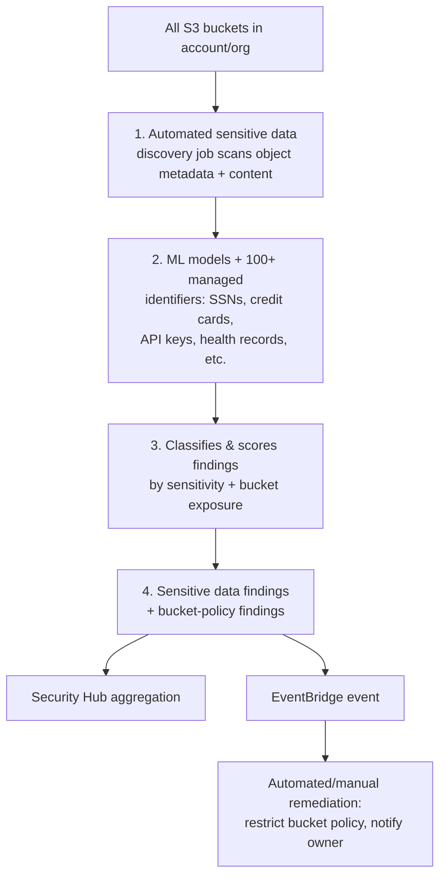
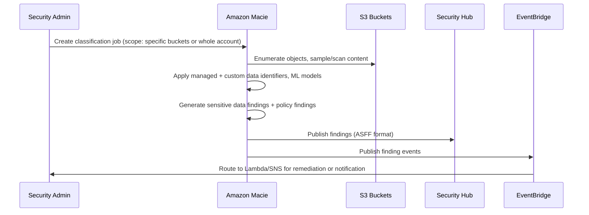
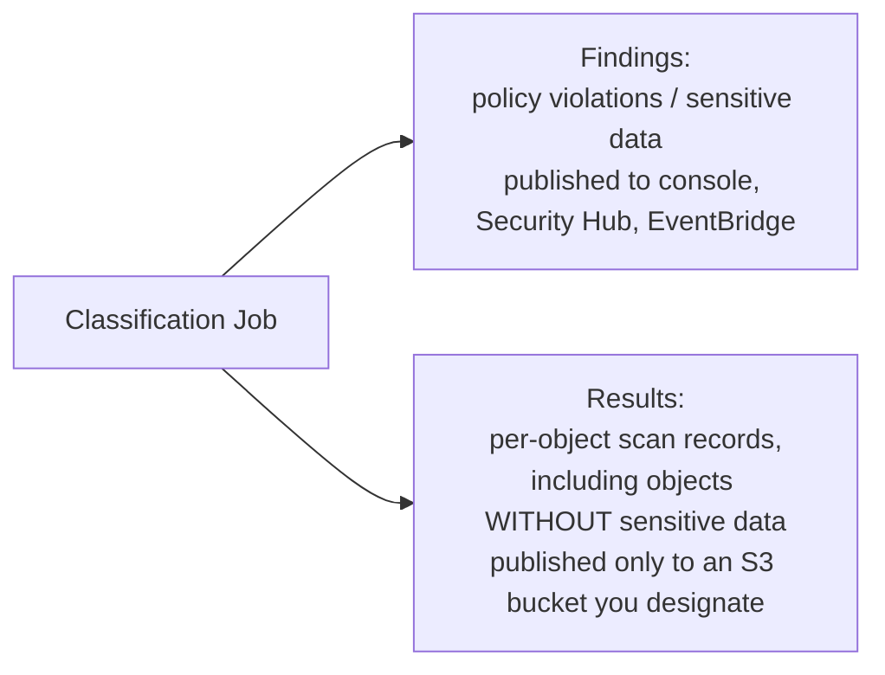
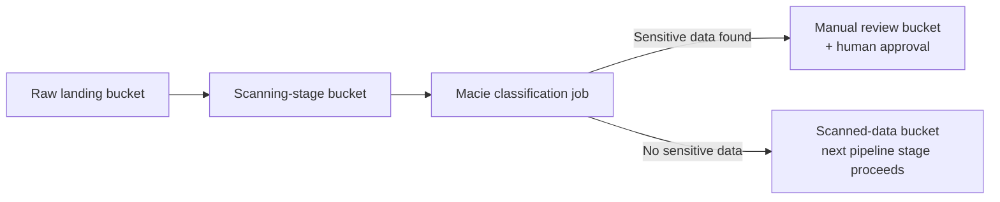
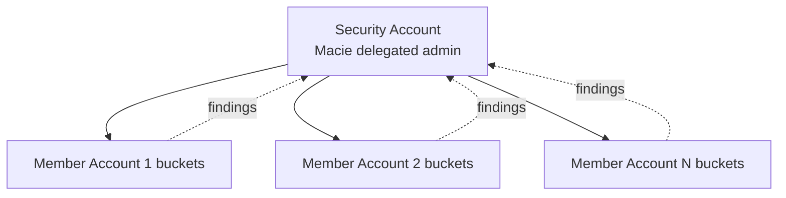
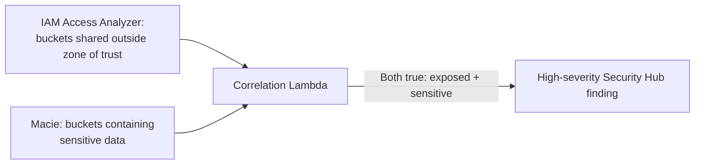
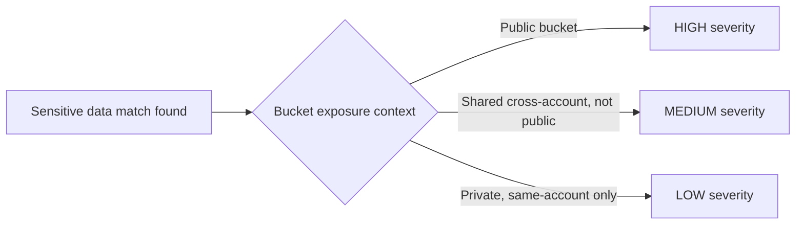

# Amazon Macie


## Definition

Macie is a managed service that automatically **discovers, classifies, and reports on sensitive
data** (like personally identifiable information, credentials, and financial data) stored in
Amazon S3, using a combination of pattern matching and machine learning, so you know exactly
where sensitive data lives and whether it's exposed — without manually auditing every bucket.

## Purpose

Organizations routinely lose track of where sensitive data actually is — a bucket created for a
one-off data export two years ago, a backup that still contains customer PII, a developer's
"just for testing" bucket that somehow has real production data in it. You can't protect data
you don't know exists, and compliance frameworks (GDPR, HIPAA, PCI-DSS) all require knowing
exactly where regulated data lives. Macie exists to continuously answer "what sensitive data do
we have, where is it, and is it safely configured" across potentially thousands of S3 buckets,
at a scale no manual audit process could keep up with.

## How It Works



Step by step:

1. Macie first builds an **inventory** of every S3 bucket across the account (or the whole
   Organization if centrally enabled), capturing bucket-level metadata: encryption status,
   public accessibility, sharing settings — this alone surfaces misconfigured buckets even
   before any content is scanned.
2. You then run **sensitive data discovery jobs** (one-time or scheduled) against chosen
   buckets, or let Macie's automated discovery sample across your whole S3 estate continuously
   at lower cost. Each object's content is scanned using both regex-style **managed data
   identifiers** (built-in patterns for 100+ categories — credit card numbers, AWS access keys,
   passport numbers, national IDs, health insurance numbers, etc.) and machine-learning models
   that catch context-dependent sensitive data regex alone would miss (e.g., recognizing a
   free-text medical record even without a rigid pattern).
3. Macie produces two kinds of findings: **sensitive data findings** (this specific object
   contains X type of sensitive data) and **policy findings** (this bucket itself is
   misconfigured — e.g., publicly accessible, unencrypted, shared outside the account).
4. Findings flow to **Security Hub** for centralized visibility and to **EventBridge**, which
   you can use to trigger automated remediation (e.g., immediately tightening an exposed
   bucket's policy) or to notify the data owner.

### Official AWS example: Macie continuously scanning an S3 bucket for PII


*Source: AWS Documentation, "Amazon Macie" (SAP on AWS security reference)
(docs.aws.amazon.com/sap/latest/general/macie.html)*

### Full sensitive-data discovery job lifecycle



### Findings and Results — the distinction the exam tests



**Findings** are the alert-worthy signal (something specific to act on); **Results** are the
complete, exhaustive scan log (every object examined, sensitive or not) — useful for building
your own Athena/QuickSight analytics on top of Macie's raw scan activity, distinct from the
findings stream that's meant for immediate action.

## Key Features / Components

- **Automated sensitive data discovery** — a lower-cost, continuous, statistically-sampled scan
  across your whole S3 estate that surfaces new/changed exposure without running full jobs on
  everything constantly.
- **Managed data identifiers** — 100+ pre-built detectors for common sensitive data types
  (financial, health, credentials, personal information) maintained and updated by AWS.
- **Custom data identifiers** — define your own regex-based pattern for organization-specific
  sensitive data (e.g., an internal employee ID format or a proprietary record number).
- **Allow lists** — exclude known-benign matches (like a publicly documented sample credit card
  number used in test fixtures) from triggering findings.
- **Bucket-level policy findings** — flags buckets that are public, unencrypted, or shared
  outside the account, independent of whether sensitive data has actually been found inside.
- **Finding severity and sample locations** — findings include where in the object the match
  was found (without necessarily exposing the full sensitive value itself in the finding),
  letting you investigate without further spreading the sensitive data around.
- **Organization-wide administration** — a delegated administrator account can manage Macie and
  view findings across every member account.
- **Results export to a dedicated S3 bucket** — the complete per-object scan log, distinct from
  the findings stream, enabling custom downstream analytics (Athena queries, QuickSight
  dashboards) over Macie's full scan history.

## Use Cases — When to Use It

- Auditing hundreds of S3 buckets accumulated over years to find out where customer PII,
  payment data, or health records actually live.
- Continuously monitoring for a new bucket or object being created that accidentally exposes
  sensitive data, catching it fast instead of during the next annual audit.
- Supporting a compliance audit (PCI-DSS, HIPAA, GDPR) by producing concrete evidence of where
  regulated data resides and that it's properly encrypted/access-controlled.
- Scanning data lake landing zones before they're promoted to production pipelines, to catch
  unintentionally included sensitive fields.
- Gating an automated data pipeline: pause ingestion into a "scanned data" bucket until Macie
  confirms no sensitive data slipped through from the raw landing zone.

## When NOT to Use It / Alternatives

- **Detecting active attacker behavior** (unusual API calls, compromised credentials) — that's
  **GuardDuty**'s job; Macie looks at data content/exposure, not behavioral threats. See
  [`guardduty.md`](guardduty.md).
- **Data stored outside S3** (RDS, DynamoDB, on-premises) — Macie is S3-specific; for other
  data stores you'd need a different discovery approach (e.g., exporting to S3 first so Macie
  can scan it, database-native tools, AWS Glue DataBrew profiling, or third-party DSPM tools).
- **Vulnerability/software weakness scanning** — that's **Inspector**; Macie classifies data
  content, Inspector scans for exploitable software flaws. See
  [`security-hub-and-inspector.md`](security-hub-and-inspector.md).
- **Very small S3 footprint with known, well-documented contents** — the cost/benefit of
  running continuous discovery jobs may not be worth it if you already have strict,
  well-audited bucket usage policies and a small number of buckets.

## Common Architectures

### 1. Gated data pipeline using Macie as a quality/compliance checkpoint



### 2. Org-wide Macie with centralized findings



### 3. Correlating Macie with IAM Access Analyzer for "exposed AND sensitive" prioritization


This is a specific, real AWS-published pattern: the highest-priority remediation target isn't
"any exposed bucket" or "any bucket with sensitive data" alone, but the intersection of both —
correlating IAM Access Analyzer's external-access findings with Macie's sensitive-data findings
surfaces exactly the buckets that are both reachable from outside the account *and* actually
contain something worth protecting.

## Why It's Important

**Real-world weight:** Data breaches involving S3 misconfiguration (public buckets containing
customer records) have been some of the most damaging, headline-making incidents in cloud
history — often the root cause wasn't malicious access at all, just nobody realizing sensitive
data was sitting in an exposed bucket. Macie directly targets that exact failure mode, which is
why it's considered a baseline control for any account storing regulated data in S3.

**Exam weight:**
- **SAA-C03 — Domain 1, Task 1.2 "Design secure workloads and applications"** lists Macie
  explicitly as part of the application-security toolkit alongside GuardDuty.
- **DVA-C03** touches it lightly — more relevant to architecture/governance than day-to-day
  development, though understanding how Macie findings feed into automated remediation
  pipelines connects to Domain 1's event-driven patterns.
- **MLA-C02 — Domain 1 (Data Preparation)** and **Domain 4 (security)** both touch this:
  scanning training data sources in S3 for accidental PII before it's used to train a model is
  an increasingly emphasized theme given the new exam's focus on responsible data handling.

## Limits & Quotas

| Item | Default / Notes |
|---|---|
| Custom data identifiers per account | 300 (soft) |
| Allow lists per account | 300 (soft) |
| Managed data identifiers | 100+, maintained and expanded by AWS over time, not user-configurable in count |
| Classification job concurrency | A fixed number of concurrent jobs per account; large estates should plan job scheduling, not assume unlimited parallelism |
| Free trial | 30 days of automated sensitive data discovery per account |
| Object size scanned | Very large objects may be sampled rather than fully scanned end-to-end, depending on job configuration — a real, testable nuance for "did Macie actually scan this entire 10GB file" questions |

## Pricing Model

- Billed based on **the volume of S3 data evaluated** for the automated discovery tier, and
  separately for full sensitive-data-discovery jobs, which price by the amount of data
  processed (per GB) plus a per-object-evaluated component.
- **30-day free trial** of automated sensitive data discovery per account.
- Cost can scale meaningfully for very large S3 estates — running full discovery jobs against
  petabyte-scale buckets is a real line-item cost worth architecting around (e.g., sampling
  strategically rather than scanning everything constantly).
- See: https://aws.amazon.com/macie/pricing/ for current numbers.

## Hands-on Lab (Floci)

Macie's actual ML-based content classification against real sensitive-data patterns isn't
something a local emulator reproduces meaningfully, but the control-plane workflow (enabling
Macie, running a job, listing findings) is practicable against sample/test data:

```bash
# Enable Macie for the account
awslocal macie2 enable-macie

# Create and populate a test bucket with a fake "sensitive" file
awslocal s3 mb s3://macie-study-bucket
echo "fake SSN: 123-45-6789, fake card: 4111-1111-1111-1111" > sample.txt
awslocal s3 cp sample.txt s3://macie-study-bucket/sample.txt

# Create a classification job targeting that bucket
awslocal macie2 create-classification-job --job-type ONE_TIME \
  --name study-job --s3-job-definition '{"bucketDefinitions":[{"accountId":"000000000000","buckets":["macie-study-bucket"]}]}'

# List jobs and findings
awslocal macie2 list-classification-jobs
awslocal macie2 list-findings
```

### Extended lab: custom data identifier for an organization-specific pattern

```bash
# Define a custom identifier for an internal employee-ID format: EMP-123456
awslocal macie2 create-custom-data-identifier \
  --name internal-employee-id \
  --regex "EMP-[0-9]{6}" \
  --description "Internal employee ID format, not a public managed identifier"

# An allow list for a known test fixture that would otherwise falsely trigger a credit-card finding
cat > allowlist.txt << 'EOF'
4111111111111111
EOF
awslocal s3 cp allowlist.txt s3://macie-study-bucket/allowlists/test-cards.txt
awslocal macie2 create-allow-list \
  --name test-fixture-cards \
  --criteria '{"s3WordsList":{"bucketName":"macie-study-bucket","objectKey":"allowlists/test-cards.txt"}}'
```

## Troubleshooting / Common Issues

**"Macie job completed but found nothing, though we know sensitive data exists":**
1. Check whether the object type is actually supported for content inspection — Macie supports
   common text/office/structured formats; some binary or unusual formats may only get
   metadata-level analysis, not full content scanning.
2. Check whether a relevant **allow list** is unintentionally suppressing real findings (not
   just the intended test-fixture pattern).
3. For very large objects, confirm whether sampling behavior (rather than full-object scanning)
   applies to the job's configuration.

**"Too many findings, security team is overwhelmed":** use **suppression**-equivalent tooling
(allow lists for known-benign patterns) and tune job scope to higher-risk buckets first rather
than running full-account discovery blindly; pair with IAM Access Analyzer correlation to
prioritize "exposed AND sensitive" over "sensitive but already well-isolated."

**"Costs are higher than expected for a large S3 estate":** confirm whether **automated
discovery** (continuous, sampled, lower-cost) or **full classification jobs** (thorough, higher
per-GB cost) are the ones driving the volume — a common mistake is running full jobs against an
entire multi-petabyte estate on a recurring schedule instead of targeting specific
high-sensitivity buckets with full jobs and relying on automated discovery elsewhere.

## Exam Tips

- **Macie vs. GuardDuty vs. Inspector** — same three-way trap as GuardDuty's doc: Macie =
  "what sensitive data exists and is it exposed" (content), GuardDuty = "is something malicious
  happening" (behavior), Inspector = "what software vulnerabilities exist" (weaknesses). A
  question mentioning "PII," "credit card numbers," or "discover sensitive data in S3" always
  points to Macie.
- **Macie is S3-only** — it does not scan RDS, DynamoDB, or EC2 filesystems directly; a
  question describing sensitive data in a database needs a different answer (or exporting that
  data to S3 first, if Macie's specific classification capability is genuinely required).
- **Automated discovery vs. full jobs** — automated discovery is the continuous, lower-cost,
  sampled option; a full classification job is thorough but costs more and should be targeted,
  not run blindly against your entire S3 estate as a default habit.
- **Findings vs. Results** — Findings are the actionable alert stream (console, Security Hub,
  EventBridge); Results are the exhaustive per-object scan log published only to an S3 bucket
  you designate, intended for custom analytics rather than immediate action.
- **Correlating with IAM Access Analyzer** — a question about prioritizing remediation across
  many flagged buckets points to combining Macie's sensitive-data findings with Access
  Analyzer's external-exposure findings to find the true highest-risk intersection.
- **Findings feed Security Hub + EventBridge**, exactly like GuardDuty — the same
  "centralize, then automate remediation" architectural pattern applies.
- Tested within **SAA-C03 Domain 1 (30%)**; present in **MLA-C02 Domain 1 and Domain 4**
  around sensitive training-data hygiene.

## Worked example: a custom data identifier and allow list working together

```json
{
  "name": "internal-contract-number",
  "regex": "CTR-[0-9]{4}-[A-Z]{2}",
  "keywords": ["contract", "agreement"],
  "ignoreWords": ["CTR-0000-XX"],
  "maximumMatchDistance": 50
}
```

This custom identifier only fires when the regex pattern appears **within 50 characters of**
one of the keywords (`contract`/`agreement`) — a technique that meaningfully reduces false
positives versus a bare regex match, since `CTR-1234-AB` appearing in an unrelated context
(a product SKU, say) wouldn't trigger a finding unless genuinely near contract-related language.
The `ignoreWords` list is a lightweight, identifier-scoped alternative to a full allow list for
known-benign literal values like a standard test fixture.

## Macie Finding Severity Model



Macie's severity scoring deliberately combines *what* was found with *how exposed* the bucket
already is — the same sensitive data type (e.g., a credit card number) produces a different
severity finding depending on whether the containing bucket is public, cross-account shared, or
fully private. This is the same "content + exposure together" philosophy behind the IAM Access
Analyzer correlation pattern described above, applied within Macie's own scoring model.

## Compliance Mapping — Why Auditors Specifically Ask About Macie

| Framework | Requirement Macie helps satisfy |
|---|---|
| GDPR | Demonstrating knowledge of where personal data of EU subjects resides |
| HIPAA | Identifying and safeguarding Protected Health Information (PHI) in storage |
| PCI-DSS | Locating cardholder data and confirming it isn't stored somewhere unapproved/unencrypted |
| SOC 2 | Evidence of a continuous, not just point-in-time, sensitive-data discovery process |

A question framed around "an auditor needs evidence of where regulated data lives, continuously,
not just a one-time manual spreadsheet" is testing recognition of Macie's specific value over a
manual audit process — the continuous/automated nature, not merely the detection capability
itself, is what satisfies modern audit expectations.

## Worked example: estimating Macie cost for a large, varied S3 estate

An organization has 500TB across 1,200 buckets, mostly inactive archival data, with 50 buckets
actively receiving new customer data daily. Cost-conscious design: enable **automated sensitive
data discovery** account-wide (low-cost, continuous, sampled) as the baseline across all 1,200
buckets, then run **full classification jobs** only against the 50 actively-written buckets on
a recurring schedule. Running full jobs against the entire 500TB archival estate repeatedly
would be a significant, avoidable recurring cost for data that, by definition, isn't changing —
automated discovery's sampling is specifically designed to catch newly-introduced exposure
cheaply, while full jobs are reserved for the subset of data where thoroughness justifies the
higher per-GB cost.

## Macie vs. a Hypothetical Manual Audit — Why "Just Have Someone Check" Doesn't Scale

| | Manual audit | Macie |
|---|---|---|
| Coverage | Whatever a person has time to sample | Every object, continuously |
| Consistency | Varies by auditor, easy to miss edge cases | Same managed identifiers applied uniformly |
| New data | Only caught at the next audit cycle | Automated discovery catches it continuously |
| Evidence for compliance | A point-in-time spreadsheet | A continuous, timestamped finding history |
| Cost at scale | Linear in headcount-hours | Linear in data volume, but with no headcount ceiling |

A question emphasizing "newly uploaded sensitive data must be caught quickly, not just at the
next quarterly audit" is testing recognition that Macie's continuous/automated nature — not
merely its detection capability — is the actual differentiator over a manual process.

## Worked example: a Macie finding investigated end to end

A Macie job flags `finance-exports-bucket/2023/q3-report.xlsx` with a HIGH severity
`SensitiveData:S3Object/Multiple` finding. Investigation walkthrough:

1. **Check the policy finding alongside the sensitive-data finding** — is the bucket itself
   public, or private/same-account only? Here, the bucket policy finding shows it's shared
   cross-account to a former contractor's AWS account that was never offboarded.
2. **Check what specific sensitive data types triggered `Multiple`** — the finding details show
   both SSNs and bank routing numbers, confirming this is genuinely sensitive financial data,
   not a false-positive pattern match.
3. **Correlate exposure + content**: a HIGH severity finding here is correctly weighted because
   it's both genuinely sensitive *and* reachable by an account that should no longer have
   access — exactly the "content + exposure together" prioritization model.
4. **Remediate**: revoke the cross-account bucket policy grant immediately (an IAM/S3 fix, not
   a Macie action), then separately decide whether the underlying file needs to be
   re-classified/moved to a more restricted bucket going forward.

This walkthrough deliberately shows Macie's actual job stopping at **detection and
classification** — the remediation itself (fixing the bucket policy) is squarely an IAM/S3
action, reinforcing that Macie surfaces the problem but doesn't fix it autonomously unless you
specifically build an automated remediation Lambda on top of its EventBridge events.

## Further Reading

- AWS Security Blog — "Use Amazon Macie for automatic, continual, and cost-effective discovery
  of sensitive data in S3":
  https://aws.amazon.com/blogs/security/use-amazon-macie-for-automatic-continual-and-cost-effective-discovery-of-sensitive-data-in-s3/
- AWS Security Blog — "Use Macie to discover sensitive data as part of automated data
  pipelines":
  https://aws.amazon.com/blogs/security/use-macie-to-discover-sensitive-data-as-part-of-automated-data-pipelines/
- AWS Security Blog — "Correlate IAM Access Analyzer findings with Amazon Macie":
  https://aws.amazon.com/blogs/security/correlate-iam-access-analyzer-findings-with-amazon-macie/
- Amazon Macie User Guide: https://docs.aws.amazon.com/macie/latest/user/what-is-macie.html
- Amazon Macie pricing: https://aws.amazon.com/macie/pricing/

## Related Terms

- [`guardduty.md`](guardduty.md) — the behavioral-threat counterpart to Macie's data-content focus
- [`security-hub-and-inspector.md`](security-hub-and-inspector.md) — central aggregation of Macie findings; Inspector covers vulnerability scanning
- [`kms.md`](kms.md) — encrypting the sensitive data Macie discovers is the natural remediation step
- `glossary/` — PII, DSPM (data security posture management), managed data identifier
