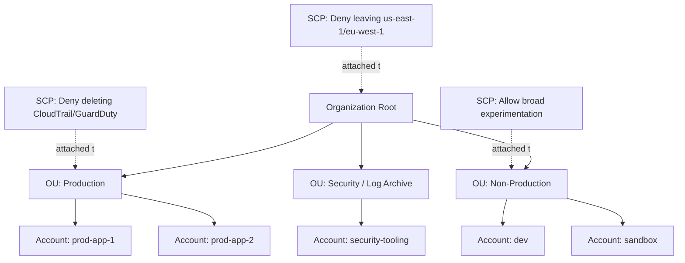
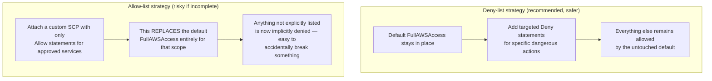
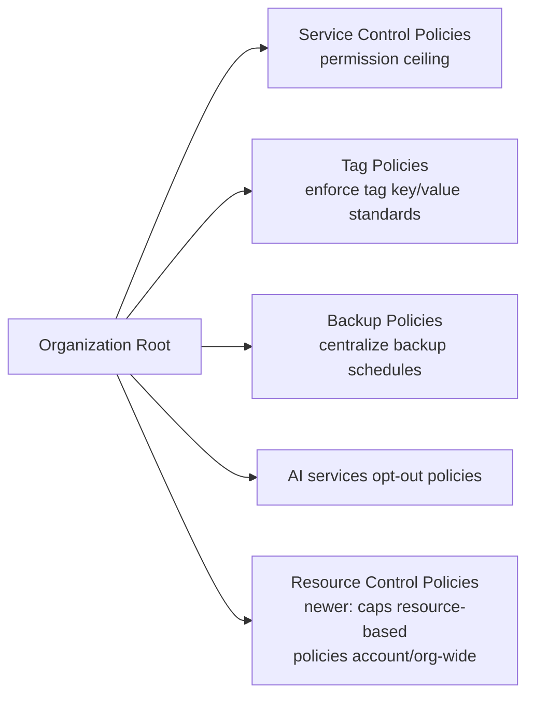
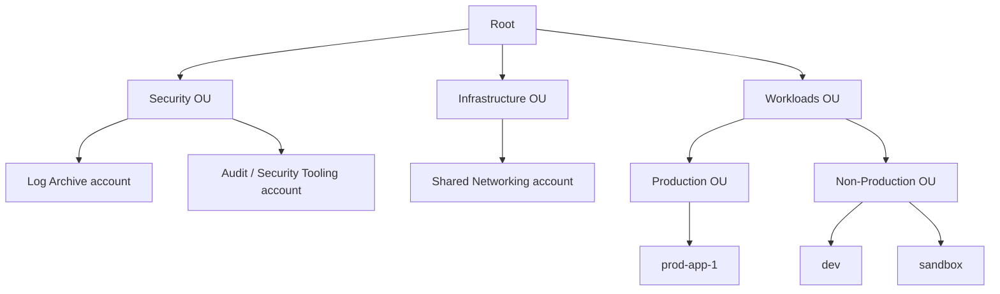
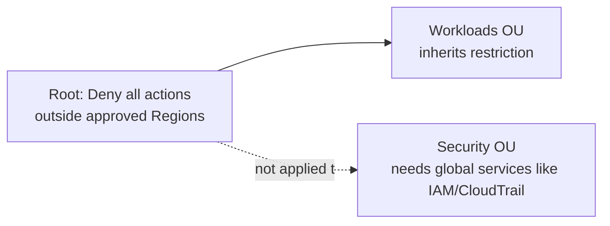
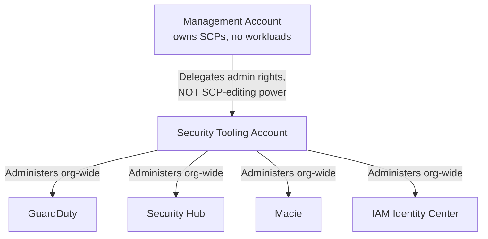
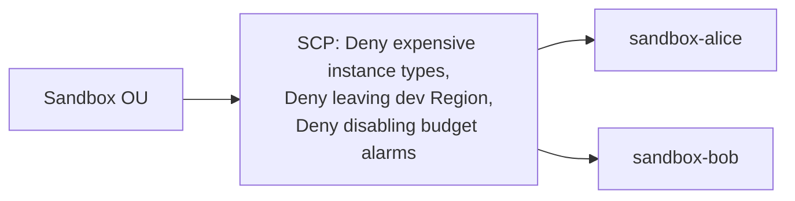

# AWS Organizations & Service Control Policies (SCPs)

> **Appears in:** [DVA-C03](../../certifications/dva-c03/README.md) · [SAA-C03](../../certifications/saa-c03/README.md)


## Definition

AWS Organizations is the service that groups **multiple AWS accounts** into one managed
structure (a hierarchy of Organizational Units) so they can be billed together, governed
together, and have policies applied across all of them at once. Service Control Policies (SCPs)
are the specific tool Organizations uses to set a **maximum permission ceiling** on everything
underneath — no identity in an affected account, including that account's own root/admin user,
can ever exceed it.

## Purpose

A company running dozens or hundreds of AWS accounts (common pattern: one account per
team/environment for strong blast-radius isolation) needs a way to enforce company-wide rules
that individual account admins cannot override by mistake or on purpose — "no account may ever
disable CloudTrail," "no account outside the designated regions may create resources," "only
the security account may modify GuardDuty settings." IAM policies alone can't do this because
they're managed *within* each account by that account's own admins. SCPs exist specifically to
sit one level above IAM and apply uniformly, with no opt-out, to every account in their scope.

## How It Works



Step by step:

1. SCPs attach to the **Root**, an **Organizational Unit (OU)**, or an individual **account**,
   and they **inherit downward** — an SCP on the Root applies to every OU and account beneath
   it; an SCP on an OU applies to every account in that OU and any nested OUs.
2. An account's **effective permission ceiling** is the intersection of every SCP that applies
   to it anywhere in its ancestry (Root → OU → nested OU → account). If any SCP in that chain
   denies an action, it's denied account-wide, no exceptions.
3. Critically: **SCPs never grant permissions.** The default AWS-managed SCP at the Root is
   `FullAWSAccess` (Allow `*` on everything) — attaching your own SCP almost always means you're
   now narrowing that default down, not adding to it. An SCP that says `"Allow": "s3:*"` and
   nothing else actually means "deny everything except S3," because it replaces the default
   wide-open Allow when applied (if you don't additionally keep an explicit broad Allow
   statement or use Deny-list style SCPs). Most real-world SCPs are written as **explicit
   Deny statements** layered on top of the default `FullAWSAccess`, which is far safer than
   trying to enumerate every Allow.
4. Once an SCP has passed (i.e., it doesn't deny the action), evaluation continues down into
   that account's own IAM — a user or role still needs an IAM policy (identity- or
   resource-based) that actually allows the specific action, exactly as described in `iam.md`.
   **An SCP that allows an action grants nothing by itself** — it only removes a ceiling that
   would otherwise block it.

### The official AWS Org Management account security architecture


*Source: AWS Prescriptive Guidance, "Security Reference Architecture — Org Management account"
(docs.aws.amazon.com/prescriptive-guidance/latest/security-reference-architecture/org-management.html)*

### Deny-list SCP vs. Allow-list SCP — the two authoring strategies



Deny-list SCPs are the AWS-recommended default authoring style precisely because they're
additive and low-risk: you keep the account's full default capability and subtract only what
you've deliberately decided to forbid. Allow-list SCPs are powerful (e.g., "this OU may only
ever use S3, DynamoDB, and Lambda") but every omission is a potential outage, not just a
missing permission — a common exam trap is a scenario where an allow-list SCP silently broke
an unrelated service nobody thought to include.

### Full worked example: SCP intersecting with an identity policy and a permission boundary

```mermaid
flowchart TD
    Request[Request: iam:CreateUser in Account X] --> SCPCheck{SCP chain for Account X\nallows iam:CreateUser?}
    SCPCheck -- Denied by SCP\ne.g. "Deny iam:CreateUser org-wide" --> Deny[DENY — stops here,\nnever reaches IAM evaluation]
    SCPCheck -- Allowed/not denied --> Boundary{Permission boundary\non the caller allows it?}
    Boundary -- No --> Deny
    Boundary -- Yes --> Identity{Identity policy\nallows it?}
    Identity -- No --> ImplicitDeny[Implicit Deny]
    Identity -- Yes --> Allow[ALLOW]
```

A common exam scenario: an organization wants to **forbid IAM user creation entirely**,
forcing all access through IAM Identity Center/federated roles. The SCP below, attached at the
Root, accomplishes this account-wide, and — crucially — no account admin, not even using
`AdministratorAccess`, can create an exception without first getting the SCP itself changed at
the Organizations management-account level:

```json
{
  "Version": "2012-10-17",
  "Statement": [
    {
      "Sid": "DenyIAMUserCreationOrgWide",
      "Effect": "Deny",
      "Action": ["iam:CreateUser", "iam:CreateAccessKey"],
      "Resource": "*"
    }
  ]
}
```

### Tag policies and backup policies — the other Organizations policy types



**Resource Control Policies (RCPs)** are a newer Organizations policy type worth knowing for
current exams: where an SCP caps what a *principal* can do, an RCP caps the maximum permissions
a **resource-based policy** (an S3 bucket policy, a KMS key policy, etc.) can ever grant,
org-wide — closing the gap where a single over-permissive bucket policy in one account could
otherwise expose data regardless of how tight SCPs are on the principal side.

## Key Features / Components

- **Organizational Units (OUs)** — a folder-like hierarchy for grouping accounts (by
  environment, business unit, compliance tier, etc.) so policies, not just billing, can be
  applied at scale.
- **Management account** — the account that owns the Organization, consolidated billing, and
  (unless delegated) the ability to create/attach SCPs. AWS strongly recommends this account
  run no workloads itself — it's purely administrative.
- **Delegated administrator** — lets the management account hand off day-to-day administration
  of specific services (GuardDuty, Security Hub, Macie, IAM Identity Center) to another account,
  without giving that account SCP-editing power.
- **Consolidated billing** — all linked accounts' usage rolls up to one bill, and volume
  discounts (e.g., S3 tiered pricing, Savings Plans) can apply across the combined usage.
- **Tag policies** — a separate Organizations policy type that standardizes tag keys/values
  across accounts (not a permission ceiling, a tagging-consistency enforcement mechanism).
- **Backup policies / AI services opt-out policies** — other org-wide policy types with the
  same attach-to-OU/account model as SCPs but governing different concerns (centralized backup
  schedules; opting entire OUs out of AWS using their data for service improvement).
- **Resource Control Policies (RCPs)** — cap the maximum permissions resource-based policies
  (S3 bucket policies, KMS key policies, etc.) can grant, closing the "principal side is locked
  down but a resource policy over-shares" gap that SCPs alone don't cover.
- **AWS Control Tower** — builds on top of Organizations to provide a pre-built landing zone
  (standard OU structure, baseline SCPs, account factory for self-service new-account creation,
  centralized logging/guardrails) — often the practical way large orgs actually adopt SCPs
  rather than writing every one from scratch.
- **Preventive vs. detective guardrails (Control Tower vocabulary)** — SCPs implement
  *preventive* guardrails (the action is blocked before it happens); AWS Config rules implement
  *detective* guardrails (the misconfiguration is flagged after the fact). Control Tower ships
  both, and a question about "stop this from ever happening" vs. "alert me after it happens"
  maps directly onto this distinction.

## Use Cases — When to Use It

- Enforcing "no account may operate outside approved regions" company-wide, so a compromised or
  careless account can't spin up resources somewhere nobody's monitoring.
- Preventing any account, including its own administrators, from disabling CloudTrail,
  GuardDuty, or Config — security logging that must survive even a malicious insider with
  account-admin rights.
- Restricting an entire "sandbox" OU to only cheap, low-risk services, so experimentation
  accounts can't accidentally run up large bills or touch production-grade services.
- Blocking root-user API access org-wide, forcing all access through IAM Identity Center/roles.
- Capping what any resource-based policy anywhere in the org can expose externally, via RCPs,
  as a backstop against a single over-permissive bucket policy.

## When NOT to Use It / Alternatives

- **Per-user or per-role fine-grained permissions within one account** — that's IAM's job
  (identity-based policies), not SCPs; SCPs are deliberately coarse, account/OU-level ceilings,
  not a replacement for normal least-privilege IAM policy authoring.
- **A single standalone AWS account with no Organization** — SCPs require AWS Organizations;
  if there's no multi-account structure, use IAM permission boundaries for a similar
  "ceiling" effect scoped to one account instead.
- **Granting access** — never reach for an SCP when the goal is to *give* someone a new
  capability; SCPs are a restriction-only tool, and a question that implies "the SCP is why
  this now works" is conceptually broken (the SCP was always allowing it by default and
  something else — IAM — actually grants access).

## Common Architectures

### 1. Standard landing zone OU structure (Control Tower default pattern)



### 2. Region-restriction SCP applied org-wide with a Security OU carve-out



### 3. Delegated administration for org-wide security tooling



### 4. Sandbox OU with a permissive, cost-capped SCP



## Worked example: a realistic production SCP bundle for a Workloads OU

```json
{
  "Version": "2012-10-17",
  "Statement": [
    {
      "Sid": "DenyLeavingApprovedRegions",
      "Effect": "Deny",
      "NotAction": ["iam:*", "organizations:*", "sts:*", "support:*", "budgets:*", "cloudfront:*"],
      "Resource": "*",
      "Condition": { "StringNotEquals": { "aws:RequestedRegion": ["us-east-1", "eu-west-1"] } }
    },
    {
      "Sid": "DenyDisablingSecurityServices",
      "Effect": "Deny",
      "Action": [
        "cloudtrail:StopLogging", "cloudtrail:DeleteTrail",
        "guardduty:DeleteDetector", "guardduty:DisassociateFromMasterAccount",
        "config:DeleteConfigurationRecorder", "config:StopConfigurationRecorder"
      ],
      "Resource": "*"
    },
    {
      "Sid": "DenyRootUserActions",
      "Effect": "Deny",
      "Action": "*",
      "Resource": "*",
      "Condition": { "StringLike": { "aws:PrincipalArn": "arn:aws:iam::*:root" } }
    },
    {
      "Sid": "DenyLeavingOrganization",
      "Effect": "Deny",
      "Action": "organizations:LeaveOrganization",
      "Resource": "*"
    }
  ]
}
```

Four independent guardrails in one SCP, each illustrating a distinct SCP authoring pattern:
`NotAction` with a region condition (deny everything *except* a safe allowlist of
global/always-needed services, outside approved regions), explicit denial of specific
destructive API calls regardless of region, a principal-matching condition specifically
targeting the root user (`aws:PrincipalArn` with a wildcard matching any account's root),
and a simple absolute denial with no conditions at all (leaving the Organization should never
be a self-service action for a member account).

## Tag Policies and Backup Policies — worked examples

A **tag policy** standardizes acceptable tag keys/values org-wide (not a permission ceiling —
purely a consistency/compliance enforcement mechanism, flagged as non-compliant rather than
silently blocked):

```json
{
  "tags": {
    "Environment": {
      "tag_key": { "@@assign": "Environment" },
      "tag_value": { "@@assign": ["Production", "Staging", "Development", "Sandbox"] },
      "enforced_for": { "@@assign": ["ec2:instance", "s3:bucket"] }
    }
  }
}
```

A **backup policy** centralizes AWS Backup plan assignment org-wide, so every account in an OU
automatically gets the same backup schedule/retention without each account team configuring it
independently:

```json
{
  "plans": {
    "DailyBackups": {
      "regions": { "@@assign": ["us-east-1"] },
      "rules": {
        "Daily": {
          "schedule_expression": { "@@assign": "cron(0 5 ? * * *)" },
          "target_backup_vault_name": { "@@assign": "org-central-vault" },
          "lifecycle": { "delete_after_days": { "@@assign": "35" } }
        }
      },
      "selections": {
        "tags": {
          "backupselection1": {
            "iam_role_arn": { "@@assign": "arn:aws:iam::$account:role/AWSBackupDefaultServiceRole" },
            "tag_key": { "@@assign": "backup" },
            "tag_value": { "@@assign": ["true"] }
          }
        }
      }
    }
  }
}
```

Both policy types use a distinctive JSON syntax (`@@assign`, `@@operators_allowed_for_child_policies`)
that's visibly different from an IAM/SCP policy document's `Statement`/`Effect`/`Action`
structure — recognizing this syntax at a glance is itself a minor but real exam-testable skill,
since a question may show a policy snippet and ask you to identify which Organizations policy
type it belongs to purely from the shape of the JSON.

## Why It's Important

**Real-world weight:** Multi-account governance at scale is unmanageable without SCPs — it's
the mechanism that lets a central security/cloud-platform team guarantee baseline protections
hold everywhere, regardless of what individual account owners configure. Regulatory frameworks
(PCI-DSS region restrictions, data residency laws) are frequently enforced this way because it's
the one control an account-level compromise or rogue admin truly cannot bypass.

**Exam weight:**
- **SAA-C03 — Domain 1, Task 1.1 "Design secure access to AWS resources"** explicitly lists
  "SCPs" and "multi-account strategy, Control Tower" — expect scenario questions contrasting
  SCP-level guardrails against IAM-level permissions in the same multi-account design.
- **DVA-C03 — Domain 2** touches SCPs more lightly (developers are consumers of the resulting
  restrictions more than authors of SCPs), but understanding "why does this API call fail
  org-wide even though my IAM policy allows it" is a Domain 2 troubleshooting-adjacent concept.
- **MLA-C02 — Domain 4** references org-wide guardrails for ML workload accounts (e.g., SCPs
  restricting which regions SageMaker/Bedrock can be used in, for data residency).

## Limits & Quotas

| Resource | Default quota | Notes |
|---|---|---|
| Accounts per Organization | 10 by default (soft, easily raised via request) | Large enterprises routinely request increases into the hundreds/thousands |
| Nesting depth of OUs | 5 levels under the Root | Deep enough for most real org structures; rarely the binding constraint |
| SCPs attached per entity (Root/OU/account) | 5 | Plan SCP consolidation — you can't just keep stacking narrow SCPs indefinitely at one level |
| SCP document size | 5,120 characters | Smaller than a typical IAM managed policy's 6,144 — encourages narrowly scoped SCPs |
| Policy types enabled simultaneously | SCPs, tag policies, backup policies, AI opt-out policies, RCPs — each enabled independently | A new Organization has only SCPs enabled by default; others require explicit enablement |

## Pricing Model

**AWS Organizations and SCPs are free.** There is no additional charge for creating an
Organization, OUs, accounts, or attaching SCPs/tag policies/backup policies — you only pay for
the underlying resources each member account actually uses, consolidated onto one bill.
See: https://aws.amazon.com/organizations/pricing/ (confirms no additional service fee).

## Hands-on Lab (Floci)

Organizations/SCPs are a true multi-account, control-plane feature that Floci's single-account
emulation does not model end-to-end. The closest practical local approximation is simulating
the **effect** of an SCP-style restriction using an IAM permission boundary (same "ceiling, not
grant" concept, scoped to one account) so you can feel the mechanics:

```bash
# Simulate an SCP-style ceiling with a permission boundary: "this role may never touch IAM itself"
cat > deny-iam-boundary.json << 'EOF'
{
  "Version": "2012-10-17",
  "Statement": [
    { "Effect": "Allow", "Action": "*", "Resource": "*" },
    { "Effect": "Deny", "Action": "iam:*", "Resource": "*" }
  ]
}
EOF
awslocal iam create-policy --policy-name NoIAMBoundary --policy-document file://deny-iam-boundary.json

awslocal iam create-role --role-name SandboxDeveloperRole \
  --assume-role-policy-document file://trust.json \
  --permissions-boundary arn:aws:iam::000000000000:policy/NoIAMBoundary
awslocal iam attach-role-policy --role-name SandboxDeveloperRole \
  --policy-arn arn:aws:iam::aws:policy/PowerUserAccess

# Even with PowerUserAccess attached, the boundary caps out IAM actions — exactly how an
# org-wide SCP would cap every account beneath it regardless of each account's own IAM policies.
awslocal iam simulate-principal-policy --policy-source-arn arn:aws:iam::000000000000:role/SandboxDeveloperRole \
  --action-names iam:CreateUser --resource-arns "*"
```

### Extended lab: deny-list vs. allow-list SCP behavior, simulated with boundaries

```bash
# Deny-list style: keep the broad Allow, subtract one dangerous action
cat > deny-list-style.json << 'EOF'
{
  "Version": "2012-10-17",
  "Statement": [
    { "Effect": "Allow", "Action": "*", "Resource": "*" },
    { "Effect": "Deny", "Action": "ec2:TerminateInstances", "Resource": "*" }
  ]
}
EOF

# Allow-list style: ONLY these actions are permitted — everything else is implicitly denied
cat > allow-list-style.json << 'EOF'
{
  "Version": "2012-10-17",
  "Statement": [
    { "Effect": "Allow", "Action": ["s3:*", "dynamodb:*"], "Resource": "*" }
  ]
}
EOF
awslocal iam create-policy --policy-name DenyListBoundary --policy-document file://deny-list-style.json
awslocal iam create-policy --policy-name AllowListBoundary --policy-document file://allow-list-style.json

# Compare: a Lambda-related action succeeds under deny-list, fails under allow-list,
# illustrating exactly why allow-list SCPs are the riskier authoring strategy
awslocal iam simulate-principal-policy --policy-source-arn arn:aws:iam::000000000000:role/SandboxDeveloperRole \
  --action-names lambda:InvokeFunction --resource-arns "*"
```

For the real multi-account Organizations API surface (`organizations create-organization`,
`create-organizational-unit`, `create-policy --type SERVICE_CONTROL_POLICY`), consult AWS's own
documentation and a real (or AWS-provided free-tier sandbox) multi-account setup — Floci does
not emulate the Organizations control plane.

## Guardrail Comparison Table — SCP vs. RCP vs. Permission Boundary vs. IAM Policy

| | Scope | Can grant? | Applies to root user? | Set by |
|---|---|---|---|---|
| **SCP** | Account/OU/Org-wide | Never — restriction only | Yes | Organizations management account (or delegated admin) |
| **RCP** | Account/OU/Org-wide, but only caps resource-based policies | Never — restriction only | Yes, for resource-based grants | Organizations management account |
| **Permission boundary** | One specific IAM user/role | Never — restriction only | No (root isn't an IAM user/role) | IAM, within a single account |
| **IAM identity policy** | One specific user/role | Yes | N/A (root bypasses most IAM constructs) | IAM, within a single account |
| **IAM resource policy** | One specific resource | Yes | N/A | IAM/resource owner, within a single account |

This table is the fastest way to answer the recurring exam-question shape "which of these
controls would stop X, and which one is scoped too narrowly/broadly to be the right answer" —
walk the scope column first (org-wide vs. single-account vs. single-resource) before even
considering whether the control can grant or only restrict.

## Troubleshooting / Common Issues

**"My IAM policy clearly allows this action, but the API call still fails with AccessDenied" —
the #1 SCP-related confusion:**
1. Confirm you're actually in a member account of an Organization (check with
   `organizations describe-organization` / the console) — if there's no Organization, this
   isn't an SCP issue at all.
2. Check every SCP in the account's full ancestry chain (Root → every OU level → account) for
   a Deny matching the action — remember effective permissions are an **intersection**, so any
   single denying SCP anywhere in the chain overrides an otherwise-correct IAM Allow.
3. Check whether an **allow-list style SCP** is in effect — the symptom here is specifically
   "a whole category of actions fails, not just one specific action," which points to an
   incomplete allow-list rather than a single targeted Deny.
4. Check for an **RCP** if the failure is specifically on a resource-based policy's grant (e.g.,
   a bucket policy that should allow an external account but doesn't) rather than an
   identity-based policy issue.

**"We added a narrowly-scoped SCP and an unrelated service broke" — the allow-list trap:**
this happens when a team intends to restrict one specific risky action but instead replaces
the account's entire default `FullAWSAccess` Allow with a narrow allow-list, inadvertently
blocking everything not explicitly listed. The fix is switching to deny-list style (keep the
default Allow, add a targeted Deny) unless an allow-list was genuinely the intent.

**"The management account itself seems unaffected by an SCP that should restrict everyone" —
not a bug:** SCPs attached at the Root do not apply to the management account itself by design
(only to member accounts) — this is precisely why AWS recommends running zero workloads in the
management account, since SCP-based guardrails simply don't reach it.

**"We deleted/edited the only SCP that granted X, and now nobody anywhere can do X" — be very
careful with allow-list SCPs at the Root level:** since the Root's allow-list SCP sets the
absolute ceiling for the *entire* Organization, removing or narrowing it can have an immediate,
Organization-wide blast radius — test SCP changes in a non-production OU first wherever possible.

## Exam Tips

- **SCPs never grant, only restrict.** If a question's answer choice implies an SCP "enables"
  or "allows" new access on its own, it's wrong — something in IAM must still separately allow
  the action.
- **SCPs apply to the root user too** — unlike IAM policies (which don't attach to the root
  user conventionally), SCPs bind the root user in every affected account. This is specifically
  why SCPs are the right tool for "not even an account admin can override this."
- **Effective permissions = intersection, not union** — a permission must be allowed by *every*
  applicable SCP in the account's OU chain *and* by IAM within the account. One denying SCP
  anywhere in the chain overrides an otherwise-permissive IAM policy.
- **Deny-list vs. allow-list SCP authoring** — a deny-list SCP (keep default Allow, add targeted
  Deny statements) is the AWS-recommended, lower-risk default; an allow-list SCP (only specific
  Allow statements, implicitly denying everything else) is powerful but dangerous if incomplete.
  A question describing an SCP accidentally breaking unrelated services points to an
  incomplete allow-list.
- **SCP vs. permission boundary** — SCP = Organizations-level, applies to whole accounts/OUs;
  permission boundary = IAM-level, applies to one specific user/role within a single account.
  Exam questions often describe a scenario and expect you to identify which of the two is the
  right scope.
- **Management account is not restricted by its own SCPs** by default in some configurations —
  know that SCPs attached at the Root do not apply to the management account itself (only to
  member accounts), which is why best practice is to run no workloads in the management
  account.
- **RCPs vs. SCPs** — SCPs cap what a *principal* can do; RCPs cap what a *resource-based
  policy* can grant, org-wide. If a question is specifically about limiting how permissive an
  S3 bucket policy or KMS key policy can ever be across the whole org, RCPs are the more
  precise answer on current exam versions that include this newer policy type.
- **Preventive vs. detective guardrails (Control Tower)** — SCPs are preventive (block before
  it happens); AWS Config rules are detective (flag after the fact). A question asking "stop
  this from ever being possible" wants an SCP; "alert us when this happens" wants Config.
- Shows up primarily in **SAA-C03 Domain 1 (30%)**, with lighter touches in DVA-C03/MLA-C02
  around org-wide guardrails affecting developer/ML workloads.

## Further Reading

- AWS Organizations User Guide — Service control policies (SCPs):
  https://docs.aws.amazon.com/organizations/latest/userguide/orgs_manage_policies_scp.html
- AWS Organizations User Guide — SCP effects on permissions:
  https://docs.aws.amazon.com/organizations/latest/userguide/orgs_manage_policies_scps.html
- AWS Prescriptive Guidance — Security Reference Architecture, Org Management account:
  https://docs.aws.amazon.com/prescriptive-guidance/latest/security-reference-architecture/org-management.html
- AWS Control Tower — Preventive and detective controls:
  https://docs.aws.amazon.com/controltower/latest/controlreference/preventive-controls.html
- AWS Storage Blog — "Managing access to backups using service control policies with AWS
  Backup": https://aws.amazon.com/blogs/storage/managing-access-to-backups-using-service-control-policies-with-aws-backup/

## Related Terms

- [`iam.md`](iam.md) — SCPs are one more ceiling in the same evaluation chain as permission boundaries
- [`sts-and-role-switching.md`](sts-and-role-switching.md) — SCPs still apply to assumed-role sessions
- [`iam-identity-center-sso.md`](iam-identity-center-sso.md) — typically deployed across the same multi-account Organization
- [`security-hub-and-inspector.md`](security-hub-and-inspector.md) — often delegated-administered org-wide, same governance model
- `glossary/` — Organizational Unit, consolidated billing, Control Tower, landing zone
