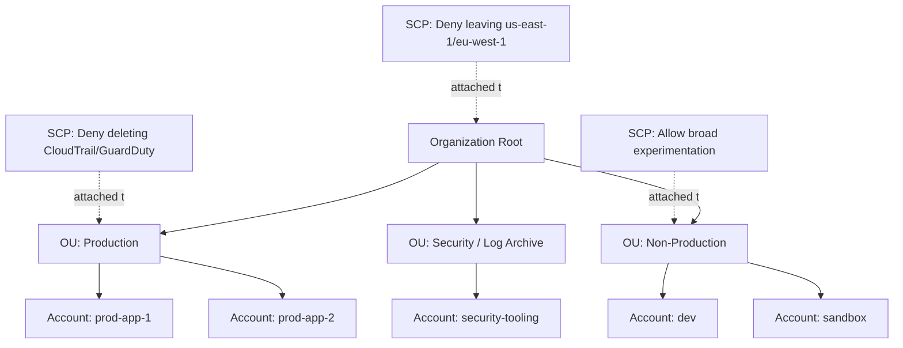

# AWS Organizations & Service Control Policies (SCPs)


## Definition

AWS Organizations is the service that groups **multiple AWS accounts** into one managed
structure (a hierarchy of Organizational Units) so they can be billed together, governed
together, and have policies applied across all of them at once. Service Control Policies (SCPs)
are the specific tool Organizations uses to set a **maximum permission ceiling** on everything
underneath — no identity in an affected account, including that account's own root/admin user,
can ever exceed it.

## Purpose

A company running dozens or hundreds of AWS accounts (common pattern: one account per
team/environment for strong blast-radius isolation) needs a way to enforce company-wide rules
that individual account admins cannot override by mistake or on purpose — "no account may ever
disable CloudTrail," "no account outside the designated regions may create resources," "only
the security account may modify GuardDuty settings." IAM policies alone can't do this because
they're managed *within* each account by that account's own admins. SCPs exist specifically to
sit one level above IAM and apply uniformly, with no opt-out, to every account in their scope.

## How It Works



Step by step:

1. SCPs attach to the **Root**, an **Organizational Unit (OU)**, or an individual **account**,
   and they **inherit downward** — an SCP on the Root applies to every OU and account beneath
   it; an SCP on an OU applies to every account in that OU and any nested OUs.
2. An account's **effective permission ceiling** is the intersection of every SCP that applies
   to it anywhere in its ancestry (Root → OU → nested OU → account). If any SCP in that chain
   denies an action, it's denied account-wide, no exceptions.
3. Critically: **SCPs never grant permissions.** The default AWS-managed SCP at the Root is
   `FullAWSAccess` (Allow `*` on everything) — attaching your own SCP almost always means you're
   now narrowing that default down, not adding to it. An SCP that says `"Allow": "s3:*"` and
   nothing else actually means "deny everything except S3," because it replaces the default
   wide-open Allow when applied (if you don't additionally keep an explicit broad Allow
   statement or use Deny-list style SCPs). Most real-world SCPs are written as **explicit
   Deny statements** layered on top of the default `FullAWSAccess`, which is far safer than
   trying to enumerate every Allow.
4. Once an SCP has passed (i.e., it doesn't deny the action), evaluation continues down into
   that account's own IAM — a user or role still needs an IAM policy (identity- or
   resource-based) that actually allows the specific action, exactly as described in `iam.md`.
   **An SCP that allows an action grants nothing by itself** — it only removes a ceiling that
   would otherwise block it.

## Key Features / Components

- **Organizational Units (OUs)** — a folder-like hierarchy for grouping accounts (by
  environment, business unit, compliance tier, etc.) so policies, not just billing, can be
  applied at scale.
- **Management account** — the account that owns the Organization, consolidated billing, and
  (unless delegated) the ability to create/attach SCPs. AWS strongly recommends this account
  run no workloads itself — it's purely administrative.
- **Delegated administrator** — lets the management account hand off day-to-day administration
  of specific services (GuardDuty, Security Hub, Macie, IAM Identity Center) to another account,
  without giving that account SCP-editing power.
- **Consolidated billing** — all linked accounts' usage rolls up to one bill, and volume
  discounts (e.g., S3 tiered pricing, Savings Plans) can apply across the combined usage.
- **Tag policies** — a separate Organizations policy type that standardizes tag keys/values
  across accounts (not a permission ceiling, a tagging-consistency enforcement mechanism).
- **Backup policies / AI services opt-out policies** — other org-wide policy types with the
  same attach-to-OU/account model as SCPs but governing different concerns (centralized backup
  schedules; opting entire OUs out of AWS using their data for service improvement).
- **AWS Control Tower** — builds on top of Organizations to provide a pre-built landing zone
  (standard OU structure, baseline SCPs, account factory for self-service new-account creation,
  centralized logging/guardrails) — often the practical way large orgs actually adopt SCPs
  rather than writing every one from scratch.

## Use Cases — When to Use It

- Enforcing "no account may operate outside approved regions" company-wide, so a compromised or
  careless account can't spin up resources somewhere nobody's monitoring.
- Preventing any account, including its own administrators, from disabling CloudTrail,
  GuardDuty, or Config — security logging that must survive even a malicious insider with
  account-admin rights.
- Restricting an entire "sandbox" OU to only cheap, low-risk services, so experimentation
  accounts can't accidentally run up large bills or touch production-grade services.
- Blocking root-user API access org-wide, forcing all access through IAM Identity Center/roles.

## When NOT to Use It / Alternatives

- **Per-user or per-role fine-grained permissions within one account** — that's IAM's job
  (identity-based policies), not SCPs; SCPs are deliberately coarse, account/OU-level ceilings,
  not a replacement for normal least-privilege IAM policy authoring.
- **A single standalone AWS account with no Organization** — SCPs require AWS Organizations;
  if there's no multi-account structure, use IAM permission boundaries for a similar
  "ceiling" effect scoped to one account instead.
- **Granting access** — never reach for an SCP when the goal is to *give* someone a new
  capability; SCPs are a restriction-only tool, and a question that implies "the SCP is why
  this now works" is conceptually broken (the SCP was always allowing it by default and
  something else — IAM — actually grants access).

## Why It's Important

**Real-world weight:** Multi-account governance at scale is unmanageable without SCPs — it's
the mechanism that lets a central security/cloud-platform team guarantee baseline protections
hold everywhere, regardless of what individual account owners configure. Regulatory frameworks
(PCI-DSS region restrictions, data residency laws) are frequently enforced this way because it's
the one control an account-level compromise or rogue admin truly cannot bypass.

**Exam weight:**
- **SAA-C03 — Domain 1, Task 1.1 "Design secure access to AWS resources"** explicitly lists
  "SCPs" and "multi-account strategy, Control Tower" — expect scenario questions contrasting
  SCP-level guardrails against IAM-level permissions in the same multi-account design.
- **DVA-C03 — Domain 2** touches SCPs more lightly (developers are consumers of the resulting
  restrictions more than authors of SCPs), but understanding "why does this API call fail
  org-wide even though my IAM policy allows it" is a Domain 2 troubleshooting-adjacent concept.
- **MLA-C02 — Domain 4** references org-wide guardrails for ML workload accounts (e.g., SCPs
  restricting which regions SageMaker/Bedrock can be used in, for data residency).

## Pricing Model

**AWS Organizations and SCPs are free.** There is no additional charge for creating an
Organization, OUs, accounts, or attaching SCPs/tag policies/backup policies — you only pay for
the underlying resources each member account actually uses, consolidated onto one bill.
See: https://aws.amazon.com/organizations/pricing/ (confirms no additional service fee).

## Hands-on Lab (Floci)

Organizations/SCPs are a true multi-account, control-plane feature that Floci's single-account
emulation does not model end-to-end. The closest practical local approximation is simulating
the **effect** of an SCP-style restriction using an IAM permission boundary (same "ceiling, not
grant" concept, scoped to one account) so you can feel the mechanics:

```bash
# Simulate an SCP-style ceiling with a permission boundary: "this role may never touch IAM itself"
cat > deny-iam-boundary.json << 'EOF'
{
  "Version": "2012-10-17",
  "Statement": [
    { "Effect": "Allow", "Action": "*", "Resource": "*" },
    { "Effect": "Deny", "Action": "iam:*", "Resource": "*" }
  ]
}
EOF
awslocal iam create-policy --policy-name NoIAMBoundary --policy-document file://deny-iam-boundary.json

awslocal iam create-role --role-name SandboxDeveloperRole \
  --assume-role-policy-document file://trust.json \
  --permissions-boundary arn:aws:iam::000000000000:policy/NoIAMBoundary
awslocal iam attach-role-policy --role-name SandboxDeveloperRole \
  --policy-arn arn:aws:iam::aws:policy/PowerUserAccess

# Even with PowerUserAccess attached, the boundary caps out IAM actions — exactly how an
# org-wide SCP would cap every account beneath it regardless of each account's own IAM policies.
awslocal iam simulate-principal-policy --policy-source-arn arn:aws:iam::000000000000:role/SandboxDeveloperRole \
  --action-names iam:CreateUser --resource-arns "*"
```

For the real multi-account Organizations API surface (`organizations create-organization`,
`create-organizational-unit`, `create-policy --type SERVICE_CONTROL_POLICY`), consult AWS's own
documentation and a real (or AWS-provided free-tier sandbox) multi-account setup — Floci does
not emulate the Organizations control plane.

## Exam Tips

- **SCPs never grant, only restrict.** If a question's answer choice implies an SCP "enables"
  or "allows" new access on its own, it's wrong — something in IAM must still separately allow
  the action.
- **SCPs apply to the root user too** — unlike IAM policies (which don't attach to the root
  user conventionally), SCPs bind the root user in every affected account. This is specifically
  why SCPs are the right tool for "not even an account admin can override this."
  a trusted exception).
- **Effective permissions = intersection, not union** — a permission must be allowed by *every*
  applicable SCP in the account's OU chain *and* by IAM within the account. One denying SCP
  anywhere in the chain overrides an otherwise-permissive IAM policy.
- **SCP vs. permission boundary** — SCP = Organizations-level, applies to whole accounts/OUs;
  permission boundary = IAM-level, applies to one specific user/role within a single account.
  Exam questions often describe a scenario and expect you to identify which of the two is the
  right scope.
- **Management account is not restricted by its own SCPs** by default in some configurations —
  know that SCPs attached at the Root do not apply to the management account itself (only to
  member accounts), which is why best practice is to run no workloads in the management
  account.
- Shows up primarily in **SAA-C03 Domain 1 (30%)**, with lighter touches in DVA-C03/MLA-C02
  around org-wide guardrails affecting developer/ML workloads.

## Related Terms

- [`iam.md`](iam.md) — SCPs are one more ceiling in the same evaluation chain as permission boundaries
- [`sts-and-role-switching.md`](sts-and-role-switching.md) — SCPs still apply to assumed-role sessions
- [`iam-identity-center-sso.md`](iam-identity-center-sso.md) — typically deployed across the same multi-account Organization
- [`security-hub-and-inspector.md`](security-hub-and-inspector.md) — often delegated-administered org-wide, same governance model
- `glossary/` — Organizational Unit, consolidated billing, Control Tower, landing zone
