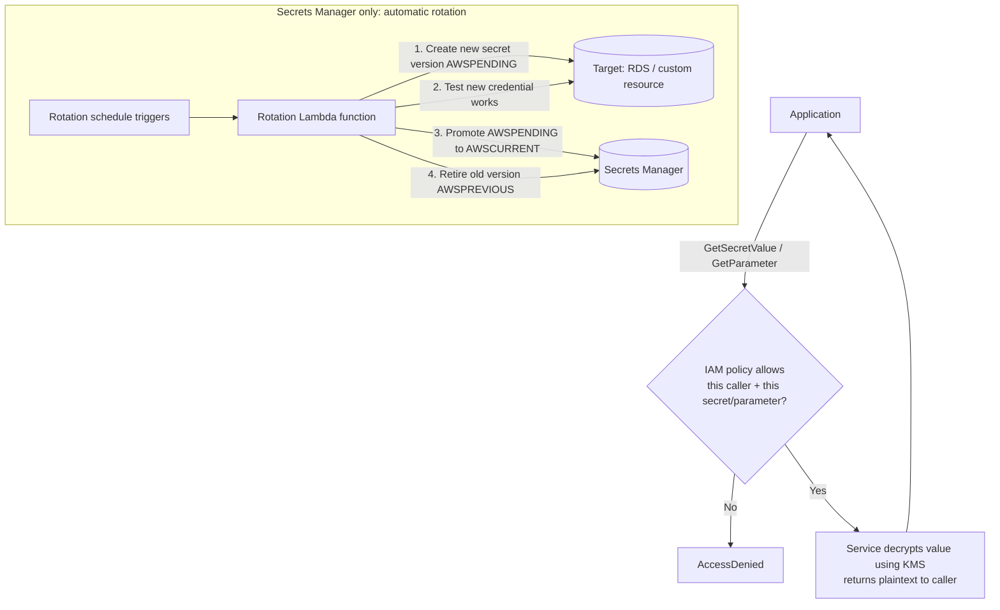

# AWS Secrets Manager vs. Systems Manager Parameter Store


## Definition

Both services store configuration values and sensitive data (database passwords, API keys,
connection strings) so your application never hardcodes them in source code — but they are
**two different services with different pricing, rotation capability, and intended scope**, and
choosing between them is one of the most commonly tested decisions in this whole category.
Secrets Manager is purpose-built for secrets that need automatic rotation. Parameter Store
(part of AWS Systems Manager) is a general-purpose, free-tier configuration/secret store that
can hold anything from a feature flag to an encrypted password, but has no built-in rotation
engine of its own.

## Purpose

Hardcoding credentials in application code or config files is one of the oldest and most
persistent sources of breaches (leaked GitHub repos, compromised CI logs, former employees who
remember a password). Both services exist to give applications a way to **fetch** a secret at
runtime via an authenticated API call (governed by IAM) instead of ever storing it in plaintext
anywhere near the code. Secrets Manager additionally exists to solve the much harder operational
problem of **rotating** that secret on a schedule without breaking the application mid-rotation
— something Parameter Store was never built to do natively.

## How It Works



Step by step:

1. **Retrieval (identical concept in both services)**: the application calls
   `secretsmanager:GetSecretValue` or `ssm:GetParameter`, IAM checks whether that specific
   principal is allowed to read that specific secret/parameter (and, for Parameter Store,
   whether it's a `SecureString` requiring `kms:Decrypt` too), and if allowed, the decrypted
   plaintext value is returned.
2. **Rotation (Secrets Manager's defining extra capability)**: on a schedule you configure,
   Secrets Manager invokes a **rotation Lambda function** (AWS provides ready-made templates for
   RDS, Redshift, DocumentDB, and a generic template for anything else).
3. The rotation Lambda follows a four-step staged process using version labels so the
   application is never broken mid-rotation: it creates a brand-new credential and stores it as
   the `AWSPENDING` version, tests that the new credential actually works against the real
   database/service, then **promotes** `AWSPENDING` to `AWSCURRENT` (what applications fetch by
   default) only after the test succeeds, and finally retires the old version as
   `AWSPREVIOUS` (kept briefly for rollback safety, not deleted immediately).
4. Applications that always fetch "the current secret" (not a hardcoded version ID) see the
   rotation happen transparently — no code change, no downtime, as long as the app re-fetches
   the secret periodically rather than caching it forever.

## Key Features / Components — Side-by-Side Comparison

| | **Secrets Manager** | **Parameter Store (Systems Manager)** |
|---|---|---|
| Built-in automatic rotation | **Yes** — native scheduled rotation via Lambda, pre-built templates for RDS/Redshift/DocumentDB | **No** — you'd have to build your own EventBridge + Lambda rotation pipeline from scratch |
| Pricing | **Not free** — per-secret monthly fee + per-10,000-API-calls fee | **Standard tier is free**; Advanced tier has a small per-parameter + per-API-call fee |
| Cross-account sharing | Native resource policies, easy cross-account access | Possible but less first-class; typically via IAM only |
| Cross-region replication | Native built-in replica support | Not built-in (must copy manually or script it) |
| Max value size | 64 KB | Standard: 4 KB; Advanced: 8 KB |
| Versioning | Full version history with staging labels (`AWSCURRENT`/`AWSPENDING`/`AWSPREVIOUS`) | Simple version counter, no staging-label rotation concept |
| Hierarchical organization | Flat naming with path-like conventions possible | True hierarchical paths (`/app/prod/db/password`) with `GetParametersByPath` |
| Encryption | Always encrypted via KMS, no option to store plaintext | `String`/`StringList` types are plaintext; `SecureString` type is KMS-encrypted (your choice) |
| Typical use | Database credentials, API keys needing rotation, OAuth tokens | App config (feature flags, non-secret settings), secrets that don't need automated rotation, cost-sensitive use at scale |
| Native integration with RDS | Deep — RDS console can auto-create and manage a Secrets Manager secret for you | None built-in |

## Use Cases — When to Use It

**Use Secrets Manager when:**
- A database credential must rotate automatically on a schedule without any manual step or
  application downtime.
- You need the secret shared securely across multiple AWS accounts via resource policy.
- You're storing anything a compliance framework explicitly calls a "secret" requiring
  rotation evidence (PCI-DSS credential rotation requirements, for example).

**Use Parameter Store when:**
- You're storing a large volume of configuration values (hundreds to thousands) where Secrets
  Manager's per-secret monthly fee would add up fast, and most of them are plain, non-rotating
  config (feature flags, environment names, non-sensitive settings).
- You want `SecureString` KMS encryption for the handful of values that are sensitive but don't
  need automated rotation (e.g., a long-lived third-party API key you rotate manually once a
  year).
- You're already using other Systems Manager features (Run Command, Automation documents) and
  want everything in one hierarchical namespace.

## When NOT to Use It / Alternatives

- **Hardcoding secrets in Lambda environment variables or container images in plaintext** —
  never; always pull from one of these two services (or at minimum, KMS-encrypt the
  environment variable), and prefer Secrets Manager/Parameter Store references directly where
  the service supports them (ECS task definitions and Lambda both support referencing Secrets
  Manager/Parameter Store directly without extra code).
- **A secret needs rotation and you're trying to force it into Parameter Store to save money**
  — technically possible by building your own rotation pipeline, but you're then
  reimplementing (poorly) what Secrets Manager already does reliably; the cost tradeoff rarely
  wins once you count engineering time.
- **Massive-scale, low-cost generic config with no sensitivity at all** — an S3 object, a
  CloudFormation parameter, or an application's own config file may be simpler than either
  service if nothing is actually a credential.

## Why It's Important

**Real-world weight:** Credential rotation is one of the highest-leverage, most
frequently-skipped security hygiene practices — a database password that's never rotated is a
permanent, growing liability the longer it exists (more systems/people end up knowing it over
time). Secrets Manager turning this into a scheduled, zero-downtime, automatic process removes
the main reason teams skip rotation (it's operationally painful to do by hand).

**Exam weight:**
- **SAA-C03 — Domain 1, Task 1.2 "Design secure workloads and applications"** lists Secrets
  Manager explicitly; the cost/rotation tradeoff against Parameter Store is a classic
  "which service" scenario question.
- **DVA-C03 — Domain 2, Task 2.2 "Implement encryption and manage sensitive data"** — expect
  direct code-level questions: fetching a secret via the SDK, referencing Secrets Manager from
  an ECS task definition, or configuring Parameter Store `SecureString` with a customer-managed
  KMS key.
- **MLA-C02 — Domain 4** — storing model API keys, third-party data source credentials, or
  database connection strings used by SageMaker/Bedrock pipelines touches this exact decision.

## Pricing Model

- **Secrets Manager**: ~$0.40/secret/month + $0.05 per 10,000 API calls (exact numbers change —
  see official page). No free tier beyond a limited trial period for new secrets.
- **Parameter Store — Standard tier**: free, up to 10,000 parameters per account, 4KB value
  limit, standard API call throughput.
- **Parameter Store — Advanced tier**: small per-parameter monthly charge + per-API-call
  charge, raises the limit to 100,000 parameters, 8KB values, higher throughput, and adds
  parameter policies (expiration, change notification).
- See: https://aws.amazon.com/secrets-manager/pricing/ and
  https://aws.amazon.com/systems-manager/pricing/ for current numbers — this cost delta is
  itself a frequently tested exam fact.

## Hands-on Lab (Floci)

```bash
# --- Secrets Manager ---
awslocal secretsmanager create-secret --name prod/db/credentials \
  --secret-string '{"username":"admin","password":"ChangeMe123!"}'

awslocal secretsmanager get-secret-value --secret-id prod/db/credentials

# Simulate a manual rotation by creating a new version (real auto-rotation needs the
# Lambda rotation template + RDS integration, which Floci's control-plane API accepts but
# does not fully execute end-to-end)
awslocal secretsmanager put-secret-value --secret-id prod/db/credentials \
  --secret-string '{"username":"admin","password":"NewRotatedPassword456!"}'
awslocal secretsmanager list-secret-version-ids --secret-id prod/db/credentials

# --- Parameter Store ---
awslocal ssm put-parameter --name "/app/prod/feature-flag-new-ui" \
  --value "true" --type String

awslocal ssm put-parameter --name "/app/prod/db/password" \
  --value "ChangeMe123!" --type SecureString

awslocal ssm get-parameter --name "/app/prod/db/password" --with-decryption

# Hierarchical fetch — get every parameter under a path at once
awslocal ssm get-parameters-by-path --path "/app/prod/" --recursive --with-decryption
```

## Exam Tips

- **The #1 trap in this entire section: "which service, cheapest, rotation needed."** If a
  scenario needs automatic rotation → Secrets Manager, regardless of cost, because Parameter
  Store cannot do it natively. If a scenario emphasizes "hundreds of config values, cost
  matters, no rotation needed" → Parameter Store Standard tier (free).
  needs value is 4KB, so Parameter Store Advanced tier.
- **Both encrypt via KMS** — don't fall for an answer implying Parameter Store is "less secure"
  for `SecureString` values; the encryption mechanism is the same KMS backend as Secrets
  Manager. The real difference is rotation tooling and pricing, not encryption strength.
- **RDS console integration** — when you let the RDS console "manage credentials in Secrets
  Manager" during database creation, it automatically wires up rotation; know this is a
  Secrets-Manager-specific, one-click capability with no Parameter Store equivalent.
- **Version staging labels** (`AWSCURRENT`, `AWSPENDING`, `AWSPREVIOUS`, and optionally
  `AWSPENDING` during rotation) are Secrets-Manager-specific vocabulary — if a question uses
  these terms, the answer is Secrets Manager.
- **Parameter Store hierarchical paths + `GetParametersByPath`** are a Parameter-Store-specific
  capability with no direct Secrets Manager equivalent — a question about fetching many related
  config values with one call under a shared prefix points here.
- Shows up heavily in **SAA-C03 Domain 1 (30%)** and **DVA-C03 Domain 2 (26%)**; lighter but
  present in **MLA-C02 Domain 4 (24%)** for securing pipeline credentials.

## Related Terms

- [`kms.md`](kms.md) — the encryption layer underneath both services
- [`iam.md`](iam.md) — IAM policies (and resource policies for Secrets Manager) gate who can read which secret
- [`acm-and-private-ca.md`](acm-and-private-ca.md) — a related but separate way to manage certificate private keys
- `glossary/` — rotation, staging label, SecureString
