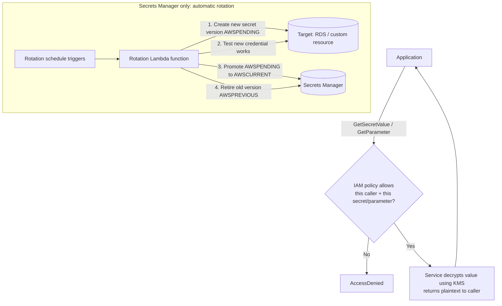
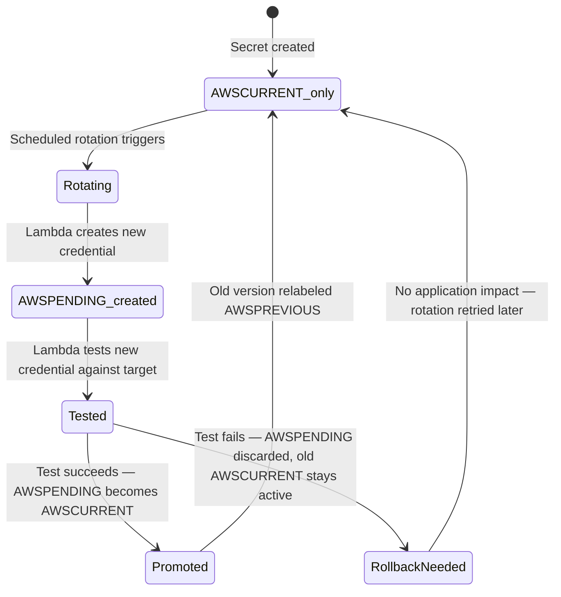
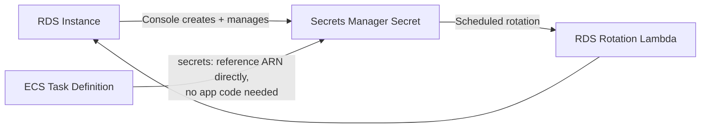
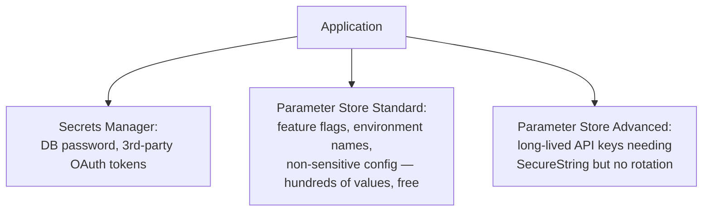
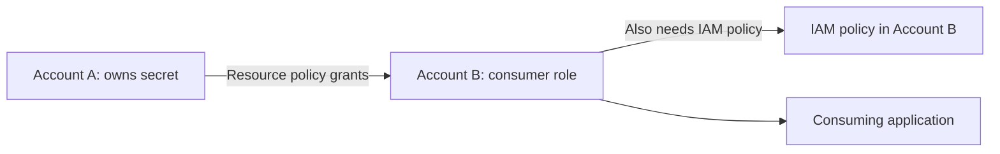

# AWS Secrets Manager vs. Systems Manager Parameter Store

> **Appears in:** [DVA-C03](../../certifications/dva-c03/README.md) · [SAA-C03](../../certifications/saa-c03/README.md)


## Definition

Both services store configuration values and sensitive data (database passwords, API keys,
connection strings) so your application never hardcodes them in source code — but they are
**two different services with different pricing, rotation capability, and intended scope**, and
choosing between them is one of the most commonly tested decisions in this whole category.
Secrets Manager is purpose-built for secrets that need automatic rotation. Parameter Store
(part of AWS Systems Manager) is a general-purpose, free-tier configuration/secret store that
can hold anything from a feature flag to an encrypted password, but has no built-in rotation
engine of its own.

## Purpose

Hardcoding credentials in application code or config files is one of the oldest and most
persistent sources of breaches (leaked GitHub repos, compromised CI logs, former employees who
remember a password). Both services exist to give applications a way to **fetch** a secret at
runtime via an authenticated API call (governed by IAM) instead of ever storing it in plaintext
anywhere near the code. Secrets Manager additionally exists to solve the much harder operational
problem of **rotating** that secret on a schedule without breaking the application mid-rotation
— something Parameter Store was never built to do natively.

## How It Works



Step by step:

1. **Retrieval (identical concept in both services)**: the application calls
   `secretsmanager:GetSecretValue` or `ssm:GetParameter`, IAM checks whether that specific
   principal is allowed to read that specific secret/parameter (and, for Parameter Store,
   whether it's a `SecureString` requiring `kms:Decrypt` too), and if allowed, the decrypted
   plaintext value is returned.
2. **Rotation (Secrets Manager's defining extra capability)**: on a schedule you configure,
   Secrets Manager invokes a **rotation Lambda function** (AWS provides ready-made templates for
   RDS, Redshift, DocumentDB, and a generic template for anything else), or uses **managed
   rotation** for certain AWS-native secret types where no Lambda function is needed at all.
3. The rotation Lambda follows a four-step staged process using version labels so the
   application is never broken mid-rotation: it creates a brand-new credential and stores it as
   the `AWSPENDING` version, tests that the new credential actually works against the real
   database/service, then **promotes** `AWSPENDING` to `AWSCURRENT` (what applications fetch by
   default) only after the test succeeds, and finally retires the old version as
   `AWSPREVIOUS` (kept briefly for rollback safety, not deleted immediately).
4. Applications that always fetch "the current secret" (not a hardcoded version ID) see the
   rotation happen transparently — no code change, no downtime, as long as the app re-fetches
   the secret periodically rather than caching it forever.

### Official AWS diagram: alternating-users rotation strategy, step by step


*Source: AWS Secrets Manager User Guide, "Lambda function rotation strategies"
(docs.aws.amazon.com/secretsmanager/latest/userguide/rotation-strategy.html)*


*Source: AWS Secrets Manager User Guide, "Lambda function rotation strategies"
(docs.aws.amazon.com/secretsmanager/latest/userguide/rotation-strategy.html)*

**Alternating users rotation** is the high-availability rotation strategy: rather than
repeatedly changing one user's password (which would briefly invalidate any already-open
database connection using the old password), Secrets Manager clones the original database user
into a second user on first rotation, then alternates which of the two users' passwords it
updates on each subsequent rotation — guaranteeing at least one of the two credentials is always
valid, even mid-rotation.

### Secret rotation state machine, generalized



### Parameter Store hierarchical retrieval pattern

```mermaid
flowchart TD
    App[Application startup] -->|GetParametersByPath\npath=/app/prod/| SSM[Parameter Store]
    SSM --> P1[/app/prod/db/host]
    SSM --> P2[/app/prod/db/password SecureString]
    SSM --> P3[/app/prod/feature-flags/new-ui]
    SSM --> P4[/app/prod/api-keys/external-vendor SecureString]
    P1 --> App
    P2 -->|kms:Decrypt| App
    P3 --> App
    P4 -->|kms:Decrypt| App
```

One `GetParametersByPath` call with `--recursive --with-decryption` fetches an entire
application's configuration tree in a single round trip — a capability Secrets Manager has no
direct equivalent for (you'd fetch each secret individually or maintain your own index).

## Key Features / Components — Side-by-Side Comparison

| | **Secrets Manager** | **Parameter Store (Systems Manager)** |
|---|---|---|
| Built-in automatic rotation | **Yes** — native scheduled rotation via Lambda, pre-built templates for RDS/Redshift/DocumentDB, or managed rotation for some types | **No** — you'd have to build your own EventBridge + Lambda rotation pipeline from scratch |
| Pricing | **Not free** — per-secret monthly fee + per-10,000-API-calls fee | **Standard tier is free**; Advanced tier has a small per-parameter + per-API-call fee |
| Cross-account sharing | Native resource policies, easy cross-account access | Possible but less first-class; typically via IAM only |
| Cross-region replication | Native built-in replica support | Not built-in (must copy manually or script it) |
| Max value size | 64 KB | Standard: 4 KB; Advanced: 8 KB |
| Versioning | Full version history with staging labels (`AWSCURRENT`/`AWSPENDING`/`AWSPREVIOUS`) | Simple version counter, no staging-label rotation concept |
| Hierarchical organization | Flat naming with path-like conventions possible | True hierarchical paths (`/app/prod/db/password`) with `GetParametersByPath` |
| Encryption | Always encrypted via KMS, no option to store plaintext | `String`/`StringList` types are plaintext; `SecureString` type is KMS-encrypted (your choice) |
| Typical use | Database credentials, API keys needing rotation, OAuth tokens | App config (feature flags, non-secret settings), secrets that don't need automated rotation, cost-sensitive use at scale |
| Native integration with RDS | Deep — RDS console can auto-create and manage a Secrets Manager secret for you | None built-in |
| Parameter policies (Advanced tier) | N/A | Expiration notifications, change notifications — a lightweight governance layer Secrets Manager doesn't have an equivalent for |

## Use Cases — When to Use It

**Use Secrets Manager when:**
- A database credential must rotate automatically on a schedule without any manual step or
  application downtime.
- You need the secret shared securely across multiple AWS accounts via resource policy.
- You're storing anything a compliance framework explicitly calls a "secret" requiring
  rotation evidence (PCI-DSS credential rotation requirements, for example).

**Use Parameter Store when:**
- You're storing a large volume of configuration values (hundreds to thousands) where Secrets
  Manager's per-secret monthly fee would add up fast, and most of them are plain, non-rotating
  config (feature flags, environment names, non-sensitive settings).
- You want `SecureString` KMS encryption for the handful of values that are sensitive but don't
  need automated rotation (e.g., a long-lived third-party API key you rotate manually once a
  year).
- You're already using other Systems Manager features (Run Command, Automation documents) and
  want everything in one hierarchical namespace.

## When NOT to Use It / Alternatives

- **Hardcoding secrets in Lambda environment variables or container images in plaintext** —
  never; always pull from one of these two services (or at minimum, KMS-encrypt the
  environment variable), and prefer Secrets Manager/Parameter Store references directly where
  the service supports them (ECS task definitions and Lambda both support referencing Secrets
  Manager/Parameter Store directly without extra code).
- **A secret needs rotation and you're trying to force it into Parameter Store to save money**
  — technically possible by building your own rotation pipeline, but you're then
  reimplementing (poorly) what Secrets Manager already does reliably; the cost tradeoff rarely
  wins once you count engineering time.
- **Massive-scale, low-cost generic config with no sensitivity at all** — an S3 object, a
  CloudFormation parameter, or an application's own config file may be simpler than either
  service if nothing is actually a credential.

## Common Architectures

### 1. RDS with Secrets Manager-managed rotation, referenced directly by ECS



### 2. Mixed-tier configuration strategy for a large application



### 3. Cross-account secret sharing via resource policy



## Why It's Important

**Real-world weight:** Credential rotation is one of the highest-leverage, most
frequently-skipped security hygiene practices — a database password that's never rotated is a
permanent, growing liability the longer it exists (more systems/people end up knowing it over
time). Secrets Manager turning this into a scheduled, zero-downtime, automatic process removes
the main reason teams skip rotation (it's operationally painful to do by hand).

**Exam weight:**
- **SAA-C03 — Domain 1, Task 1.2 "Design secure workloads and applications"** lists Secrets
  Manager explicitly; the cost/rotation tradeoff against Parameter Store is a classic
  "which service" scenario question.
- **DVA-C03 — Domain 2, Task 2.2 "Implement encryption and manage sensitive data"** — expect
  direct code-level questions: fetching a secret via the SDK, referencing Secrets Manager from
  an ECS task definition, or configuring Parameter Store `SecureString` with a customer-managed
  KMS key.
- **MLA-C02 — Domain 4** — storing model API keys, third-party data source credentials, or
  database connection strings used by SageMaker/Bedrock pipelines touches this exact decision.

## Limits & Quotas

| Resource | Default quota | Notes |
|---|---|---|
| Secrets Manager secret value size | 64 KB | Includes metadata overhead in the JSON structure |
| Secrets per account (Secrets Manager) | 500,000 (soft) | Rarely the binding constraint; cost scales linearly before this matters |
| Parameter Store Standard — parameters per account | 10,000 | The hard trigger to consider Advanced tier |
| Parameter Store Standard — value size | 4 KB | Advanced tier raises this to 8 KB |
| Parameter Store Advanced — parameters per account | 100,000 | Also unlocks parameter policies (expiration/change notifications) |
| `GetParametersByPath` — parameters returned per call | 10 (without pagination token) | Must paginate for larger config trees |
| Secrets Manager rotation window | Configurable, as short as hours | A very tight rotation window on a slow-to-respond target database can cause rotation timeouts — a real operational tuning concern |

## Pricing Model

- **Secrets Manager**: ~$0.40/secret/month + $0.05 per 10,000 API calls (exact numbers change —
  see official page). No free tier beyond a limited trial period for new secrets.
- **Parameter Store — Standard tier**: free, up to 10,000 parameters per account, 4KB value
  limit, standard API call throughput.
- **Parameter Store — Advanced tier**: small per-parameter monthly charge + per-API-call
  charge, raises the limit to 100,000 parameters, 8KB values, higher throughput, and adds
  parameter policies (expiration, change notification).
- See: https://aws.amazon.com/secrets-manager/pricing/ and
  https://aws.amazon.com/systems-manager/pricing/ for current numbers — this cost delta is
  itself a frequently tested exam fact.

## Hands-on Lab (Floci)

```bash
# --- Secrets Manager ---
awslocal secretsmanager create-secret --name prod/db/credentials \
  --secret-string '{"username":"admin","password":"ChangeMe123!"}'

awslocal secretsmanager get-secret-value --secret-id prod/db/credentials

# Simulate a manual rotation by creating a new version (real auto-rotation needs the
# Lambda rotation template + RDS integration, which Floci's control-plane API accepts but
# does not fully execute end-to-end)
awslocal secretsmanager put-secret-value --secret-id prod/db/credentials \
  --secret-string '{"username":"admin","password":"NewRotatedPassword456!"}'
awslocal secretsmanager list-secret-version-ids --secret-id prod/db/credentials

# --- Parameter Store ---
awslocal ssm put-parameter --name "/app/prod/feature-flag-new-ui" \
  --value "true" --type String

awslocal ssm put-parameter --name "/app/prod/db/password" \
  --value "ChangeMe123!" --type SecureString

awslocal ssm get-parameter --name "/app/prod/db/password" --with-decryption

# Hierarchical fetch — get every parameter under a path at once
awslocal ssm get-parameters-by-path --path "/app/prod/" --recursive --with-decryption
```

### Extended lab: resource policy for cross-account secret sharing

```bash
# Attach a resource policy to a Secrets Manager secret granting another account read access
cat > secret-resource-policy.json << 'EOF'
{
  "Version": "2012-10-17",
  "Statement": [
    {
      "Effect": "Allow",
      "Principal": {"AWS": "arn:aws:iam::444455556666:role/ConsumerRole"},
      "Action": "secretsmanager:GetSecretValue",
      "Resource": "*"
    }
  ]
}
EOF
awslocal secretsmanager put-resource-policy --secret-id prod/db/credentials \
  --resource-policy file://secret-resource-policy.json

# Tag-based parameter organization, mirroring how teams scale Parameter Store usage
awslocal ssm add-tags-to-resource --resource-type Parameter \
  --resource-id "/app/prod/db/password" --tags Key=Team,Value=platform
```

## Troubleshooting / Common Issues

**"Application suddenly can't connect to the database after a rotation":**
1. Check whether the application is caching the secret value at startup only, rather than
   re-fetching `AWSCURRENT` periodically — this is the single most common cause, and the fix is
   application-level (re-fetch on connection failure / periodically), not a Secrets Manager bug.
2. Check the rotation Lambda's CloudWatch Logs for a failed test step — if `AWSPENDING` never
   promoted successfully, `AWSCURRENT` should still be the old, working credential; a stuck
   rotation is usually a target-connectivity or permissions issue for the Lambda itself.

**"AccessDenied on GetSecretValue despite a seemingly correct IAM policy":** check for a
**resource policy** on the secret itself (Secrets Manager secrets can have them, much like S3
buckets) that might be more restrictive than expected, especially in a cross-account scenario
where both sides need to agree exactly as described in `iam.md`.

**"Parameter Store SecureString value comes back encrypted/garbled":** the call didn't include
`--with-decryption` (CLI) or the SDK's `WithDecryption: true` — SecureString values are returned
as ciphertext by default unless explicitly requested decrypted, and the caller also needs
`kms:Decrypt` on the backing key.

**"Hit the 10,000 parameter limit and new parameters fail to create":** this is the clean
signal to migrate to Parameter Store Advanced tier (or re-evaluate whether some of those
parameters actually belong in Secrets Manager instead) rather than trying to delete your way
back under the ceiling indefinitely.

## Exam Tips

- **The #1 trap in this entire section: "which service, cheapest, rotation needed."** If a
  scenario needs automatic rotation → Secrets Manager, regardless of cost, because Parameter
  Store cannot do it natively. If a scenario emphasizes "hundreds of config values, cost
  matters, no rotation needed" → Parameter Store Standard tier (free). If the scenario's largest
  needs value is 4KB, Standard tier suffices; above that, Advanced tier.
- **Both encrypt via KMS** — don't fall for an answer implying Parameter Store is "less secure"
  for `SecureString` values; the encryption mechanism is the same KMS backend as Secrets
  Manager. The real difference is rotation tooling and pricing, not encryption strength.
- **RDS console integration** — when you let the RDS console "manage credentials in Secrets
  Manager" during database creation, it automatically wires up rotation; know this is a
  Secrets-Manager-specific, one-click capability with no Parameter Store equivalent.
- **Version staging labels** (`AWSCURRENT`, `AWSPENDING`, `AWSPREVIOUS`) are Secrets-Manager-
  specific vocabulary — if a question uses these terms, the answer is Secrets Manager.
- **Alternating users rotation strategy** — recognize this as the high-availability rotation
  pattern (two users, one always valid mid-rotation), distinct from the simpler single-user
  strategy that briefly risks dropped connections during the exact moment of password change.
- **Parameter Store hierarchical paths + `GetParametersByPath`** are a Parameter-Store-specific
  capability with no direct Secrets Manager equivalent — a question about fetching many related
  config values with one call under a shared prefix points here.
- **ECS task definitions and Lambda can reference either service directly** without the
  application writing SDK code to fetch the value itself — a question about "minimize code
  changes to pull in a secret" points to this native reference capability.
- Shows up heavily in **SAA-C03 Domain 1 (30%)** and **DVA-C03 Domain 2 (26%)**; lighter but
  present in **MLA-C02 Domain 4 (24%)** for securing pipeline credentials.

## Worked example: estimating cost for a large configuration-heavy application

An application needs 2,000 Parameter Store `SecureString` values (feature flags + light
secrets) and 15 database/API credentials needing rotation. Rough cost reasoning:

- **2,000 parameters** comfortably fit under Parameter Store Standard's 10,000-parameter free
  tier — **$0/month** for this part, regardless of read volume, since Standard tier API calls
  are also free up to generous throughput limits.
- **15 rotating secrets** in Secrets Manager at roughly $0.40/secret/month ≈ **$6/month** base
  fee, plus a small per-10,000-API-calls charge that's typically negligible unless the
  application fetches secrets extremely frequently without caching.

A common wrong instinct is putting all 2,015 values into Secrets Manager "for consistency,"
which would cost roughly $6/month for the 15 that need rotation plus **~$800/month** for the
2,000 that don't — the exact scenario this whole comparison doc's core exam trap is built
around: matching the service to whether rotation is actually needed, not defaulting to the
more feature-rich (and more expensive) option everywhere.

## Secrets Manager Resource Policy — Full Worked Example With Conditions

```json
{
  "Version": "2012-10-17",
  "Statement": [
    {
      "Sid": "CrossAccountReadWithCondition",
      "Effect": "Allow",
      "Principal": { "AWS": "arn:aws:iam::444455556666:role/AnalyticsRole" },
      "Action": "secretsmanager:GetSecretValue",
      "Resource": "*",
      "Condition": {
        "StringEquals": { "secretsmanager:VersionStage": "AWSCURRENT" },
        "IpAddress": { "aws:SourceIp": "203.0.113.0/24" }
      }
    }
  ]
}
```

Scoping cross-account access to `VersionStage: AWSCURRENT` specifically prevents the consuming
account from ever requesting a stale `AWSPREVIOUS` version during a rotation window — a subtle
but real production concern for any cross-account secret-sharing relationship involving
actively-rotated credentials.

## Worked example: a Lambda-based rotation function outline for a non-RDS custom secret

```python
def lambda_handler(event, context):
    step = event["Step"]
    secret_id = event["SecretId"]
    token = event["ClientRequestToken"]

    if step == "createSecret":
        new_value = generate_new_credential()
        secretsmanager.put_secret_value(
            SecretId=secret_id, ClientRequestToken=token,
            SecretString=new_value, VersionStages=["AWSPENDING"])
    elif step == "setSecret":
        apply_credential_to_target_service(new_value)
    elif step == "testSecret":
        assert verify_credential_works(new_value)
    elif step == "finishSecret":
        secretsmanager.update_secret_version_stage(
            SecretId=secret_id, VersionStage="AWSCURRENT",
            MoveToVersionId=token, RemoveFromVersionId=current_version_id())
```

This is the generic four-step rotation Lambda shape (`createSecret` → `setSecret` →
`testSecret` → `finishSecret`) every rotation template follows, including the pre-built
RDS/Redshift/DocumentDB ones — recognizing these four named steps is itself a testable detail,
since a question about "why did a rotation fail partway through" is often pointing at exactly
which of these four steps the failure occurred in (a `testSecret` failure, for instance, means
the new credential was created but never promoted, leaving the application unaffected).

## Choosing Between Single-User and Alternating-Users Rotation Strategy

| Factor | Single-user strategy | Alternating-users strategy |
|---|---|---|
| Complexity | Simpler — one user, one password changes | More complex — two users, cloning logic |
| Connection drop risk during rotation | Slightly higher — brief window where old connections may fail on next auth | Lower — one of the two users is always valid |
| Requires a separate superuser secret | No | Yes — for the initial user-cloning step |
| AWS's recommendation for most cases | **Default/recommended** | Reserve for high-availability-critical workloads needing zero rotation-related risk |

## Further Reading

- AWS Secrets Manager User Guide — Rotate secrets:
  https://docs.aws.amazon.com/secretsmanager/latest/userguide/rotating-secrets.html
- AWS Secrets Manager User Guide — Lambda function rotation strategies:
  https://docs.aws.amazon.com/secretsmanager/latest/userguide/rotation-strategy.html
- AWS Systems Manager User Guide — Parameter Store:
  https://docs.aws.amazon.com/systems-manager/latest/userguide/systems-manager-parameter-store.html
- AWS Secrets Manager pricing: https://aws.amazon.com/secrets-manager/pricing/
- AWS Systems Manager pricing: https://aws.amazon.com/systems-manager/pricing/

## Related Terms

- [`kms.md`](kms.md) — the encryption layer underneath both services
- [`iam.md`](iam.md) — IAM policies (and resource policies for Secrets Manager) gate who can read which secret
- [`acm-and-private-ca.md`](acm-and-private-ca.md) — a related but separate way to manage certificate private keys
- `glossary/` — rotation, staging label, SecureString
