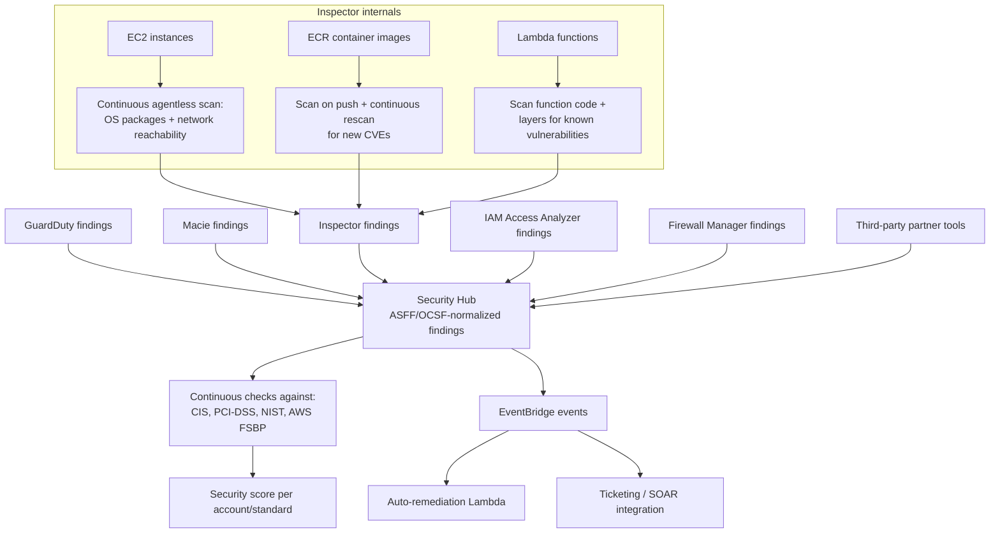
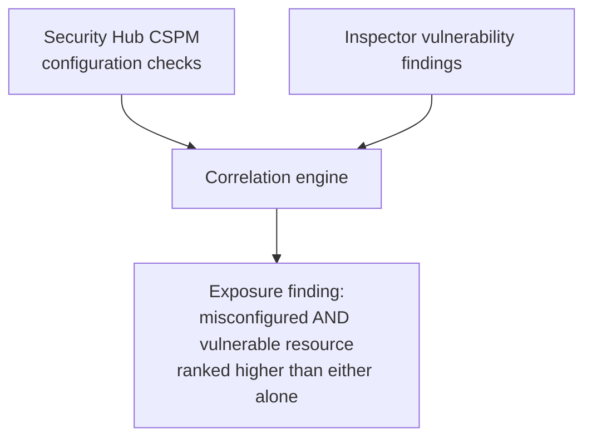
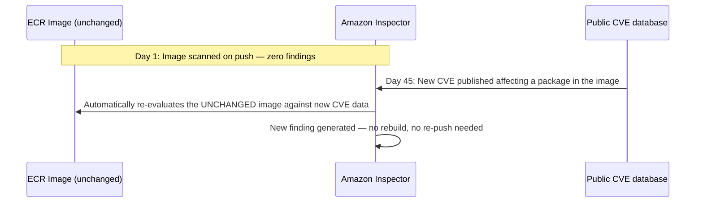
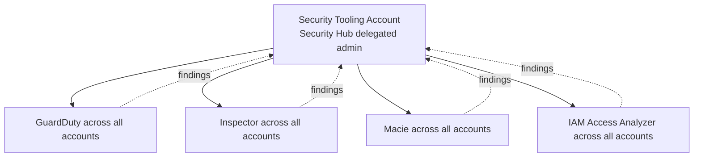
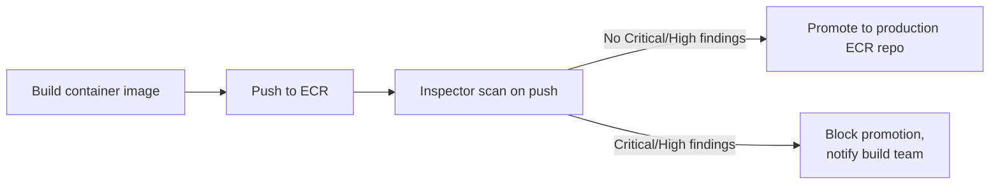
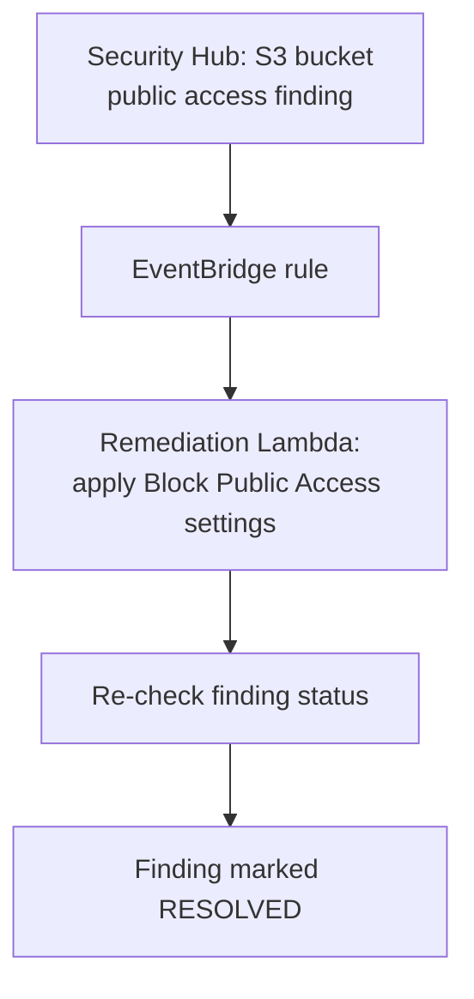
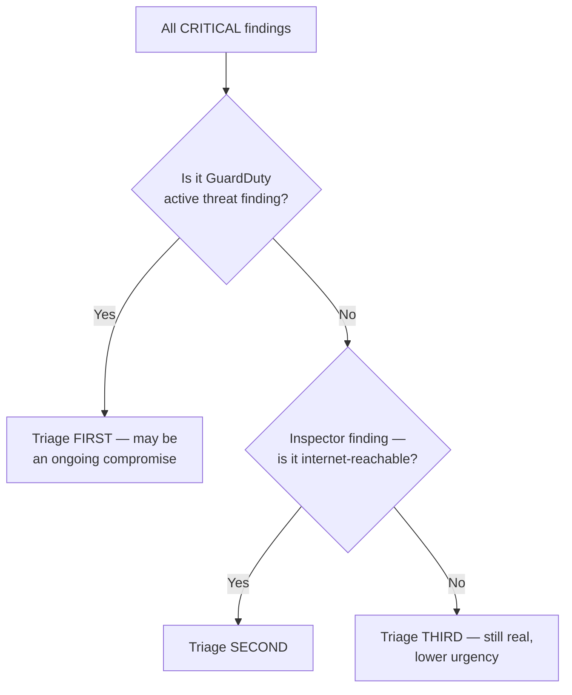

# AWS Security Hub & Amazon Inspector

> **Appears in:** [DVA-C03](../../certifications/dva-c03/README.md) · [SAA-C03](../../certifications/saa-c03/README.md)


## Definition

**Security Hub** is a central dashboard that aggregates security findings from GuardDuty,
Macie, Inspector, IAM Access Analyzer, Firewall Manager, and third-party security tools into
one place, and continuously checks your account against security standards/best practices.
**Amazon Inspector** is an automated **vulnerability scanner** that checks EC2 instances,
container images in ECR, and Lambda functions for known software vulnerabilities (CVEs) and
network reachability issues. They're documented together because they're the natural
"detect weaknesses (Inspector) → see everything in one place (Security Hub)" pairing, but they
are two separate services.

## Purpose

A mature AWS environment quickly accumulates findings from many different security tools, each
with its own console, its own finding format, and its own alert fatigue risk — nobody can
realistically watch five separate dashboards. Security Hub exists to be the **single pane of
glass**: one normalized finding format (AWS Security Finding Format, ASFF — evolving toward the
industry-standard Open Cybersecurity Schema Framework, OCSF, in newer Security Hub versions),
one place to see severity-ranked issues across every security service and every account in an
Organization, and one place to check compliance posture against recognized standards (CIS AWS
Foundations, PCI-DSS, NIST, AWS Foundational Security Best Practices). Inspector exists because
"did we patch this known vulnerability" is a continuous, moving target — new CVEs are published
constantly, and manually tracking which of your EC2 instances/containers/Lambda functions run
vulnerable package versions doesn't scale.

## How It Works



Step by step:

1. **Inspector** continuously (not just once) scans enabled resources: EC2 instances
   (via SSM, no separate agent to install if SSM is already present), container images in ECR
   (scanned on push, and automatically **rescanned** when a new CVE is published that affects
   an existing image, even if the image itself hasn't changed), and Lambda function code/layers.
2. Each scan produces findings with a **CVSS-based severity score**, which package/line
   introduced the vulnerability, and — for EC2 — whether the vulnerable service is actually
   **network-reachable from the internet**, which Inspector factors into prioritization (an
   internet-reachable critical vulnerability is a very different priority than the same CVE on
   an isolated internal instance).
3. **Security Hub** ingests findings from Inspector, GuardDuty, Macie, IAM Access Analyzer,
   Firewall Manager, and supported third-party tools, normalizing them all into a common schema
   so they're comparable and filterable in one dashboard.
4. Independently of ingested findings, Security Hub runs its own **continuous configuration
   checks** against selected security standards (CIS AWS Foundations Benchmark, PCI-DSS, NIST
   800-53, AWS Foundational Security Best Practices) and reports a compliance score.
5. Every finding (ingested or Security-Hub-native) can trigger an **EventBridge** event for
   automated remediation (a Lambda function that fixes the underlying misconfiguration) or
   routes into a ticketing/SOAR system for human follow-up.

### Official AWS architecture: Security Tooling account security services


*Source: AWS Prescriptive Guidance, "Security Reference Architecture — Security OU, Security
Tooling account"
(docs.aws.amazon.com/prescriptive-guidance/latest/security-reference-architecture/security-tooling.html)*

### Exposure findings — Security Hub's correlation capability



Newer Security Hub versions go beyond simple aggregation into **correlation** — specifically
combining posture-management findings (a resource is misconfigured) with vulnerability findings
(that same resource runs vulnerable software) into a single "exposure" finding ranked more
urgently than either signal alone would be, mirroring the same "content + exposure together"
prioritization philosophy used elsewhere in this category (see Macie's IAM Access Analyzer
correlation pattern).

### Inspector continuous rescan trigger — the "clean today, flagged tomorrow" pattern



## Key Features / Components — Security Hub

- **ASFF / OCSF finding normalization** — the common schema every integrated finding is
  normalized into, enabling cross-service filtering/correlation; newer Security Hub versions
  are migrating toward the industry-standard Open Cybersecurity Schema Framework (OCSF).
- **Security standards/scoring** — CIS AWS Foundations Benchmark, PCI-DSS, NIST 800-53, AWS
  Foundational Security Best Practices — each gives a percentage compliance score per account.
- **Insights** — saved, curated queries across findings (e.g., "all critical findings on
  internet-facing resources") for recurring investigation patterns.
- **Cross-Region, cross-account aggregation** — a delegated administrator account can see
  findings from every member account and every enabled Region in one view.
- **Automated remediation playbooks** — via EventBridge + Lambda (or Systems Manager
  Automation documents), common findings can be auto-remediated without human intervention.
- **Exposure findings (correlation)** — combining posture-management and vulnerability
  (Inspector) findings into a single, more urgently-ranked composite finding.

## Key Features / Components — Inspector

- **Continuous, agentless scanning** — unlike older vulnerability scanners requiring scheduled
  scans and dedicated agents, Inspector v2 scans continuously as new CVEs are published or
  package state changes, using the SSM agent already present on managed instances.
- **EC2 scanning** — OS-level package vulnerability scanning plus **network reachability
  analysis** (can this vulnerable port actually be reached from the internet).
- **ECR container image scanning** — scans on push and automatically rescans existing images
  when new vulnerability intelligence is published, so an image that was "clean" last month
  gets flagged the moment a relevant CVE is disclosed.
- **Lambda code scanning** — scans function code and layers for known vulnerable dependencies.
- **Code Security (newer)** — extends Inspector's scanning into source code repositories
  themselves (before an image is even built), catching vulnerable dependencies earlier in the
  pipeline than image-scan-on-push alone would.
- **Risk-based prioritization** — combines CVSS severity with exploitability and network
  exposure context into an Inspector-specific risk score, so you're not just sorting a flat
  CVE severity list.
- **Delegated administration** — a central Security Tooling account can manage Inspector
  findings and coverage settings across every member account in an Organization.

## Use Cases — When to Use It

- Giving a security team one dashboard instead of five, across potentially hundreds of AWS
  accounts in an Organization.
- Continuously tracking compliance posture against PCI-DSS or CIS benchmarks ahead of an audit,
  with concrete, prioritized remediation items instead of a point-in-time manual checklist.
- Automatically rescanning container images in ECR so a previously "clean" image gets flagged
  the day a new critical CVE affecting one of its packages is published — without rebuilding or
  manually re-scanning anything.
- Prioritizing patch work by combining vulnerability severity with actual internet exposure,
  so the team fixes the critical-and-internet-facing issue before the critical-but-isolated one.
- Catching a vulnerable dependency in a source code repository before it's even built into a
  container image, via Inspector Code Security.

## When NOT to Use It / Alternatives

- **You need the actual threat detection or data classification itself** — Security Hub doesn't
  generate those findings on its own; it aggregates what GuardDuty/Macie/Inspector already
  produce. Enabling Security Hub alone with nothing feeding it gives you an empty dashboard.
- **You need deep, authenticated vulnerability scanning with custom compliance policies beyond
  AWS's supported standards, or scanning of non-AWS/on-prem assets** — consider a third-party
  vulnerability management tool (several integrate findings back into Security Hub via its
  partner ecosystem) alongside Inspector rather than expecting Inspector to cover everything.
- **A single, very small account with only one or two security tools enabled** — the
  aggregation value of Security Hub scales with the number of accounts/tools; a lone developer
  account with just GuardDuty enabled may not need the extra Security Hub layer immediately,
  though it's still useful for the standards/scoring feature alone.

## Common Architectures

### 1. Org-wide Security Hub with full source integration



### 2. CI/CD pipeline with Inspector gating container promotion



### 3. Automated remediation playbook for a common misconfiguration



## Why It's Important

**Real-world weight:** Security operations teams are measured on mean-time-to-detect and
mean-time-to-remediate; fragmented tooling directly worsens both. Continuous vulnerability
scanning (Inspector) closes the gap between "a CVE was published" and "we know we're affected,"
which for internet-facing systems is often measured in hours before active exploitation begins
in the wild.

**Exam weight:**
- **SAA-C03 — Domain 1** references Security Hub and Inspector as part of the broader security
  tooling landscape, typically in scenarios about centralizing findings across a multi-account
  Organization (paired with the delegated-administrator pattern from `organizations-and-scps.md`).
- **DVA-C03 — Domain 2 and Domain 3** reference Inspector specifically for **ECR container
  image scanning** as part of the CI/CD pipeline (new explicit container focus in DVA-C03) —
  developers are expected to know images get scanned on push and continuously rescanned.
- **MLA-C02 — Domain 4** lists continuous security monitoring and vulnerability management as
  part of "Operating, Monitoring, and Securing ML and AI Solutions" — scanning container images
  used for SageMaker custom training/inference containers is directly relevant.

## Limits & Quotas

| Item | Default / Notes |
|---|---|
| Security Hub Insights (saved queries) per account | 100 (soft) |
| Security standards enabled simultaneously | All supported standards can be enabled at once; each adds its own set of continuous checks and cost |
| Custom insight filter complexity | Bounded by the finding schema's supported fields, not an arbitrary query language |
| Inspector EC2 scan cadence | Continuous, triggered by package/state changes — not a fixed daily/weekly schedule |
| Inspector ECR rescan trigger | New CVE intelligence OR image metadata change — not purely time-based |
| Delegated administrator scope | Per-service (GuardDuty, Security Hub, Macie, Inspector each delegated independently) | A single security account is commonly delegated admin for all of them, but this is a configuration choice, not an automatic bundling |

## Pricing Model

- **Security Hub**: billed per security check performed and per finding ingested from other
  services (two separate cost components), with a free trial period per account.
- **Inspector**: billed per resource scanned per month — a per-instance rate for EC2, a
  per-image rate for ECR (covers both initial and ongoing rescans), and a per-function rate for
  Lambda — scaling with how many resources you enable scanning on, not a flat fee.
- See: https://aws.amazon.com/security-hub/pricing/ and
  https://aws.amazon.com/inspector/pricing/ for current numbers.

## Hands-on Lab (Floci)

```bash
# Enable Security Hub and a standard
awslocal securityhub enable-security-hub --enable-default-standards
awslocal securityhub get-enabled-standards

# List findings currently aggregated (empty until a source service produces some —
# generate GuardDuty sample findings first, per guardduty.md's lab, to see them flow in)
awslocal securityhub get-findings

# Create an Insight (saved query) for critical findings
awslocal securityhub create-insight --name "Critical-Open-Findings" \
  --filters '{"SeverityLabel":[{"Value":"CRITICAL","Comparison":"EQUALS"}],"RecordState":[{"Value":"ACTIVE","Comparison":"EQUALS"}]}' \
  --group-by-attribute "ResourceType"

# --- Inspector ---
awslocal inspector2 enable --resource-types EC2 ECR LAMBDA
awslocal inspector2 list-findings
awslocal inspector2 list-coverage   # which resources are actually being scanned
```

### Extended lab: simulating the CI/CD gating pattern

```bash
# Push a container image, then check Inspector's finding status before promoting it
awslocal ecr create-repository --repository-name study-app
# (docker build/push steps happen outside Floci's emulation surface)
awslocal inspector2 list-findings --filter-criteria '{"ecrImageRepositoryName":[{"comparison":"EQUALS","value":"study-app"}]}'

# Gate logic: only promote if no CRITICAL/HIGH findings exist
awslocal inspector2 list-findings --filter-criteria '{"severity":[{"comparison":"EQUALS","value":"CRITICAL"}],"ecrImageRepositoryName":[{"comparison":"EQUALS","value":"study-app"}]}'
```

## Troubleshooting / Common Issues

**"Security Hub dashboard is empty despite known security issues existing":** confirm the
*source* services (GuardDuty, Macie, Inspector, IAM Access Analyzer) are actually enabled —
Security Hub itself generates only its own standards-compliance checks natively; it has nothing
to show from a service that was never turned on.

**"Compliance score dropped sharply after enabling a new standard":** this is expected — each
standard evaluates a different, independent set of checks; enabling PCI-DSS alongside CIS
doesn't inherit CIS's existing pass rate, it runs its own full check suite from scratch.

**"An ECR image flagged as vulnerable hasn't actually changed in months":** this is the correct,
intended behavior of continuous rescanning — new CVE intelligence can flag a previously-clean,
completely unchanged image; the fix is rebuilding with patched dependencies, not assuming
Inspector made an error.

**"Findings from a member account aren't visible in the delegated administrator's Security
Hub":** confirm the specific source service (not just Security Hub itself) has also delegated
administration to the same account, and that the member account has actually accepted
association — delegation is configured per-service, and a gap in just one service's delegation
chain silently excludes its findings from the aggregated view.

## Exam Tips

- **Security Hub aggregates; it doesn't detect on its own** — a question implying Security Hub
  "finds" threats or sensitive data directly is conflating it with GuardDuty/Macie; Security
  Hub's own native contribution is the compliance-standard checks, correlation/exposure
  findings, and the unified dashboard, not primary threat detection itself.
- **Inspector vs. GuardDuty vs. Macie — the recurring three-way distinction** — Inspector =
  known software vulnerabilities (CVEs) before exploitation; GuardDuty = active malicious
  behavior; Macie = sensitive data content/exposure. "CVE," "vulnerability," "patch" in a
  question point to Inspector specifically.
- **Inspector continuously rescans**, it's not a one-time scan-on-push-only tool for ECR — an
  image can go from "clean" to "flagged" without anyone rebuilding it, purely because a new CVE
  was published.
- **Network reachability context** is Inspector's distinguishing prioritization feature over a
  generic CVE scanner — know that it factors "is this actually reachable from the internet"
  into its risk scoring, not just raw CVSS severity.
- **Exposure findings/correlation** are Security Hub's newer value-add beyond simple
  aggregation — combining a misconfiguration with a vulnerability on the same resource into one
  higher-priority finding; a question about "which issue to fix first" among many separate
  findings may be testing recognition of this correlated prioritization.
- **Delegated administrator model is per-service** — a central security account can administer
  GuardDuty, Security Hub, Macie, and Inspector independently; a gap in delegating just one of
  them is a common, testable troubleshooting scenario.
- Tested across **SAA-C03 Domain 1 (30%)**, **DVA-C03 Domain 2/3 (26%/22%)** (container
  scanning specifically), and **MLA-C02 Domain 4 (24%)**.

## Worked exam scenario: prioritizing remediation across hundreds of findings

A Security Hub dashboard shows 40 CRITICAL Inspector findings and 15 CRITICAL GuardDuty
findings simultaneously after a quiet period of security tooling being under-monitored. A junior
analyst wants to know where to start. The correct triage order, reflecting how AWS's own
guidance frames this: **active threats (GuardDuty) before potential weaknesses (Inspector)** —
a GuardDuty finding means something may be happening *right now*, while an Inspector finding
means something *could* be exploited but isn't necessarily being actively exploited yet. Within
Inspector's findings specifically, prioritize by the **combination of CVSS severity and network
reachability** (an internet-reachable critical CVE before an isolated critical CVE), not by raw
CVSS score alone — exactly the distinguishing capability Inspector offers over a generic
vulnerability scanner.



## Worked example: a complete ASFF-style finding (recognizing the schema on sight)

```json
{
  "SchemaVersion": "2018-10-08",
  "Id": "arn:aws:inspector2:us-east-1:111122223333:finding/abc123",
  "ProductArn": "arn:aws:securityhub:us-east-1::product/aws/inspector",
  "GeneratorId": "AWSInspector",
  "AwsAccountId": "111122223333",
  "Types": ["Software and Configuration Checks/Vulnerabilities/CVE"],
  "CreatedAt": "2025-01-15T08:00:00Z",
  "Severity": { "Label": "CRITICAL", "Normalized": 90 },
  "Resources": [
    { "Type": "AwsEc2Instance", "Id": "arn:aws:ec2:us-east-1:111122223333:instance/i-0abc123" }
  ],
  "Compliance": { "Status": "FAILED" },
  "RecordState": "ACTIVE"
}
```

Recognizing this shape — `SchemaVersion`, `ProductArn`, `GeneratorId`, a `Severity` object with
both a `Label` and a `Normalized` numeric score, and a `Resources` array — is itself a minor but
real exam skill: a question may show a finding snippet and ask which service it most likely
originated from purely based on the `GeneratorId`/`Types` fields, without stating it directly.

## Security Hub Standards Comparison — What Each One Actually Checks

| Standard | Focus | Typical trigger for adoption |
|---|---|---|
| CIS AWS Foundations Benchmark | General security hygiene baseline (MFA, logging, IAM basics) | Default starting point for most organizations |
| AWS Foundational Security Best Practices (FSBP) | AWS-specific best practices across all services | AWS's own recommended default alongside CIS |
| PCI-DSS | Payment card data handling | Handling cardholder data |
| NIST 800-53 | US federal/government-aligned controls | Government contracts, FedRAMP-adjacent work |

Enabling multiple standards simultaneously means each one runs its **own independent** check
suite — a resource can pass CIS but fail PCI-DSS (or vice versa) on the very same finding
category, since the specific control requirements and thresholds differ between frameworks even
when they're checking conceptually similar things.

## Further Reading

- AWS Security Hub User Guide — What is AWS Security Hub?:
  https://docs.aws.amazon.com/securityhub/latest/userguide/what-is-securityhub-v2.html
- Amazon Inspector User Guide — What is Amazon Inspector?:
  https://docs.aws.amazon.com/inspector/latest/user/what-is-inspector.html
- Amazon Inspector User Guide — Integration with AWS Security Hub:
  https://docs.aws.amazon.com/inspector/latest/user/securityhub-integration.html
- AWS Prescriptive Guidance — Security Reference Architecture, Security Tooling account:
  https://docs.aws.amazon.com/prescriptive-guidance/latest/security-reference-architecture/security-tooling.html
- AWS Solutions Library — Automated Security Response on AWS:
  https://docs.aws.amazon.com/solutions/latest/automated-security-response-on-aws/architecture-overview.html
- AWS Security Hub pricing: https://aws.amazon.com/security-hub/pricing/
- Amazon Inspector pricing: https://aws.amazon.com/inspector/pricing/

## Related Terms

- [`guardduty.md`](guardduty.md) — behavioral threat findings that flow into Security Hub
- [`macie.md`](macie.md) — sensitive data findings that flow into Security Hub
- [`organizations-and-scps.md`](organizations-and-scps.md) — the delegated-administrator, org-wide model both services use
- [`iam.md`](iam.md) — IAM Access Analyzer findings also flow into Security Hub
- `glossary/` — ASFF, OCSF, CVE, CVSS, CIS Benchmark, delegated administrator
