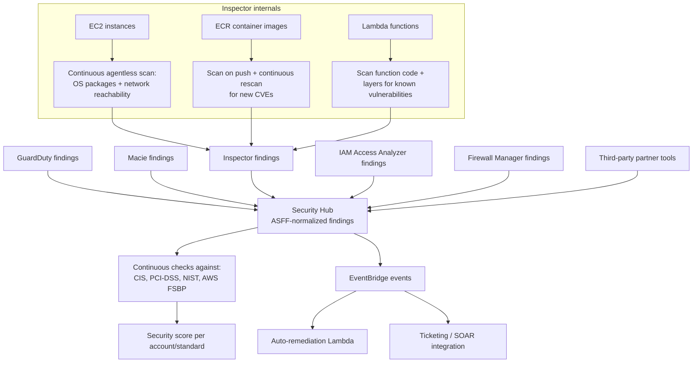

# AWS Security Hub & Amazon Inspector


## Definition

**Security Hub** is a central dashboard that aggregates security findings from GuardDuty,
Macie, Inspector, IAM Access Analyzer, Firewall Manager, and third-party security tools into
one place, and continuously checks your account against security standards/best practices.
**Amazon Inspector** is an automated **vulnerability scanner** that checks EC2 instances,
container images in ECR, and Lambda functions for known software vulnerabilities (CVEs) and
network reachability issues. They're documented together because they're the natural
"detect weaknesses (Inspector) → see everything in one place (Security Hub)" pairing, but they
are two separate services.

## Purpose

A mature AWS environment quickly accumulates findings from many different security tools, each
with its own console, its own finding format, and its own alert fatigue risk — nobody can
realistically watch five separate dashboards. Security Hub exists to be the **single pane of
glass**: one normalized finding format (AWS Security Finding Format, ASFF), one place to see
severity-ranked issues across every security service and every account in an Organization, and
one place to check compliance posture against recognized standards (CIS AWS Foundations, PCI-
DSS, NIST, AWS Foundational Security Best Practices). Inspector exists because "did we patch
this known vulnerability" is a continuous, moving target — new CVEs are published constantly,
and manually tracking which of your EC2 instances/containers/Lambda functions run vulnerable
package versions doesn't scale.

## How It Works



Step by step:

1. **Inspector** continuously (not just once) scans enabled resources: EC2 instances
   (via SSM, no separate agent to install if SSM is already present), container images in ECR
   (scanned on push, and automatically **rescanned** when a new CVE is published that affects
   an existing image, even if the image itself hasn't changed), and Lambda function code/layers.
2. Each scan produces findings with a **CVSS-based severity score**, which package/line
   introduced the vulnerability, and — for EC2 — whether the vulnerable service is actually
   **network-reachable from the internet**, which Inspector factors into prioritization (an
   internet-reachable critical vulnerability is a very different priority than the same CVE on
   an isolated internal instance).
3. **Security Hub** ingests findings from Inspector, GuardDuty, Macie, IAM Access Analyzer,
   Firewall Manager, and supported third-party tools, normalizing them all into the same **AWS
   Security Finding Format (ASFF)** so they're comparable and filterable in one dashboard.
4. Independently of ingested findings, Security Hub runs its own **continuous configuration
   checks** against selected security standards (CIS AWS Foundations Benchmark, PCI-DSS, NIST
   800-53, AWS Foundational Security Best Practices) and reports a compliance score.
5. Every finding (ingested or Security-Hub-native) can trigger an **EventBridge** event for
   automated remediation (a Lambda function that fixes the underlying misconfiguration) or
   routes into a ticketing/SOAR system for human follow-up.

## Key Features / Components — Security Hub

- **ASFF (AWS Security Finding Format)** — the common schema every integrated finding is
  normalized into, enabling cross-service filtering/correlation.
- **Security standards/scoring** — CIS AWS Foundations Benchmark, PCI-DSS, NIST 800-53, AWS
  Foundational Security Best Practices — each gives a percentage compliance score per account.
- **Insights** — saved, curated queries across findings (e.g., "all critical findings on
  internet-facing resources") for recurring investigation patterns.
- **Cross-Region, cross-account aggregation** — a delegated administrator account can see
  findings from every member account and every enabled Region in one view.
- **Automated remediation playbooks** — via EventBridge + Lambda (or Systems Manager
  Automation documents), common findings can be auto-remediated without human intervention.

## Key Features / Components — Inspector

- **Continuous, agentless scanning** — unlike older vulnerability scanners requiring scheduled
  scans and dedicated agents, Inspector v2 scans continuously as new CVEs are published or
  package state changes, using the SSM agent already present on managed instances.
- **EC2 scanning** — OS-level package vulnerability scanning plus **network reachability
  analysis** (can this vulnerable port actually be reached from the internet).
- **ECR container image scanning** — scans on push and automatically rescans existing images
  when new vulnerability intelligence is published, so an image that was "clean" last month
  gets flagged the moment a relevant CVE is disclosed.
- **Lambda code scanning** — scans function code and layers for known vulnerable dependencies.
- **Risk-based prioritization** — combines CVSS severity with exploitability and network
  exposure context into an Inspector-specific risk score, so you're not just sorting a flat
  CVE severity list.

## Use Cases — When to Use It

- Giving a security team one dashboard instead of five, across potentially hundreds of AWS
  accounts in an Organization.
- Continuously tracking compliance posture against PCI-DSS or CIS benchmarks ahead of an audit,
  with concrete, prioritized remediation items instead of a point-in-time manual checklist.
- Automatically rescanning container images in ECR so a previously "clean" image gets flagged
  the day a new critical CVE affecting one of its packages is published — without rebuilding or
  manually re-scanning anything.
- Prioritizing patch work by combining vulnerability severity with actual internet exposure,
  so the team fixes the critical-and-internet-facing issue before the critical-but-isolated one.

## When NOT to Use It / Alternatives

- **You need the actual threat detection or data classification itself** — Security Hub doesn't
  generate those findings on its own; it aggregates what GuardDuty/Macie/Inspector already
  produce. Enabling Security Hub alone with nothing feeding it gives you an empty dashboard.
- **You need deep, authenticated vulnerability scanning with custom compliance policies beyond
  AWS's supported standards, or scanning of non-AWS/on-prem assets** — consider a third-party
  vulnerability management tool (several integrate findings back into Security Hub via its
  partner ecosystem) alongside Inspector rather than expecting Inspector to cover everything.
- **A single, very small account with only one or two security tools enabled** — the
  aggregation value of Security Hub scales with the number of accounts/tools; a lone developer
  account with just GuardDuty enabled may not need the extra Security Hub layer immediately,
  though it's still useful for the standards/scoring feature alone.

## Why It's Important

**Real-world weight:** Security operations teams are measured on mean-time-to-detect and
mean-time-to-remediate; fragmented tooling directly worsens both. Continuous vulnerability
scanning (Inspector) closes the gap between "a CVE was published" and "we know we're affected,"
which for internet-facing systems is often measured in hours before active exploitation begins
in the wild.

**Exam weight:**
- **SAA-C03 — Domain 1** references Security Hub and Inspector as part of the broader security
  tooling landscape, typically in scenarios about centralizing findings across a multi-account
  Organization (paired with the delegated-administrator pattern from `organizations-and-scps.md`).
- **DVA-C03 — Domain 2 and Domain 3** reference Inspector specifically for **ECR container
  image scanning** as part of the CI/CD pipeline (new explicit container focus in DVA-C03) —
  developers are expected to know images get scanned on push and continuously rescanned.
- **MLA-C02 — Domain 4** lists continuous security monitoring and vulnerability management as
  part of "Operating, Monitoring, and Securing ML and AI Solutions" — scanning container images
  used for SageMaker custom training/inference containers is directly relevant.

## Pricing Model

- **Security Hub**: billed per security check performed and per finding ingested from other
  services (two separate cost components), with a free trial period per account.
- **Inspector**: billed per resource scanned per month — a per-instance rate for EC2, a
  per-image rate for ECR (covers both initial and ongoing rescans), and a per-function rate for
  Lambda — scaling with how many resources you enable scanning on, not a flat fee.
- See: https://aws.amazon.com/security-hub/pricing/ and
  https://aws.amazon.com/inspector/pricing/ for current numbers.

## Hands-on Lab (Floci)

```bash
# Enable Security Hub and a standard
awslocal securityhub enable-security-hub --enable-default-standards
awslocal securityhub get-enabled-standards

# List findings currently aggregated (empty until a source service produces some —
# generate GuardDuty sample findings first, per guardduty.md's lab, to see them flow in)
awslocal securityhub get-findings

# Create an Insight (saved query) for critical findings
awslocal securityhub create-insight --name "Critical-Open-Findings" \
  --filters '{"SeverityLabel":[{"Value":"CRITICAL","Comparison":"EQUALS"}],"RecordState":[{"Value":"ACTIVE","Comparison":"EQUALS"}]}' \
  --group-by-attribute "ResourceType"

# --- Inspector ---
awslocal inspector2 enable --resource-types EC2 ECR LAMBDA
awslocal inspector2 list-findings
awslocal inspector2 list-coverage   # which resources are actually being scanned
```

## Exam Tips

- **Security Hub aggregates; it doesn't detect on its own** — a question implying Security Hub
  "finds" threats or sensitive data directly is conflating it with GuardDuty/Macie; Security
  Hub's own native contribution is the compliance-standard checks and the unified dashboard/
  ASFF normalization, not threat detection itself.
- **Inspector vs. GuardDuty vs. Macie — the recurring three-way distinction** — Inspector =
  known software vulnerabilities (CVEs) before exploitation; GuardDuty = active malicious
  behavior; Macie = sensitive data content/exposure. "CVE," "vulnerability," "patch" in a
  question point to Inspector specifically.
- **Inspector continuously rescans**, it's not a one-time scan-on-push-only tool for ECR — an
  image can go from "clean" to "flagged" without anyone rebuilding it, purely because a new CVE
  was published.
- **Network reachability context** is Inspector's distinguishing prioritization feature over a
  generic CVE scanner — know that it factors "is this actually reachable from the internet"
  into its risk scoring, not just raw CVSS severity.
- **Delegated administrator model** applies here too, same as GuardDuty/Macie — a central
  security account can administer Security Hub across an Organization without being the
  management account.
- Tested across **SAA-C03 Domain 1 (30%)**, **DVA-C03 Domain 2/3 (26%/22%)** (container
  scanning specifically), and **MLA-C02 Domain 4 (24%)**.

## Related Terms

- [`guardduty.md`](guardduty.md) — behavioral threat findings that flow into Security Hub
- [`macie.md`](macie.md) — sensitive data findings that flow into Security Hub
- [`organizations-and-scps.md`](organizations-and-scps.md) — the delegated-administrator, org-wide model both services use
- [`iam.md`](iam.md) — IAM Access Analyzer findings also flow into Security Hub
- `glossary/` — ASFF, CVE, CVSS, CIS Benchmark, delegated administrator
