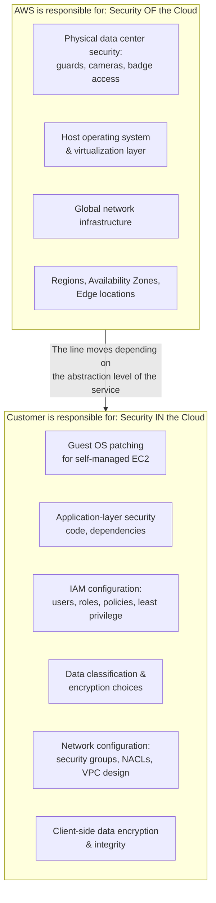

# The AWS Shared Responsibility Model — Deep Dive


## Definition

The Shared Responsibility Model is the foundational rule that defines **what AWS secures versus
what you, the customer, must secure**, when you use any AWS service. It is not a specific
service — it's the conceptual contract underneath every single security decision in this
category, and every other doc in this folder is, in some sense, "how a customer fulfills their
half of this model."

## Purpose

Before cloud computing, "who's responsible for security" was simple: you owned the data center,
so you owned all of it, top to bottom. The cloud fundamentally splits that ownership between
AWS and the customer, and without a clearly defined line, both over-trust ("AWS secures
everything, I don't need to think about it") and under-trust ("I can't trust AWS with
anything, I must control the physical hardware myself") lead to real, costly mistakes. AWS
publishes this model explicitly so customers know exactly which security tasks are genuinely
AWS's job (and therefore already handled) and which are genuinely theirs (and therefore their
liability if skipped).

## How It Works



Step by step — **the line moves depending on how managed the service is**, which is the part
most people get wrong by memorizing a flat split instead of understanding the sliding scale:

1. For **infrastructure services** like EC2, you're closest to "traditional" responsibility:
   AWS secures the physical hardware, the hypervisor, and the facilities; **you** are
   responsible for the guest operating system (patching, configuration), any software you
   install, your network configuration (security groups, NACLs, VPC routing), your IAM setup,
   and your data (encryption, classification, backup).
2. For **managed services** like RDS, AWS takes over more: it patches the underlying database
   engine's OS and manages the database software's patching cadence (within your maintenance
   window); **you** still own schema-level security, database user/credential management,
   network access control to the instance, and your data's encryption settings.
3. For **serverless/abstracted services** like Lambda, S3, or DynamoDB, AWS's share grows even
   further: it manages the entire underlying compute/OS/scaling; **you** are responsible for
   your function code's security, your IAM permissions governing who can invoke/access it, and
   your data's encryption and access policies.
4. **Regardless of abstraction level, a fixed set of things are always the customer's job**:
   IAM configuration (who can do what), data classification and encryption choices, client-side
   encryption if you add it, network traffic protection configuration (even if AWS secures the
   underlying network fabric, you still configure security groups/NACLs/VPC design), and
   operating system/network/firewall configuration for anything you manage yourself.
5. **A fixed set of things are always AWS's job, no matter the service**: physical security of
   data centers, the global network infrastructure backbone, the host OS and virtualization
   layer for managed services, and maintaining the infrastructure that provides the published
   service availability.

## Key Features / Components

- **"Security OF the cloud" (AWS's half)** — physical facilities, hardware, global network,
  the virtualization layer, and for managed services, the underlying software stack AWS
  operates on your behalf.
- **"Security IN the cloud" (the customer's half)** — everything you configure, install, or put
  data into: IAM, OS patching (where applicable), network configuration, application code,
  data encryption, and data classification.
- **AWS Compliance Programs / AWS Artifact** — AWS undergoes third-party audits (SOC 1/2/3, ISO
  27001, PCI-DSS, FedRAMP, HIPAA eligibility, etc.) and makes these audit reports available
  on-demand via **AWS Artifact**, which is how customers get evidence of AWS's half of the model
  being fulfilled without having to audit AWS's data centers themselves.
- **The sliding scale by service category** — IaaS (EC2, EBS) = most customer responsibility;
  PaaS/managed (RDS, ElastiCache) = shared, moderate customer responsibility; fully managed/
  serverless (Lambda, S3, DynamoDB, Bedrock) = least customer responsibility, but **never
  zero** — IAM and data-level decisions remain yours in every single case.
- **Shared Responsibility for AI/ML specifically** — a newer, explicitly called-out nuance:
  for a foundation model consumed via Amazon Bedrock, AWS secures the model-hosting
  infrastructure, but the customer is still responsible for the prompts/data sent to the model,
  IAM access to invoke it, and any fine-tuning data's sensitivity — directly relevant to
  MLA-C02's GenAI additions.

## Use Cases — When to Use It (as a design principle)

- Deciding whether a security finding/incident is "our fault" or "AWS's fault" during a
  postmortem — almost every real-world breach traced through this model lands on the customer's
  half (a misconfigured S3 bucket, an over-broad IAM policy, an unpatched guest OS), not AWS's.
- Choosing between EC2 (full OS control, full OS responsibility) and a managed alternative
  (Fargate, Lambda, RDS) specifically to shrink your own half of the responsibility surface
  when you don't need that level of control.
- Justifying, to an auditor or compliance team, exactly which controls are already satisfied by
  AWS's own compliance certifications (via AWS Artifact) versus which controls your organization
  must separately implement and prove.

## When NOT to Use It / Alternatives

- There's no "alternative" to the Shared Responsibility Model — it's not optional and it's not
  a service you can turn off; it describes reality regardless of which AWS services you pick.
  The only thing you influence is **how much falls on your side**, by choosing more or less
  abstracted/managed services.
- **Don't treat "AWS is responsible for security of the cloud" as "I don't need to think about
  security at all"** — this is the single most dangerous misreading of the model, and it's
  exactly the misunderstanding every exam question in this topic is designed to catch you on.

## Why It's Important

**Real-world weight:** Virtually every well-known cloud data breach in the last decade was a
customer-side failure under this model — a publicly exposed S3 bucket, an overly permissive
IAM role, an unpatched EC2 instance's OS — not a failure of AWS's underlying infrastructure.
Understanding exactly where the line falls is the difference between correctly allocating
security effort and either wasting it (duplicating what AWS already guarantees) or dangerously
skipping it (assuming AWS covers something it explicitly doesn't).

**Exam weight — this concept underlies every security question across all three certs, even
when not named directly:**
- **SAA-C03 — Domain 1 "Design Secure Architectures" (30%)** is, structurally, almost entirely
  about correctly exercising the customer's half of this model (Task 1.1 access design, Task
  1.2 workload security, Task 1.3 data security controls) — it's the single conceptual anchor
  for the entire highest-weighted domain in the cert.
- **DVA-C03 — Domain 2 "Security" (26%)**, especially the new **Task 2.3** on AI service
  integration risk, is directly built on the model's extension into GenAI: knowing that using
  Bedrock doesn't absolve you of controlling what data goes into prompts or who can invoke the
  model.
- **MLA-C02 — Domain 4 "Operating, Monitoring, and Securing ML and AI Solutions" (24%)**
  explicitly tests the model's application to ML infrastructure: SageMaker/Bedrock's hosting
  layer is AWS's responsibility, but training data sensitivity, IAM least privilege for
  pipelines, and model/endpoint access control are squarely the customer's.
- It is one of AWS's own most-repeated teaching concepts across **every** associate-level exam
  guide and whitepaper — expect at least one direct definitional question ("which of these is
  AWS's responsibility vs. the customer's") on every exam.

## Pricing Model

Not applicable — this is a conceptual framework, not a billable service. Its practical cost
impact is indirect: choosing more AWS-managed services shrinks your team's operational security
burden (and therefore headcount/effort cost) at the expense of less infrastructure control, and
vice versa for more self-managed, IaaS-level services.

## Hands-on Lab (Floci)

There's no API to "configure" the Shared Responsibility Model — the practical lab here is
**contrasting two services that sit at different points on the sliding scale** and noticing
exactly which security tasks Floci's local emulation still leaves entirely to you either way:

```bash
# EC2 (IaaS end of the scale): you are responsible for the guest OS, patching,
# security group rules, and anything running inside the instance.
awslocal ec2 run-instances --image-id ami-00000000 --instance-type t3.micro
awslocal ec2 create-security-group --group-name study-sg --description "lab"
awslocal ec2 authorize-security-group-ingress --group-name study-sg \
  --protocol tcp --port 22 --cidr 203.0.113.0/24   # YOUR job: scope this tightly, not 0.0.0.0/0

# DynamoDB (fully managed end of the scale): no OS, no patching, no servers to secure —
# but IAM policy correctness and encryption choice are STILL entirely your responsibility.
awslocal dynamodb create-table --table-name StudyTable \
  --attribute-definitions AttributeName=id,AttributeType=S \
  --key-schema AttributeName=id,KeyType=HASH \
  --billing-mode PAY_PER_REQUEST \
  --sse-specification Enabled=true,SSEType=KMS   # YOUR job: choose to enable this
```

Notice both commands still required a *deliberate customer security decision* (the CIDR scope,
the SSE/KMS flag) — illustrating that no matter how managed the service, the customer's half of
the model never disappears, it only shrinks in scope.

## Exam Tips

- **"Security OF the cloud" = AWS. "Security IN the cloud" = customer.** This exact phrasing
  appears verbatim in AWS's own materials and is often quoted directly in exam questions —
  memorize it precisely.
- **The split is a sliding scale, not a fixed 50/50** — EC2 leaves you with much more
  responsibility (guest OS, patching) than Lambda or DynamoDB does; a question contrasting two
  service choices is testing whether you know the responsibility split moves with the service's
  abstraction level, not that it's static.
- **IAM, data classification, and encryption choices are ALWAYS the customer's job**, no matter
  which service — these never shift to AWS's side regardless of how "managed" the service is.
  This is the most commonly tested specific fact in this topic.
- **Physical data center security and the underlying host/hypervisor are ALWAYS AWS's job** —
  customers never get physical access to AWS data centers, and this is non-negotiable across
  every service tier.
- **AWS Artifact** is the specific, named tool for retrieving AWS's own compliance reports
  (SOC 2, ISO 27001, PCI-DSS attestations) — a question about "how do I get evidence AWS meets
  compliance standard X" points to Artifact, not to manually auditing AWS.
- **GenAI-specific nuance (new for DVA-C03/MLA-C02)**: using a managed foundation model via
  Bedrock still leaves prompt/data content, access control, and guardrail configuration on the
  customer's side — a question implying "Bedrock handles all AI security" is wrong.
- This concept is **foundational across all three certs simultaneously** — it's arguably the
  single idea most likely to appear, in some form, on every one of SAA-C03, DVA-C03, and
  MLA-C02.

## Related Terms

- [`iam.md`](iam.md) — the single biggest concrete customer-side responsibility
- [`kms.md`](kms.md) — encryption choice is always the customer's decision, even though KMS's HSMs are AWS-operated
- [`organizations-and-scps.md`](organizations-and-scps.md) — org-wide enforcement of customer-side responsibilities at scale
- `00-fundamentals/aws-global-infrastructure.md` — the physical/network layer that is entirely AWS's responsibility
- `glossary/` — compliance program, AWS Artifact, SOC 2, ISO 27001
