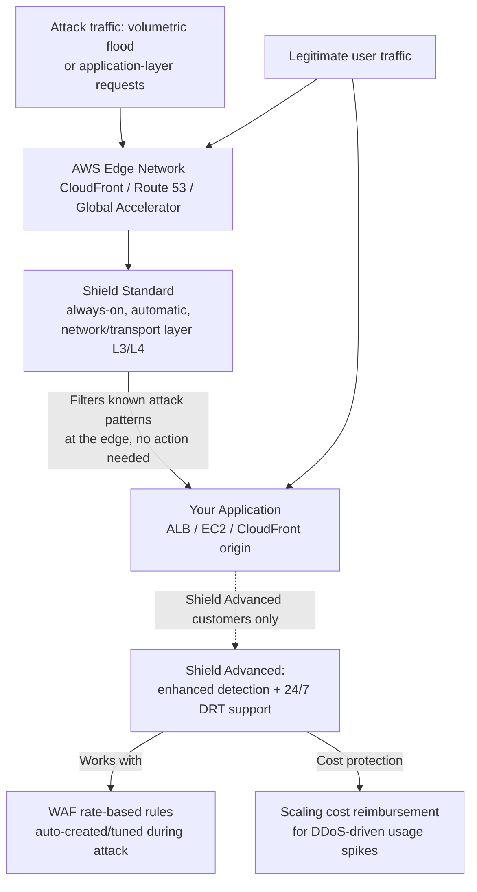
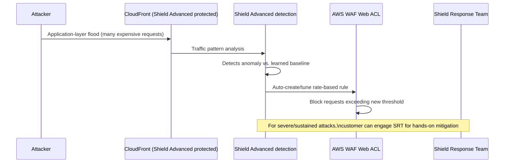
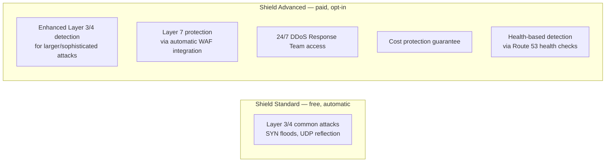
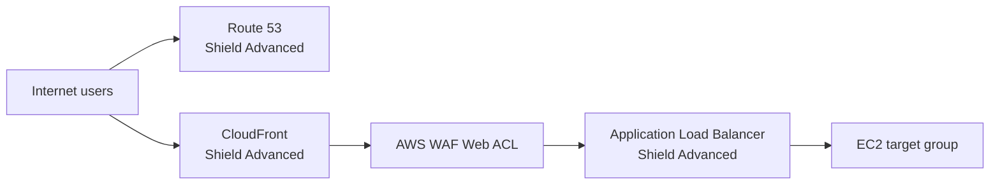
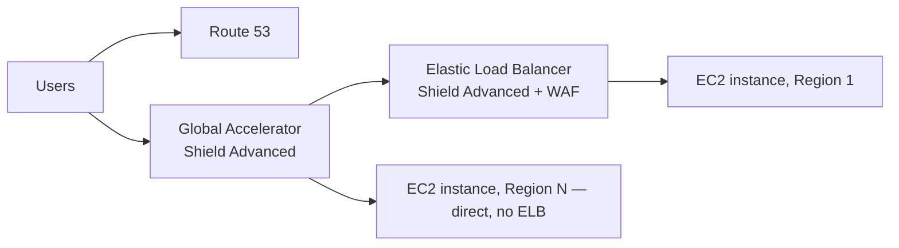
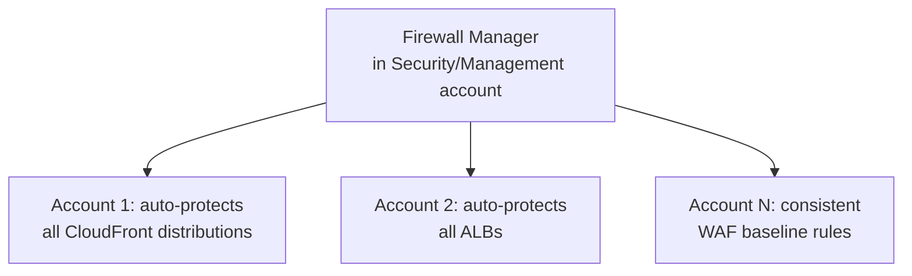
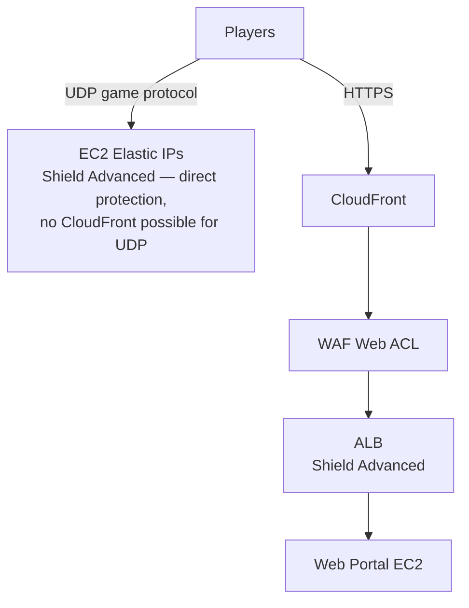
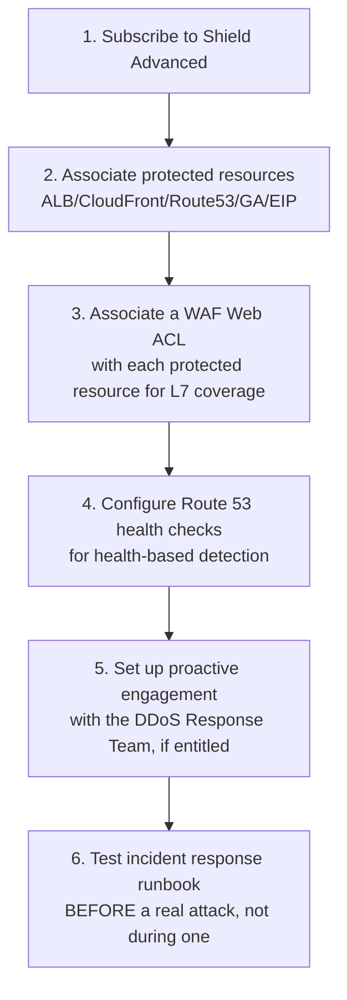
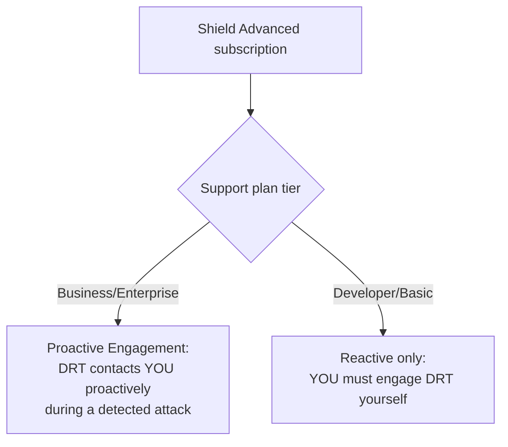

# AWS Shield (Standard & Advanced)


## Definition

Shield is AWS's managed **Distributed Denial of Service (DDoS) protection** service. It
continuously monitors traffic to detect and automatically mitigate attacks aimed at
overwhelming your application with traffic volume or exhausting its resources, so legitimate
users can keep reaching your service during an attack.

## Purpose

A DDoS attack doesn't try to breach your data — it tries to make your service unusable by
flooding it with more traffic/requests than it (or the infrastructure in front of it) can
handle, whether that's a brute-force volumetric flood (terabits of garbage traffic) or a more
surgical application-layer attack (millions of expensive, legitimate-looking HTTP requests).
Shield exists because defending against this at AWS's network scale is something individual
customers can't replicate themselves — AWS's global network capacity and automated mitigation
systems can absorb and filter attack traffic that would overwhelm almost anyone's own
infrastructure.

## How It Works



Step by step:

1. **Shield Standard is automatically active on every AWS account, for free, with no
   configuration** — it protects against the most common network and transport layer (Layer 3/
   Layer 4) DDoS attacks (SYN floods, UDP reflection attacks) for any resource using AWS edge
   services (CloudFront, Route 53, Global Accelerator) automatically, and extends baseline
   protection to any AWS resource.
2. Traffic enters through AWS's edge network, where Shield's always-on detection systems
   continuously baseline normal traffic patterns and automatically identify/filter obviously
   malicious volumetric patterns before they ever reach your application — no manual
   intervention, no extra subscription needed for this baseline layer.
3. **Shield Advanced** (a paid, opt-in tier) adds: enhanced detection for larger and more
   sophisticated attacks, near-real-time visibility into attack details via the Shield console,
   and automatic application-layer protection by integrating with **AWS WAF** — Shield Advanced
   can automatically create and tune WAF rate-based rules in response to a detected
   application-layer attack pattern.
4. Shield Advanced customers get access to the **AWS Shield Response Team (SRT)**, a 24/7 team
   you can engage during an active attack for hands-on mitigation help, and a **cost protection
   guarantee** — if an attack causes usage-based services (EC2, CloudFront, Route 53) to scale
   up and inflate your bill, AWS credits back those DDoS-attributable charges.

### Official AWS reference architecture: DDoS-resilient web application


*Source: AWS WAF Developer Guide, "Example Shield Advanced DDoS resiliency architecture for
common web applications"
(docs.aws.amazon.com/waf/latest/developerguide/ddos-resiliency-example-web.html)*

This is AWS's own published reference architecture for maximizing DDoS resilience: insert
Route 53 and CloudFront **in front of** the actual compute layer (ELB + EC2), protect both edge
services with Shield Advanced, and pair CloudFront with a WAF Web ACL. The key insight is that
Shield Advanced protects the edge resources (Route 53 hosted zones, CloudFront distributions),
not the origin directly — the origin benefits by being shielded *behind* already-protected edge
infrastructure, rather than being directly exposed to the internet.

### Shield Advanced automatic WAF rate-based rule creation during an attack



### Shield Standard vs. Advanced — protection surface comparison



## Key Features / Components

- **Shield Standard** — free, automatic, always-on for every AWS account; protects against
  common network/transport-layer (L3/L4) DDoS attacks.
- **Shield Advanced** — paid subscription; adds enhanced/application-layer (L7) DDoS detection,
  deeper visibility, automatic WAF integration for attack mitigation, 24/7 DDoS Response Team
  access, and cost protection for attack-driven scaling charges.
- **DDoS Response Team (DRT)** — Shield Advanced customers can grant the DRT access to assist
  during an active attack, including making emergency WAF rule changes on your behalf if
  authorized.
- **Health-based detection** — Shield Advanced can integrate with Route 53 health checks to
  more accurately distinguish an actual attack from a legitimate traffic spike (e.g., a
  marketing campaign going viral shouldn't be auto-mitigated as an attack).
- **AWS Firewall Manager integration** — centrally deploy and enforce Shield Advanced
  protections (and WAF rules) across many accounts/resources in an Organization from one place.
- **Cost protection** — Shield Advanced's SLA-backed guarantee to credit scaling charges caused
  specifically by a DDoS event.
- **Protected resource types** — Shield Advanced can protect CloudFront distributions, Route 53
  hosted zones, Global Accelerator accelerators, Elastic Load Balancers, and Elastic IP
  addresses attached to EC2 instances — a specific list worth memorizing, since Shield Advanced
  cannot protect arbitrary resource types outside this set.
- **Global threat environment dashboard** — Shield Advanced customers get visibility into
  broader DDoS trends/threat landscape data, not just attacks against their own resources.

## Use Cases — When to Use It

- Any public-facing website or API automatically benefits from Shield Standard with zero setup
  — this is simply always on.
- A business-critical, revenue-generating web application or API where even a short DDoS-caused
  outage is expensive enough to justify Shield Advanced's cost for enhanced protection, 24/7
  expert response, and the billing-spike safety net.
- A gaming company or financial services firm that is a known, frequent DDoS target wants
  Shield Advanced's proactive detection and DRT engagement during active incidents.
- Combining Shield Advanced with WAF for layered defense against both volumetric (L3/L4) and
  application-layer (L7) attacks simultaneously.
- An enterprise with dozens of accounts wants Shield Advanced + WAF enforced consistently
  everywhere via Firewall Manager, without each account team configuring it independently.

## When NOT to Use It / Alternatives

- **Protecting against application-logic exploits** (SQL injection, XSS, bad bots scraping
  content) — that's **WAF**'s job, not Shield's; Shield defends against volume/availability
  attacks, WAF defends against malicious request content. See [`waf.md`](waf.md). In practice
  they're used together, not as alternatives.
- **Low-traffic internal applications with no public exposure** — Shield Standard's baseline is
  already free and automatic, so there's no "opt out," but paying for Shield Advanced on an
  internal-only, low-risk workload usually isn't worth the cost.
- **Detecting/blocking a specific malicious actor's behavior pattern that isn't a DDoS** (e.g.,
  credential stuffing against a login endpoint) — that's more of a **WAF rate-based rule + Cognito
  advanced security** problem than a Shield problem specifically.

## Common Architectures

### 1. Fully layered edge defense for a public web application



### 2. TCP/UDP application protection via Global Accelerator


AWS's own reference pattern notes that even an instance reached directly via Global Accelerator
without a load balancer in front still benefits from the accelerator's own Shield Advanced
protection and the infrastructure-layer mitigation built into the accelerator's edge network.

### 3. Org-wide Shield Advanced + WAF enforcement via Firewall Manager



## Why It's Important

**Real-world weight:** DDoS attacks remain one of the most common attack types against public
internet infrastructure, and they don't require any data breach to cause real business damage
— an e-commerce site unreachable during a sale event, or an API unavailable during a critical
window, directly costs revenue and trust. Shield Standard being free and automatic for
*everyone* is a meaningful baseline the exam expects you to know exists without any
configuration.

**Exam weight:**
- **SAA-C03 — Domain 1, Task 1.2 "Design secure workloads and applications"** lists Shield
  explicitly — questions commonly test whether you know Shield Standard is already active (no
  need to "enable" basic DDoS protection) versus when Shield Advanced's extra capability is
  actually justified by the scenario.
- **DVA-C03** touches Shield lightly, mostly in the context of understanding why an app might
  see automatic WAF rule changes during an attack if Shield Advanced is active.
- **MLA-C02** rarely tests Shield directly, though availability protection for a public-facing
  model inference API is conceptually related to Domain 4's operating/securing objectives.

## Limits & Quotas

| Item | Default / Notes |
|---|---|
| Shield Advanced subscription term | Minimum 1-year commitment, billed monthly | A real, testable contractual detail distinct from most AWS pay-as-you-go pricing |
| Protected resources per subscription | A generous included count, additional resources billed incrementally | Scales with how many CloudFront/ALB/Route 53/Global Accelerator/EIP resources you protect |
| DRT engagement | Requires Shield Advanced + (for proactive engagement) a qualifying Business/Enterprise Support plan | A common exam nuance — Shield Advanced alone doesn't automatically include the highest tier of proactive DRT engagement |
| Health check integration | Tied to Route 53 health check limits | Standard Route 53 health check quotas apply |

## Pricing Model

- **Shield Standard: free**, automatically included for every AWS account, no opt-in needed.
- **Shield Advanced: a real, non-trivial monthly subscription fee** (billed at the
  organization level if enabled org-wide via Firewall Manager) **plus** data transfer out
  charges for protected resources — this is one of the more expensive line items in this
  service category, with a required 1-year commitment.
- See: https://aws.amazon.com/shield/pricing/ for current numbers — the exam reliably tests
  that Standard is free and Advanced is a paid, committed subscription.

## Hands-on Lab (Floci)

DDoS protection is fundamentally an AWS-network-edge capability — there is no way to generate
or meaningfully simulate a real DDoS attack against a local emulator, and Floci does not model
Shield's detection/mitigation behavior. The practical "lab" here is architectural: practice
designing a layered defense and verify the supporting pieces (WAF Web ACL, Route 53 health
checks) that Shield Advanced integrates with:

```bash
# Shield Advanced itself isn't something to "configure" locally — practice the WAF layer
# it integrates with instead (see waf.md for the full WAF lab)
awslocal wafv2 create-web-acl --name study-rate-limit-acl --scope REGIONAL \
  --default-action Allow={} \
  --visibility-config SampledRequestsEnabled=true,CloudWatchMetricsEnabled=true,MetricName=studyAcl \
  --rules '[{"Name":"RateLimitRule","Priority":1,"Action":{"Block":{}},"Statement":{"RateBasedStatement":{"Limit":2000,"AggregateKeyType":"IP"}},"VisibilityConfig":{"SampledRequestsEnabled":true,"CloudWatchMetricsEnabled":true,"MetricName":"rateLimit"}}]'

# Route 53 health check — the signal Shield Advanced uses to distinguish
# a real attack from a legitimate traffic surge
awslocal route53 create-health-check --caller-reference study-hc-1 \
  --health-check-config IPAddress=203.0.113.10,Port=443,Type=HTTPS,ResourcePath=/health
```

### Extended lab: designing the layered architecture checklist

```bash
# Verify every resource in the intended protection chain actually exists and is correctly
# layered — CloudFront in front of the ALB, not the ALB exposed directly
awslocal cloudfront list-distributions
awslocal elbv2 describe-load-balancers
awslocal wafv2 list-web-acls --scope REGIONAL

# Confirm the WAF Web ACL is actually associated with the CloudFront distribution/ALB —
# a Shield Advanced + WAF architecture provides no application-layer benefit if this
# association step was skipped
awslocal wafv2 get-web-acl-for-resource --resource-arn <alb-arn>
```

## Troubleshooting / Common Issues

**"We have Shield Advanced but still see application-layer attack impact":** confirm Shield
Advanced's automatic WAF integration is actually enabled for the specific protected resource,
and that a WAF Web ACL is genuinely associated — Shield Advanced's L7 mitigation works *through*
WAF rule creation/tuning, so a resource with Shield Advanced but no associated Web ACL gets no
meaningful L7 benefit.

**"Cost protection claim was denied":** review the specific SLA terms — cost protection covers
usage-based scaling charges *attributable to a declared DDoS event* on *protected* resources; an
unprotected resource's scaling costs, or cost increases unrelated to an actual DDoS event, fall
outside the guarantee's scope.

**"A legitimate traffic spike (e.g., product launch) was throttled/mitigated as if it were an
attack":** this is specifically what **health-based detection** via Route 53 health checks is
designed to prevent — if it's not configured, Shield Advanced has less context to distinguish a
real spike from an attack pattern purely from traffic shape alone.

## Exam Tips

- **Shield Standard is always on, for free, for every account** — a question implying you need
  to "enable basic DDoS protection" is testing whether you know it's already there by default.
- **Shield vs. WAF** — Shield defends against volume/availability attacks (network/transport
  layer, and with Advanced, some application layer); WAF defends against malicious request
  *content* (SQL injection, XSS, bad bots) at Layer 7. They're complementary, not
  interchangeable — a well-designed answer often includes both together.
- **Shield Advanced's cost protection** is a specific, named, testable feature — if a question
  describes "an attack caused our bill to spike, how do we get that back," Shield Advanced's
  cost protection guarantee is the mechanism, assuming Advanced was already subscribed on the
  affected resources.
- **DRT (DDoS Response Team)** engagement requires Shield Advanced and (often) a qualifying
  support plan tier — know this is a paid-tier benefit, not available to Shield Standard
  customers, and that proactive engagement specifically may need a higher support tier still.
- **Firewall Manager** is how Shield Advanced (and WAF) protections get applied consistently
  across many accounts/resources in an Organization — a multi-account "enforce this everywhere"
  scenario points to Firewall Manager as the orchestration layer.
- **Protected resource types are a fixed list** — CloudFront, Route 53 hosted zones, Global
  Accelerator, ELB, and EC2 Elastic IPs; a question describing protection for an arbitrary
  resource type outside this list should raise suspicion.
- **Health-based detection via Route 53** is the specific mechanism for distinguishing a
  legitimate traffic surge from an attack — a question about false-positive mitigation during a
  viral marketing event points here.
- Tested in **SAA-C03 Domain 1 (30%)**; lighter touches elsewhere.

## Worked exam scenario: choosing the right combination for a gaming company

A gaming company runs a latency-sensitive UDP-based multiplayer backend directly on EC2
instances with Elastic IPs (no load balancer, since the game protocol needs direct UDP access),
and separately a web-based player portal behind an ALB. They've been targeted by DDoS attacks
twice in the past year, each costing real downtime during peak hours.

**Correct architecture:** Shield Advanced on the EC2 Elastic IPs (protecting the latency-sensitive
UDP game servers directly, since they can't be fronted by a Layer-7 service that would add
latency) **and** Shield Advanced + WAF on the ALB fronting the web portal (where Layer 7
inspection is valuable and latency is less critical). A common wrong answer is proposing
CloudFront in front of the UDP game servers — CloudFront is HTTP(S)-only and cannot front
arbitrary UDP traffic, making it structurally incompatible with this specific workload, no
matter how appealing "just put CloudFront in front of everything" sounds as a generic answer.



## Shield Advanced Onboarding Checklist — the sequence that actually matters



Skipping step 3 is the single most common real-world gap: teams subscribe to Shield Advanced
expecting broad protection, without realizing the Layer 7 mitigation specifically depends on an
associated WAF Web ACL — Shield Advanced alone, with no Web ACL, still only delivers enhanced
Layer 3/4 protection, not the application-layer benefit many assume comes bundled by default.

## Cost Protection Guarantee — What It Actually Covers vs. Doesn't

| Covered | Not covered |
|---|---|
| EC2/CloudFront/Route 53 scaling charges directly attributable to a declared DDoS event on a *protected* resource | Scaling charges on an *unprotected* resource in the same account |
| Usage spikes during the attack window with supporting evidence | Charges from unrelated traffic spikes (e.g., a viral marketing campaign, not an attack) |
| Resources explicitly associated with the Shield Advanced subscription | Resources never associated, even if technically eligible resource types |

A scenario describing "we have Shield Advanced on our ALB but the cost spike was actually on an
*unprotected* S3 bucket being hit with GET request floods" is testing whether you recognize
cost protection is scoped strictly to *protected* resources — Shield Advanced doesn't
retroactively cover cost for anything you didn't actually associate it with.

## Worked example: estimating whether Shield Advanced is worth the cost

An e-commerce company does $2M/month in revenue through its site, running on CloudFront + ALB
+ EC2. Last year, two DDoS attacks caused roughly 4 hours of combined downtime. Rough
cost-justification reasoning: 4 hours of downtime against $2M/month revenue (~$2,778/hour
average) represents roughly $11,000 in direct lost-revenue exposure from attacks alone in a
single year — before counting reputational cost, support burden, or the usage-based scaling
charges Shield Advanced's cost protection would have reimbursed. Against Shield Advanced's
real, non-trivial annual subscription commitment, this is a straightforward cost/benefit
calculation any SAA-C03 "should this company subscribe to Shield Advanced" scenario is
implicitly asking you to reason through: weigh the committed subscription cost against the
business's actual demonstrated attack exposure and revenue sensitivity to downtime, not a
blanket "DDoS protection is always worth it" assumption.

## Shield Advanced Proactive Engagement — The Highest Support Tier Feature



A question describing "the DDoS Response Team contacted us before we even noticed the attack"
is specifically describing **Proactive Engagement**, which requires both Shield Advanced and a
qualifying higher-tier AWS Support plan — not a capability automatically included with Shield
Advanced alone regardless of support tier.

## Further Reading

- AWS WAF Developer Guide — Example Shield Advanced DDoS resiliency architecture for common web
  applications:
  https://docs.aws.amazon.com/waf/latest/developerguide/ddos-resiliency-example-web.html
- AWS WAF Developer Guide — Example Shield Advanced DDoS resiliency architecture for TCP and
  UDP applications:
  https://docs.aws.amazon.com/waf/latest/developerguide/ddos-resiliency-example-tcp-udp.html
- AWS Shield Documentation: https://docs.aws.amazon.com/shield/
- AWS Shield pricing: https://aws.amazon.com/shield/pricing/

## Related Terms

- [`waf.md`](waf.md) — the complementary Layer 7 content-filtering defense, often paired with Shield Advanced
- [`security-hub-and-inspector.md`](security-hub-and-inspector.md) — central visibility alongside other security findings
- [`organizations-and-scps.md`](organizations-and-scps.md) — org-wide Shield Advanced/Firewall Manager deployment model
- `glossary/` — DDoS, volumetric attack, Layer 3/4 vs Layer 7, Firewall Manager
