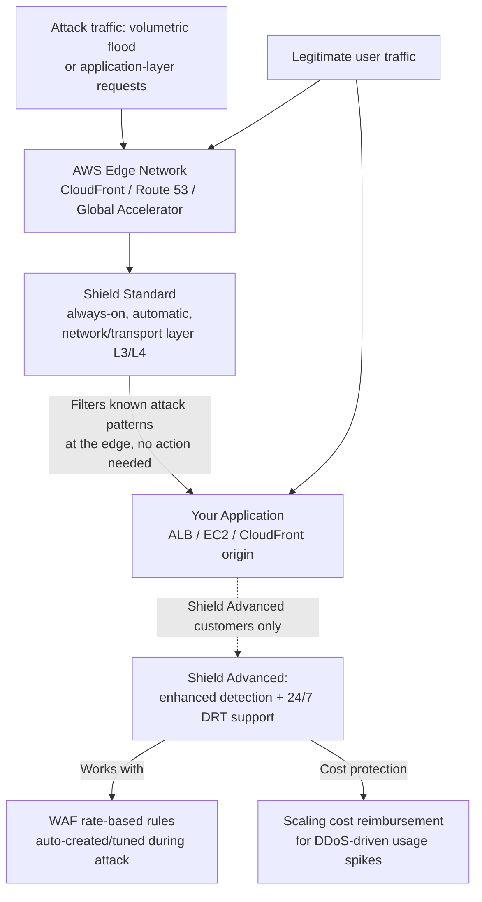

# AWS Shield (Standard & Advanced)


## Definition

Shield is AWS's managed **Distributed Denial of Service (DDoS) protection** service. It
continuously monitors traffic to detect and automatically mitigate attacks aimed at
overwhelming your application with traffic volume or exhausting its resources, so legitimate
users can keep reaching your service during an attack.

## Purpose

A DDoS attack doesn't try to breach your data — it tries to make your service unusable by
flooding it with more traffic/requests than it (or the infrastructure in front of it) can
handle, whether that's a brute-force volumetric flood (terabits of garbage traffic) or a more
surgical application-layer attack (millions of expensive, legitimate-looking HTTP requests).
Shield exists because defending against this at AWS's network scale is something individual
customers can't replicate themselves — AWS's global network capacity and automated mitigation
systems can absorb and filter attack traffic that would overwhelm almost anyone's own
infrastructure.

## How It Works



Step by step:

1. **Shield Standard is automatically active on every AWS account, for free, with no
   configuration** — it protects against the most common network and transport layer (Layer 3/
   Layer 4) DDoS attacks (SYN floods, UDP reflection attacks) for any resource using AWS edge
   services (CloudFront, Route 53, Global Accelerator) automatically, and extends baseline
   protection to any AWS resource.
2. Traffic enters through AWS's edge network, where Shield's always-on detection systems
   continuously baseline normal traffic patterns and automatically identify/filter obviously
   malicious volumetric patterns before they ever reach your application — no manual
   intervention, no extra subscription needed for this baseline layer.
3. **Shield Advanced** (a paid, opt-in tier) adds: enhanced detection for larger and more
   sophisticated attacks, near-real-time visibility into attack details via the Shield console,
   and automatic application-layer protection by integrating with **AWS WAF** — Shield Advanced
   can automatically create and tune WAF rate-based rules in response to a detected
   application-layer attack pattern.
4. Shield Advanced customers get access to the **AWS Shield Response Team (SRT)**, a 24/7 team
   you can engage during an active attack for hands-on mitigation help, and a **cost protection
   guarantee** — if an attack causes usage-based services (EC2, CloudFront, Route 53) to scale
   up and inflate your bill, AWS credits back those DDoS-attributable charges.

## Key Features / Components

- **Shield Standard** — free, automatic, always-on for every AWS account; protects against
  common network/transport-layer (L3/L4) DDoS attacks.
- **Shield Advanced** — paid subscription; adds enhanced/application-layer (L7) DDoS detection,
  deeper visibility, automatic WAF integration for attack mitigation, 24/7 DDoS Response Team
  access, and cost protection for attack-driven scaling charges.
- **DDoS Response Team (DRT)** — Shield Advanced customers can grant the DRT access to assist
  during an active attack, including making emergency WAF rule changes on your behalf if
  authorized.
- **Health-based detection** — Shield Advanced can integrate with Route 53 health checks to
  more accurately distinguish an actual attack from a legitimate traffic spike (e.g., a
  marketing campaign going viral shouldn't be auto-mitigated as an attack).
- **AWS Firewall Manager integration** — centrally deploy and enforce Shield Advanced
  protections (and WAF rules) across many accounts/resources in an Organization from one place.
- **Cost protection** — Shield Advanced's SLA-backed guarantee to credit scaling charges caused
  specifically by a DDoS event.

## Use Cases — When to Use It

- Any public-facing website or API automatically benefits from Shield Standard with zero setup
  — this is simply always on.
- A business-critical, revenue-generating web application or API where even a short DDoS-caused
  outage is expensive enough to justify Shield Advanced's cost for enhanced protection, 24/7
  expert response, and the billing-spike safety net.
- A gaming company or financial services firm that is a known, frequent DDoS target wants
  Shield Advanced's proactive detection and DRT engagement during active incidents.
- Combining Shield Advanced with WAF for layered defense against both volumetric (L3/L4) and
  application-layer (L7) attacks simultaneously.

## When NOT to Use It / Alternatives

- **Protecting against application-logic exploits** (SQL injection, XSS, bad bots scraping
  content) — that's **WAF**'s job, not Shield's; Shield defends against volume/availability
  attacks, WAF defends against malicious request content. See [`waf.md`](waf.md). In practice
  they're used together, not as alternatives.
- **Low-traffic internal applications with no public exposure** — Shield Standard's baseline is
  already free and automatic, so there's no "opt out," but paying for Shield Advanced on an
  internal-only, low-risk workload usually isn't worth the cost.
- **Detecting/blocking a specific malicious actor's behavior pattern that isn't a DDoS** (e.g.,
  credential stuffing against a login endpoint) — that's more of a **WAF rate-based rule + Cognito
  advanced security** problem than a Shield problem specifically.

## Why It's Important

**Real-world weight:** DDoS attacks remain one of the most common attack types against public
internet infrastructure, and they don't require any data breach to cause real business damage
— an e-commerce site unreachable during a sale event, or an API unavailable during a critical
window, directly costs revenue and trust. Shield Standard being free and automatic for
*everyone* is a meaningful baseline the exam expects you to know exists without any
configuration.

**Exam weight:**
- **SAA-C03 — Domain 1, Task 1.2 "Design secure workloads and applications"** lists Shield
  explicitly — questions commonly test whether you know Shield Standard is already active (no
  need to "enable" basic DDoS protection) versus when Shield Advanced's extra capability is
  actually justified by the scenario.
- **DVA-C03** touches Shield lightly, mostly in the context of understanding why an app might
  see automatic WAF rule changes during an attack if Shield Advanced is active.
- **MLA-C02** rarely tests Shield directly, though availability protection for a public-facing
  model inference API is conceptually related to Domain 4's operating/securing objectives.

## Pricing Model

- **Shield Standard: free**, automatically included for every AWS account, no opt-in needed.
- **Shield Advanced: a real, non-trivial monthly subscription fee** (billed at the
  organization level if enabled org-wide via Firewall Manager) **plus** data transfer out
  charges for protected resources — this is one of the more expensive line items in this
  service category, with a required 1-year commitment.
- See: https://aws.amazon.com/shield/pricing/ for current numbers — the exam reliably tests
  that Standard is free and Advanced is a paid, committed subscription.

## Hands-on Lab (Floci)

DDoS protection is fundamentally an AWS-network-edge capability — there is no way to generate
or meaningfully simulate a real DDoS attack against a local emulator, and Floci does not model
Shield's detection/mitigation behavior. The practical "lab" here is architectural: practice
designing a layered defense and verify the supporting pieces (WAF Web ACL, Route 53 health
checks) that Shield Advanced integrates with:

```bash
# Shield Advanced itself isn't something to "configure" locally — practice the WAF layer
# it integrates with instead (see waf.md for the full WAF lab)
awslocal wafv2 create-web-acl --name study-rate-limit-acl --scope REGIONAL \
  --default-action Allow={} \
  --visibility-config SampledRequestsEnabled=true,CloudWatchMetricsEnabled=true,MetricName=studyAcl \
  --rules '[{"Name":"RateLimitRule","Priority":1,"Action":{"Block":{}},"Statement":{"RateBasedStatement":{"Limit":2000,"AggregateKeyType":"IP"}},"VisibilityConfig":{"SampledRequestsEnabled":true,"CloudWatchMetricsEnabled":true,"MetricName":"rateLimit"}}]'

# Route 53 health check — the signal Shield Advanced uses to distinguish
# a real attack from a legitimate traffic surge
awslocal route53 create-health-check --caller-reference study-hc-1 \
  --health-check-config IPAddress=203.0.113.10,Port=443,Type=HTTPS,ResourcePath=/health
```

## Exam Tips

- **Shield Standard is always on, for free, for every account** — a question implying you need
  to "enable basic DDoS protection" is testing whether you know it's already there by default.
- **Shield vs. WAF** — Shield defends against volume/availability attacks (network/transport
  layer, and with Advanced, some application layer); WAF defends against malicious request
  *content* (SQL injection, XSS, bad bots) at Layer 7. They're complementary, not
  interchangeable — a well-designed answer often includes both together.
- **Shield Advanced's cost protection** is a specific, named, testable feature — if a question
  describes "an attack caused our bill to spike, how do we get that back," Shield Advanced's
  cost protection guarantee is the mechanism, assuming Advanced was already subscribed.
- **DRT (DDoS Response Team)** engagement requires Shield Advanced and (often) a support plan
  tier — know this is a paid-tier benefit, not available to Shield Standard customers.
- **Firewall Manager** is how Shield Advanced (and WAF) protections get applied consistently
  across many accounts/resources in an Organization — a multi-account "enforce this everywhere"
  scenario points to Firewall Manager as the orchestration layer.
- Tested in **SAA-C03 Domain 1 (30%)**; lighter touches elsewhere.

## Related Terms

- [`waf.md`](waf.md) — the complementary Layer 7 content-filtering defense, often paired with Shield Advanced
- [`security-hub-and-inspector.md`](security-hub-and-inspector.md) — central visibility alongside other security findings
- [`organizations-and-scps.md`](organizations-and-scps.md) — org-wide Shield Advanced/Firewall Manager deployment model
- `glossary/` — DDoS, volumetric attack, Layer 3/4 vs Layer 7, Firewall Manager
