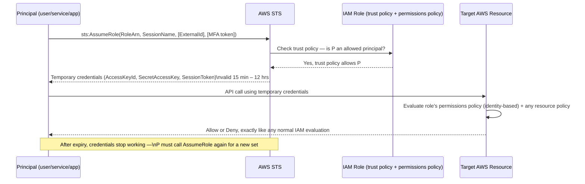
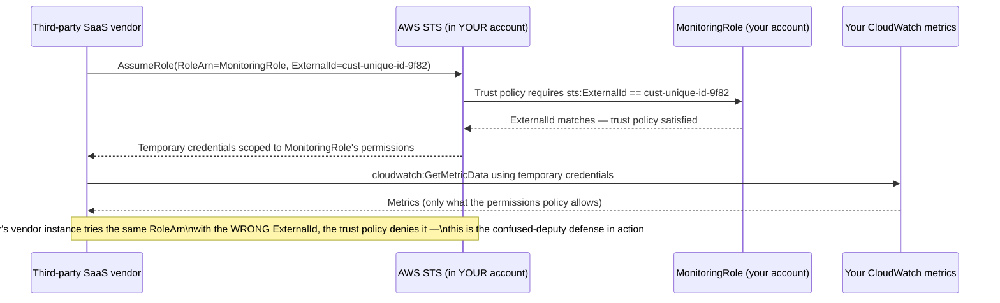
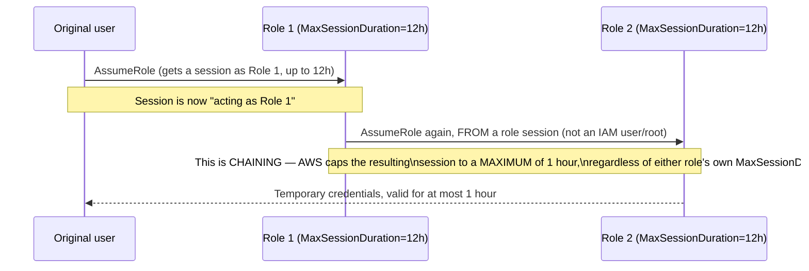
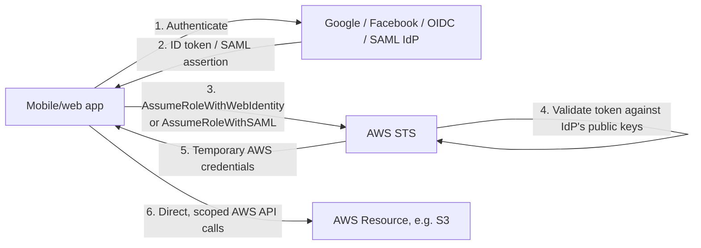
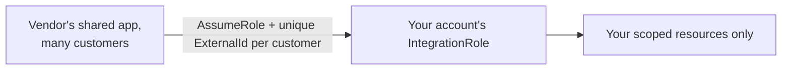
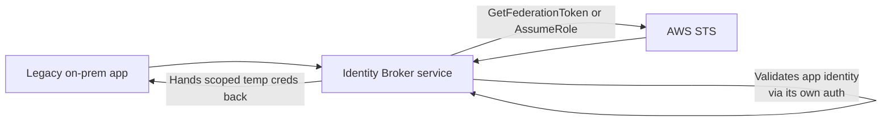
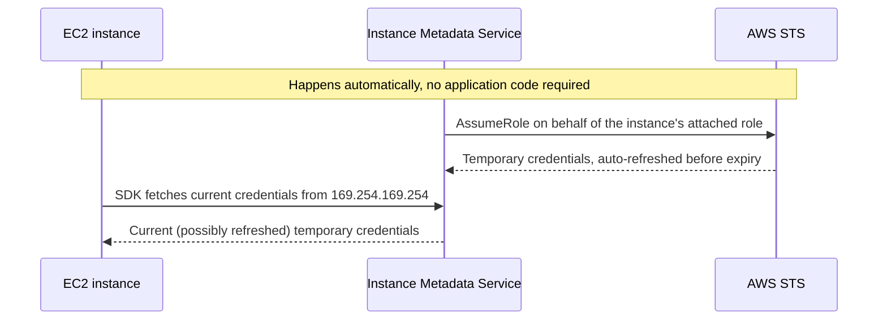
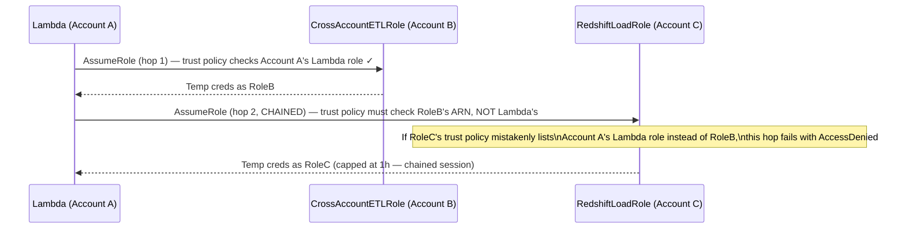
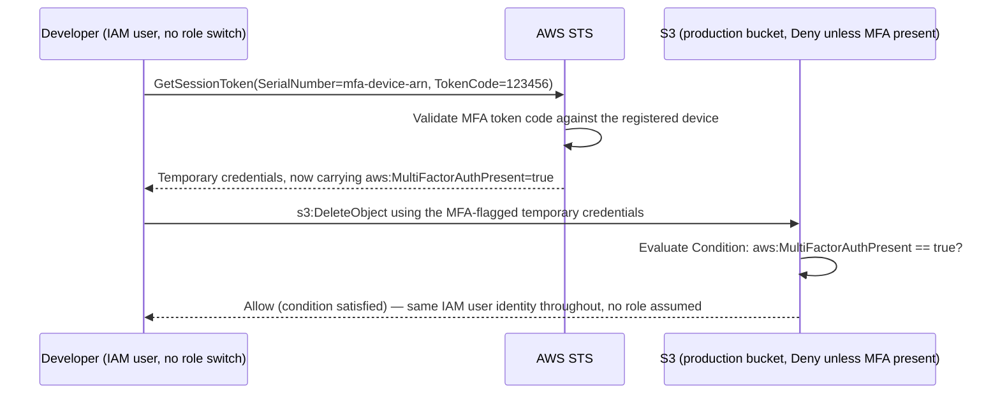

# AWS STS & Role Switching (AssumeRole)

> **Appears in:** [DVA-C03](../../certifications/dva-c03/README.md) · [SAA-C03](../../certifications/saa-c03/README.md)


## Definition

AWS Security Token Service (STS) is the service that **issues short-lived, temporary
credentials** instead of permanent ones. "Role switching" is the act of a principal
(a user, an application, or an AWS service) temporarily becoming a different identity — an IAM
role — by calling STS and receiving a fresh access key, secret key, and session token that
expire on their own after a set time window.

## Purpose

Long-term credentials (an IAM user's static access key/secret key) are a liability: if leaked,
they work forever until someone manually revokes them, and they're easy to accidentally commit
to a public repo, bake into an AMI, or leave on a former employee's laptop. STS exists so that
almost nothing in AWS ever needs a long-term secret: EC2 instances, Lambda functions, federated
users, and cross-account access all get credentials that **expire automatically**, usually
within an hour, drastically shrinking the blast radius of any leak and removing the operational
burden of manual key rotation.

## How It Works



Step by step:

1. The principal calls `sts:AssumeRole` (or `AssumeRoleWithSAML` / `AssumeRoleWithWebIdentity`
   for federated logins, or `GetSessionToken` for simple MFA-protected temporary creds without
   switching identity) specifying which role it wants to become.
2. STS checks the role's **trust policy** — a resource-based policy attached to the role itself
   that lists which principals (which account, which specific user/role, which external IdP) are
   allowed to assume it. This is a separate document from the role's *permissions* policy; mixing
   the two up is a classic exam trap.
3. If the trust policy allows the caller (and any required conditions — MFA presence, a
   matching `ExternalId` for third-party access, source IP restriction — are satisfied), STS
   mints temporary credentials: an access key, a secret key, and a **session token** that must
   be included on every subsequent API call.
4. From that point, every API call using those temporary credentials is evaluated exactly like
   any other IAM request (see the evaluation flow in `iam.md`) — the role's attached permissions
   policies apply, any session policy passed at AssumeRole time further restricts them, SCPs and
   permission boundaries still apply.
5. When the credentials expire (the caller chooses a duration within the role's configured
   max — default max 1 hour, configurable up to 12 hours for most roles), they simply stop
   working. There is nothing to "revoke" in the traditional sense — the next call just fails
   with an expired-token error, and the principal must assume the role again.

### Official AWS cross-partition AssumeRole flow (the general pattern for all federated role assumption)


*Source: AWS Identity and Access Management User Guide, "Federating AWS identities across AWS
partitions" (docs.aws.amazon.com/IAM/latest/UserGuide/id_roles_providers_outbound_cross_partition.html)*

This diagram illustrates the generalized trust-token exchange every `AssumeRoleWith*` variant
follows: a token is minted by one trust anchor, presented to STS, validated against the issuer's
public signing keys, and exchanged for scoped temporary credentials — whether that trust anchor
is a SAML IdP, an OIDC web identity provider, or (as pictured) a cross-partition source STS.

### Full trust policy anatomy — the document people confuse with the permissions policy

```json
{
  "Version": "2012-10-17",
  "Statement": [
    {
      "Sid": "AllowAccountBToAssumeWithExternalId",
      "Effect": "Allow",
      "Principal": { "AWS": "arn:aws:iam::222233334444:root" },
      "Action": "sts:AssumeRole",
      "Condition": {
        "StringEquals": { "sts:ExternalId": "partner-secret-abc123" },
        "Bool": { "aws:MultiFactorAuthPresent": "true" }
      }
    }
  ]
}
```

This is the **trust policy** — it lives on the role and answers *only* "who may call
AssumeRole on me." It is completely separate from the role's **permissions policy**, which
answers "what can a session that successfully assumed this role actually do":

```json
{
  "Version": "2012-10-17",
  "Statement": [
    {
      "Sid": "ScopedReadOnlyForPartner",
      "Effect": "Allow",
      "Action": ["s3:GetObject", "s3:ListBucket"],
      "Resource": ["arn:aws:s3:::partner-exchange-bucket", "arn:aws:s3:::partner-exchange-bucket/*"]
    }
  ]
}
```

A role can have a perfectly permissive trust policy and an empty permissions policy (the
session would assume successfully but be able to do nothing), or vice versa — a locked-down
trust policy that nobody can actually satisfy, paired with a wide-open permissions policy that
never gets exercised. The exam tests whether you can identify *which* of the two documents is
broken given a specific symptom (see Troubleshooting below).

### Full cross-account AssumeRole chain with ExternalId (confused-deputy defense)



The **confused deputy problem** this defends against: if the vendor serves *many* customers
from one shared application, and that shared app is tricked (or misconfigured) into assuming
*your* RoleArn using *another customer's* session context, `ExternalId` is the one piece of
information unique to the trust relationship between you and the vendor — without the correct
value, the trust policy simply won't match, no matter how the vendor's app was tricked.

### Role chaining — and why it caps at one hour



### AssumeRoleWithWebIdentity / AssumeRoleWithSAML federation flow



## Key Features / Components

- **AssumeRole** — the standard call: an IAM principal (user or role) in the same or a
  different AWS account becomes another role. This is how cross-account access, EC2 instance
  profiles, and Lambda execution roles all fundamentally work.
- **AssumeRoleWithSAML** — for enterprise federation: an external IdP (Active Directory
  Federation Services, Okta, etc.) issues a SAML assertion, and STS exchanges it for temporary
  AWS credentials without ever creating an IAM user for that person. This is the mechanism
  behind IAM Identity Center's SSO portal.
- **AssumeRoleWithWebIdentity** — for apps using a public identity provider token (Google,
  Facebook, Amazon, Cognito Identity Pools) to get temporary AWS credentials, typically for a
  mobile/web app that needs direct, scoped access to an AWS resource (e.g., a user uploading
  directly to their own folder in S3).
- **GetSessionToken** — gets temporary credentials for the *calling identity itself* (no role
  switch), mainly used to satisfy an MFA-required condition on a sensitive API call without
  changing who you are.
- **GetFederationToken** — a less common call for building a custom identity broker that issues
  scoped-down temporary credentials for a federated user without assuming a pre-created role.
- **GetCallerIdentity** — not a credential-issuing call, but the fastest way to debug "which
  identity am I actually running as right now" — returns the Account, UserId, and Arn of the
  currently active credentials; the first command to run when troubleshooting any
  role-switching confusion.
- **ExternalId** — a shared secret string required in third-party cross-account access
  scenarios (e.g., giving a SaaS vendor a role to assume) to defend against the "confused
  deputy" problem, where the vendor might be tricked into assuming a role on behalf of the
  wrong customer.
- **Session duration** — configurable per role (`DurationSeconds`, bounded by the role's
  `MaxSessionDuration` setting, default 1 hour, max 12 hours for most assume-role flows).
- **Session policies** — an inline policy passed at the moment of `AssumeRole` that further
  restricts (never expands) what the resulting session can do versus the role's own attached
  policies — useful for scoping a single session down tighter than the role normally allows.
- **Chained role assumption** — a session from one AssumeRole can itself assume a second role
  (role chaining), but AWS caps the resulting session to a maximum 1-hour duration regardless of
  what either role allows, specifically to limit how long a long chain of trust can be ridden.
- **Regional STS endpoints** — STS has both a legacy global endpoint and Region-specific
  endpoints; using the Region-specific endpoint closer to your workload reduces latency and, for
  some Regions, is required (opt-in Regions only support the regional endpoint).

## Use Cases — When to Use It

- **EC2 instance reading from S3 with zero static keys.** Situation: an application on EC2
  needs S3 access. Why this fits: the instance profile role is assumed automatically by the EC2
  service and refreshed transparently — the application code never touches a credential at all.
  Tradeoff: the instance metadata service (IMDS) itself becomes a sensitive target — an SSRF
  vulnerability in the app can let an attacker steal the current session's temporary credentials,
  which is why IMDSv2 (token-required) is the recommended default over IMDSv1.
- **Central security-tooling account auditing 50 member accounts.** Situation: a security team
  needs read-only access into every account in an Organization to run compliance scans. Why this
  fits: one identical `ReadOnlyAuditRole` per member account, each trusting only the security
  account, lets the team assume in on demand with no standing credentials anywhere. Tradeoff:
  deploying and keeping that role consistent across every account requires StackSets/Control
  Tower-style automation — hand-rolling it account by account invites drift and gaps.
- **Third-party SaaS vendor access via ExternalId, not a shared key.** Situation: a monitoring
  vendor needs to read your CloudWatch metrics. Why this fits: a role ARN + unique `ExternalId`
  replaces handing over an access key, and access is revocable instantly by deleting the trust
  statement. Tradeoff: if the vendor loses track of which `ExternalId` belongs to which customer
  internally, legitimate calls can fail — the burden of correctly threading the ID through every
  API call falls on the vendor's own application design.
- **MFA-gated sensitive action without switching identity.** Situation: a developer needs to
  delete a production resource that requires MFA. Why this fits: `GetSessionToken` with an MFA
  device code produces credentials that satisfy `aws:MultiFactorAuthPresent` while the caller
  stays the *same* identity — simpler than assuming a role just to prove MFA. Tradeoff: this
  only re-authenticates the same user; it does nothing to narrow *which* actions that user can
  take, so it's not a substitute for least-privilege scoping on the underlying identity policy.
- **Mobile app uploading directly to a per-user S3 prefix.** Situation: users need to upload
  photos straight from a mobile client without routing every byte through a backend server. Why
  this fits: `AssumeRoleWithWebIdentity` via a Cognito Identity Pool scopes the session to only
  that user's folder using `${cognito-identity.amazonaws.com:sub}`. Tradeoff: the client now
  holds real (if scoped and short-lived) AWS credentials — a compromised device can still act
  within that user's own prefix for the life of the session, so session duration should be kept
  tight for this pattern.
- **Zero-trust service-to-service auth inside a Kubernetes cluster (IRSA).** Situation: pods in
  an EKS cluster need distinct AWS permissions per workload, not one shared node-level role. Why
  this fits: `AssumeRoleWithWebIdentity` via the cluster's OIDC provider (IRSA) lets each
  Kubernetes service account map to its own IAM role, with no broad node role shared across every
  pod. Tradeoff: OIDC provider setup and per-service-account role mapping is more initial
  configuration than attaching one instance-profile role to the whole node group.
- **Incident response — immediately cutting off an active session.** Situation: a role's
  credentials are suspected compromised mid-incident. Why this fits: because STS credentials are
  short-lived by design, the practical "kill switch" is revoking the role's active sessions
  (via a revocation policy or deleting/tightening the role) rather than hunting for one static
  key to rotate. Tradeoff: any legitimate workload still relying on that role is cut off at the
  same moment — a broad revocation during an incident can cause collateral outage for unrelated,
  non-compromised uses of the same role if roles aren't scoped narrowly per workload already.
- **Confused-deputy defense for a multi-tenant vendor integration.** Situation: a vendor serves
  many customers from one shared application and must never let Customer B's session
  accidentally touch Customer A's AWS resources. Why this fits: a unique `ExternalId` per
  customer in the trust policy is the one piece of context that ties a specific `AssumeRole` call
  to a specific trust relationship, closing the confused-deputy gap entirely at the IAM layer.
  Tradeoff: this defense is only as strong as the vendor's own internal bookkeeping — if their
  system passes the wrong `ExternalId` for the wrong customer, STS has no way to know that's a
  mistake rather than a legitimate call.
- **Federated enterprise SSO into a workload account (SAML).** Situation: employees need console
  access to an AWS account without AWS ever issuing them a personal IAM user. Why this fits:
  `AssumeRoleWithSAML` exchanges a SAML assertion from the corporate IdP directly for temporary
  credentials, so offboarding in the corporate directory is the only access-removal step needed.
  Tradeoff: this flow is entirely dependent on the IdP's own availability and correctness — an
  IdP outage blocks legitimate access with no fallback unless a break-glass IAM user is
  separately maintained.
- **Chained role assumption across a three-account data pipeline.** Situation: a Lambda function
  in Account A must read from S3 in Account B and write to Redshift in Account C. Why this fits:
  each hop is a normal `AssumeRole` call, letting each account own and audit exactly what the
  "next hop" role is permitted to do in its own territory. Tradeoff: role chaining hard-caps the
  final session at 1 hour regardless of each role's own `MaxSessionDuration`, which can be a
  surprising constraint for long-running batch jobs that need to span multiple hops.

## When NOT to Use It / Alternatives

- **Simple, single-account, single-person CLI access with no sensitive data** — plain IAM user
  credentials (though still discouraged) are at least simpler to reason about than a full
  AssumeRole chain; in practice, though, AWS recommends `aws sso login` (Identity Center) even
  here, which issues STS credentials transparently.
- **You need credentials that never expire for a long-running on-prem server with no way to
  re-authenticate periodically** — consider **IAM Roles Anywhere** (still STS-based, but
  designed for that pattern via certificate-based trust) rather than fighting STS's
  short-lived-by-design nature with workarounds like manually refreshing every hour.

## Common Architectures

### 1. Hub-and-spoke cross-account audit access

```mermaid
flowchart TD
    Hub[Security Account\n(hub)] -->|AssumeRole| Spoke1[Account 1\nAuditRole]
    Hub -->|AssumeRole| Spoke2[Account 2\nAuditRole]
    Hub -->|AssumeRole| SpokeN[Account N\nAuditRole]
```

### 2. Third-party SaaS integration with ExternalId



### 3. Identity broker pattern for legacy/non-AWS-native apps



### 4. EC2 instance profile — the most common AssumeRole flow of all, fully automatic



## Worked scenario: debugging a real multi-hop AssumeRole failure

A data pipeline needs: Lambda (Account A) → assumes `CrossAccountETLRole` (Account B) → that
role needs to read from S3 (Account B) and write to Redshift (Account C). Walking the chain:

1. **Lambda's own execution role (Account A)** needs an identity policy allowing
   `sts:AssumeRole` on `arn:aws:iam::B:role/CrossAccountETLRole` specifically — not a wildcard
   ARN, which is routinely rejected by security review and, more importantly, by well-written
   SCPs restricting cross-account AssumeRole targets.
2. **`CrossAccountETLRole`'s trust policy (Account B)** must list Account A's Lambda execution
   role ARN (or the whole Account A) as a trusted principal.
3. **`CrossAccountETLRole`'s permissions policy (Account B)** must allow `s3:GetObject` on the
   source bucket, **and** must itself be allowed to further assume a role in Account C (a second
   hop) — meaning this becomes a **chained** assumption, capped at a 1-hour session regardless
   of how generously each role's `MaxSessionDuration` is configured.
4. **The Account C role's trust policy** must list `CrossAccountETLRole`'s ARN (from Account B)
   as a trusted principal, not Account A's Lambda role — a common mistake is trusting the
   *original* caller instead of the *immediately preceding* role in the chain, which is what
   trust policies actually check.

If step 4 is wrong (trusting Account A's Lambda role instead of Account B's
`CrossAccountETLRole`), the symptom is confusing: the first `AssumeRole` call succeeds, data
reads from S3 work fine, and only the *second* hop into Account C fails — which looks like a
Redshift permissions problem until you realize the trust policy on the Account C role was
checking the wrong principal entirely.



## Why It's Important

**Real-world weight:** Virtually every "serverless app got hacked because of a leaked static
key" postmortem would have been a non-issue if the workload had used a role instead. STS-backed
temporary credentials are the backbone of how AWS expects every non-human workload to
authenticate — it is foundational, not optional, architecture.

**Exam weight:**
- **SAA-C03 — Domain 1, Task 1.1** explicitly lists "STS/role switching" alongside IAM and
  SCPs as part of designing secure multi-account access.
- **DVA-C03 — Domain 2, Task 2.1 "Implement authentication/authorization for apps and AWS
  services"** lists STS directly — developers are expected to request temporary credentials in
  code (SDK's `AssumeRoleProvider`/`STSAssumeRoleCredentials`) rather than loading static keys
  from config.
- **MLA-C02 — Domain 4** — SageMaker notebook/training/endpoint execution all run under
  assumed roles; understanding that a SageMaker job's permissions come from its execution
  role's trust + permissions policies (not the data scientist's personal IAM user) is tested.

## Limits & Quotas

| Item | Default | Notes |
|---|---|---|
| Minimum session duration | 15 minutes | Floor for `DurationSeconds` on AssumeRole |
| Default `MaxSessionDuration` | 1 hour | Must be explicitly raised (up to 12h) per role if longer sessions are needed |
| Maximum `MaxSessionDuration` | 12 hours | For standard AssumeRole; `GetFederationToken`/`GetSessionToken` cap differently |
| Chained-role session cap | 1 hour, hard ceiling | Cannot be configured higher regardless of either role's own setting |
| Session policy size | 2,048 characters | Passed inline at AssumeRole call time |
| Packed policy size warning threshold | ~450 characters utilization of the 2,048 cap triggers a CLI/SDK warning | Still succeeds unless the hard limit is exceeded |
| STS request rate | Shared account-level quota, typically very high | Rarely a practical constraint outside extreme automation scale |

## Pricing Model

**STS is free.** There is no charge for calling `AssumeRole`, `GetSessionToken`, or any other
STS API, and no charge based on session count or duration. See:
https://aws.amazon.com/premiumsupport/knowledge-center/iam-sts-pricing/ (STS itself has no
dedicated pricing page because the answer is simply "no cost").

## Hands-on Lab (Floci)

```bash
# Create a role that trusts the account root (local emulator simplification)
cat > trust.json << 'EOF'
{
  "Version": "2012-10-17",
  "Statement": [
    { "Effect": "Allow",
      "Principal": {"AWS": "arn:aws:iam::000000000000:root"},
      "Action": "sts:AssumeRole",
      "Condition": {"StringEquals": {"sts:ExternalId": "lab-secret-123"}}
    }
  ]
}
EOF
awslocal iam create-role --role-name CrossAccountReadOnly --assume-role-policy-document file://trust.json
awslocal iam attach-role-policy --role-name CrossAccountReadOnly \
  --policy-arn arn:aws:iam::aws:policy/ReadOnlyAccess

# Assume it and inspect the returned temporary credentials
awslocal sts assume-role \
  --role-arn arn:aws:iam::000000000000:role/CrossAccountReadOnly \
  --role-session-name lab-session \
  --external-id lab-secret-123 \
  --duration-seconds 900

# Use the returned AccessKeyId/SecretAccessKey/SessionToken for a scoped call
export AWS_ACCESS_KEY_ID=<from output>
export AWS_SECRET_ACCESS_KEY=<from output>
export AWS_SESSION_TOKEN=<from output>
aws --endpoint-url=http://localhost:4566 s3 ls   # now running AS the assumed role

# Confirm exactly which identity is currently active — the first debugging command always
awslocal sts get-caller-identity

# GetSessionToken (no role switch, just temporary self-credentials)
awslocal sts get-session-token --duration-seconds 900
```

### Extended lab: proving role chaining caps at 1 hour and testing a wrong ExternalId

```bash
# Create a second role, trusting the first role (sets up a chain)
cat > trust-chain.json << 'EOF'
{
  "Version": "2012-10-17",
  "Statement": [
    { "Effect": "Allow",
      "Principal": {"AWS": "arn:aws:iam::000000000000:role/CrossAccountReadOnly"},
      "Action": "sts:AssumeRole"
    }
  ]
}
EOF
awslocal iam create-role --role-name ChainedRole --assume-role-policy-document file://trust-chain.json \
  --max-session-duration 43200   # 12 hours configured, but chaining will still cap at 1h

# Assume the first role, then use ITS credentials to assume the second (the chain)
# — attempting --duration-seconds higher than 3600 on the second hop will be rejected/truncated
awslocal sts assume-role \
  --role-arn arn:aws:iam::000000000000:role/ChainedRole \
  --role-session-name chained-session \
  --duration-seconds 3600

# Deliberately use the WRONG external ID to see the trust policy reject the call
awslocal sts assume-role \
  --role-arn arn:aws:iam::000000000000:role/CrossAccountReadOnly \
  --role-session-name bad-session \
  --external-id totally-wrong-id
# Expect: AccessDenied — the trust policy's Condition does not match
```

## STS API Call Comparison — Which Variant For Which Scenario

| Call | Who calls it | What it returns | Typical scenario |
|---|---|---|---|
| `AssumeRole` | An existing IAM user/role (same or cross-account) | Temp creds for a named IAM role | Cross-account access, EC2/Lambda execution roles, general role switching |
| `AssumeRoleWithSAML` | Anyone holding a valid SAML assertion from a trusted IdP | Temp creds for a named IAM role | Enterprise workforce SSO (Okta, ADFS, Entra ID) — underlies IAM Identity Center |
| `AssumeRoleWithWebIdentity` | Anyone holding a valid OIDC/web identity token | Temp creds for a named IAM role | Mobile/web apps via Cognito Identity Pools, Google/Facebook/Apple login, EKS IRSA (IAM Roles for Service Accounts) |
| `GetSessionToken` | The calling identity itself (no role) | Temp creds for the SAME identity, MFA-enhanced | Satisfying an `aws:MultiFactorAuthPresent` condition without changing identity |
| `GetFederationToken` | A long-term IAM user building a custom broker | Temp creds with policy intersected at call time | Legacy/custom identity-broker patterns, largely superseded by Identity Pools/Identity Center |
| `GetCallerIdentity` | Anyone, any credentials | Account, UserId, Arn of the CURRENT caller | Debugging "who am I right now" |
| `DecodeAuthorizationMessage` | Anyone who received an encoded AccessDenied message | Human-readable reason for the denial | Decoding the opaque encoded message AWS sometimes returns instead of a plain reason |

`EKS IRSA` (IAM Roles for Service Accounts) deserves a specific mention for anyone touching
containers on the exam: it's `AssumeRoleWithWebIdentity` under the hood, using the cluster's
OIDC provider as the trust anchor, letting individual Kubernetes service accounts get scoped
AWS permissions without sharing a single, overly broad node-level IAM role across every pod.

## Troubleshooting / Common Issues

**"User/Role is not authorized to perform: sts:AssumeRole" — trust policy problem:**
1. Check that the **trust policy** on the target role actually lists the calling account/
   principal — a common mistake is editing the role's *permissions* policy and wondering why
   assumption still fails; these are two different documents.
2. Check any `Condition` block on the trust policy (ExternalId, MFA, source IP) — a mismatched
   condition produces the same generic denial as a missing principal entry.
3. Confirm the caller's own identity policy allows `sts:AssumeRole` on that specific role ARN —
   both the trust policy (on the role) and the caller's identity policy (in the caller's
   account) must independently allow the assumption.

**"Session successfully assumed but every subsequent API call is denied" — permissions policy
problem, not a trust policy problem:**
1. The trust policy clearly worked (you have credentials), so stop looking there.
2. Check the role's **permissions policy** for the specific action/resource being called.
3. Check for a **session policy** passed at AssumeRole time that might be *narrower* than the
   role's own permissions policy — session policies can only restrict, never expand.
4. Check SCPs and permission boundaries — they still apply to assumed-role sessions exactly as
   they would to the role's "native" use.

**"Credentials worked an hour ago, now every call fails with ExpiredTokenException":** this is
not a policy problem at all — the session's duration elapsed. The fix is calling `AssumeRole`
again, not editing any policy. If this happens surprisingly early in a chained scenario, check
whether role chaining is in play (1-hour hard cap regardless of configured `MaxSessionDuration`).

**"We trust the vendor's RoleArn but a different customer's session somehow got our data" (or
the reverse, a legitimate vendor call unexpectedly denied):** check the `ExternalId` condition
in the trust policy — either it's missing entirely (confused-deputy risk) or a value mismatch
is blocking a legitimate call. `GetCallerIdentity` on the vendor's side is the fastest way to
confirm which customer's RoleArn was actually targeted.

## Exam Tips

- **Trust policy vs. permissions policy** — the trust policy (on the role) decides *who can
  assume* the role; the permissions policy (also on the role) decides *what the role can do
  once assumed*. A question describing "the role can't be assumed by the expected account" is
  a trust-policy problem; "the assumed session can't call the API it needs" is a permissions-
  policy problem. Don't mix them up.
- **ExternalId is for third-party cross-account access**, specifically to prevent the confused
  deputy problem — if a question mentions "a vendor/partner account needs access to our
  resources," ExternalId in the trust policy is very likely part of the correct answer.
- **Session duration is capped by `MaxSessionDuration` on the role**, not by whatever the
  caller requests — if a scenario needs an 8-hour session, the role's max must be configured
  for at least that; the default ceiling without configuration is 1 hour.
- **Chained AssumeRole caps out at 1 hour total**, regardless of each role's individual max —
  a common "why did my long session expire early" trap.
- **Session policies only restrict, never expand** — a question offering "pass a session
  policy to grant MORE access than the role allows" as an answer choice is always wrong.
- **`GetCallerIdentity` is the fastest debugging tool** — if a question's scenario is "confirm
  exactly which identity a script is currently running as," this is the specific, correct API
  call, distinct from `AssumeRole` or `GetSessionToken`.
- **STS vs. IAM Identity Center** — Identity Center is the human-facing portal/SSO layer;
  STS is the underlying mechanism it (and everything else — EC2, Lambda, federation) calls to
  actually mint credentials. A question about "the technical AWS API behind role switching" is
  always STS, even in an Identity Center scenario.
- **EC2 instance profiles use AssumeRole automatically** — know that the Instance Metadata
  Service handles the assume/refresh cycle transparently; no application code calls
  `AssumeRole` explicitly for this specific pattern.
- Shows up in **SAA-C03 Domain 1 (30%)** and **DVA-C03 Domain 2 (26%)** most heavily; touched
  in **MLA-C02 Domain 4 (24%)** around execution-role security for ML workloads.

## GetSessionToken + MFA flow — satisfying a sensitive-action condition without switching identity



This is the specific, correct mechanism for "require MFA before this one sensitive action" when
the caller should remain the *same* identity afterward (contrast with `AssumeRole`, which
produces a *different* identity's session). A common exam distractor is proposing `AssumeRole`
for an MFA-gated action that doesn't actually need a role switch at all — `GetSessionToken` is
simpler and is the textbook-correct answer whenever the scenario says "the same user, just with
MFA satisfied," not "become a different role."

## Further Reading

- AWS STS API Reference — AssumeRole:
  https://docs.aws.amazon.com/STS/latest/APIReference/API_AssumeRole.html
- AWS IAM User Guide — Federating AWS identities across AWS partitions (cross-partition flow):
  https://docs.aws.amazon.com/IAM/latest/UserGuide/id_roles_providers_outbound_cross_partition.html
- AWS IAM User Guide — Tutorial: Delegate access across AWS accounts using IAM roles:
  https://docs.aws.amazon.com/IAM/latest/UserGuide/tutorial_cross-account-with-roles.html
- AWS IAM User Guide — Creating a role to delegate permissions to an IAM user:
  https://docs.aws.amazon.com/IAM/latest/UserGuide/id_roles_create_for-user.html
- AWS Security Blog — "How to use trust policies with IAM roles":
  https://aws.amazon.com/blogs/security/how-to-use-trust-policies-with-iam-roles/

## Related Terms

- [`iam.md`](iam.md) — policy evaluation order; roles vs. users vs. groups
- [`iam-identity-center-sso.md`](iam-identity-center-sso.md) — the human SSO layer built on STS
- [`organizations-and-scps.md`](organizations-and-scps.md) — SCPs still apply to assumed-role sessions
- [`cognito.md`](cognito.md) — Identity Pools use `AssumeRoleWithWebIdentity` under the hood
- `glossary/` — trust policy, confused deputy, federation, temporary credentials
