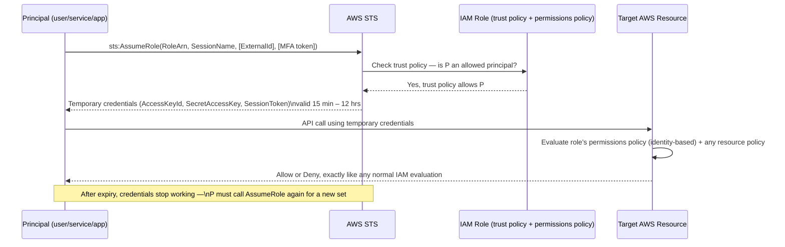

# AWS STS & Role Switching (AssumeRole)


## Definition

AWS Security Token Service (STS) is the service that **issues short-lived, temporary
credentials** instead of permanent ones. "Role switching" is the act of a principal
(a user, an application, or an AWS service) temporarily becoming a different identity — an IAM
role — by calling STS and receiving a fresh access key, secret key, and session token that
expire on their own after a set time window.

## Purpose

Long-term credentials (an IAM user's static access key/secret key) are a liability: if leaked,
they work forever until someone manually revokes them, and they're easy to accidentally commit
to a public repo, bake into an AMI, or leave on a former employee's laptop. STS exists so that
almost nothing in AWS ever needs a long-term secret: EC2 instances, Lambda functions, federated
users, and cross-account access all get credentials that **expire automatically**, usually
within an hour, drastically shrinking the blast radius of any leak and removing the operational
burden of manual key rotation.

## How It Works



Step by step:

1. The principal calls `sts:AssumeRole` (or `AssumeRoleWithSAML` / `AssumeRoleWithWebIdentity`
   for federated logins, or `GetSessionToken` for simple MFA-protected temporary creds without
   switching identity) specifying which role it wants to become.
2. STS checks the role's **trust policy** — a resource-based policy attached to the role itself
   that lists which principals (which account, which specific user/role, which external IdP) are
   allowed to assume it. This is a separate document from the role's *permissions* policy; mixing
   the two up is a classic exam trap.
3. If the trust policy allows the caller (and any required conditions — MFA presence, a
   matching `ExternalId` for third-party access, source IP restriction — are satisfied), STS
   mints temporary credentials: an access key, a secret key, and a **session token** that must
   be included on every subsequent API call.
4. From that point, every API call using those temporary credentials is evaluated exactly like
   any other IAM request (see the evaluation flow in `iam.md`) — the role's attached permissions
   policies apply, any session policy passed at AssumeRole time further restricts them, SCPs and
   permission boundaries still apply.
5. When the credentials expire (the caller chooses a duration within the role's configured
   max — default max 1 hour, configurable up to 12 hours for most roles), they simply stop
   working. There is nothing to "revoke" in the traditional sense — the next call just fails
   with an expired-token error, and the principal must assume the role again.

## Key Features / Components

- **AssumeRole** — the standard call: an IAM principal (user or role) in the same or a
  different AWS account becomes another role. This is how cross-account access, EC2 instance
  profiles, and Lambda execution roles all fundamentally work.
- **AssumeRoleWithSAML** — for enterprise federation: an external IdP (Active Directory
  Federation Services, Okta, etc.) issues a SAML assertion, and STS exchanges it for temporary
  AWS credentials without ever creating an IAM user for that person. This is the mechanism
  behind IAM Identity Center's SSO portal.
- **AssumeRoleWithWebIdentity** — for apps using a public identity provider token (Google,
  Facebook, Amazon Cognito Identity Pools) to get temporary AWS credentials, typically for a
  mobile/web app that needs direct, scoped access to an AWS resource (e.g., a user uploading
  directly to their own folder in S3).
- **GetSessionToken** — gets temporary credentials for the *calling identity itself* (no role
  switch), mainly used to satisfy an MFA-required condition on a sensitive API call without
  changing who you are.
- **ExternalId** — a shared secret string required in third-party cross-account access
  scenarios (e.g., giving a SaaS vendor a role to assume) to defend against the "confused
  deputy" problem, where the vendor might be tricked into assuming a role on behalf of the
  wrong customer.
- **Session duration** — configurable per role (`DurationSeconds`, bounded by the role's
  `MaxSessionDuration` setting, default 1 hour, max 12 hours for most assume-role flows).
- **Session policies** — an inline policy passed at the moment of `AssumeRole` that further
  restricts (never expands) what the resulting session can do versus the role's own attached
  policies — useful for scoping a single session down tighter than the role normally allows.
- **Chained role assumption** — a session from one AssumeRole can itself assume a second role
  (role chaining), but AWS caps the resulting session to a maximum 1-hour duration regardless of
  what either role allows, specifically to limit how long a long chain of trust can be ridden.

## Use Cases — When to Use It

- An EC2 instance needs to read from S3: the instance profile role is assumed automatically by
  the EC2 service, and the application on the instance never touches a static key.
- A central security-tooling account needs **read-only** access into 50 member accounts to run
  compliance scans: one role per member account, each trusting the security account, assumed on
  demand.
- A third-party monitoring SaaS needs access to your CloudWatch metrics: you give them a role
  ARN + ExternalId instead of an access key, and you can revoke access instantly by deleting
  the role or its trust policy statement.
- A developer needs to test an action that requires MFA (e.g., deleting a production resource):
  `GetSessionToken` with an MFA device serial number and token code produces credentials that
  satisfy the `aws:MultiFactorAuthPresent` condition.

## When NOT to Use It / Alternatives

- **Simple, single-account, single-person CLI access with no sensitive data** — plain IAM user
  credentials (though still discouraged) are at least simpler to reason about than a full
  AssumeRole chain; in practice, though, AWS recommends `aws sso login` (Identity Center) even
  here, which issues STS credentials transparently.
- **You need credentials that never expire for a long-running on-prem server with no way to
  re-authenticate periodically** — consider **IAM Roles Anywhere** (still STS-based, but
  designed for that pattern via certificate-based trust) rather than fighting STS's
  short-lived-by-design nature with workarounds like manually refreshing every hour.

## Why It's Important

**Real-world weight:** Virtually every "serverless app got hacked because of a leaked static
key" postmortem would have been a non-issue if the workload had used a role instead. STS-backed
temporary credentials are the backbone of how AWS expects every non-human workload to
authenticate — it is foundational, not optional, architecture.

**Exam weight:**
- **SAA-C03 — Domain 1, Task 1.1** explicitly lists "STS/role switching" alongside IAM and
  SCPs as part of designing secure multi-account access.
- **DVA-C03 — Domain 2, Task 2.1 "Implement authentication/authorization for apps and AWS
  services"** lists STS directly — developers are expected to request temporary credentials in
  code (SDK's `AssumeRoleProvider`/`STSAssumeRoleCredentials`) rather than loading static keys
  from config.
- **MLA-C02 — Domain 4** — SageMaker notebook/training/endpoint execution all run under
  assumed roles; understanding that a SageMaker job's permissions come from its execution
  role's trust + permissions policies (not the data scientist's personal IAM user) is tested.

## Pricing Model

**STS is free.** There is no charge for calling `AssumeRole`, `GetSessionToken`, or any other
STS API, and no charge based on session count or duration. See:
https://aws.amazon.com/premiumsupport/knowledge-center/iam-sts-pricing/ (STS itself has no
dedicated pricing page because the answer is simply "no cost").

## Hands-on Lab (Floci)

```bash
# Create a role that trusts the account root (local emulator simplification)
cat > trust.json << 'EOF'
{
  "Version": "2012-10-17",
  "Statement": [
    { "Effect": "Allow",
      "Principal": {"AWS": "arn:aws:iam::000000000000:root"},
      "Action": "sts:AssumeRole",
      "Condition": {"StringEquals": {"sts:ExternalId": "lab-secret-123"}}
    }
  ]
}
EOF
awslocal iam create-role --role-name CrossAccountReadOnly --assume-role-policy-document file://trust.json
awslocal iam attach-role-policy --role-name CrossAccountReadOnly \
  --policy-arn arn:aws:iam::aws:policy/ReadOnlyAccess

# Assume it and inspect the returned temporary credentials
awslocal sts assume-role \
  --role-arn arn:aws:iam::000000000000:role/CrossAccountReadOnly \
  --role-session-name lab-session \
  --external-id lab-secret-123 \
  --duration-seconds 900

# Use the returned AccessKeyId/SecretAccessKey/SessionToken for a scoped call
export AWS_ACCESS_KEY_ID=<from output>
export AWS_SECRET_ACCESS_KEY=<from output>
export AWS_SESSION_TOKEN=<from output>
aws --endpoint-url=http://localhost:4566 s3 ls   # now running AS the assumed role

# GetSessionToken (no role switch, just temporary self-credentials)
awslocal sts get-session-token --duration-seconds 900
```

## Exam Tips

- **Trust policy vs. permissions policy** — the trust policy (on the role) decides *who can
  assume* the role; the permissions policy (also on the role) decides *what the role can do
  once assumed*. A question describing "the role can't be assumed by the expected account" is
  a trust-policy problem; "the assumed session can't call the API it needs" is a permissions-
  policy problem. Don't mix them up.
- **ExternalId is for third-party cross-account access**, specifically to prevent the confused
  deputy problem — if a question mentions "a vendor/partner account needs access to our
  resources," ExternalId in the trust policy is very likely part of the correct answer.
- **Session duration is capped by `MaxSessionDuration` on the role**, not by whatever the
  caller requests — if a scenario needs an 8-hour session, the role's max must be configured
  for at least that; the default ceiling without configuration is 1 hour.
- **Chained AssumeRole caps out at 1 hour total**, regardless of each role's individual max —
  a common "why did my long session expire early" trap.
- **STS vs. IAM Identity Center** — Identity Center is the human-facing portal/SSO layer;
  STS is the underlying mechanism it (and everything else — EC2, Lambda, federation) calls to
  actually mint credentials. A question about "the technical AWS API behind role switching" is
  always STS, even in an Identity Center scenario.
- Shows up in **SAA-C03 Domain 1 (30%)** and **DVA-C03 Domain 2 (26%)** most heavily; touched
  in **MLA-C02 Domain 4 (24%)** around execution-role security for ML workloads.

## Related Terms

- [`iam.md`](iam.md) — policy evaluation order; roles vs. users vs. groups
- [`iam-identity-center-sso.md`](iam-identity-center-sso.md) — the human SSO layer built on STS
- [`organizations-and-scps.md`](organizations-and-scps.md) — SCPs still apply to assumed-role sessions
- [`cognito.md`](cognito.md) — Identity Pools use `AssumeRoleWithWebIdentity` under the hood
- `glossary/` — trust policy, confused deputy, federation, temporary credentials
