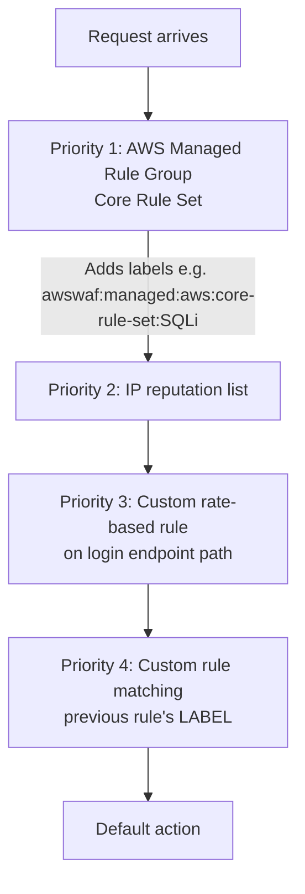
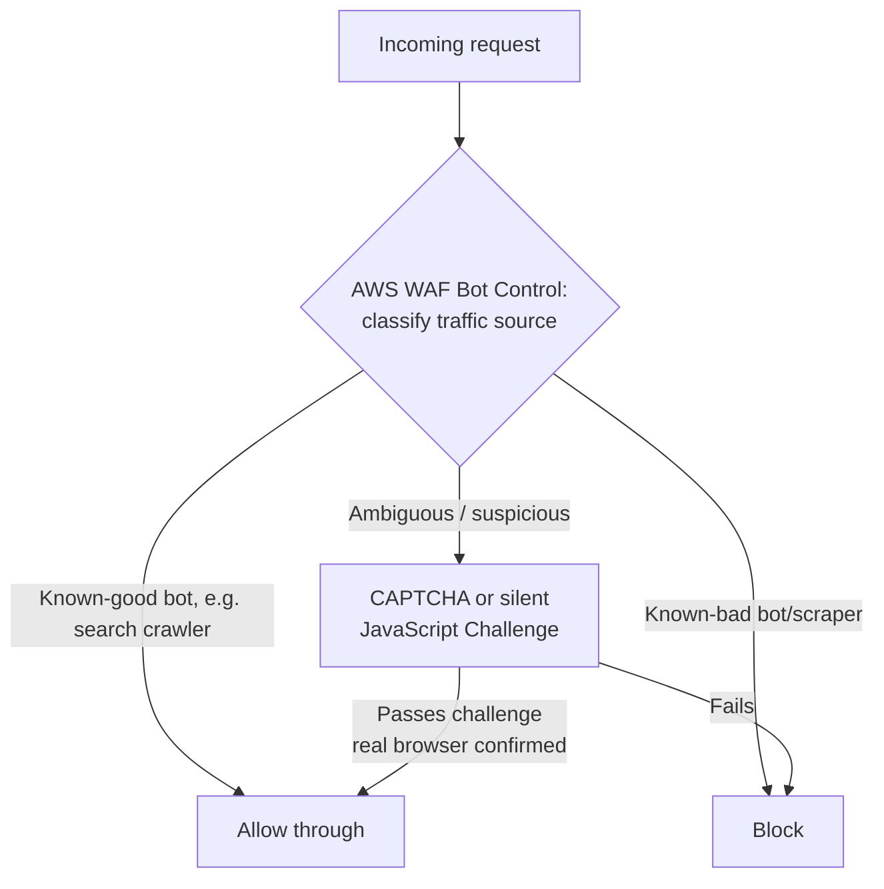
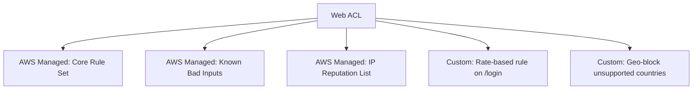
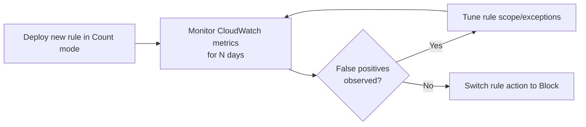
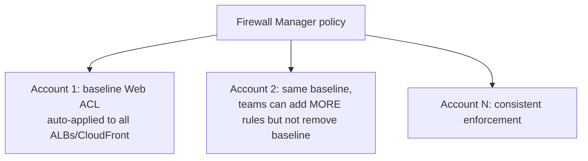
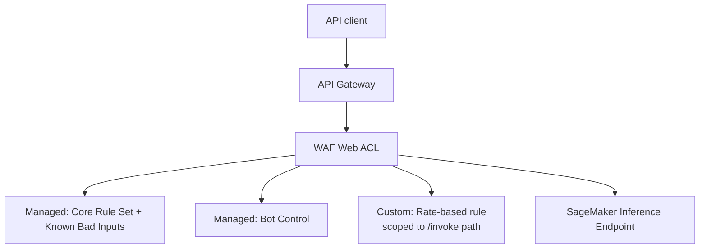

# AWS WAF (Web Application Firewall)

> **Appears in:** [DVA-C03](../../certifications/dva-c03/README.md) · [SAA-C03](../../certifications/saa-c03/README.md)


## Definition

WAF is a **Layer 7 (application-layer) firewall** that inspects the actual content of incoming
web requests — headers, query strings, body, IP address, geography — and blocks, allows, counts,
or rate-limits them based on rules you define, protecting web applications and APIs from common
exploits (SQL injection, cross-site scripting) and unwanted bot traffic.

## Purpose

Network-layer defenses (security groups, NACLs, Shield) can't tell the difference between a
legitimate HTTP request and one carrying a malicious SQL injection payload — both are "just
HTTP traffic" at that layer. WAF exists specifically to inspect *what's inside* the request and
make a content-aware decision, closing the gap that lower-layer network controls fundamentally
can't address, without requiring every application to implement its own input-sanitization
defenses from scratch.

## How It Works

```mermaid
flowchart TD
    Req[Incoming HTTP(S) request] --> Attach[WAF attached to:\nCloudFront / ALB / API Gateway / AppSync / Cognito]
    Attach --> WebACL[Web ACL: ordered list of rules]
    WebACL --> R1{Rule 1: AWS Managed Rule Group\ne.g. Core rule set — SQLi/XSS patterns}
    R1 -- Match --> Action1[Block / Allow / Count\nper rule's action]
    R1 -- No match --> R2{Rule 2: Rate-based rule\ne.g. >2000 req/5min from one IP}
    R2 -- Match --> Action2[Block that IP temporarily]
    R2 -- No match --> R3{Rule 3: Custom rule\ne.g. geo-match, IP set, string match}
    R3 -- Match --> Action3[Block / Allow / Count]
    R3 -- No match --> Default[Default action: Allow or Block]
    Action1 --> Log[Logged to CloudWatch/S3/Kinesis\nfor visibility + tuning]
    Action2 --> Log
    Action3 --> Log
    Default --> Log
```

Step by step:

1. WAF attaches directly to an AWS resource that terminates HTTP(S): **CloudFront**, an
   **Application Load Balancer**, **API Gateway**, **AppSync**, or a **Cognito** user pool —
   it inspects every request to that resource before it reaches your application.
2. A **Web ACL (Access Control List)** holds an **ordered list of rules**, evaluated top to
   bottom by priority. Rules can come from **AWS Managed Rule Groups** (pre-built, continuously
   updated rule sets for common threats — SQL injection, XSS, the OWASP Top 10, known bad bots,
   IP reputation lists) or from **rules you write yourself** (string match, regex match, size
   constraint, geo-match by country, IP set match, or rate-based limiting).
3. Each rule's outcome is one of: **Block** (reject the request, typically returning a 403),
   **Allow** (let it through, skip remaining rules depending on config), or **Count** (log it as
   if it matched, but don't actually block — the standard way to safely test a new rule in
   production before enforcing it).
4. **Rate-based rules** track request counts per IP (or other aggregation key) over a rolling
   window and automatically block an IP that exceeds the threshold — this is the mechanism
   behind protecting a login endpoint from credential-stuffing or brute-force attempts, and the
   mechanism Shield Advanced automatically creates/tunes during a detected application-layer
   DDoS attack.
5. If no rule matches, the Web ACL's **default action** (Allow or Block) applies. Every
   evaluated request (matched or not) can be logged to CloudWatch Logs, S3, or Kinesis Data
   Firehose for visibility, auditing, and rule tuning.

### Official AWS reference architecture: WAF Web ACL as the central inspection point


*Source: AWS Solutions Constructs, "aws-wafwebacl-cloudfront"
(docs.aws.amazon.com/solutions/latest/constructs/aws_wafwebacl_cloudfront.html)*

### Full rule evaluation order within a Web ACL, with priority and labels



**Labels** are an underused but testable WAF capability: a managed rule group can be configured
in **Count** mode specifically so it *labels* matching requests without blocking them, and a
later custom rule in the same Web ACL can then make the actual block/allow decision based on
that label — letting you build conditional logic across multiple rule evaluations rather than
each rule acting in total isolation.

### Bot Control and CAPTCHA/Challenge decision flow



## Key Features / Components

- **Web ACLs** — the top-level container of ordered rules, attached to one or more protected
  resources.
- **AWS Managed Rule Groups** — AWS-maintained rule sets (Core Rule Set, SQL database rule
  group, known bad inputs, Amazon IP reputation list, Bot Control) that update automatically as
  new threats emerge, without you having to track CVEs/exploit patterns yourself.
- **Custom rules** — string/regex match on headers or body, size constraints, geographic
  match/block by country, IP set match (block/allow specific IP ranges).
- **Rate-based rules** — automatic blocking of an IP (or custom aggregation key) exceeding a
  request-count threshold in a rolling time window — the primary defense against
  application-layer floods and brute-force/credential-stuffing attempts.
- **AWS WAF Bot Control** — a managed rule group specifically for identifying and
  categorizing/blocking automated bot traffic (scrapers, scanners) while allowing known-good
  bots (search engine crawlers) through.
- **CAPTCHA and Challenge actions** — instead of a flat block, WAF can present a CAPTCHA or a
  silent JavaScript challenge to verify a request is coming from a real browser, not a script.
- **Labels** — rules can tag matching requests with labels (without necessarily blocking them),
  which subsequent rules in the same Web ACL can then key their own decisions off of, enabling
  multi-stage conditional logic within one Web ACL.
- **Logging** — full request logging to CloudWatch Logs, S3, or Kinesis Data Firehose for
  analysis and rule tuning.
- **Firewall Manager integration** — deploy and enforce a consistent WAF Web ACL baseline
  across every account/resource in an Organization centrally.
- **Protection packs (newer console concept)** — a guided setup flow that recommends a bundle
  of rules/rule groups tailored to your described scenario, simplifying initial Web ACL
  configuration while still producing a standard underlying Web ACL you can further customize.

## Use Cases — When to Use It

- **Blocking SQL injection/XSS without custom detection logic.** Situation: a public API needs
  protection against common web exploits without the team building its own pattern-matching
  engine. Why this fits: AWS Managed Rule Groups give continuously-updated protection against the
  OWASP Top 10 with zero custom rule authoring. Tradeoff: managed rule group updates can
  occasionally start blocking previously-allowed legitimate traffic when AWS tunes patterns in
  response to new threat intelligence — business-critical endpoints may need the update pinned
  or run in parallel Count mode before trusting new versions blindly.
- **Rate-limiting a login endpoint against credential stuffing.** Situation: attackers are
  hammering a `/login` endpoint with stolen credential lists. Why this fits: a rate-based rule
  scoped specifically to that path (via a `ScopeDownStatement`) blocks abusive IPs without
  affecting normal browsing traffic elsewhere on the same site. Tradeoff: a rate limit set too
  aggressively can lock out legitimate users sharing an IP (corporate NAT, campus network) —
  tuning the threshold requires real traffic data, not a guess.
- **Geo-blocking high-fraud or unsupported regions.** Situation: an application doesn't operate
  in certain countries, or those countries account for disproportionate fraud/abuse. Why this
  fits: a geo-match rule blocks that traffic outright with a simple country-code list, no custom
  IP-range maintenance needed. Tradeoff: geo-blocking by IP geolocation isn't perfectly accurate
  and can be bypassed by VPNs — it's a blunt, imperfect instrument, not a precise access control.
- **Distinguishing good bots (search crawlers) from bad bots (scrapers).** Situation: a content
  site wants to block scraping/competitive data harvesting while still allowing legitimate search
  engine indexing. Why this fits: Bot Control classifies traffic sources and can block bad bots
  while explicitly allowing known-good ones through, rather than a blunt "block everything that
  looks automated" rule. Tradeoff: Bot Control's classification isn't infallible — a
  sophisticated scraper mimicking browser behavior closely enough may evade classification, and
  CAPTCHA/Challenge actions add real friction for ambiguous legitimate users too.
- **Safe rollout of a new security rule in production.** Situation: a team wants to deploy a new
  WAF rule without risking blocking legitimate traffic they didn't anticipate. Why this fits:
  deploying in **Count** mode first lets the team observe match volume via CloudWatch before
  switching to **Block**, catching false positives before they cause real user impact. Tradeoff:
  running in Count mode means the threat the rule targets is *not yet actually blocked* during
  the observation window — there's a real security/safety tradeoff in delaying enforcement to
  reduce false-positive risk.
- **Protecting a public ML inference endpoint from scraping and abuse.** Situation: a SageMaker
  model exposed via API Gateway needs protection from both competitors harvesting model behavior
  and malicious payloads probing the infrastructure. Why this fits: layering a Managed Rule Group
  (payload protection), Bot Control (scraping), and a rate-based rule scoped to the inference
  path (cost/extraction control) addresses three distinct risks at once. Tradeoff: each layer
  adds its own WCU cost and potential for false positives — a legitimate high-volume API client
  (a partner integration) needs an explicit allowlist carve-out or it gets rate-limited alongside
  actual abusers.
- **Compliance evidence of application-layer attack mitigation (PCI-DSS).** Situation: an
  auditor wants proof that web application attacks (injection, XSS) are actively defended
  against, not just assumed handled by the application's own code. Why this fits: WAF's
  CloudWatch/S3/Kinesis logging gives a concrete, timestamped record of blocked/counted requests
  as evidence of an active control. Tradeoff: logs showing blocked requests prove the control
  exists and fires — they don't prove the application's own input handling is also correct;
  WAF is a defense-in-depth layer, not a substitute for secure application code.
- **Org-wide consistent WAF baseline via Firewall Manager.** Situation: an enterprise wants every
  account's ALB/CloudFront to inherit the same baseline Web ACL rules, with teams free to add
  more but not remove the baseline. Why this fits: Firewall Manager enforces this centrally
  without each team's WAF configuration drifting independently. Tradeoff: a baseline that's too
  broad/restrictive for one team's specific application creates friction — Firewall Manager
  policies need to be genuinely "lowest common denominator safe" or they generate constant
  exception requests.
- **Zero-trust content inspection regardless of request origin.** Situation: a security team
  wants every request inspected for malicious content, not just requests from "untrusted"
  sources. Why this fits: WAF inspects every request to the protected resource uniformly —
  there's no network-location-based bypass, aligning with the zero-trust principle of never
  assuming origin implies safety. Tradeoff: uniform inspection of 100% of traffic has a real,
  non-trivial per-request cost at high volume — a cost/coverage tradeoff that needs budgeting for
  genuinely high-traffic applications.
- **Multi-stage conditional logic using labels.** Situation: a security team wants to combine
  multiple weak signals (suspicious user agent + unusual request pattern) into one confident
  block decision, rather than each signal alone triggering action. Why this fits: labels let an
  earlier rule tag matching requests (in Count mode) that a later rule can key its own decision
  off of, building compound logic within one Web ACL. Tradeoff: label-based multi-stage logic is
  more complex to reason about and debug than a single flat rule — troubleshooting why a request
  was or wasn't blocked requires tracing through multiple rule evaluations, not just one.

## When NOT to Use It / Alternatives

- **Protecting against volumetric network-layer DDoS floods** — that's **Shield**'s job; WAF
  operates at Layer 7 on request content, it doesn't absorb massive volumetric traffic the way
  Shield's edge-network mitigation does. See [`shield.md`](shield.md). In practice they're
  layered together, not substitutes.
- **Internal, non-HTTP traffic** (database connections, SSH, raw TCP services) — WAF only
  inspects HTTP(S) requests to the specific resource types it attaches to; use security groups/
  NACLs for general network-layer traffic control instead.
- **You need to inspect traffic at a resource WAF can't attach to** (e.g., a raw EC2 instance
  with no ALB/CloudFront/API Gateway in front of it) — put an ALB or CloudFront distribution in
  front of it first, or consider **AWS Network Firewall** for broader VPC-level traffic
  inspection beyond HTTP.
- **Extremely low-traffic internal tools with no public exposure and strict cost sensitivity**
  — WAF has a real per-rule, per-request cost; weigh it against actual risk for low-value
  internal-only endpoints.

## Common Architectures

### 1. Layered rule groups for a public API



### 2. Count-then-Block safe rollout pipeline



### 3. Centralized WAF baseline across an Organization via Firewall Manager



## Why It's Important

**Real-world weight:** SQL injection and cross-site scripting remain perennial entries in the
OWASP Top 10 despite being well-understood for decades, because manual input sanitization is
easy to get wrong in any one of hundreds of code paths. A managed, continuously-updated WAF
rule set is a pragmatic, low-maintenance defense-in-depth layer that catches classes of attack
even well-written application code sometimes misses.

**Exam weight:**
- **SAA-C03 — Domain 1, Task 1.2 "Design secure workloads and applications"** lists WAF
  explicitly alongside Shield — questions commonly test *where* WAF attaches (CloudFront, ALB,
  API Gateway) and the difference between WAF and Shield's scope.
- **DVA-C03 — Domain 2** touches WAF in the context of protecting APIs built with API Gateway;
  developers are expected to know WAF integrates directly with API Gateway stages.
- **MLA-C02 — Domain 4** references protecting public-facing inference endpoints, where WAF in
  front of an API Gateway/ALB fronting a SageMaker/Bedrock endpoint is a relevant control.

## Limits & Quotas

| Item | Default / Notes |
|---|---|
| Rules per Web ACL | 1,500 WCUs (Web ACL Capacity Units) worth of rules by default (soft, requestable) | Complexity-weighted, not a simple rule count — a regex-heavy rule costs more WCUs than a simple IP match |
| Web ACLs per account per Region/scope | 100 (soft) |
| Rate-based rule evaluation window | Fixed rolling windows (e.g., 5 minutes) with a configurable request-count threshold | |
| Managed Rule Group updates | Automatic, no action required | AWS/Marketplace vendors push updates; your Web ACL picks them up without redeployment |
| Request body inspection size | Limited (a few tens of KB by default, configurable higher for some resource types) | A question about "large POST bodies bypassing inspection" points to this size-limit nuance |

**Web ACL Capacity Units (WCUs)** are the real governing constraint, not a flat rule count —
simple rules (an IP match) cost very few WCUs; complex rules (nested logical statements, large
regex patterns) cost significantly more, so a Web ACL can hit its capacity ceiling with far
fewer than 1,500 "rules" if those rules are individually expensive.

## Pricing Model

- Billed per **Web ACL** (fixed monthly fee), per **rule** within that Web ACL (fixed monthly
  fee each), and per **million requests** processed.
- **Managed Rule Groups from AWS Marketplace vendors** may carry additional subscription costs
  beyond AWS's own managed groups.
- No free tier for WAF itself — cost scales with both configuration complexity (rule count/WCUs)
  and traffic volume.
- See: https://aws.amazon.com/waf/pricing/ for current numbers.

## Hands-on Lab (Floci)

```bash
# Create a Web ACL with a rate-based rule and a simple custom block rule
awslocal wafv2 create-web-acl --name study-web-acl --scope REGIONAL \
  --default-action Allow={} \
  --visibility-config SampledRequestsEnabled=true,CloudWatchMetricsEnabled=true,MetricName=studyWebAcl \
  --rules '[
    {
      "Name": "RateLimit2000",
      "Priority": 1,
      "Action": {"Block": {}},
      "Statement": {"RateBasedStatement": {"Limit": 2000, "AggregateKeyType": "IP"}},
      "VisibilityConfig": {"SampledRequestsEnabled": true, "CloudWatchMetricsEnabled": true, "MetricName": "rateLimit"}
    },
    {
      "Name": "BlockBadCountry",
      "Priority": 2,
      "Action": {"Block": {}},
      "Statement": {"GeoMatchStatement": {"CountryCodes": ["KP"]}},
      "VisibilityConfig": {"SampledRequestsEnabled": true, "CloudWatchMetricsEnabled": true, "MetricName": "geoBlock"}
    }
  ]'

# List Web ACLs and inspect one
awslocal wafv2 list-web-acls --scope REGIONAL
awslocal wafv2 get-web-acl --name study-web-acl --scope REGIONAL --id <id-from-above>

# Associate it with an existing ALB (requires the ALB's ARN from an ELB lab)
awslocal wafv2 associate-web-acl \
  --web-acl-arn <web-acl-arn> --resource-arn <alb-arn>
```

### Extended lab: Count-mode rollout and a labeled two-stage rule

```bash
# Deploy a new custom rule in COUNT mode first — standard safe rollout practice
cat > count-mode-rule.json << 'EOF'
[
  {
    "Name": "SuspiciousUserAgent",
    "Priority": 3,
    "Action": {"Count": {}},
    "Statement": {
      "ByteMatchStatement": {
        "SearchString": "curl",
        "FieldToMatch": {"SingleHeader": {"Name": "user-agent"}},
        "TextTransformations": [{"Priority": 0, "Type": "LOWERCASE"}],
        "PositionalConstraint": "CONTAINS"
      }
    },
    "VisibilityConfig": {"SampledRequestsEnabled": true, "CloudWatchMetricsEnabled": true, "MetricName": "suspiciousUA"}
  }
]
EOF

# Attach AWS Managed Rule Group for SQL injection protection
awslocal wafv2 update-web-acl --name study-web-acl --scope REGIONAL --id <id> \
  --default-action Allow={} \
  --visibility-config SampledRequestsEnabled=true,CloudWatchMetricsEnabled=true,MetricName=studyWebAcl \
  --rules "$(cat count-mode-rule.json)"
```

## Troubleshooting / Common Issues

**"New rule is blocking legitimate traffic unexpectedly":**
1. Check whether the rule was deployed directly in **Block** mode instead of **Count** mode
   first — this is the textbook rollout mistake WAF's Count action specifically exists to
   prevent.
2. Review CloudWatch sampled requests for the rule to see exactly which legitimate requests
   matched, and refine the rule's scope (narrower string match, more specific IP set) rather
   than disabling it entirely.

**"A managed rule group update suddenly started blocking previously-allowed traffic":** this is
expected behavior when AWS updates a managed rule group's patterns in response to new threat
intelligence — if business-critical, consider pinning to a specific managed rule group *version*
(where supported) rather than always tracking the latest, or run a parallel Count-mode copy of
updated groups before fully trusting auto-updates in a highly sensitive environment.

**"Web ACL seems to not be inspecting large POST request bodies":** check the configured
request body inspection size limit for the resource type — bodies beyond the configured
threshold may not be fully inspected by content-matching rules, a specific and testable gap
distinct from "the rule itself is broken."

**"Hit the WCU capacity ceiling while adding more rules":** request a capacity increase, or
audit existing rules for unnecessarily expensive constructs (overly broad regex, unnecessarily
nested logical statements) — WCU cost is about rule complexity, not just rule count, so
simplifying existing rules can free capacity without reducing coverage.

## Exam Tips

- **WAF vs. Shield — same recurring pairing** — WAF = content inspection (Layer 7: SQLi, XSS,
  bad bots); Shield = volumetric/availability protection (Layer 3/4, and with Advanced, some L7
  via WAF integration). A question mentioning "SQL injection" or "cross-site scripting" always
  points to WAF, never Shield alone.
- **WAF attaches to specific resource types only**: CloudFront, ALB, API Gateway, AppSync,
  Cognito user pools. It does not attach directly to a raw EC2 instance or NLB — know this list.
- **Count mode before Block mode** — the safe rollout pattern for new rules; a question about
  "test a new rule without risking blocking legitimate traffic" wants Count mode first.
- **Rate-based rules are the standard credential-stuffing/brute-force defense** at the
  application layer — distinguish this from Shield's broader volumetric DDoS mitigation.
- **Managed Rule Groups update automatically** — you don't maintain SQL injection/XSS pattern
  lists yourself; AWS (and optional Marketplace vendors) keep them current.
- **Web ACL Capacity Units (WCUs), not a flat rule count**, govern Web ACL complexity limits —
  a question about hitting a capacity ceiling with "few" rules is testing whether you know
  complex rules (regex, nested logic) cost disproportionately more capacity.
- **Labels enable multi-stage rule logic** within one Web ACL — a question about combining
  signals from multiple rules before a final block/allow decision points to this capability.
- **Firewall Manager** deploys consistent WAF Web ACLs across many accounts — same
  multi-account governance pattern as Shield Advanced.
- Tested in **SAA-C03 Domain 1 (30%)** and touched in **DVA-C03 Domain 2 (26%)**.

## Worked exam scenario: API Gateway protecting a public ML inference endpoint

A company exposes a SageMaker model through API Gateway for public inference requests and wants
to prevent both scraping (competitors harvesting model behavior via automated queries) and
malicious payloads crafted to probe the underlying infrastructure. The correct design layers
three WAF capabilities together: an **AWS Managed Rule Group** (Core Rule Set + Known Bad
Inputs) for payload-level protection, **Bot Control** to identify and block automated scraping
traffic while allowing legitimate API clients, and a **rate-based rule** scoped to the specific
inference endpoint path to cap how many inference calls any single API key/IP can make per
window — directly limiting both cost exposure (inference calls aren't free) and model-extraction
risk from high-volume automated querying.



## Worked example: a complete multi-rule-group Web ACL as real JSON

```json
{
  "Name": "ProductionWebACL",
  "Scope": "CLOUDFRONT",
  "DefaultAction": { "Allow": {} },
  "Rules": [
    {
      "Name": "AWS-AWSManagedRulesCommonRuleSet",
      "Priority": 0,
      "OverrideAction": { "None": {} },
      "Statement": {
        "ManagedRuleGroupStatement": { "VendorName": "AWS", "Name": "AWSManagedRulesCommonRuleSet" }
      },
      "VisibilityConfig": { "SampledRequestsEnabled": true, "CloudWatchMetricsEnabled": true, "MetricName": "commonRuleSet" }
    },
    {
      "Name": "LoginEndpointRateLimit",
      "Priority": 1,
      "Action": { "Block": {} },
      "Statement": {
        "RateBasedStatement": {
          "Limit": 300,
          "AggregateKeyType": "IP",
          "ScopeDownStatement": { "ByteMatchStatement": { "SearchString": "/login", "FieldToMatch": { "UriPath": {} }, "TextTransformations": [{ "Priority": 0, "Type": "NONE" }], "PositionalConstraint": "STARTS_WITH" } }
        }
      },
      "VisibilityConfig": { "SampledRequestsEnabled": true, "CloudWatchMetricsEnabled": true, "MetricName": "loginRateLimit" }
    }
  ]
}
```

The `ScopeDownStatement` nested inside the rate-based rule is a frequently-missed but
important capability: it narrows the rate limit to apply **only** to requests matching the
inner statement (here, the `/login` path specifically), rather than rate-limiting every request
to the entire site uniformly — letting you set an aggressive threshold on a sensitive endpoint
without affecting normal browsing traffic elsewhere on the same site.

## WAF Classic vs. WAFv2 — A Legacy Distinction Still Worth Recognizing

| | WAF Classic (legacy) | WAFv2 (current) |
|---|---|---|
| API/CLI prefix | `waf`/`waf-regional` | `wafv2` |
| Rule groups | Limited, less composable | Full managed + custom rule group support |
| CloudFront + regional in one API | No — separate APIs | Yes — unified `wafv2` API with a `Scope` parameter |
| Labels | Not supported | Supported |
| Bot Control, CAPTCHA | Not supported | Supported |

Seeing `wafv2` in a CLI command or API reference (as used throughout this doc's lab sections)
confirms you're working with the current generation; `waf`/`waf-regional` prefixes belong to
the legacy Classic API that AWS documentation increasingly treats as superseded.

## Further Reading

- AWS WAF Developer Guide — How AWS WAF works:
  https://docs.aws.amazon.com/waf/latest/developerguide/how-aws-waf-works.html
- AWS WAF Developer Guide — Configuring protection in AWS WAF (Web ACLs):
  https://docs.aws.amazon.com/waf/latest/developerguide/web-acl.html
- AWS Solutions Constructs — aws-wafwebacl-cloudfront:
  https://docs.aws.amazon.com/solutions/latest/constructs/aws_wafwebacl_cloudfront.html
- AWS Solutions Library — Security Automations for AWS WAF:
  https://docs.aws.amazon.com/solutions/latest/security-automations-for-aws-waf/architecture-overview.html
- AWS WAF pricing: https://aws.amazon.com/waf/pricing/

## Related Terms

- [`shield.md`](shield.md) — the complementary volumetric/availability defense, often layered with WAF
- [`security-hub-and-inspector.md`](security-hub-and-inspector.md) — central findings visibility
- [`organizations-and-scps.md`](organizations-and-scps.md) — Firewall Manager's org-wide WAF deployment model
- `glossary/` — OWASP Top 10, SQL injection, XSS, Web ACL, rate-based rule
