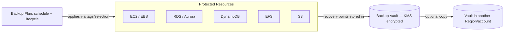
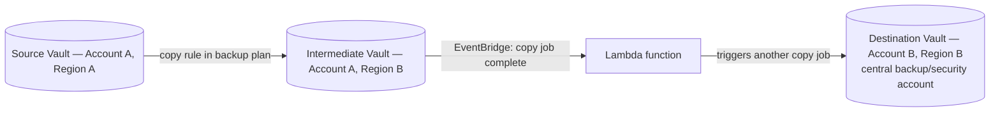
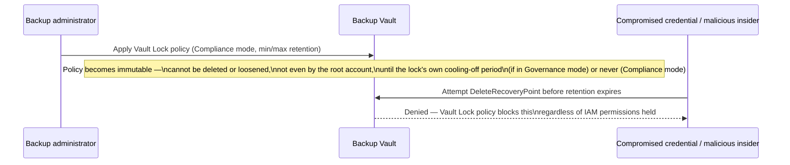

# AWS Backup

> **Appears in:** [SAA-C03](../../certifications/saa-c03/README.md)


<!-- official AWS Architecture Icons asset; see diagrams/README.md for the convention -->

*Service · Storage · maps to SAA-C03 Domain 1 & 2*

## Definition

AWS Backup is a **fully managed, centralized backup service**. Instead of configuring backups
separately inside each AWS service (an EBS snapshot schedule here, an RDS snapshot setting there,
a DynamoDB point-in-time-recovery toggle somewhere else), you define one policy — a **backup
plan** — and apply it across many services and many accounts at once.

## Purpose

Every AWS service that holds data historically had its *own* backup mechanism, each with different
settings, different retention models, and no single place to prove to an auditor "here is our
backup policy and here is proof it ran." For regulated industries and any team running more than a
handful of resources, that fragmentation is both an operational burden and a compliance risk. AWS
Backup exists to give one consistent policy engine, one audit trail, and one place to test
restores — across EC2, EBS, RDS/Aurora, DynamoDB, EFS, FSx, Storage Gateway volumes, and S3.

It's worth being explicit about what AWS Backup *is not*: it does not replace each service's native
backup mechanism, it **orchestrates** it. Under the hood, a backup job against an EBS volume is
still, literally, an EBS `CreateSnapshot` call; against RDS it's still an RDS snapshot. What AWS
Backup adds on top is the scheduling, tagging-based resource discovery, cross-account/cross-Region
copy automation, immutability (Vault Lock), and audit/compliance reporting layer that each
individual service's own console doesn't provide on its own.

## How It Works



Walking through it:

1. You create a **backup plan**: a schedule (cron-like, e.g., daily at 5 AM UTC), a lifecycle
   (e.g., move to cold storage after 30 days, delete after 365), and optionally a cross-
   Region/cross-account copy rule.
2. You assign resources to the plan either by **explicit ARN** or — more commonly — by **tags**
   (e.g., "back up everything tagged `Environment=production`"), so new resources get protected
   automatically just by being tagged correctly.
3. On schedule, AWS Backup triggers the right native backup API for each resource type behind the
   scenes (an EBS snapshot, an RDS snapshot, a DynamoDB export, etc.) and stores the resulting
   **recovery point** inside a **backup vault** — an encrypted, access-controlled container.
4. If configured, the recovery point is also **copied to a vault in another Region or account**,
   protecting against a Region-wide event or a compromised/deleted primary account.

### Real-world architecture: protecting an S3 data lake


*Figure: a production AWS Backup architecture protecting an Amazon S3 data lake, showing the
separation between the storage administrator (who configures S3-native protections like
Versioning, Replication, and Object Lock) and the backup administrator (who owns backup plans,
vaults, and the KMS keys that encrypt them) — a separation-of-duties pattern AWS explicitly
recommends for compliance-sensitive data lakes. Source: [AWS Storage Blog — "Best practices for data lake protection with AWS Backup"](https://aws.amazon.com/blogs/storage/best-practices-for-data-lake-protection-with-aws-backup/), © Amazon Web Services.*

### Cross-account copy destination flow


*Figure: configuring a "copy to destination" rule within a backup plan — this is the mechanism that
automatically pushes a second copy of every recovery point into a different account and/or Region,
without any extra scripting or EventBridge/Lambda glue needed. Source: [AWS Storage Blog — "Best practices for data lake protection with AWS Backup"](https://aws.amazon.com/blogs/storage/best-practices-for-data-lake-protection-with-aws-backup/), © Amazon Web Services.*



This two-hop pattern (same-account cross-Region copy, then an event-triggered second copy into a
different account) is a real, AWS-documented architecture for protecting **encrypted** resources
across account boundaries, since a direct cross-account copy of an encrypted recovery point
requires careful KMS key-policy coordination that's easier to manage in two discrete steps.

### AWS Backup Vault Lock — the immutability guarantee



Vault Lock comes in two modes: **Governance mode** can still be removed by specific authorized
principals (useful while testing a retention policy before committing to it), while **Compliance
mode** is permanent — once locked, *no one*, including AWS itself, can delete the vault or shorten
retention before it expires. This is the single feature that turns "we have backups" into "we have
backups an attacker with full admin access cannot destroy," which is the actual bar most ransomware
and regulatory-compliance frameworks require.

## Key Features / Components

- **Backup plans** — schedule + lifecycle (transition to cold storage, expiration) + copy rules,
  reusable across many resources.
- **Backup vaults** — encrypted containers for recovery points; access controlled via vault access
  policies (resource-based, like S3 bucket policies).
- **Vault Lock** — makes a vault **immutable (WORM)** — once locked, not even the root account can
  delete recovery points before their retention expires, a key ransomware/compliance defense.
- **Tag-based resource assignment** — new resources matching a tag are automatically enrolled,
  reducing "we forgot to back this one up" risk.
- **Cross-Region / cross-account copy** — built-in DR and centralized-governance pattern (e.g., a
  security/backup account in AWS Organizations holding copies from many member accounts).
- **On-demand backups** — manual, one-off backup outside the schedule (e.g., right before a risky change).
- **AWS Backup Audit Manager** — generates compliance reports showing which resources are/aren't
  covered by a plan, and whether backups actually completed successfully.
- **Restore testing** — automated, periodic test restores to validate that backups are actually
  usable, not just "present."
- **Legal hold** — freeze specific recovery points from deletion/expiration during litigation or investigation.
- **Logically air-gapped vaults** — a newer vault type that stores backups in an isolated,
  service-owned account boundary, automatically compliance-locked, shareable via AWS Resource
  Access Manager for cross-account restore without needing a separate copy job for every resource.
- **Continuous backup (PITR) for S3 and supported services** — point-in-time restore to any second
  within a retention window of up to 35 days, layered alongside periodic (snapshot-style) backups
  in the same plan.

## Use Cases — When to Use It

- **Regulated healthcare group needing one provable backup policy across EC2, RDS, and DynamoDB.** An
  auditor wants a single policy and a single audit trail, not three different per-service configuration
  screenshots. One AWS Backup plan applied by tag covers all three natively. *Alternative cost:*
  configuring each service's native backup tool separately means stitching together three audit
  stories for every compliance review.
- **Ransomware resilience for a mid-size company after a near-miss credential compromise.** The company
  needs recovery points an attacker with full admin access cannot delete. Vault Lock in Compliance mode
  makes backups immutable even against a compromised root account. *Alternative cost:* relying on IAM
  permission boundaries alone doesn't help if the attacker's stolen credential already has the
  deny-bypassing privilege.
- **Cross-account/cross-Region DR governance for a company under AWS Organizations.** Quickly growing
  member accounts all need consistent backup coverage without per-account manual setup. An
  Organization-wide backup policy plus tag-based assignment enrolls every new resource in every account
  automatically. *Alternative cost:* manually configuring backups per account as they're created
  guarantees some will be missed — exactly the audit finding AWS Backup exists to prevent.
- **Protecting a multi-service e-commerce application (EC2 + RDS + EFS) with one consistent retention
  window.** The checkout service, its database, and its shared asset storage must all restore to the
  same point in time after an incident. One backup plan applied across all three resource types
  guarantees consistent scheduling/retention. *Alternative cost:* three separate native backup
  schedules risk subtly different retention windows that don't actually let you restore the whole
  application consistently.
- **Pre-deployment backup gate in a CI/CD pipeline for a SaaS company.** Before a risky database
  migration runs, the pipeline needs an automatic, auditable rollback point without waiting for the
  nightly schedule. An on-demand AWS Backup job via API, triggered as a pipeline step, gives this.
  *Alternative cost:* relying on the previous night's scheduled backup instead could be many hours
  stale by deployment time.
- **Protecting an S3 data lake with separation of duties for a financial institution.** Compliance
  requires that no single compromised identity can both alter live data and delete its backups. A
  backup administrator role owns the AWS Backup vault/KMS key independently from the storage
  administrator who manages bucket-level S3 features. *Alternative cost:* letting the same team/role
  manage both fails the separation-of-duties control an auditor will specifically ask about.
- **Compliance archival of 7-year financial records with centralized cold-storage transition.** Records
  must move to cheap, auditable cold storage automatically as they age, across every account that
  generates them. A backup plan's lifecycle rule (warm-to-cold transition, expiration) applies
  uniformly without per-account scripting. *Alternative cost:* hand-building per-account lifecycle
  automation instead duplicates logic the backup plan already centralizes.
- **Logically air-gapped vault for a company in a highly targeted industry (critical infrastructure).**
  The company needs backup storage isolated into a separate, service-owned account boundary an
  attacker in the production account structure can't reach even with full admin rights there. A
  logically air-gapped vault, shareable only via AWS RAM, gives this highest-isolation tier.
  *Alternative cost:* a regular cross-account copy rule still depends on the destination account's own
  security posture, which may itself be compromised in a sophisticated attack.
- **Database storage recovery testing for an insurance company's quarterly DR drill.** Compliance
  requires proof that backups are actually restorable, not just present. AWS Backup's automated
  restore testing validates this on a schedule and produces a report. *Alternative cost:* trusting
  "the backup job succeeded" as proof of restorability is exactly the gap that turns a real disaster
  into a failed recovery.
- **Centralizing Storage Gateway volume backups for a branch-office hybrid environment.** A retail
  chain's Stored Volume Gateway backups (per-branch EBS snapshots) need the same governance as its
  cloud-native resources. AWS Backup can apply the same plan/retention/Vault Lock policy to Storage
  Gateway volumes alongside EC2/RDS. *Alternative cost:* managing Storage Gateway's own native snapshot
  scheduling separately reintroduces the fragmented-policy problem AWS Backup exists to solve.
- **Log retention governance for a SaaS company's observability data.** Operational logs stored in a
  supported backup target need the same retention and immutability guarantees as the rest of the
  company's protected resources, without a separate bespoke policy. A single backup plan extended to
  cover the log-storage resource keeps the audit story uniform. *Alternative cost:* a standalone
  retention script for just the logging resource is one more unaudited, unmonitored process an
  auditor will ask about separately from everything else.

## When NOT to Use It / Alternatives

- **A single, one-off snapshot you'll delete in an hour** — just use the native EBS/RDS snapshot
  API directly; spinning up a backup plan for a single ad-hoc action is unnecessary overhead.
- **Extremely custom backup logic that doesn't fit the plan/schedule model** (e.g., application-
  consistent backups requiring a custom pre/post script sequence beyond what AWS Backup's hooks
  support) — you may need a native or third-party tool alongside AWS Backup, not instead of it.
- **Real-time/near-zero-RPO replication** (not really "backup" semantics at all) — look at
  database-native replication (RDS read replicas, DynamoDB Global Tables) or AWS Elastic Disaster
  Recovery for continuous replication instead.

## Why It's Important

**Real world:** backup governance is one of the first things an auditor or a new CISO asks about —
"show me your backup policy and prove it's being enforced" — and AWS Backup is the standard answer
for doing that across a multi-service AWS footprint without reinventing it per team. Vault Lock has
become a baseline ransomware-defense expectation in many compliance frameworks.

**Exam weight:** **SAA-C03** Domain 1, Task 1.3 ("Determine appropriate data security controls")
covers backup/replication policy design directly; Domain 2, Task 2.2 (resilient/fault-tolerant
architectures) covers backup as a core DR strategy element. Questions contrasting "use native
per-service snapshots" vs. "use AWS Backup to centralize policy across many services/accounts"
are a recurring pattern.

## Pricing Model — Deep Dive

| Component | Illustrative $/GB-month (us-east-1) |
|---|---|
| Warm storage (EBS, EFS, most services) | $0.05 |
| Warm storage (DynamoDB) | $0.10 |
| Cold storage (supported services: EBS, EFS, DynamoDB w/ advanced features, others) | $0.01–$0.0125 |
| Warm restore | $0.02/GB |
| Cold restore | $0.03/GB |
| Cross-Region/cross-account copy transfer | $0.02–$0.04/GB |
| Item-level restore | $0.50/request + per-GB charges |

*(Illustrative list prices at time of writing — confirm current numbers at
https://aws.amazon.com/backup/pricing/; AWS Backup pricing is layered **on top of** the storage
rates of whichever underlying service it's protecting, so always check both this page and the
target service's own pricing.)*

### Worked example 1 — warm vs. cold storage break-even for long-tail retention

A compliance requirement mandates keeping EBS backups for 7 years, but restores are essentially
never requested after the first 90 days. For 2 TB of backup data:

```
All warm storage, 7 years:   2,000 GB × $0.05 × 84 months          = $8,400.00 total
Warm for 90 days, then cold:
  Warm (3 months):           2,000 GB × $0.05 × 3                   =   $300.00
  Cold (remaining ~81 months): 2,000 GB × $0.0125 × 81                =  $2,025.00
  ------------------------------------------------------------------------------
  Total                                                               ≈ $2,325.00 total
```

Moving to cold storage after the realistic "might still need a fast restore" window saves roughly
**72%** over the full retention period for data that's genuinely long-tail — directly mirroring the
cost logic of S3 lifecycle transitions, just inside AWS Backup's own vault pricing instead.

### Worked example 2 — cross-account copy cost for centralized DR governance

An organization with 10 member accounts, each generating roughly 500 GB/month of new backup data,
copies every recovery point to a central security/backup account in a different Region:

```
Per account:   500 GB × $0.03 (illustrative cross-region transfer rate)  =  $15.00/month
10 accounts:   10 × $15.00                                                = $150.00/month
+ destination-account storage at that Region's warm/cold rate (separate line item)
```

This cost is usually treated as the price of **provable, centralized compliance** rather than
optimized away — the alternative (an attacker or an accidental deletion wiping out the only copy of
a resource in its home account) is the risk this spend is buying down.

### Worked example 3 — item-level restore vs. full recovery-point restore

Recovering a single accidentally-deleted file from an EFS backup, instead of the whole file
system:

```
Item-level restore: $0.50 flat request fee + per-GB charge for just the recovered item(s)
Full recovery-point restore: no flat fee, but restores (and bills for) the entire file system's data
```

For large file systems where only a handful of files need recovering, item-level restore is both
operationally faster and usually cheaper — but it is only available for a specific subset of
resource types (EFS, S3, EBS, VMware, EKS, Redshift Serverless at time of writing), so always
check whether the protected resource type supports it before assuming it's an option.

## Common Architectures

**1. Organization-wide tag-based governance via AWS Organizations.** A management account deploys
CloudFormation StackSets that provision IAM roles, local backup vaults, and KMS keys into every
member account, then attaches an **Organization backup policy** at the root OU — any resource
tagged `Environment=production` anywhere in the organization is automatically enrolled in a
standard backup plan, with no per-account manual setup required as new accounts are created.

**2. Logically air-gapped vault for ransomware resilience.** Fully managed resources (S3, DynamoDB,
EFS) back up directly into a logically air-gapped vault with no intermediate copy step; non-fully-
managed resources (EBS, Aurora, FSx) first create a temporary snapshot in the source account, which
AWS Backup then transfers into the air-gapped vault and cleans up automatically — giving every
resource type a path into an isolated, compliance-locked vault that's shareable to a recovery
account via AWS RAM without ever granting that recovery account standing access to production.

**3. Separation-of-duties S3 data lake protection.** A storage administrator owns S3-native
protections (Versioning, Same/Cross-Region Replication, Object Lock), while a distinct backup
administrator role owns the AWS Backup plan, vault access policy, and vault's KMS key — enforced
via IAM Identity Center role mapping — so that no single compromised identity can both alter the
live data *and* delete its backups.

**4. Pre-change on-demand backup gate in a CI/CD pipeline.** Before a deployment pipeline applies a
potentially destructive database migration, it triggers an **on-demand backup** of the target
resource via the AWS Backup API and waits for confirmation that the recovery point completed
successfully before proceeding — giving every risky deployment an automatic, auditable rollback
point without relying on the scheduled nightly backup alone (which might be many hours stale by
deployment time).

## Limits & Quotas

- **Backup plans per account** — soft limit commonly around 100 (raisable via Service Quotas).
- **Resource assignments per backup plan** — effectively unbounded when assigned by tag (scales
  automatically with tagged resources); explicit ARN-based selections have a lower practical limit
  per plan.
- **Backup vaults per account/Region** — soft limit commonly around 100 (raisable).
- **Continuous backup (PITR) retention** — maximum **35 days**; longer retention requires layering
  periodic (snapshot) backups on top within the same plan.
- **Vault Lock minimum lock-in** — Governance mode can be removed by sufficiently privileged
  principals; Compliance mode, once applied, **cannot** be removed or weakened for the life of the
  vault — treat enabling Compliance mode as a one-way door.
- **Cross-account copy** — requires the destination vault's access policy to explicitly allow the
  source account (and, for KMS-encrypted resources, appropriate key policy grants) — this is a
  configuration step, not an automatic capability.
- **Legal hold** — can be applied to a vault or specific recovery points; while active, it overrides
  even a configured lifecycle expiration rule, intentionally preventing deletion during litigation.
- **Backup Audit Manager controls** — a fixed catalog of managed controls (e.g., "resources are
  protected by backup plan," "recovery points are encrypted," "last recovery point created within N
  days"), each independently scoped by tags, with custom frameworks combining multiple controls
  into one named, reportable compliance bundle.
- **Logically air-gapped vault minimum retention** — carries its own fixed Compliance-mode lock by
  design (not optional), reflecting its purpose as the highest-isolation vault type.
- **Restore job concurrency** — subject to per-account, per-service concurrent restore-job quotas
  that vary by resource type; large-scale DR drills restoring many resources simultaneously should
  verify current quotas rather than assuming unlimited parallelism.

## Troubleshooting / Common Issues

- **"Resources I expected to be backed up aren't showing recovery points"** — the single most
  common cause is a **tag mismatch**: either the resource isn't tagged with the exact key/value the
  backup selection expects, or the selection's IAM role lacks permission on that specific resource
  type — check AWS Backup Audit Manager's compliance report, which flags untagged/unprotected
  resources explicitly.
- **Backup job fails with a permissions error** — the AWS Backup service role needs resource-
  specific permissions (e.g., `ec2:CreateSnapshot`, `rds:CreateDBSnapshot`) in addition to generic
  Backup permissions; the default `AWSBackupDefaultServiceRole` managed policy covers most common
  cases, but custom/restrictive IAM setups can silently block specific resource types.
- **Can't delete a vault or a recovery point before its scheduled expiration** — if Vault Lock
  (especially Compliance mode) is applied, this is **working as intended**, not a bug; there is no
  override.
- **Cross-account copy job stuck or failing** — verify the destination vault's **access policy**
  explicitly allows the source account's backup role to write to it, and that the KMS key
  protecting the destination vault grants the necessary cross-account key permissions.
- **Restore succeeded but the restored resource is in the wrong Region/account** — confirm the
  restore operation targeted the correct vault copy; a resource backed up with cross-Region/cross-
  account copy rules will have **separate, independently restorable** recovery points in each
  vault, and restoring from the wrong one is a common operator mistake during an actual incident.
- **Audit Manager reports show "non-compliant" resources that are definitely backed up** — check
  whether the control's *evaluation scope* (its own tag filter) actually matches the resource; a
  resource can be genuinely backed up by a plan while still failing an Audit Manager control whose
  tag-based scope doesn't line up with the plan's own tag-based assignment.

## Hands-on Lab (Floci)

**Honest limitation:** AWS Backup's control plane is not in Floci's documented support table
(only S3's object API is fully emulated — see `labs-floci/README.md`), and AWS Backup's real value
is orchestrating *other* services' native backup APIs (EBS, RDS, DynamoDB), several of which
aren't deeply emulated locally either. Use the commands below to learn the real CLI workflow; treat
unsupported responses from Floci as expected, and pair this with the native **EBS snapshot** lab in
[`ebs.md`](ebs.md) for the closest hands-on equivalent you can actually exercise locally.

```bash
# Create a backup vault
aws backup create-backup-vault --backup-vault-name study-vault

# Create a backup plan (daily, 30-day retention)
cat > plan.json << 'EOF'
{
  "BackupPlanName": "daily-study-plan",
  "Rules": [{
    "RuleName": "DailyBackups",
    "TargetBackupVaultName": "study-vault",
    "ScheduleExpression": "cron(0 5 * * ? *)",
    "Lifecycle": {"DeleteAfterDays": 30}
  }]
}
EOF
aws backup create-backup-plan --backup-plan file://plan.json

# Assign resources to the plan by tag
cat > selection.json << 'EOF'
{
  "SelectionName": "tag-production",
  "IamRoleArn": "arn:aws:iam::111122223333:role/AWSBackupDefaultServiceRole",
  "ListOfTags": [{"ConditionType": "STRINGEQUALS", "ConditionKey": "Environment", "ConditionValue": "production"}]
}
EOF
aws backup create-backup-selection --backup-plan-id <plan-id> --backup-selection file://selection.json

# Trigger an on-demand backup job for a specific EBS volume
aws backup start-backup-job \
  --backup-vault-name study-vault \
  --resource-arn arn:aws:ec2:us-east-1:111122223333:volume/vol-xxxxxxxx \
  --iam-role-arn arn:aws:iam::111122223333:role/AWSBackupDefaultServiceRole

# List recovery points in the vault
aws backup list-recovery-points-by-backup-vault --backup-vault-name study-vault

# Apply a Vault Lock policy (Governance mode, for testing before committing to Compliance)
aws backup put-backup-vault-lock-configuration \
  --backup-vault-name study-vault \
  --min-retention-days 30 --max-retention-days 2555 --changeable-for-days 3

# Start a restore job from a recovery point
aws backup start-restore-job \
  --recovery-point-arn arn:aws:backup:us-east-1:111122223333:recovery-point:xxxxxxxx-xxxx \
  --iam-role-arn arn:aws:iam::111122223333:role/AWSBackupDefaultServiceRole \
  --metadata '{"file-system-id":"fs-xxxxxxxx"}'
```

## Exam-Style Scenario Walkthroughs

**Scenario 1:** A regulated healthcare company runs EC2/EBS, RDS, and DynamoDB workloads across 15
AWS accounts under AWS Organizations, and an auditor demands a single, provable backup policy with
evidence that every production resource is actually covered and backups actually succeed. What's
the solution, and what specific AWS Backup feature produces the audit evidence?

*Answer:* A centralized AWS Backup deployment via AWS Organizations (StackSets provisioning roles
and vaults into every member account, an Organization backup policy enforcing tag-based assignment
at the root OU), paired with **AWS Backup Audit Manager**, which generates compliance reports
showing exactly which resources are/aren't covered by a plan and whether scheduled backups actually
completed — the artifact an auditor is asking for.

**Scenario 2:** A company suffered a ransomware incident where the attacker obtained
administrator-level credentials and attempted to delete all backup recovery points before
encrypting production data. Going forward, what AWS Backup feature specifically prevents this, and
which of its two modes should be chosen for a permanent, non-negotiable policy?

*Answer:* AWS Backup **Vault Lock**, in **Compliance mode**. Governance mode can still be removed
by sufficiently privileged principals (useful only for testing a policy before committing), while
Compliance mode is permanent and cannot be reversed or bypassed by anyone, including the root
account — the only mode that actually defeats a fully-compromised administrator credential.

**Scenario 3:** An organization needs backups of a specific RDS database copied automatically into
a separate AWS account dedicated to backup storage, in a different Region than production, with no
custom scripting. What AWS Backup feature handles this directly within the backup plan itself?

*Answer:* A **copy rule** within the backup plan's rule definition, specifying the destination
vault's ARN (in the target account/Region) — AWS Backup automatically copies each recovery point
there as part of the same scheduled job, with no EventBridge/Lambda glue required for the basic
case (more complex encrypted cross-account scenarios may still use the two-hop
intermediate-vault-plus-Lambda pattern described above).

**Scenario 4:** A team needs to recover a single accidentally deleted file from a 10 TB EFS file
system backup, as fast and cheaply as possible, without restoring the entire file system. What
AWS Backup capability fits, and what's the cost model difference versus a full restore?

*Answer:* **Item-level restore** — supported for EFS (among a specific list of resource types) —
which charges a flat per-request fee (~$0.50) plus per-GB charges for just the recovered item(s),
rather than restoring (and being billed for) the entire 10 TB file system, which both an item-level
restore and a full recovery-point restore would need to read through if a less-targeted option were
used instead.

## Exam Tips

- **"Centralize backup policy across multiple AWS services/accounts"** is the signature phrase
  pointing to AWS Backup over any single service's native snapshot tooling.
- **Vault Lock = immutability / WORM / ransomware or compliance defense** — if a question mentions
  "even an administrator should not be able to delete backups before retention expires," that's
  Vault Lock specifically, not just "a backup vault."
- **Governance mode vs. Compliance mode** — Governance can still be bypassed by authorized
  principals (useful for testing); Compliance is permanent and irreversible. A question emphasizing
  "not even AWS can override this" wants Compliance mode.
- Don't confuse AWS Backup (centralized backup **orchestration/policy**) with **Storage Gateway**
  (a hybrid **access bridge** for on-prem apps) — they can work together (AWS Backup can protect
  Storage Gateway volumes) but solve different problems.
- Tag-based assignment is the scalable pattern tested over manually listing every resource ARN.
- **Logically air-gapped vaults** are the newest, most isolated option — if a scenario needs backup
  storage that's isolated into a separate, service-owned account boundary shareable via AWS RAM,
  that's the specific feature being tested, not a regular cross-account copy rule.

## Further Reading

- [AWS Backup Developer Guide](https://docs.aws.amazon.com/aws-backup/latest/devguide/whatisbackup.html) — official documentation home
- [AWS Backup Vault Lock](https://docs.aws.amazon.com/aws-backup/latest/devguide/vault-lock.html)
- [AWS Backup pricing](https://aws.amazon.com/backup/pricing/) — current, authoritative rates
- [AWS Storage Blog — Best practices for data lake protection with AWS Backup](https://aws.amazon.com/blogs/storage/best-practices-for-data-lake-protection-with-aws-backup/) — the architecture and figures referenced above
- [AWS Storage Blog — Streamline ransomware protection with logically air-gapped vaults](https://aws.amazon.com/blogs/storage/streamline-ransomware-protection-while-reducing-cost-with-logically-air-gapped-vault-primary-backup/)

## Related Terms

- [`ebs.md`](ebs.md) — one of the most common resources protected by AWS Backup
- [`efs.md`](efs.md), [`fsx.md`](fsx.md) — also directly supported resource types
- [`storage-gateway.md`](storage-gateway.md) — volumes can be protected via AWS Backup
- [`s3.md`](s3.md), [`s3-glacier.md`](s3-glacier.md) — underlying cold-storage destinations for retained backups
- `KMS`, `AWS Organizations`, `IAM role` — see glossary
