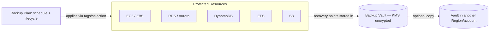

# AWS Backup


<!-- official AWS Architecture Icons asset; see diagrams/README.md for the convention -->

*Service · Storage · maps to SAA-C03 Domain 1 & 2*

## Definition

AWS Backup is a **fully managed, centralized backup service**. Instead of configuring backups
separately inside each AWS service (an EBS snapshot schedule here, an RDS snapshot setting there,
a DynamoDB point-in-time-recovery toggle somewhere else), you define one policy — a **backup
plan** — and apply it across many services and many accounts at once.

## Purpose

Every AWS service that holds data historically had its *own* backup mechanism, each with different
settings, different retention models, and no single place to prove to an auditor "here is our
backup policy and here is proof it ran." For regulated industries and any team running more than a
handful of resources, that fragmentation is both an operational burden and a compliance risk. AWS
Backup exists to give one consistent policy engine, one audit trail, and one place to test
restores — across EC2, EBS, RDS/Aurora, DynamoDB, EFS, FSx, Storage Gateway volumes, and S3.

## How It Works



Walking through it:

1. You create a **backup plan**: a schedule (cron-like, e.g., daily at 5 AM UTC), a lifecycle
   (e.g., move to cold storage after 30 days, delete after 365), and optionally a cross-
   Region/cross-account copy rule.
2. You assign resources to the plan either by **explicit ARN** or — more commonly — by **tags**
   (e.g., "back up everything tagged `Environment=production`"), so new resources get protected
   automatically just by being tagged correctly.
3. On schedule, AWS Backup triggers the right native backup API for each resource type behind the
   scenes (an EBS snapshot, an RDS snapshot, a DynamoDB export, etc.) and stores the resulting
   **recovery point** inside a **backup vault** — an encrypted, access-controlled container.
4. If configured, the recovery point is also **copied to a vault in another Region or account**,
   protecting against a Region-wide event or a compromised/deleted primary account.

## Key Features / Components

- **Backup plans** — schedule + lifecycle (transition to cold storage, expiration) + copy rules,
  reusable across many resources.
- **Backup vaults** — encrypted containers for recovery points; access controlled via vault access
  policies (resource-based, like S3 bucket policies).
- **Vault Lock** — makes a vault **immutable (WORM)** — once locked, not even the root account can
  delete recovery points before their retention expires, a key ransomware/compliance defense.
- **Tag-based resource assignment** — new resources matching a tag are automatically enrolled,
  reducing "we forgot to back this one up" risk.
- **Cross-Region / cross-account copy** — built-in DR and centralized-governance pattern (e.g., a
  security/backup account in AWS Organizations holding copies from many member accounts).
- **On-demand backups** — manual, one-off backup outside the schedule (e.g., right before a risky change).
- **AWS Backup Audit Manager** — generates compliance reports showing which resources are/aren't
  covered by a plan, and whether backups actually completed successfully.
- **Restore testing** — automated, periodic test restores to validate that backups are actually
  usable, not just "present."
- **Legal hold** — freeze specific recovery points from deletion/expiration during litigation or investigation.

## Use Cases — When to Use It

- **Regulated industries needing a provable, centralized backup policy** (finance, healthcare) —
  one audit trail across every service instead of per-service configuration screenshots.
- **Protecting a multi-service application** (e.g., EC2 + RDS + EFS + DynamoDB working together) —
  one plan, one schedule, consistent retention across all of it.
- **Ransomware resilience** — Vault Lock creates immutable recovery points an attacker (or a
  compromised admin credential) cannot delete.
- **Cross-account/cross-Region DR strategy** — centralize backup governance via AWS Organizations,
  with automatic copies landing in a dedicated backup account/Region.
- **Simplifying operations at scale** — tag-based assignment means a growing fleet of resources
  stays backed up without per-resource manual setup.

## When NOT to Use It / Alternatives

- **A single, one-off snapshot you'll delete in an hour** — just use the native EBS/RDS snapshot
  API directly; spinning up a backup plan for a single ad-hoc action is unnecessary overhead.
- **Extremely custom backup logic that doesn't fit the plan/schedule model** (e.g., application-
  consistent backups requiring a custom pre/post script sequence beyond what AWS Backup's hooks
  support) — you may need a native or third-party tool alongside AWS Backup, not instead of it.
- **Real-time/near-zero-RPO replication** (not really "backup" semantics at all) — look at
  database-native replication (RDS read replicas, DynamoDB Global Tables) or AWS Elastic Disaster
  Recovery for continuous replication instead.

## Why It's Important

**Real world:** backup governance is one of the first things an auditor or a new CISO asks about —
"show me your backup policy and prove it's being enforced" — and AWS Backup is the standard answer
for doing that across a multi-service AWS footprint without reinventing it per team. Vault Lock has
become a baseline ransomware-defense expectation in many compliance frameworks.

**Exam weight:** **SAA-C03** Domain 1, Task 1.3 ("Determine appropriate data security controls")
covers backup/replication policy design directly; Domain 2, Task 2.2 (resilient/fault-tolerant
architectures) covers backup as a core DR strategy element. Questions contrasting "use native
per-service snapshots" vs. "use AWS Backup to centralize policy across many services/accounts"
are a recurring pattern.

## Pricing Model (summary)

Billed **per GB-month of backup storage** consumed in the vault, with a cheaper rate for "cold"
storage tiers versus "warm," plus charges for **restore operations** (per GB restored) and
**cross-Region data transfer** for copy rules. There is no charge for the backup plan/schedule
itself — only the storage and operations it generates. Current rates:
https://aws.amazon.com/backup/pricing/

## Hands-on Lab (Floci)

**Honest limitation:** AWS Backup's control plane is not in Floci's documented support table
(only S3's object API is fully emulated — see `labs-floci/README.md`), and AWS Backup's real value
is orchestrating *other* services' native backup APIs (EBS, RDS, DynamoDB), several of which
aren't deeply emulated locally either. Use the commands below to learn the real CLI workflow; treat
unsupported responses from Floci as expected, and pair this with the native **EBS snapshot** lab in
[`ebs.md`](ebs.md) for the closest hands-on equivalent you can actually exercise locally.

```bash
# Create a backup vault
aws backup create-backup-vault --backup-vault-name study-vault

# Create a backup plan (daily, 30-day retention)
cat > plan.json << 'EOF'
{
  "BackupPlanName": "daily-study-plan",
  "Rules": [{
    "RuleName": "DailyBackups",
    "TargetBackupVaultName": "study-vault",
    "ScheduleExpression": "cron(0 5 * * ? *)",
    "Lifecycle": {"DeleteAfterDays": 30}
  }]
}
EOF
aws backup create-backup-plan --backup-plan file://plan.json

# Assign resources to the plan by tag
cat > selection.json << 'EOF'
{
  "SelectionName": "tag-production",
  "IamRoleArn": "arn:aws:iam::111122223333:role/AWSBackupDefaultServiceRole",
  "ListOfTags": [{"ConditionType": "STRINGEQUALS", "ConditionKey": "Environment", "ConditionValue": "production"}]
}
EOF
aws backup create-backup-selection --backup-plan-id <plan-id> --backup-selection file://selection.json

# Trigger an on-demand backup job for a specific EBS volume
aws backup start-backup-job \
  --backup-vault-name study-vault \
  --resource-arn arn:aws:ec2:us-east-1:111122223333:volume/vol-xxxxxxxx \
  --iam-role-arn arn:aws:iam::111122223333:role/AWSBackupDefaultServiceRole

# List recovery points in the vault
aws backup list-recovery-points-by-backup-vault --backup-vault-name study-vault
```

## Exam Tips

- **"Centralize backup policy across multiple AWS services/accounts"** is the signature phrase
  pointing to AWS Backup over any single service's native snapshot tooling.
- **Vault Lock = immutability / WORM / ransomware or compliance defense** — if a question mentions
  "even an administrator should not be able to delete backups before retention expires," that's
  Vault Lock specifically, not just "a backup vault."
- Don't confuse AWS Backup (centralized backup **orchestration/policy**) with **Storage Gateway**
  (a hybrid **access bridge** for on-prem apps) — they can work together (AWS Backup can protect
  Storage Gateway volumes) but solve different problems.
- Tag-based assignment is the scalable pattern tested over manually listing every resource ARN.

## Related Terms

- [`ebs.md`](ebs.md) — one of the most common resources protected by AWS Backup
- [`efs.md`](efs.md), [`fsx.md`](fsx.md) — also directly supported resource types
- [`storage-gateway.md`](storage-gateway.md) — volumes can be protected via AWS Backup
- [`s3.md`](s3.md), [`s3-glacier.md`](s3-glacier.md) — underlying cold-storage destinations for retained backups
- `KMS`, `AWS Organizations`, `IAM role` — see glossary
