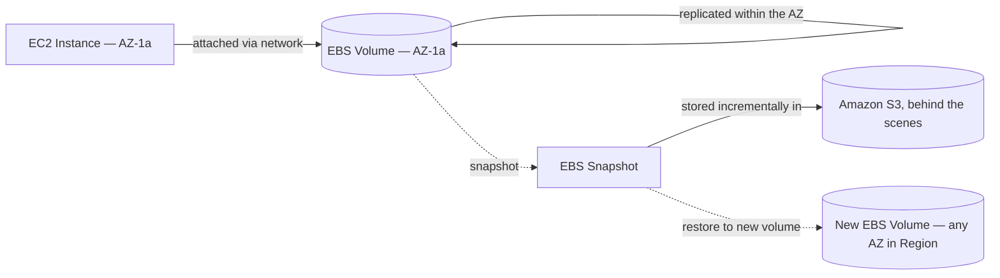
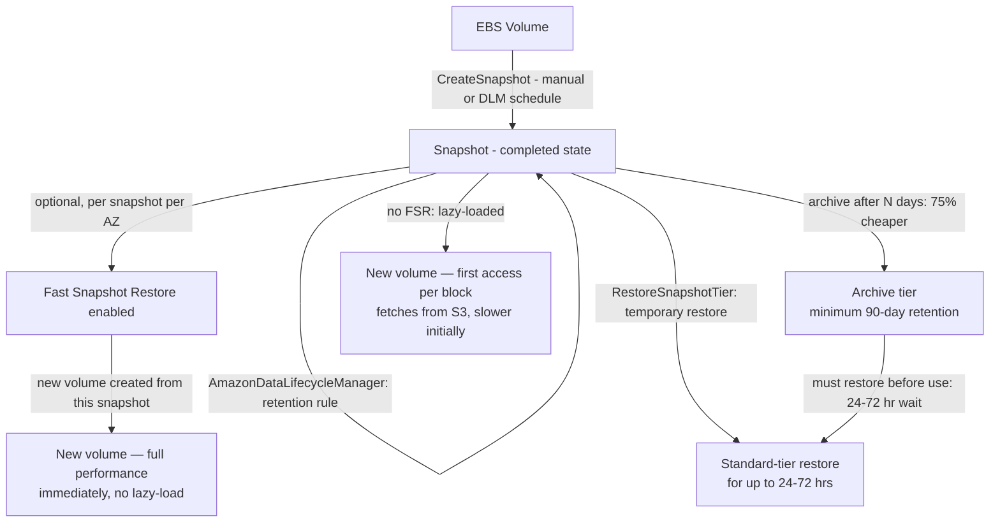
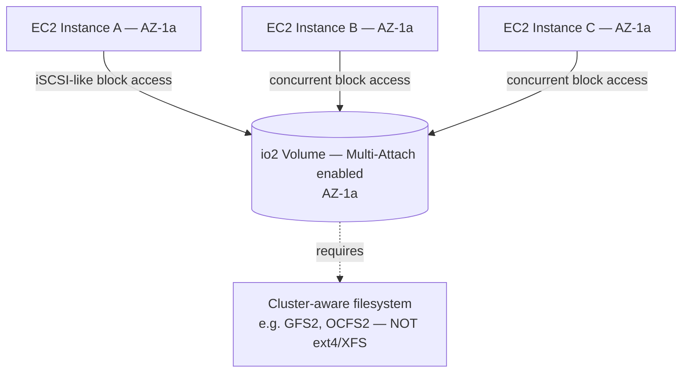

# Amazon EBS (Elastic Block Store)

> **Appears in:** [SAA-C03](../../certifications/saa-c03/README.md)


<!-- official AWS Architecture Icons asset; see diagrams/README.md for the convention -->

*Service · Storage · maps to SAA-C03 Domain 2 & 3 & 4, DVA-C03 Domain 1 (context), MLA-C02 (context)*

## Definition

Amazon EBS is **network-attached block storage** — a virtual hard drive you attach to a single EC2
instance. It behaves exactly like a raw disk: you format it with a filesystem (ext4, XFS, NTFS...)
and the OS reads/writes blocks directly, the same way it would to a physical SSD.

## Purpose

An EC2 instance's own local "instance store" disk is **ephemeral** — stop or terminate the
instance and that data is gone. Databases, boot volumes, and anything you need to persist across
reboots need storage that survives independently of the instance's lifecycle. EBS exists to give
EC2 instances durable, low-latency, resizable disks that behave like local storage but live on the
network and can be snapshotted, detached, and reattached elsewhere.

It's worth being precise about what "network-attached" costs you versus a truly local disk: every
EBS I/O operation travels over the instance's network path (on Nitro-based instances, EBS traffic
uses a dedicated, separate network interface from regular networking, which is why EBS-optimized
performance didn't used to be "free" on older instance generations but now is the default on all
current-generation types). This is also why EBS volumes are physically tied to a single
Availability Zone — the storage racks backing a volume live in that AZ's facility, and the
instance using it must be colocated there for the latency to stay low.

## How It Works



Walking through it:

1. You create a volume **in a specific Availability Zone** and attach it to an EC2 instance that
   is running **in that same AZ** — this AZ-lock is the single most important fact about EBS.
2. AWS automatically replicates the volume's data **within that AZ** (not across AZs) to protect
   against a single hardware failure.
3. A **snapshot** is a point-in-time, incremental backup of the volume, stored durably in S3
   (though you don't manage it as an S3 object directly). "Incremental" means only the blocks
   changed since the last snapshot are actually copied, keeping snapshots cheap and fast.
4. Because the snapshot lives in S3 (Region-wide, not AZ-bound), you can **restore it into a brand
   new volume in any AZ** in that Region — or copy the snapshot to another Region entirely — which
   is how you move data across AZs/Regions despite the volume itself being AZ-locked.

### How incremental snapshots actually accumulate data

The "incremental" claim is easy to state and easy to misunderstand — people sometimes assume each
snapshot only contains the delta and is therefore useless on its own. In reality, every snapshot
is **independently fully restorable**; what's incremental is only the *storage*, not the
usability:


*Figure: Snap A (first snapshot) is a full copy of the volume's 10 GiB of data. Snap B only
physically stores the 4 GiB that changed since Snap A, but logically represents a complete,
restorable 10 GiB point-in-time state by referencing Snap A's unchanged blocks. Snap C repeats the
pattern. Total stored data for all three snapshots: 16 GiB, not 30 GiB. Source: [Amazon EBS User Guide — "How Amazon EBS snapshots work"](https://docs.aws.amazon.com/ebs/latest/userguide/how_snapshots_work.html), © Amazon Web Services.*

The same incremental-referencing behavior also works **across different volumes** — a snapshot
taken of Volume 2 (itself created from a snapshot of Volume 1) only stores the blocks that changed
*after* Volume 2 was created, referencing the original volume's snapshot for everything else:


*Figure: incremental snapshots work across volume lineage, not just within one volume's history —
Snap B (of Vol 2) is incremental against Snap A (of Vol 1) even though they're different volumes,
because Vol 2 was created from Snap A. Source: [Amazon EBS User Guide — "How Amazon EBS snapshots work"](https://docs.aws.amazon.com/ebs/latest/userguide/how_snapshots_work.html), © Amazon Web Services.*

### Full snapshot lifecycle, including Fast Snapshot Restore and the Archive tier



Walking through it: by default, a volume created from a snapshot **lazy-loads** its blocks — the
first read of each block fetches it from the snapshot's S3-backed storage on demand, which can
cause a performance dip right after a restore until all blocks have been touched at least once.
**Fast Snapshot Restore (FSR)** pre-warms a specific snapshot in a specific AZ so every volume
created from it has full IOPS/throughput from the first I/O — at an hourly cost per
snapshot-per-AZ, so it's usually reserved for frequently-restored "golden" snapshots (AMI base
images, disaster-recovery runbooks), not every ad-hoc backup. The **Archive tier** (a cheaper,
colder tier for snapshots you rarely restore — think "the Glacier of EBS snapshots") requires
90-day minimum retention and a 24–72 hour restore wait before the snapshot becomes usable again.

### Multi-Attach topology



Multi-Attach lets up to 16 Nitro-based instances **in the same AZ** attach to one io1/io2 volume
simultaneously — but a plain Linux filesystem like ext4 has no concept of another machine writing
to the same disk at the same time and will corrupt data if two instances mount it normally. This
only works safely with a **cluster-aware filesystem** or an application that manages its own disk
locking (common in some clustered database and SAP HANA deployments) — the exam's trap is
suggesting Multi-Attach as a generic "share one disk between app servers" solution, which it is
not.

## Key Features / Components

- **Volume types**:
  - `gp3` — current-generation general purpose SSD; baseline 3,000 IOPS / 125 MB/s included,
    both scalable independently of size (and cheaper than gp2 for the same performance).
  - `gp2` — previous-generation general purpose SSD; IOPS scale with volume size (3 IOPS/GB) —
    legacy, being phased toward gp3.
  - `io2` / `io2 Block Express` — Provisioned IOPS SSD for the highest-performance, most durable
    workloads (large databases); up to 256,000 IOPS on Block Express.
  - `io1` — previous-generation Provisioned IOPS SSD — legacy equivalent of io2.
  - `st1` — Throughput Optimized HDD — cheap, high-throughput, sequential access (big data, log processing).
  - `sc1` — Cold HDD — cheapest, lowest-performance, for rarely-accessed sequential data.
- **Snapshots** — incremental, point-in-time backups in S3; the basis for AMIs, DR, and cloning.
- **Elastic Volumes** — resize (GiB), change volume type, or adjust IOPS/throughput **live**,
  without detaching or stopping the instance.
- **Multi-Attach** — attach a single io1/io2 volume to multiple EC2 instances in the same AZ
  simultaneously (requires a cluster-aware filesystem; niche but testable).
- **Encryption** — EBS encryption (via KMS) encrypts data at rest, in transit between instance and
  volume, and all snapshots/volumes derived from an encrypted volume — enabled by default per account/Region setting.
- **Amazon Data Lifecycle Manager (DLM)** — automates scheduled snapshot creation and retention.
- **Fast Snapshot Restore (FSR)** — pre-warms a snapshot so volumes created from it have full
  performance immediately, instead of "lazy-loading" blocks on first access.
- **EBS Snapshots Archive tier** — a cheaper, colder tier for snapshots rarely restored, at roughly
  75% lower storage cost than standard snapshot tier, with a 90-day minimum and a restore wait.
- **EBS direct APIs** — `StartSnapshot`/`PutSnapshotBlock`/`ListChangedBlocks` let third-party
  backup tools read/write snapshot data at the block level without needing to launch an EC2
  instance — the mechanism many backup vendors (and AWS Backup itself) use under the hood.

## Use Cases — When to Use It

- **Boot volumes for a fleet of EC2 web servers.** Every EC2 instance needs a root device to boot its
  OS and application code from. EBS gp3 is the default, resizable without downtime. *Alternative
  cost:* instance store (ephemeral local disk) is faster but vanishes on stop/terminate — unacceptable
  for anything that must survive a restart.
- **Self-managed relational database for a SaaS company on EC2.** A team runs PostgreSQL directly on
  EC2 (not RDS) for full control over extensions/tuning. EBS io2 gives the consistent low-latency
  block I/O a transactional database needs. *Alternative cost:* S3 isn't an option at all here — it
  has no random-write, low-latency semantics a database engine's storage layer requires.
- **Genomics/bioinformatics pipeline scratch disk.** A research pipeline needs fast local scratch space
  for intermediate alignment files during a multi-hour job. A gp3 or io2 volume sized for the job gives
  predictable IOPS. *Alternative cost:* using network file storage (EFS) for pure scratch work instead
  adds unnecessary multi-AZ replication cost for data that's deleted at job end anyway.
- **Pre-deployment snapshot-and-rollback for a financial trading platform.** Before a risky schema
  migration, the team snapshots production EBS volumes, enabling immediate rollback if the migration
  fails. *Alternative cost:* relying solely on application-level migration-reversal scripts is riskier
  under real incident pressure than a point-in-time disk restore.
- **Clustered database storage via Multi-Attach for an SAP HANA scale-out deployment.** Several nodes
  need to see the same block device concurrently, coordinated by a cluster-aware filesystem. EBS
  Multi-Attach is the only block-storage option supporting this topology directly. *Alternative cost:*
  giving each node its own separate volume and replicating data at the application layer duplicates
  work HANA's own clustering already solves.
- **Big-data cluster with tiered volume types.** A Hadoop/Spark cluster on EC2 mixes gp3 (hot working
  data), st1 (large sequential log/shuffle files), and sc1 (cold historical partitions) on the same
  node. *Alternative cost:* putting everything on gp3/io2 instead pays for random-IOPS performance the
  sequential workloads don't need.
- **Golden AMI with Fast Snapshot Restore for a flash-sale e-commerce platform.** An Auto Scaling group
  must launch fully warmed-up instances the instant a traffic spike hits. FSR pre-warms the AMI's
  backing snapshot so every new volume has full I/O from boot. *Alternative cost:* without FSR, each
  new instance lazy-loads blocks on first access — exactly when the platform can least afford degraded
  disk performance.
- **Cross-Region DR for a manufacturing company's ERP system.** Scheduled snapshots of the ERP's EBS
  volumes are copied to a secondary Region via Data Lifecycle Manager, ready to restore if the primary
  Region fails. *Alternative cost:* a live, continuously-replicated standby volume isn't possible at
  all — EBS volumes can't span Regions, so snapshot-copy is the only cross-Region path EBS has.
- **Encrypted local caching tier for a media transcoding farm.** Transcoding nodes need a fast local
  disk to hold the source file and intermediate renditions during a job. io2/gp3 with EBS
  encryption-by-default satisfies both performance and at-rest encryption in one resource.
  *Alternative cost:* streaming the source file directly from S3 on every read during transcoding adds
  API latency/cost to an already I/O-bound workload.
- **Database storage for a legacy on-prem application migrated via lift-and-shift.** An application
  expects a local disk mount with POSIX/NTFS semantics and no application-rewrite budget. EBS behaves
  exactly like the on-prem SAN LUN it replaces. *Alternative cost:* re-platforming onto S3 or a managed
  database at the same time multiplies the project's risk and timeline for no immediate business
  requirement.
- **Log processing storage for a batch analytics pipeline.** A nightly ETL job reads large sequential
  log files start-to-finish on a single worker instance. st1 (Throughput Optimized HDD) is tuned
  exactly for this access pattern. *Alternative cost:* gp3/io2 instead charges for random-IOPS
  performance the purely sequential job never exercises.
- **Compliance archival of cold EBS snapshots for a regulated enterprise.** Years of nightly snapshots
  pile up, most of which will never be restored. The EBS Snapshots Archive tier cuts storage cost
  roughly 75% for snapshots kept purely for audit/compliance retention. *Alternative cost:* leaving
  every historical snapshot in the standard tier pays full price indefinitely for recovery points that
  are, realistically, never going to be restored.

## When NOT to Use It / Alternatives

- **Multiple instances need to read/write the same data concurrently** — EBS volumes attach to one
  instance at a time (barring the Multi-Attach niche case). Use **EFS** (Linux, NFS) or **FSx**
  (Windows/HPC/NetApp) instead.
- **You're storing files to be served over HTTP/an API, not mounted as a disk** — use **S3**; it's
  cheaper per GB and doesn't require a running EC2 instance to hold it.
- **You need storage that survives the *loss of an entire AZ* without manual snapshot/restore** —
  EBS alone only replicates within one AZ; pair it with cross-AZ application architecture (e.g.,
  RDS Multi-AZ, which uses EBS underneath but handles the failover for you) or regular snapshots.
- **Extremely high-throughput sequential big-data workloads at the lowest cost** — st1/sc1 cover
  some of this, but purpose-built services (S3 + Athena/EMR) often fit better than block storage.

## Why It's Important

**Real world:** EBS underpins the majority of EC2-hosted workloads — every lift-and-shift
migration, every self-managed database on EC2, every custom AMI. Snapshot strategy is also a core
disaster-recovery and ransomware-resilience practice (immutable, point-in-time recovery points).

**Exam weight:**
- **SAA-C03** — Domain 2 Task 2.2 (resiliency: snapshots, cross-AZ/Region DR strategy), Domain 3
  Task 3.1 (performance: volume type selection — gp3 vs io2 vs st1/sc1 — is a classic scenario
  question), Domain 4 Task 4.1 (cost: gp3 vs gp2 savings, right-sizing IOPS/throughput).
- **DVA-C03** — comes up contextually wherever EC2-hosted application storage/performance is discussed.
- **MLA-C02** — occasionally as the storage layer under EC2-based training instances before data
  moves to S3/FSx for actual training I/O.

## Pricing Model — Deep Dive

| Volume type | Illustrative $/GB-month (us-east-1) | Extra performance cost | Best for |
|---|---|---|---|
| gp3 | $0.08 | $0.005/provisioned IOPS-month above 3,000; $0.04/provisioned MB/s-month above 125 | Almost everything — the default choice |
| gp2 | $0.10 | None (IOPS bundled, 3 per GB) | Legacy; migrate to gp3 |
| io2 / io2 Block Express | $0.125 | $0.065/IOPS-month (first 32,000), tiered cheaper above | Mission-critical databases, sub-ms latency |
| io1 | $0.125 | $0.065/IOPS-month, no tiering | Legacy; io2 is strictly better at the same price |
| st1 | $0.045 | None | Sequential throughput workloads (logs, big data) |
| sc1 | $0.015 | None | Coldest, cheapest sequential access |
| Snapshots (standard tier) | ~$0.05/GB-month of changed data | None | Active, frequently-restored recovery points |
| Snapshots (Archive tier) | ~$0.0125/GB-month | Restore fee applies, 24–72 hr wait | Long-term, rarely-restored recovery points |

*(Illustrative list prices at time of writing — confirm current numbers at
https://aws.amazon.com/ebs/pricing/.)*

### Worked example 1 — gp3 vs gp2 for a 500 GB database volume needing 6,000 IOPS

```
gp2: IOPS scale at 3/GB, so 500 GB gives 1,500 IOPS baseline — NOT enough.
     To reach 6,000 IOPS on gp2 you'd need to over-provision size to ~2,000 GB (6,000 / 3).
     Cost: 2,000 GB × $0.10                                  = $200.00/month
           (you are paying for 1,500 GB of capacity you don't need, purely to buy IOPS)

gp3: 500 GB at baseline 3,000 IOPS included, provision 3,000 extra IOPS to reach 6,000.
     Storage: 500 GB × $0.08                                 =  $40.00/month
     Extra IOPS: 3,000 × $0.005                               =  $15.00/month
     ---------------------------------------------------------------
     Total                                                     =  $55.00/month
```

gp3 delivers the same 6,000 IOPS at roughly **73% lower cost** than over-provisioning gp2 for IOPS
alone — this is the canonical "cost-optimize without losing performance" exam scenario, and it's
also a very real, very common migration recommendation in actual AWS bills.

### Worked example 2 — io2 Block Express for a latency-critical OLTP database

A 1 TB volume needing 32,000 provisioned IOPS (a demanding transactional database):

```
Storage:     1,000 GB × $0.125                                = $125.00/month
IOPS:        32,000 × $0.065                                   = $2,080.00/month
-------------------------------------------------------------------------
Total                                                           ≈ $2,205.00/month
```

This is why io2/io2 Block Express is reserved for genuinely IOPS-hungry, latency-sensitive
workloads (large OLTP databases, SAP HANA) — at this scale, IOPS cost dwarfs storage cost, the
opposite of the gp3 example above where storage dominated.

### Worked example 3 — snapshot storage cost over a retention window

A 500 GB gp3 volume with ~2% of its blocks changing daily, kept with daily snapshots and a 30-day
retention (a common DLM policy):

```
Day 1 (full snapshot):      500 GB × $0.05                     =  $25.00
Days 2-30 (incremental,
  ~10 GB changed/day):      10 GB × 29 days × $0.05             ≈  $14.50
-------------------------------------------------------------------------
Total storage for 30 days of daily snapshots                    ≈  $39.50/month
```

Because only *changed* blocks are billed after the first snapshot, the real-world cost of frequent
snapshotting is usually a small fraction of "volume size × number of snapshots" — a common
misconception that makes teams under-snapshot out of an unfounded fear of cost.

## Common Architectures

**1. Golden AMI with Fast Snapshot Restore for fast autoscaling.** A company bakes a fully
configured application image into an AMI backed by an EBS snapshot, enables FSR on that snapshot in
every AZ the Auto Scaling group spans, so that when a scale-out event launches new instances during
a traffic spike, each new volume has full I/O performance from boot instead of a slow lazy-loaded
ramp-up — critical when the scale-out itself is a response to a load spike.

**2. Cross-Region DR via snapshot copy.** Amazon Data Lifecycle Manager takes scheduled snapshots
of production volumes in the primary Region, and a copy rule automatically replicates each
snapshot to a secondary Region. If the primary Region becomes unavailable, new volumes are created
from the most recent copied snapshot in the secondary Region and attached to standby instances
there — a pattern that works because snapshots (unlike volumes) are not AZ- or even Region-bound
once copied.

**3. Tiered volume strategy for a big-data cluster.** Hot, actively-queried data sits on gp3 for
balanced cost/performance; `st1` (Throughput Optimized HDD) holds large sequential log/intermediate
files being read start-to-finish by batch jobs; `sc1` (Cold HDD) holds rarely-touched historical
partitions kept only for compliance — all three types can be mixed on the same instance as
separate attached volumes, matching each data category's actual access pattern to the cheapest
volume type that satisfies it.

**4. Pre-deployment snapshot-and-rollback pattern.** Before any risky production change (a schema
migration, a major version upgrade), an automated pipeline step snapshots the affected EBS
volume(s), proceeds with the deployment, and — if post-deployment health checks fail — restores a
fresh volume from that pre-change snapshot and swaps it onto a standby instance, giving teams a
fast, reliable rollback path that doesn't depend on the application's own migration-reversal logic
working correctly under pressure.

## Limits & Quotas

- **Volume size** — 1 GiB to **64 TiB** per volume (gp2/gp3/io1/io2/st1/sc1).
- **io2 Block Express** — up to **256,000 IOPS** and 4,000 MB/s per volume; standard io2 tops out
  lower (64,000 IOPS on Nitro instances).
- **gp3 maximum** — 16,000 IOPS and 1,000 MB/s per volume.
- **Volumes per instance** — generally up to 28 EBS volumes attachable per Nitro-based instance
  (varies by instance type/generation; a real, if less-tested, practical ceiling).
- **Snapshots per Region per account** — no hard published cap on count, but there are default
  request-rate (API) quotas for `CreateSnapshot` calls per minute that matter at very large fleet
  scale.
- **Multi-Attach** — up to **16 instances**, same Availability Zone only, io1/io2 volumes only.
- **EBS encryption-by-default** — an account/Region-level setting; once enabled, *every* new
  volume and snapshot in that Region is encrypted automatically, with no way to opt a specific new
  volume out.
- **Elastic Volumes cooldown** — after modifying a volume's size/type/IOPS, you must generally wait
  **6 hours** before the next modification to the same volume (though in practice AWS has relaxed
  this in various ways over time — verify current behavior for a given volume).
- **Maximum throughput by volume type** — gp3 tops out at 1,000 MB/s, io2 Block Express at
  4,000 MB/s, st1 at 500 MB/s, and sc1 at 250 MB/s — a frequent consideration when the workload is
  throughput-bound rather than IOPS-bound.
- **Snapshot copy across Regions** — no hard count limit, but subject to the same per-account
  `CopySnapshot` API rate quota as any other EC2 API action; large fleet-wide DR copy jobs should
  account for this when estimating completion time.
- **EBS direct APIs block size** — `PutSnapshotBlock` operates on fixed 512 KiB blocks, which is
  the underlying granularity behind "only changed blocks are billed" — useful context for
  understanding why snapshot costs scale with actual byte-level change volume, not file-level
  change count.

## Troubleshooting / Common Issues

- **"I can't attach this volume to my instance"** — the single most common cause is an
  **AZ mismatch**: the volume and the instance must be in the exact same Availability Zone, not
  just the same Region. Snapshot the volume and restore it into a new volume in the correct AZ.
- **New volume from a snapshot feels slow right after restore** — this is lazy-loading, not a
  fault: blocks are fetched from the snapshot's backing store on first touch. Either pre-warm with
  **Fast Snapshot Restore**, or run a full-disk read (`dd if=/dev/xvdf of=/dev/null bs=1M`) once
  after restore to force every block to load before the workload starts.
- **gp2 volume's IOPS seem capped lower than expected** — gp2 IOPS are a function of **volume
  size** (3 IOPS/GB, burstable to 3,000 below ~1 TB using a burst-credit model similar to T-series
  instances) — if the workload outgrew its burst credits, either grow the volume or migrate to
  gp3/io2, which decouple IOPS from size entirely.
- **Snapshot stuck in "pending" for a long time** — large volumes with a lot of changed data since
  the last snapshot simply take time; check `DescribeSnapshots` progress percentage rather than
  assuming it's hung.
- **Multi-Attach volume showing corrupted data** — almost always a standard (non-cluster-aware)
  filesystem mounted from multiple instances at once; Multi-Attach does not add file-locking
  semantics by itself — the application or filesystem must be cluster-aware.
- **Encrypted volume restore fails across accounts** — a snapshot encrypted with a customer-managed
  KMS key can't be shared/restored into another account unless that account is also granted
  `kms:Decrypt`/`kms:CreateGrant` on the specific key — a very common cross-account AMI-sharing
  stumbling block.

## Hands-on Lab (Floci)

Floci's documented support table lists **EC2 as real Docker-backed compute**, but does not list
a dedicated EBS data-plane emulation — EBS API calls are part of the EC2 API family, so you can
practice the **workflow and CLI syntax**, but don't expect real multi-AZ block-replication physics
or true IOPS throttling locally. Treat this as API muscle memory, not a performance benchmark
(consistent with the Floci "honest limitation" noted in `labs-floci/README.md`).

```bash
# Create a 10 GiB gp3 volume in a given AZ
awslocal ec2 create-volume \
  --availability-zone us-east-1a \
  --size 10 --volume-type gp3 --iops 3000 --throughput 125

# List volumes
awslocal ec2 describe-volumes

# Attach it to a running instance (replace with a real instance-id from your Floci EC2 lab)
awslocal ec2 attach-volume \
  --volume-id vol-xxxxxxxx --instance-id i-xxxxxxxx --device /dev/xvdf

# Take a snapshot
awslocal ec2 create-snapshot \
  --volume-id vol-xxxxxxxx --description "pre-deploy backup"

# List snapshots
awslocal ec2 describe-snapshots --owner-ids self

# Restore a new volume from the snapshot (can target a different AZ)
awslocal ec2 create-volume \
  --availability-zone us-east-1b \
  --snapshot-id snap-xxxxxxxx --volume-type gp3

# Modify a live volume's size/type/IOPS without detaching
awslocal ec2 modify-volume \
  --volume-id vol-xxxxxxxx --size 20 --volume-type gp3 --iops 4000

# Practice a Data Lifecycle Manager-style retention policy shape (control plane only)
aws dlm create-lifecycle-policy \
  --description "daily-snapshots-30-day-retention" \
  --state ENABLED \
  --execution-role-arn arn:aws:iam::111122223333:role/AWSDataLifecycleManagerDefaultRole \
  --policy-details '{"ResourceTypes":["VOLUME"],"TargetTags":[{"Key":"Backup","Value":"true"}],"Schedules":[{"Name":"Daily","CreateRule":{"Interval":24,"IntervalUnit":"HOURS"},"RetainRule":{"Count":30}}]}'
```

## Exam-Style Scenario Walkthroughs

**Scenario 1:** A self-managed PostgreSQL database on EC2 needs 10,000 consistent IOPS with the
lowest possible cost, and the team doesn't need the absolute highest performance ceiling that io2
offers. Which volume type, and why not the alternatives?

*Answer:* gp3, with 10,000 IOPS provisioned explicitly (above its 3,000 baseline). gp2 would
require over-provisioning capacity far beyond what's needed just to reach that IOPS level (3
IOPS/GB means ~3,333 GB of gp2 just to hit 10,000 IOPS, regardless of actual storage need); io2
would work but costs more per GB and per IOPS than gp3 for a workload that doesn't need io2's
sub-millisecond latency ceiling or 256,000 IOPS headroom.

**Scenario 2:** An application team needs to move a 2 TB EBS volume's data from `us-east-1a` to a
new EC2 instance running in `us-west-2b`. What's the sequence of steps?

*Answer:* Create a snapshot of the source volume (this uploads it to S3, which is Region-wide/not
AZ-bound), **copy the snapshot** to `us-west-2` (a cross-Region snapshot copy operation), then
create a new volume from the copied snapshot **in `us-west-2b`**, and attach it to the target
instance. You cannot attach the original volume directly — it is permanently locked to
`us-east-1a` — the snapshot is the only cross-AZ/cross-Region mobility mechanism EBS has.

**Scenario 3:** A newly-restored volume from a snapshot is showing degraded read performance for
the first hour of use, then returns to normal. Is this a problem, and if the team needs full
performance immediately after every restore, what should they enable?

*Answer:* This is expected **lazy-loading** behavior, not a fault — each block is fetched from the
snapshot's S3-backed storage on first access. If immediate full performance is a hard requirement
(e.g., this volume backs a database that must be production-ready the instant it's restored),
enable **Fast Snapshot Restore (FSR)** on that specific snapshot in the target AZ ahead of time.

**Scenario 4:** A compliance team wants nightly EBS snapshots of all production volumes retained
for 30 days, replicated to a second Region for disaster recovery, applied consistently across 40
EC2 instances without manually scripting each one. What AWS feature handles this most simply?

*Answer:* Amazon Data Lifecycle Manager (DLM) for the scheduling/retention policy on tagged
volumes, or — for a more centralized, cross-service, auditable approach — **AWS Backup**, which can
apply one backup plan (schedule + retention + cross-Region copy rule) across all tagged EBS
volumes without per-volume manual configuration. DLM is EBS-snapshot-specific and lighter-weight;
AWS Backup is the broader, auditable choice if other resource types need the same governance.

## Exam Tips

- **EBS volumes are AZ-locked** — you cannot attach a volume to an instance in a different AZ.
  The trick to "move" one: snapshot it (snapshots are Region-wide, stored in S3), then create a
  new volume from the snapshot in the target AZ (or copy the snapshot to another Region first).
- **gp3 vs gp2** — gp3 decouples IOPS/throughput from volume size and is generally cheaper for the
  same performance; if a question emphasizes "cost-optimize without losing performance," gp3 is
  usually the answer over gp2.
- **Instance store vs. EBS** — instance store is ephemeral (physically attached, gone on
  stop/terminate); EBS is persistent and network-attached. "Data must survive instance stop" always
  points to EBS (or further, to S3/snapshots for even stronger durability).
- **Snapshots are incremental** — only changed blocks since the last snapshot are stored, which is
  why frequent snapshotting is cheap, not why it's slow.
- **Fast Snapshot Restore vs. default lazy-loading** — a question about "new volumes from a
  snapshot have degraded performance immediately after creation" wants FSR as the fix.
- **Multi-Attach is not a generic file-sharing feature** — it needs a cluster-aware filesystem; if
  the scenario just says "share storage across instances" without mentioning a cluster-aware
  filesystem, the intended answer is EFS, not EBS Multi-Attach.
- This is also where the **object vs. block vs. file storage** exam framing anchors on the "block"
  side — EBS is mountable, single-instance, raw block device.

## Further Reading

- [Amazon EBS User Guide](https://docs.aws.amazon.com/ebs/latest/userguide/what-is-ebs.html) — official documentation home
- [How Amazon EBS snapshots work](https://docs.aws.amazon.com/ebs/latest/userguide/how_snapshots_work.html) — the incremental snapshot model, diagrams referenced above
- [Amazon EBS volume types](https://docs.aws.amazon.com/ebs/latest/userguide/ebs-volume-types.html)
- [Amazon EBS pricing](https://aws.amazon.com/ebs/pricing/) — current, authoritative rates
- [Amazon Data Lifecycle Manager](https://docs.aws.amazon.com/AWSEC2/latest/UserGuide/snapshot-lifecycle.html)

## Related Terms

- [`s3.md`](s3.md) — snapshots are stored here under the hood; also the cheaper alternative for non-block access patterns
- [`efs.md`](efs.md) — the shared/multi-instance alternative
- [`fsx.md`](fsx.md) — Windows/HPC/NetApp file system alternative
- [`aws-backup.md`](aws-backup.md) — centralizes EBS snapshot policy across accounts
- `AMI`, `KMS`, `Availability Zone` — see glossary
