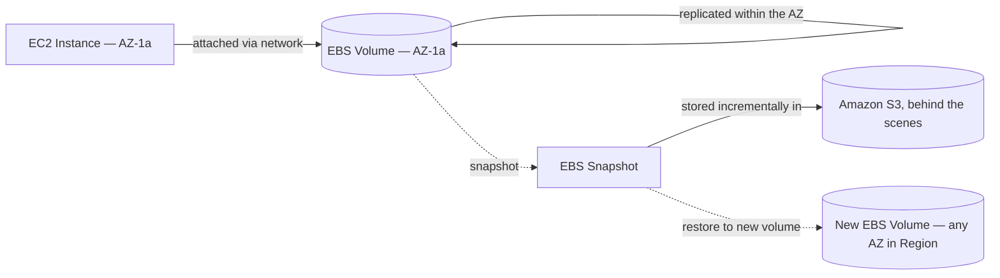

# Amazon EBS (Elastic Block Store)


<!-- official AWS Architecture Icons asset; see diagrams/README.md for the convention -->

*Service · Storage · maps to SAA-C03 Domain 2 & 3 & 4, DVA-C03 Domain 1 (context), MLA-C02 (context)*

## Definition

Amazon EBS is **network-attached block storage** — a virtual hard drive you attach to a single EC2
instance. It behaves exactly like a raw disk: you format it with a filesystem (ext4, XFS, NTFS...)
and the OS reads/writes blocks directly, the same way it would to a physical SSD.

## Purpose

An EC2 instance's own local "instance store" disk is **ephemeral** — stop or terminate the
instance and that data is gone. Databases, boot volumes, and anything you need to persist across
reboots need storage that survives independently of the instance's lifecycle. EBS exists to give
EC2 instances durable, low-latency, resizable disks that behave like local storage but live on the
network and can be snapshotted, detached, and reattached elsewhere.

## How It Works



Walking through it:

1. You create a volume **in a specific Availability Zone** and attach it to an EC2 instance that
   is running **in that same AZ** — this AZ-lock is the single most important fact about EBS.
2. AWS automatically replicates the volume's data **within that AZ** (not across AZs) to protect
   against a single hardware failure.
3. A **snapshot** is a point-in-time, incremental backup of the volume, stored durably in S3
   (though you don't manage it as an S3 object directly). "Incremental" means only the blocks
   changed since the last snapshot are actually copied, keeping snapshots cheap and fast.
4. Because the snapshot lives in S3 (Region-wide, not AZ-bound), you can **restore it into a brand
   new volume in any AZ** in that Region — or copy the snapshot to another Region entirely — which
   is how you move data across AZs/Regions despite the volume itself being AZ-locked.

## Key Features / Components

- **Volume types**:
  - `gp3` — current-generation general purpose SSD; baseline 3,000 IOPS / 125 MB/s included,
    both scalable independently of size (and cheaper than gp2 for the same performance).
  - `gp2` — previous-generation general purpose SSD; IOPS scale with volume size (3 IOPS/GB) —
    legacy, being phased toward gp3.
  - `io2` / `io2 Block Express` — Provisioned IOPS SSD for the highest-performance, most durable
    workloads (large databases); up to 256,000 IOPS on Block Express.
  - `io1` — previous-generation Provisioned IOPS SSD — legacy equivalent of io2.
  - `st1` — Throughput Optimized HDD — cheap, high-throughput, sequential access (big data, log processing).
  - `sc1` — Cold HDD — cheapest, lowest-performance, for rarely-accessed sequential data.
- **Snapshots** — incremental, point-in-time backups in S3; the basis for AMIs, DR, and cloning.
- **Elastic Volumes** — resize (GiB), change volume type, or adjust IOPS/throughput **live**,
  without detaching or stopping the instance.
- **Multi-Attach** — attach a single io1/io2 volume to multiple EC2 instances in the same AZ
  simultaneously (requires a cluster-aware filesystem; niche but testable).
- **Encryption** — EBS encryption (via KMS) encrypts data at rest, in transit between instance and
  volume, and all snapshots/volumes derived from an encrypted volume — enabled by default per account/Region setting.
- **Amazon Data Lifecycle Manager (DLM)** — automates scheduled snapshot creation and retention.
- **Fast Snapshot Restore (FSR)** — pre-warms a snapshot so volumes created from it have full
  performance immediately, instead of "lazy-loading" blocks on first access.

## Use Cases — When to Use It

- **Boot volumes for EC2 instances** — the root device almost every EC2 instance uses.
- **Relational databases on EC2** (self-managed MySQL/PostgreSQL/SQL Server) needing consistent,
  low-latency block I/O.
- **Transactional, latency-sensitive workloads** where the filesystem needs to behave like a local disk.
- **Workloads needing resizable, swappable performance** — start on gp3, bump IOPS live if a
  workload gets heavier, no downtime.
- **Point-in-time recovery / cloning** — snapshot before a risky deployment, restore if it goes wrong.

## When NOT to Use It / Alternatives

- **Multiple instances need to read/write the same data concurrently** — EBS volumes attach to one
  instance at a time (barring the Multi-Attach niche case). Use **EFS** (Linux, NFS) or **FSx**
  (Windows/HPC/NetApp) instead.
- **You're storing files to be served over HTTP/an API, not mounted as a disk** — use **S3**; it's
  cheaper per GB and doesn't require a running EC2 instance to hold it.
- **You need storage that survives the *loss of an entire AZ* without manual snapshot/restore** —
  EBS alone only replicates within one AZ; pair it with cross-AZ application architecture (e.g.,
  RDS Multi-AZ, which uses EBS underneath but handles the failover for you) or regular snapshots.
- **Extremely high-throughput sequential big-data workloads at the lowest cost** — st1/sc1 cover
  some of this, but purpose-built services (S3 + Athena/EMR) often fit better than block storage.

## Why It's Important

**Real world:** EBS underpins the majority of EC2-hosted workloads — every lift-and-shift
migration, every self-managed database on EC2, every custom AMI. Snapshot strategy is also a core
disaster-recovery and ransomware-resilience practice (immutable, point-in-time recovery points).

**Exam weight:**
- **SAA-C03** — Domain 2 Task 2.2 (resiliency: snapshots, cross-AZ/Region DR strategy), Domain 3
  Task 3.1 (performance: volume type selection — gp3 vs io2 vs st1/sc1 — is a classic scenario
  question), Domain 4 Task 4.1 (cost: gp3 vs gp2 savings, right-sizing IOPS/throughput).
- **DVA-C03** — comes up contextually wherever EC2-hosted application storage/performance is discussed.
- **MLA-C02** — occasionally as the storage layer under EC2-based training instances before data
  moves to S3/FSx for actual training I/O.

## Pricing Model (summary)

Billed **per GB-month provisioned** (not used — you pay for the size you allocated), plus
**IOPS and throughput charges** above the included baseline for gp3/io2, plus **provisioned IOPS
charges** for io1/io2 regardless of baseline. Snapshots are billed per GB-month of the *incremental*
data stored in S3. Cross-Region snapshot copy adds data transfer cost. Current rates:
https://aws.amazon.com/ebs/pricing/

## Hands-on Lab (Floci)

Floci's documented support table lists **EC2 as real Docker-backed compute**, but does not list
a dedicated EBS data-plane emulation — EBS API calls are part of the EC2 API family, so you can
practice the **workflow and CLI syntax**, but don't expect real multi-AZ block-replication physics
or true IOPS throttling locally. Treat this as API muscle memory, not a performance benchmark
(consistent with the Floci "honest limitation" noted in `labs-floci/README.md`).

```bash
# Create a 10 GiB gp3 volume in a given AZ
awslocal ec2 create-volume \
  --availability-zone us-east-1a \
  --size 10 --volume-type gp3 --iops 3000 --throughput 125

# List volumes
awslocal ec2 describe-volumes

# Attach it to a running instance (replace with a real instance-id from your Floci EC2 lab)
awslocal ec2 attach-volume \
  --volume-id vol-xxxxxxxx --instance-id i-xxxxxxxx --device /dev/xvdf

# Take a snapshot
awslocal ec2 create-snapshot \
  --volume-id vol-xxxxxxxx --description "pre-deploy backup"

# List snapshots
awslocal ec2 describe-snapshots --owner-ids self

# Restore a new volume from the snapshot (can target a different AZ)
awslocal ec2 create-volume \
  --availability-zone us-east-1b \
  --snapshot-id snap-xxxxxxxx --volume-type gp3
```

## Exam Tips

- **EBS volumes are AZ-locked** — you cannot attach a volume to an instance in a different AZ.
  The trick to "move" one: snapshot it (snapshots are Region-wide, stored in S3), then create a
  new volume from the snapshot in the target AZ (or copy the snapshot to another Region first).
- **gp3 vs gp2** — gp3 decouples IOPS/throughput from volume size and is generally cheaper for the
  same performance; if a question emphasizes "cost-optimize without losing performance," gp3 is
  usually the answer over gp2.
- **Instance store vs. EBS** — instance store is ephemeral (physically attached, gone on
  stop/terminate); EBS is persistent and network-attached. "Data must survive instance stop" always
  points to EBS (or further, to S3/snapshots for even stronger durability).
- **Snapshots are incremental** — only changed blocks since the last snapshot are stored, which is
  why frequent snapshotting is cheap, not why it's slow.
- This is also where the **object vs. block vs. file storage** exam framing anchors on the "block"
  side — EBS is mountable, single-instance, raw block device.

## Related Terms

- [`s3.md`](s3.md) — snapshots are stored here under the hood; also the cheaper alternative for non-block access patterns
- [`efs.md`](efs.md) — the shared/multi-instance alternative
- [`fsx.md`](fsx.md) — Windows/HPC/NetApp file system alternative
- [`aws-backup.md`](aws-backup.md) — centralizes EBS snapshot policy across accounts
- `AMI`, `KMS`, `Availability Zone` — see glossary
