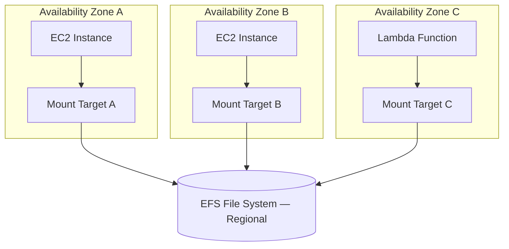

# Amazon EFS (Elastic File System)


<!-- official AWS Architecture Icons asset; see diagrams/README.md for the convention -->

*Service · Storage · maps to SAA-C03 Domain 3, DVA-C03 Domain 1, MLA-C02 Domain 1*

## Definition

Amazon EFS is a **managed, elastic NFS (Network File System)** that many compute resources — EC2
instances, containers, Lambda functions — can mount and use **at the same time**, like a shared
network drive that automatically grows and shrinks as you add or remove files.

## Purpose

EBS solves "one server, one disk." But plenty of real workloads need the opposite: a fleet of web
servers all serving the same uploaded content, a cluster of batch workers all reading/writing a
shared dataset, or containers that need persistent shared storage without each one owning its own
volume. Before EFS, teams ran their own NFS server (a single point of failure to manage and scale
by hand). EFS gives you that shared-filesystem experience as a fully managed, auto-scaling service.

## How It Works



Walking through it:

1. You create **one EFS file system**, which is a **Regional** resource (not tied to a single AZ).
2. For each AZ you want to access it from, you create a **mount target** — a network interface in
   that AZ's subnet with its own IP.
3. Any compute resource in that AZ (EC2, ECS/EKS task, Lambda via VPC) mounts the file system
   through its local mount target using the standard **NFSv4.1** protocol — to the OS, it just
   looks like a local directory.
4. All mount targets point at the **same underlying file system**, so every client sees the exact
   same files in real time — write from instance A, read it from instance B immediately.

## Key Features / Components

- **Performance modes** — *General Purpose* (default, lowest latency, suits most workloads) vs.
  *Max I/O* (higher aggregate throughput/IOPS at slightly higher latency, for massively parallel workloads).
- **Throughput modes** — *Bursting* (scales with storage size, with burst credits), *Provisioned*
  (fixed throughput regardless of size, you pay for it), *Elastic* (automatically scales throughput
  up/down with actual workload, recommended default for unpredictable traffic).
- **Storage classes** — Standard, Infrequent Access (IA), and Archive — EFS has its own lifecycle
  management that moves files between these based on access, similar in spirit to S3's classes.
- **Mount targets** — one per AZ you need access from, each with a security group controlling access.
- **Access Points** — application-specific entry points into a shared file system, each enforcing
  its own POSIX user/group identity and root directory — lets many apps safely share one file system.
- **Encryption** — at rest (KMS) and in transit (TLS) via mount options.
- **EFS Replication** — managed, near-continuous replication of a file system to another Region
  for disaster recovery.

## Use Cases — When to Use It

- **Content management systems / shared web content** — a fleet of web servers (behind a load
  balancer) all serving (and sometimes writing) the same uploaded media or config.
- **Container persistent storage** — ECS and EKS pods across multiple nodes/AZs needing a shared,
  persistent volume that survives container restarts.
- **Lambda shared file access** — functions needing to read/write large shared datasets or
  dependencies beyond the `/tmp` ephemeral limit.
- **Big data / analytics shared scratch space** — many compute nodes processing the same dataset
  concurrently (EMR, genomics, media processing pipelines).
- **Home directories / enterprise file shares** for Linux-based environments.
- **Lift-and-shift of existing on-prem NFS workloads** with minimal application changes.

## When NOT to Use It / Alternatives

- **Windows workloads** — EFS speaks NFS, not SMB; Windows clients can't natively mount it. Use
  **FSx for Windows File Server** instead.
- **Single-instance block storage** (a database's data directory, a boot volume) — EFS is overkill
  and more expensive per GB than EBS for that pattern; use **EBS**.
- **Extreme HPC/ML throughput requirements at massive parallel scale** (e.g., thousands of GPUs
  reading training data simultaneously) — consider **FSx for Lustre**, purpose-built for that.
- **Durable object storage served over HTTP, not mounted** — use **S3**, which is cheaper and
  doesn't require a running compute instance or VPC networking to reach it.

## Why It's Important

**Real world:** EFS is the standard answer whenever an architecture needs "shared state across a
horizontally-scaled fleet" without re-architecting into object storage or a database — a very
common real pattern in traditional web apps and legacy migrations.

**Exam weight:**
- **SAA-C03** — Domain 3, Task 3.1 ("Determine high-performing and/or scalable storage
  solutions") explicitly names the **object/file/block tradeoff among S3, EFS, and EBS** — this is
  one of the most reliably-tested comparisons on the exam.
- **DVA-C03** — Domain 1, when applications need shared persistent storage across container
  tasks or Lambda functions.
- **MLA-C02** — Domain 1, shared access to datasets for distributed data preparation/training jobs
  across multiple compute nodes.

## Pricing Model (summary)

Billed **per GB-month actually stored** (not provisioned — a key difference from EBS), varying by
storage class (Standard costs more than IA/Archive), plus **throughput charges** if you use
Provisioned throughput mode, plus retrieval/request charges for IA. There's no pre-provisioning —
you only pay for what you put in it. Current rates: https://aws.amazon.com/efs/pricing/

## Hands-on Lab (Floci)

**Honest limitation:** Floci's documented storage support (see `labs-floci/README.md`) lists only
S3's object API as fully emulated — EFS is not in that table. The commands below are the real,
correct AWS CLI syntax for learning the *workflow and API shape*; running them against a local
Floci endpoint may return "not implemented" for some calls. If so, that's expected — use this to
learn the sequence of operations, and validate actual mount/read/write behavior against AWS's
free-tier EFS (12 months free tier includes limited EFS storage) or the official documentation.

```bash
# Create a file system
awslocal efs create-file-system \
  --performance-mode generalPurpose \
  --throughput-mode elastic \
  --tags Key=Name,Value=study-efs

# Create a mount target in a given subnet/AZ (needs a VPC/subnet from your lab setup)
awslocal efs create-mount-target \
  --file-system-id fs-xxxxxxxx \
  --subnet-id subnet-xxxxxxxx \
  --security-groups sg-xxxxxxxx

# List file systems and mount targets
awslocal efs describe-file-systems
awslocal efs describe-mount-targets --file-system-id fs-xxxxxxxx

# Create an access point scoped to one application's directory
awslocal efs create-access-point \
  --file-system-id fs-xxxxxxxx \
  --posix-user Uid=1000,Gid=1000 \
  --root-directory "Path=/app-data,CreationInfo={OwnerUid=1000,OwnerGid=1000,Permissions=755}"

# On a real EC2 instance, you would then mount it like:
#   sudo mount -t nfs4 -o nfsvers=4.1 fs-xxxxxxxx.efs.us-east-1.amazonaws.com:/ /mnt/efs
```

## Exam Tips

- **EFS is Linux/NFS-only** — any question mentioning Windows, SMB, or Active Directory
  integration rules out EFS; the answer there is FSx for Windows File Server.
- **EFS is Regional, not AZ-bound** — unlike EBS, one file system is reachable from every AZ in
  the Region (via mount targets), which is exactly why it's the answer when multiple AZs/instances
  need the *same* shared data.
- The classic trap sentence: "many EC2 instances across multiple Availability Zones need to read
  and write the same files concurrently" → **EFS**, not EBS (can't share) and not S3 (not a
  mountable filesystem).
- You pay for **storage used**, not provisioned, which is the opposite billing model from EBS —
  a cost-optimization question may test this distinction directly.
- Remember the **three-way object/block/file identification**: S3 = object, EBS = block, EFS
  (and FSx) = file. This single distinction resolves a large fraction of SAA-C03 storage questions.

## Related Terms

- [`ebs.md`](ebs.md) — single-instance block storage alternative
- [`fsx.md`](fsx.md) — Windows/HPC/NetApp file system alternatives
- [`s3.md`](s3.md) — object storage alternative
- `NFS`, `VPC`, `Security Group` — see glossary
