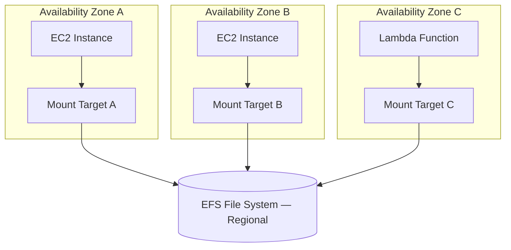
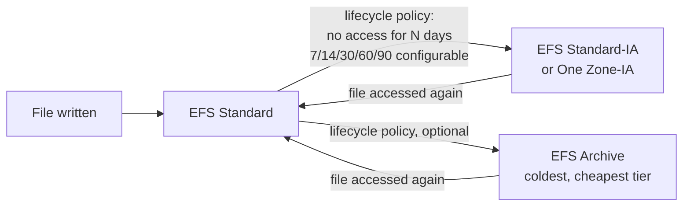

# Amazon EFS (Elastic File System)

> **Appears in:** [SAA-C03](../../certifications/saa-c03/README.md)


<!-- official AWS Architecture Icons asset; see diagrams/README.md for the convention -->

*Service · Storage · maps to SAA-C03 Domain 3, DVA-C03 Domain 1, MLA-C02 Domain 1*

## Definition

Amazon EFS is a **managed, elastic NFS (Network File System)** that many compute resources — EC2
instances, containers, Lambda functions — can mount and use **at the same time**, like a shared
network drive that automatically grows and shrinks as you add or remove files.

## Purpose

EBS solves "one server, one disk." But plenty of real workloads need the opposite: a fleet of web
servers all serving the same uploaded content, a cluster of batch workers all reading/writing a
shared dataset, or containers that need persistent shared storage without each one owning its own
volume. Before EFS, teams ran their own NFS server (a single point of failure to manage and scale
by hand). EFS gives you that shared-filesystem experience as a fully managed, auto-scaling service.

A detail that often gets lost: EFS doesn't just avoid the "single NFS server" bottleneck for
compute, it also avoids it for **capacity planning**. A self-hosted NFS server has a disk you sized
up front; fill it and you're resizing/migrating under pressure. EFS has no provisioned size at
all — it is billed purely on bytes actually stored, the same mental model as S3, which is the
single biggest reason EFS billing looks so different from EBS's "pay for what you provisioned"
model.

## How It Works



Walking through it:

1. You create **one EFS file system**, which is a **Regional** resource (not tied to a single AZ).
2. For each AZ you want to access it from, you create a **mount target** — a network interface in
   that AZ's subnet with its own IP.
3. Any compute resource in that AZ (EC2, ECS/EKS task, Lambda via VPC) mounts the file system
   through its local mount target using the standard **NFSv4.1** protocol — to the OS, it just
   looks like a local directory.
4. All mount targets point at the **same underlying file system**, so every client sees the exact
   same files in real time — write from instance A, read it from instance B immediately.

### The official regional multi-AZ mount picture


*Figure: a Regional EFS file system with one mount target created per Availability Zone — every
EC2 instance in a given AZ shares that AZ's single mount target regardless of which subnet it's
in, and all mount targets read/write the same underlying file system. Source: [Amazon EFS User Guide — "Managing mount targets"](https://docs.aws.amazon.com/efs/latest/ug/accessing-fs.html), © Amazon Web Services.*

### One Zone file systems — a different resilience/cost tradeoff

EFS also offers **One Zone** storage classes (Standard and IA), trading the default multi-AZ
resilience for a lower price, similar in spirit to S3 One Zone-IA:


*Figure: a One Zone EFS file system has exactly one mount target, in one AZ. An instance in a
*different* AZ can still reach it over the mount target's IP, but incurs cross-AZ data transfer
charges and added latency — and loses access entirely if that one AZ fails. Source: [Amazon EFS User Guide — "Managing mount targets"](https://docs.aws.amazon.com/efs/latest/ug/accessing-fs.html), © Amazon Web Services.*

### Storage class lifecycle and Infrequent Access tiering



EFS Lifecycle Management works much like S3 Intelligent-Tiering: you set a policy ("move files not
accessed in 30 days to IA"), and EFS automatically demotes/promotes individual files based on real
access — with no application changes, no different mount path, and the file instantly reappears at
the Standard rate the moment it's read again.

### Hybrid on-premises mount via Direct Connect/VPN

```mermaid
flowchart LR
    OnPrem[On-premises Linux server] -->|Direct Connect or VPN| VPC[Customer VPC]
    VPC --> MT[EFS Mount Target — in VPC subnet]
    MT --> FS[(EFS File System)]
    OnPrem -.mount -t nfs4 fs-id.efs.region.amazonaws.com:/ /mnt/efs.-> MT
```

EFS isn't limited to AWS-hosted compute — any on-premises Linux server with network reachability
into the VPC (via Direct Connect or a Site-to-Site VPN) can mount the file system exactly like an
EC2 instance would, which is a common step in a **gradual migration**: move the storage layer to
EFS first while application servers are still on-premises, then move compute later without another
data migration.

## Key Features / Components

- **Performance modes** — *General Purpose* (default, lowest latency, suits most workloads) vs.
  *Max I/O* (higher aggregate throughput/IOPS at slightly higher latency, for massively parallel workloads).
- **Throughput modes** — *Bursting* (scales with storage size, with burst credits), *Provisioned*
  (fixed throughput regardless of size, you pay for it), *Elastic* (automatically scales throughput
  up/down with actual workload, recommended default for unpredictable traffic).
- **Storage classes** — Standard, Infrequent Access (IA), and Archive — EFS has its own lifecycle
  management that moves files between these based on access, similar in spirit to S3's classes.
- **Mount targets** — one per AZ you need access from, each with a security group controlling access.
- **Access Points** — application-specific entry points into a shared file system, each enforcing
  its own POSIX user/group identity and root directory — lets many apps safely share one file system.
- **Encryption** — at rest (KMS) and in transit (TLS) via mount options.
- **EFS Replication** — managed, near-continuous replication of a file system to another Region
  for disaster recovery.
- **One Zone storage classes** — Standard and IA variants that live in a single AZ, at a
  significantly lower price, for recreatable or already-redundant data.
- **EFS Intelligent-Tiering-style lifecycle policies** — configurable access windows (7, 14, 30, 60,
  or 90 days of inactivity) before a file moves to IA, and back to Standard the moment it's read.

## Use Cases — When to Use It

- **Shared render farm storage for a VFX/animation studio.** Hundreds of render nodes across multiple
  AZs need concurrent read/write access to the same scene files and output frames. EFS's Regional,
  multi-AZ mount gives every node the identical view with POSIX locking semantics render software
  expects. *Alternative cost:* giving each node its own EBS volume instead means manually syncing scene
  data to every node before each job — operationally untenable at render-farm scale.
- **WordPress/CMS fleet behind a load balancer.** Multiple EC2 instances serve the same site, and any
  instance must be able to show media uploaded via a different instance. EFS mounted at
  `wp-content/uploads` solves this without a database/object-storage rewrite. *Alternative cost:* local
  disk per instance breaks the moment the load balancer routes a later request to a different instance
  than the one that received the upload.
- **Container persistent storage for a multi-tenant SaaS platform on EKS.** Pods are rescheduled across
  nodes/AZs constantly, but tenant data must persist regardless of which node a pod lands on. EFS (via
  the EFS CSI driver) gives a shared, durable volume that survives pod rescheduling. *Alternative
  cost:* a local `emptyDir` or node-local volume loses data on every reschedule — unacceptable for
  stateful tenant data.
- **Lambda-based ML inference with shared model artifacts.** Many concurrent Lambda invocations across
  every AZ need to read the same multi-gigabyte model file without re-downloading it from S3 on every
  cold start. EFS Access Points mounted into Lambda give every invocation the same cached file
  instantly. *Alternative cost:* re-fetching from S3 per invocation adds meaningful latency and GET
  cost multiplied across every concurrent cold start.
- **Genomics/bioinformatics shared scratch space for a research institute.** Dozens of EC2 compute
  nodes process the same reference genome dataset concurrently, each needing to read and sometimes
  write intermediate results others can see. EFS gives this shared view natively over NFS.
  *Alternative cost:* copying the dataset to each node's local EBS volume instead wastes storage N
  times over and requires manual synchronization of intermediate outputs.
- **Enterprise Linux home directories for a university or engineering firm.** Hundreds of users need a
  familiar, centrally-managed home-directory experience accessible from any login node. EFS replaces a
  self-hosted NFS server the IT team would otherwise patch and scale by hand. *Alternative cost:*
  running that NFS server on a single EC2 instance with an EBS volume reintroduces the
  single-point-of-failure problem EFS was built to remove.
- **Lift-and-shift of an on-premises NFS file server for a logistics company.** An existing application
  already expects an NFS mount with minimal code-change tolerance. EFS speaks the identical NFSv4.1
  protocol, so the migration is a mount-point change, not an application rewrite. *Alternative cost:*
  forcing a rewrite onto S3's object API instead blows the migration's budget and timeline for no
  immediate benefit.
- **Shared configuration/metadata store across an application cluster.** Multiple application servers
  need to read (and occasionally write) small shared config files consistently. EFS gives real-time
  consistency across all mounts. *Alternative cost:* using S3 for this introduces read-after-write edge
  cases for very hot, frequently-overwritten small files, and no file-locking semantics the application
  may expect.
- **Compliance archival of shared departmental file shares.** A regulated company keeps years of
  departmental Linux file shares that must remain mountable (not just downloadable) for legacy tooling
  during an audit. EFS Standard-IA with lifecycle management keeps cold data cheap while still fully
  mountable at any time. *Alternative cost:* exporting everything to S3/Glacier instead requires
  rebuilding whatever on-prem tooling expects a live mounted filesystem.
- **Cross-Region DR for a shared file system backing a trading platform's reference data.** EFS
  Replication keeps a read-only standby file system in a second Region, promotable to writable if the
  primary Region fails. *Alternative cost:* application-level rsync/DataSync jobs scripted by hand
  require the team to build and maintain their own replication monitoring that EFS Replication provides
  natively.
- **Big data / analytics shared scratch space for a media processing pipeline.** Many compute nodes
  (EMR, custom batch workers) process the same dataset concurrently, writing intermediate results that
  downstream stages must see immediately. EFS's shared, consistent view removes the need for a
  staging/handoff step between stages. *Alternative cost:* routing every intermediate file through S3
  instead adds PUT/GET latency and eventual-consistency considerations at every pipeline stage boundary.

## When NOT to Use It / Alternatives

- **Windows workloads** — EFS speaks NFS, not SMB; Windows clients can't natively mount it. Use
  **FSx for Windows File Server** instead.
- **Single-instance block storage** (a database's data directory, a boot volume) — EFS is overkill
  and more expensive per GB than EBS for that pattern; use **EBS**.
- **Extreme HPC/ML throughput requirements at massive parallel scale** (e.g., thousands of GPUs
  reading training data simultaneously) — consider **FSx for Lustre**, purpose-built for that.
- **Durable object storage served over HTTP, not mounted** — use **S3**, which is cheaper and
  doesn't require a running compute instance or VPC networking to reach it.

## Why It's Important

**Real world:** EFS is the standard answer whenever an architecture needs "shared state across a
horizontally-scaled fleet" without re-architecting into object storage or a database — a very
common real pattern in traditional web apps and legacy migrations.

**Exam weight:**
- **SAA-C03** — Domain 3, Task 3.1 ("Determine high-performing and/or scalable storage
  solutions") explicitly names the **object/file/block tradeoff among S3, EFS, and EBS** — this is
  one of the most reliably-tested comparisons on the exam.
- **DVA-C03** — Domain 1, when applications need shared persistent storage across container
  tasks or Lambda functions.
- **MLA-C02** — Domain 1, shared access to datasets for distributed data preparation/training jobs
  across multiple compute nodes.

## Pricing Model — Deep Dive

| Component | Illustrative $/GB-month (us-east-1) |
|---|---|
| EFS Standard (Regional, multi-AZ) | $0.30 |
| EFS Standard-IA | $0.025 |
| EFS One Zone | $0.16 |
| EFS One Zone-IA | $0.0133 |
| IA data access/retrieval | $0.01/GB |
| Provisioned Throughput | $6.00/MB-per-second-month |
| Elastic Throughput (read) | $0.03/GB |
| Elastic Throughput (write) | $0.06/GB |

*(Illustrative list prices at time of writing — confirm current numbers at
https://aws.amazon.com/efs/pricing/.)*

### Worked example 1 — lifecycle management savings on a mostly-cold content store

A media library has 600 GB total; lifecycle analysis shows roughly 80% of files haven't been
touched in 30+ days. Without any lifecycle policy, everything sits on Standard:

```
No lifecycle policy:    600 GB × $0.30                       = $180.00/month

With 30-day IA policy:  120 GB (hot, Standard) × $0.30        =  $36.00
                        480 GB (cold, Standard-IA) × $0.025    =  $12.00
                        + occasional IA reads, say 20 GB/mo
                          × $0.01                               =   $0.20
                        -------------------------------------------------
                        Total                                   ≈  $48.20/month
```

That's a **~73% reduction** purely from enabling lifecycle management with zero application
changes — directly mirroring the slide AWS itself uses in EFS pricing materials, where enabling IA
with 80% of data cold brings a blended effective rate down to roughly $0.08/GB-month.

### Worked example 2 — One Zone vs. Regional for a dev/test environment

A 200 GB development file system, non-production, recreatable from a CI pipeline if lost:

```
EFS Standard (Regional, 3 AZ):   200 GB × $0.30                = $60.00/month
EFS One Zone:                     200 GB × $0.16                = $32.00/month
```

Choosing One Zone here saves **~47%**, which is a defensible trade for a dev/test environment but
would be the wrong call for the production file system it's modeled after — a classic exam
scenario hinge point ("is this data critical, or recreatable?").

### Worked example 3 — Provisioned vs. Elastic throughput for a bursty analytics job

A batch job needs 500 MB/s of throughput for 2 hours a day, and near-zero the rest of the time, on
a 100 GB file system (too small for Bursting mode to naturally provide that much throughput):

```
Provisioned Throughput (500 MB/s, all month):  500 × $6.00                      = $3,000.00/month
Elastic Throughput (only pay for actual use):
   2 hrs/day × 30 days × 500 MB/s × 3,600 s/hr = 108,000,000 MB transferred/mo
   ≈ 105,468 GB × $0.03 (read) [example: mostly reads]                           ≈ $3,164.00  (one-time, scales with actual volume moved, not a flat monthly rate)
```

The exact Elastic number depends heavily on real traffic patterns (and whether it's reads or
writes, since they're priced differently) — the point for the exam is qualitative: **Provisioned
Throughput is a flat, predictable cost regardless of usage; Elastic Throughput scales with actual
data moved** — for a short-lived daily burst against a long idle period, Elastic is usually cheaper,
but for sustained heavy throughput all day, Provisioned can end up cheaper per GB transferred.
Always model the actual access pattern, not just the peak requirement.

### Worked example 4 — AWS DataSync as the migration on-ramp

Migrating an existing 10 TB on-premises NFS share into EFS is itself a cost/time consideration
separate from EFS's own ongoing pricing. **AWS DataSync** (a distinct service, not covered in depth
in this document) is the standard tool for this initial bulk transfer, billed per-GB transferred
(roughly $0.0125/GB at time of writing) rather than per-GB-month stored:

```
One-time DataSync transfer:  10,000 GB × $0.0125                = $125.00 one-time
Ongoing EFS storage (Standard): 10,000 GB × $0.30                = $3,000.00/month
```

The one-time migration cost is trivial compared to ongoing storage cost — the real decision this
should prompt is applying **lifecycle management from day one** of the migrated file system, rather
than treating cost optimization as something to revisit later once the dataset has already
accumulated months of full-price Standard storage.

## Common Architectures

**1. WordPress/CMS fleet behind an Application Load Balancer.** Multiple EC2 instances (or ECS
tasks) in an Auto Scaling group all mount the same EFS file system for the `wp-content/uploads`
directory, so any instance can serve any user's previously uploaded media regardless of which
instance originally received the upload — solving the classic "user uploads to instance A, but the
load balancer routes their next request to instance B" problem without a database or object-storage
rewrite.

**2. Lambda with large shared ML model artifacts.** Lambda functions mount an EFS Access Point to
read a multi-gigabyte model file that's too large for the `/tmp` ephemeral storage limit (and too
slow to re-download from S3 on every cold start) — the file is loaded once into EFS, and every
concurrent Lambda invocation across all AZs reads it from the same shared mount, sharing OS page
cache benefits where available.

**3. Cross-Region DR for a shared file system.** EFS Replication continuously, asynchronously
replicates a production file system to a read-only replica in a second Region. If the primary
Region fails, the replica is promoted to a standalone, writable file system, and DR compute (EC2 or
containers, already provisioned or launched from a pre-baked template) mounts it and resumes
service — all without managing custom rsync/DataSync jobs.

**4. Multi-tenant SaaS application with per-tenant Access Points.** A single EFS file system backs
many tenants' data, with one **EFS Access Point** created per tenant, each scoped to its own root
directory and enforcing its own POSIX identity — application code mounts the Access Point rather
than the raw file system, so a bug in one tenant's request handling cannot accidentally read or
write another tenant's files, without needing a separate file system (and separate mount targets,
cost, and management overhead) per tenant.

## Limits & Quotas

- **Mount targets** — exactly **one per Availability Zone** per file system (not one per subnet;
  if an AZ has multiple subnets, you pick one for the mount target, and every instance in that AZ,
  regardless of subnet, shares it).
- **File system size** — effectively unlimited, auto-scales with usage (petabyte scale is
  supported with no pre-provisioning).
- **Maximum file size** — 52 TB (per individual file within the file system).
- **Throughput (Bursting mode)** — scales with file system size, roughly 50 KB/s per GB stored
  baseline, with a burst credit system for temporary spikes above baseline.
- **Elastic Throughput** — up to several GB/s aggregate per file system (exact ceiling depends on
  Region and is periodically raised — check current quotas before capacity planning).
- **Access Points per file system** — up to 1,000 (soft limit, raisable via Service Quotas).
- **File systems per account per Region** — default soft quota around 1,000 (One Zone + Regional
  combined), raisable.
- **Concurrent connections** — thousands of simultaneous clients can mount the same file system; no
  practical hard cap tested on the exam, but real deployments do watch NFS client-side connection
  limits per mount target.
- **EFS Replication lag** — typically completes within 15 minutes under normal conditions (similar
  spirit to S3 RTC, though without a formal SLA attached to the base feature), tracked via the
  `TimeSinceLastSync` CloudWatch metric on the replica file system.
- **Directories per file system** — no hard published cap distinct from general POSIX filesystem
  norms; EFS is designed to scale to large directory trees without the performance cliffs some
  traditional filesystems hit at high file counts per directory.
- **IAM-based access control granularity** — EFS supports resource policies and IAM condition keys
  scoped down to individual Access Points, letting a single file system serve many applications
  each restricted to its own Access Point without touching file system-level permissions.

## Troubleshooting / Common Issues

- **"My EC2 instance can't mount the file system"** — check, in order: (1) a **mount target
  actually exists in that instance's AZ**, (2) the mount target's **security group allows inbound
  NFS (port 2049)** from the instance's security group, (3) the instance has a **network path** to
  the mount target's subnet (routing, NACLs), (4) for on-prem clients, that **Direct
  Connect/VPN** routing reaches the VPC.
- **One Zone file system reachable but slow/expensive from other AZs** — this is expected: an
  instance outside the file system's single AZ incurs **cross-AZ data transfer charges** and
  higher latency reaching the one mount target — if this matters, you need a Regional (multi-AZ)
  file system instead.
- **Lifecycle management "isn't saving money"** — confirm the policy is actually configured (it's
  off by default) and that the access-window setting (7/14/30/60/90 days) matches the real cold
  threshold for your data — a 90-day window on data that goes cold after 10 days won't transition
  it for 80 extra days of full-price storage.
- **Throughput throttled unexpectedly on Bursting mode** — the file system ran out of **burst
  credits**; either the file system is too small for the sustained throughput being demanded (grow
  it, since baseline throughput scales with size), or switch to Provisioned or Elastic throughput
  mode.
- **Windows clients cannot mount at all** — EFS is NFS-only; this is not a misconfiguration to
  debug, it's a protocol mismatch — the fix is **FSx for Windows File Server**, not a different EFS
  setting.
- **Lambda cold-start latency increased after adding an EFS mount** — mounting EFS from Lambda adds
  VPC networking overhead (an ENI must attach) on cold starts; this is an expected tradeoff, not a
  bug, and is why EFS-from-Lambda is typically reserved for cases where the shared-file requirement
  genuinely outweighs the added cold-start cost.

## Hands-on Lab (Floci)

**Honest limitation:** Floci's documented storage support (see `labs-floci/README.md`) lists only
S3's object API as fully emulated — EFS is not in that table. The commands below are the real,
correct AWS CLI syntax for learning the *workflow and API shape*; running them against a local
Floci endpoint may return "not implemented" for some calls. If so, that's expected — use this to
learn the sequence of operations, and validate actual mount/read/write behavior against AWS's
free-tier EFS (12 months free tier includes limited EFS storage) or the official documentation.

```bash
# Create a file system
awslocal efs create-file-system \
  --performance-mode generalPurpose \
  --throughput-mode elastic \
  --tags Key=Name,Value=study-efs

# Create a mount target in a given subnet/AZ (needs a VPC/subnet from your lab setup)
awslocal efs create-mount-target \
  --file-system-id fs-xxxxxxxx \
  --subnet-id subnet-xxxxxxxx \
  --security-groups sg-xxxxxxxx

# List file systems and mount targets
awslocal efs describe-file-systems
awslocal efs describe-mount-targets --file-system-id fs-xxxxxxxx

# Create an access point scoped to one application's directory
awslocal efs create-access-point \
  --file-system-id fs-xxxxxxxx \
  --posix-user Uid=1000,Gid=1000 \
  --root-directory "Path=/app-data,CreationInfo={OwnerUid=1000,OwnerGid=1000,Permissions=755}"

# Configure lifecycle management (move to IA after 30 days, back to Standard on access)
aws efs put-lifecycle-configuration \
  --file-system-id fs-xxxxxxxx \
  --lifecycle-policies '[{"TransitionToIA":"AFTER_30_DAYS"},{"TransitionToPrimaryStorageClass":"AFTER_1_ACCESS"}]'

# On a real EC2 instance, you would then mount it like:
#   sudo mount -t nfs4 -o nfsvers=4.1 fs-xxxxxxxx.efs.us-east-1.amazonaws.com:/ /mnt/efs
```

## Exam-Style Scenario Walkthroughs

**Scenario 1:** A fleet of 12 EC2 instances across 3 Availability Zones, behind an Application Load
Balancer, all need to read and write the same uploaded media files from any instance at any time.
Which storage service, and what's the one resource you must create per AZ?

*Answer:* Amazon EFS. You must create a **mount target** in each of the 3 AZs (one per AZ, shared
by every instance in that AZ regardless of subnet) so instances in every AZ can reach the single
Regional file system with low latency — without a mount target in an AZ, instances there cannot
mount the file system at all.

**Scenario 2:** A development team wants the cheapest possible shared storage for a non-production,
fully recreatable test dataset used by a single AZ's worth of CI runners. What's the most
cost-effective EFS configuration, and what's the tradeoff?

*Answer:* EFS One Zone (or One Zone-IA if access is infrequent), accepting that this file system has
**no cross-AZ redundancy** — if that one AZ fails, the data (and the mount) is unavailable. This
tradeoff is acceptable specifically because the dataset is described as fully recreatable and
non-production; for anything production-critical, Regional (multi-AZ) EFS Standard would be the
correct choice despite the higher cost.

**Scenario 3:** An organization is migrating an on-premises NFS-based home-directory server to AWS,
but wants to validate the migration gradually, keeping some users' home directories on-premises
while others move to cloud-hosted compute, all needing to see the same files during the transition.
What's the bridging architecture?

*Answer:* Create the EFS file system in AWS with a mount target in the VPC, then connect the
on-premises network to the VPC via Direct Connect or a Site-to-Site VPN, and mount the EFS file
system on the on-premises Linux servers using the same NFSv4.1 protocol they already understand —
both on-prem and cloud-hosted compute can mount and see the identical file system simultaneously
during the gradual cutover.

**Scenario 4:** A Lambda function needs to read a 3 GB machine learning model file on every
invocation, and re-downloading it from S3 on every cold start is adding unacceptable latency. The
team is also concerned about Lambda's `/tmp` ephemeral storage limit. What's the fix?

*Answer:* Mount an EFS **Access Point** into the Lambda function (via VPC networking) and store
the model file on EFS instead of relying on `/tmp` or re-fetching from S3 per invocation — EFS
has no practical per-file size limit relevant here (up to 52 TB per file), persists across
invocations and cold starts, and every concurrent Lambda execution across every AZ can read the
same file from the same shared mount.

## Exam Tips

- **EFS is Linux/NFS-only** — any question mentioning Windows, SMB, or Active Directory
  integration rules out EFS; the answer there is FSx for Windows File Server.
- **EFS is Regional, not AZ-bound** — unlike EBS, one file system is reachable from every AZ in
  the Region (via mount targets), which is exactly why it's the answer when multiple AZs/instances
  need the *same* shared data.
- The classic trap sentence: "many EC2 instances across multiple Availability Zones need to read
  and write the same files concurrently" → **EFS**, not EBS (can't share) and not S3 (not a
  mountable filesystem).
- You pay for **storage used**, not provisioned, which is the opposite billing model from EBS —
  a cost-optimization question may test this distinction directly.
- **One Zone classes trade resilience for cost** — the same tradeoff pattern as S3 One Zone-IA;
  don't pick One Zone if the scenario says the data must survive an AZ failure.
- **Lifecycle management moves files back to Standard automatically on access** — this "no
  retrieval penalty surprise" distinguishes it from a naive reading of S3's IA retrieval-fee model;
  know that EFS IA *does* still charge a per-GB data access fee, it's just automatic and
  bidirectional.
- Remember the **three-way object/block/file identification**: S3 = object, EBS = block, EFS
  (and FSx) = file. This single distinction resolves a large fraction of SAA-C03 storage questions.

## Further Reading

- [Amazon EFS User Guide — How Amazon EFS works](https://docs.aws.amazon.com/efs/latest/ug/how-it-works.html) — official documentation home
- [Managing mount targets](https://docs.aws.amazon.com/efs/latest/ug/accessing-fs.html) — the Regional vs. One Zone diagrams referenced above
- [Amazon EFS lifecycle management](https://docs.aws.amazon.com/efs/latest/ug/lifecycle-management-efs.html)
- [Amazon EFS pricing](https://aws.amazon.com/efs/pricing/) — current, authoritative rates
- [EFS performance guidance](https://docs.aws.amazon.com/efs/latest/ug/performance.html)

## Related Terms

- [`ebs.md`](ebs.md) — single-instance block storage alternative
- [`fsx.md`](fsx.md) — Windows/HPC/NetApp file system alternatives
- [`s3.md`](s3.md) — object storage alternative
- `NFS`, `VPC`, `Security Group` — see glossary
