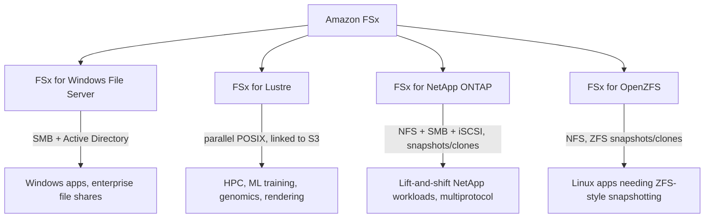
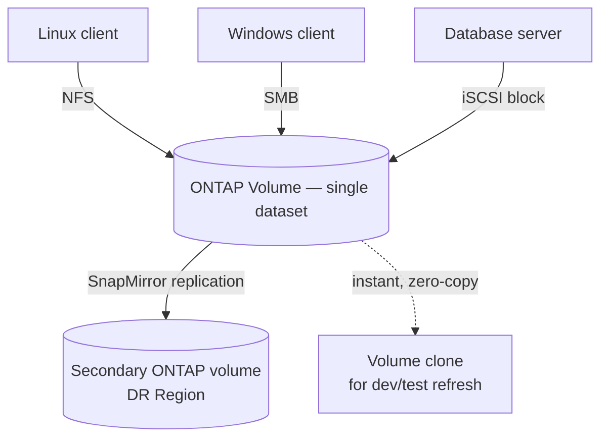
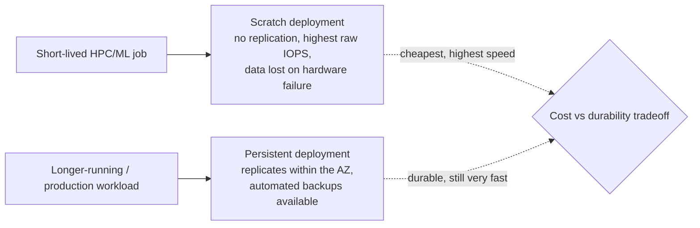

# Amazon FSx


<!-- official AWS Architecture Icons asset; see diagrams/README.md for the convention -->

*Service · Storage · maps to SAA-C03 Domain 3, MLA-C02 Domain 1 (FSx for Lustre specifically)*

## Definition

Amazon FSx is a family of **fully managed, third-party-compatible file systems**. Instead of one
generic file system, AWS gives you four purpose-built flavors — Windows File Server, Lustre,
NetApp ONTAP, and OpenZFS — each a managed version of a specific, well-known file system
technology, so you get its native feature set without having to install, patch, or operate it
yourself.

## Purpose

EFS covers Linux/NFS shared storage well, but it doesn't speak SMB (Windows), it isn't tuned for
extreme-throughput HPC/ML workloads, and it doesn't replicate NetApp-specific enterprise features
(deduplication, cloning, SnapMirror) that many existing on-prem environments depend on. FSx exists
so organizations with a specific file-system requirement — often from an existing on-prem system
they're migrating — get a **managed, native-compatible** equivalent in AWS, instead of either
running their own file server on EC2 or forcing a workload onto a file system that doesn't fit.

The unifying idea across all four flavors is the same bet AWS makes with RDS versus a generic
database server: rather than build one "AWS file system" and ask every workload to adapt to it,
AWS runs the *actual upstream software* (real Windows Server file sharing stack, real Lustre, real
NetApp ONTAP, real OpenZFS) as a managed service — so existing tooling, client drivers, and
operational knowledge transfer directly, at the cost of each flavor having its own distinct pricing
model, deployment options, and failure modes that you have to learn individually.

## How It Works



Walking through it:

1. **FSx for Windows File Server** speaks **SMB** and integrates with **Active Directory**, so
   Windows applications and users see it exactly like an on-prem Windows file share — including
   DFS namespaces and shadow copies (previous-versions "restore a file" UI).
2. **FSx for Lustre** is a parallel, POSIX-compliant file system built for extreme throughput and
   low latency across thousands of compute nodes simultaneously — and it can **link directly to an
   S3 bucket**, presenting S3 objects as files and writing results back to S3, which is exactly the
   pattern ML training jobs use.
3. **FSx for NetApp ONTAP** runs real NetApp ONTAP software managed by AWS — **multiprotocol**
   (NFS, SMB, and iSCSI simultaneously on the same data), with NetApp's storage efficiency features
   (deduplication, compression, instant clones, SnapMirror replication).
4. **FSx for OpenZFS** gives you the open-source ZFS file system's point-in-time snapshots, clones,
   and compression on Linux-based NFS workloads, without NetApp-specific licensing.

### FSx for Lustre linked to S3 — the ML training pattern


*Figure: a real genomics-workflow architecture using three separate FSx for Lustre file systems
(reference data, source data, and working/output data), each linked to its own S3 bucket via a
Data Repository Association — reference and source are read-only imports from S3, while the
working file system has both import and export paths so results are written back to S3 as the
single source of truth. Source: [AWS Storage Blog — "Using Amazon FSx for Lustre for Genomics Workflows on AWS"](https://aws.amazon.com/blogs/storage/using-amazon-fsx-for-lustre-for-genomics-workflows-on-aws/), © Amazon Web Services.*

The data repository association (DRA) is the mechanism underneath this: when an object already
exists in the linked S3 bucket, FSx for Lustre **lazily loads** its content into the file system on
first file access (so you don't wait for a bulk import before compute can start), and a **Data
Repository Task** can later export changed/new files back to S3 explicitly, or on an export-path
file system, automatically.

### Multi-protocol access on FSx for NetApp ONTAP



The headline feature that distinguishes ONTAP from every other FSx flavor (and from EFS) is that
**the same underlying data** can be accessed simultaneously over NFS, SMB, and iSCSI — a Linux
analytics job, a Windows reporting tool, and a database server can all work against one dataset
without three separate copies, which is exactly the "multiprotocol" requirement that marks an
exam question as an ONTAP question rather than an EFS or Windows File Server one.

### Lustre deployment types: scratch vs. persistent



## Key Features / Components

- **FSx for Windows File Server** — SMB protocol, Active Directory (self-managed or AWS Managed
  Microsoft AD) integration, DFS namespaces for scaling across multiple file systems, shadow
  copies, Windows ACLs/quotas.
- **FSx for Lustre** — *scratch* deployment (temporary, high-performance, no replication — for
  short-lived HPC jobs) vs. *persistent* deployment (durable, replicated, for longer-running
  workloads); direct **S3 data repository association** (lazy-load objects as files, export
  results back).
- **FSx for NetApp ONTAP** — multiprotocol access, storage efficiency (dedup/compression/thin
  provisioning), instant snapshots and zero-copy clones, SnapMirror for DR replication, tiering to
  a cheaper capacity pool automatically.
- **FSx for OpenZFS** — ZFS snapshots/clones, configurable record size and compression, NFS access,
  sub-millisecond latencies on SSD-backed storage.
- All four: encryption at rest (KMS) and in transit, VPC-based networking, automated daily backups,
  and Multi-AZ deployment options for high availability (varies by flavor).
- **Storage tiers (Lustre)** — SSD (highest performance, highest cost) vs. HDD (6–10x cheaper per
  GB, with an optional SSD read-cache layer to offset the lower raw HDD throughput).
- **Automatic capacity-pool tiering (ONTAP)** — infrequently accessed data automatically moves to
  a lower-cost capacity pool tier, transparent to clients, conceptually similar to EFS/S3
  lifecycle tiering but implemented at the storage-engine level.

## Use Cases — When to Use It

- **FSx for Windows File Server** — enterprise file shares for Windows users, Windows-based
  applications (e.g., SharePoint, home directories, group shares) migrating from on-prem.
- **FSx for Lustre** — machine learning training on large datasets, high-performance computing
  (genomics, computational fluid dynamics), media rendering farms — anywhere "fastest possible
  shared throughput tied to S3" is the requirement.
- **FSx for NetApp ONTAP** — lift-and-shift of existing on-prem NetApp environments, workloads
  needing both NFS and SMB access to the *same* data, database workloads wanting instant
  clones for dev/test refreshes.
- **FSx for OpenZFS** — Linux workloads wanting ZFS's snapshot/clone model without NetApp's
  specific enterprise feature set or licensing.

## When NOT to Use It / Alternatives

- **Simple Linux NFS shared storage with no special feature requirement** — plain **EFS** is
  usually simpler to manage and cheaper; don't reach for FSx just because it's "more powerful" if
  you don't need its specific capabilities.
- **Object storage access pattern over HTTP** — use **S3** directly (and in the Lustre case, FSx
  is often paired *with* S3, not instead of it).
- **Single-instance block storage** (a database's local disk) — use **EBS**, which is cheaper for
  that pattern and doesn't require managing a separate file system.
- **No Windows/HPC/NetApp-specific requirement** — defaulting to the most specialized (and often
  more expensive) FSx flavor when EFS would do is a common real-world and exam anti-pattern.

## Why It's Important

**Real world:** FSx is the practical bridge for enterprises whose applications are *not*
Linux/NFS-native — Windows file shares and NetApp environments are extremely common in regulated
and legacy enterprise IT, and FSx lets them move to AWS without rewriting those dependencies. FSx
for Lustre specifically has become a standard building block in large-scale ML training pipelines
— the AWS Machine Learning blog's own SageMaker HyperPod large-model training write-ups (e.g.
training a 70-billion-parameter model) describe FSx for Lustre as the performance-critical layer
sitting between S3 and thousands of GPU training nodes, specifically to avoid S3 becoming an I/O
bottleneck at that scale.

**Exam weight:**
- **SAA-C03** — Domain 3, Task 3.1 (high-performing/scalable storage) tests choosing the *correct
  FSx flavor* against a scenario's protocol/feature keywords (Windows+AD, HPC, NetApp, ZFS).
- **MLA-C02** — Domain 1 (data preparation) names **FSx for Lustre** directly as a high-throughput
  option for storing and streaming large training datasets, especially when linked to an S3 data
  lake.

## Pricing Model — Deep Dive

| FSx flavor / config | Illustrative $/GB-month (us-east-1) | Notes |
|---|---|---|
| Lustre — Scratch SSD | $0.140 | No replication, cheapest SSD option |
| Lustre — Persistent SSD, 125 MB/s per TiB | $0.145 | Baseline throughput included |
| Lustre — Persistent SSD, 250 MB/s per TiB | $0.290 | Higher baseline throughput tier |
| Lustre — Persistent HDD, 12 MB/s per TiB | $0.025 | ~6x cheaper than SSD; optional SSD cache add-on |
| Lustre backups | $0.05/GB-month | Automated or on-demand backups |
| Windows File Server (SSD) | from ~$0.013–$0.10+/GB depending on deployment/throughput | Varies significantly by Multi-AZ vs Single-AZ and throughput capacity |
| OpenZFS (Multi-AZ SSD) | ~$0.18/GB-month | Plus throughput capacity charges |
| ONTAP (SSD + capacity pool) | SSD tier higher, capacity pool tier ~$0.022–$0.044/GB-month | Automatic tiering blends the effective rate |

*(Illustrative list prices at time of writing — confirm current numbers at
https://aws.amazon.com/fsx/pricing/; FSx pricing is more deployment-option-dependent than any other
storage service in this repo, so treat these as directional, not quote-ready.)*

### Worked example 1 — scratch vs. persistent Lustre for a genomics pipeline

AWS's own published example: a 4,800 GB scratch Lustre file system, run 8 hours/day for a 30-day
month, then deleted:

```
Hourly rate: $0.140/GB-month ÷ 30 days ÷ 24 hours = $0.000194/GB-hour
4,800 GB × $0.000194/GB-hour × 8 hours/day × 30 days = $224.06/month
```

Compare that to the cost of achieving similar performance by over-provisioning three separate 1 TB
EBS gp3 scratch volumes per compute node for the same job duration — in AWS's own published
genomics-workflow case study, the EBS-staging alternative worked out to roughly **$0.035 per
workflow run** against **$0.1164 per workflow run** on FSx for Lustre for the same 10-minute job —
cheaper on EBS for *this specific short job*, but the blog explicitly notes real genomics workflows
run **8–12 hours** with more steps and more data, at which point the performance and developer-
productivity gains of a true shared POSIX filesystem (no re-staging data between steps, no AWS CLI
baked into every container) outweigh the raw per-GB-hour cost difference. This is the core lesson
for the exam: **a service's raw unit price is not the same question as its total cost for a given
workload** — throughput, job duration, and operational complexity all factor into the real answer.

### Worked example 2 — persistent Lustre with metadata IOPS for an ongoing training job

A persistent file system storing 2,000 GB of data requiring at least 125 MB/s throughput and 3,000
metadata IOPS (AWS's own published pricing example), achieved via 50% data compression against
1,200 GB of actual provisioned SSD capacity:

```
Storage:          1,200 GB × $0.145/GB-month                 = $174.00/month
Metadata IOPS:     1,500 IOPS × $0.055/IOPS-month              =  $82.50/month
----------------------------------------------------------------------------
Total                                                           ≈ $256.50/month
```

### Worked example 3 — HDD vs. SSD Lustre for a genome-analysis workload

A 10 TiB genome reference dataset, read sequentially and infrequently (classic HDD-friendly
pattern):

```
SSD persistent (50 MB/s per TiB):  10,240 GB × $0.14           = $1,433.60/month
HDD persistent (12 MB/s per TiB):  10,240 GB × $0.025          =   $256.00/month
HDD + SSD read cache (40 MB/s/TiB effective): 10,240 GB × $0.041 ≈ $419.84/month
```

HDD with an SSD read-cache layer gets most of the way to SSD-level *effective* throughput for
roughly **a quarter of the cost** — the right choice whenever the access pattern is read-heavy and
somewhat repetitive (the cache absorbs the "hot" subset), which is exactly AWS's own published
guidance for genome-analysis-style workloads.

### Worked example 4 — FSx for Windows File Server Single-AZ vs. Multi-AZ

A 2 TB Windows file share supporting a department's shared drives, deciding between Single-AZ
(cheaper, no automatic failover) and Multi-AZ (standby file server in a second AZ, automatic
failover) deployment:

```
Single-AZ:   2,000 GB × illustrative $0.013/GB-month (storage tier, SSD)  ≈  $26.00/month
             + throughput capacity charge (separate line item, varies by configured Mbps)

Multi-AZ:    same storage rate, roughly double the effective cost due to the standby
             copy's storage and the Multi-AZ throughput capacity premium
             ≈ $55-65/month for an equivalent configuration (illustrative)
```

The Multi-AZ premium buys **automatic failover** if the primary AZ's file server becomes
unavailable — appropriate for a production file share supporting business-critical workflows, but
often unnecessary overhead for a low-stakes departmental share where a short, rare outage is
tolerable; this exact Single-AZ-vs-Multi-AZ cost/resilience tradeoff appears across nearly every
AWS managed-database and managed-file-system service, not just FSx.

## Common Architectures

**1. ML training with FSx for Lustre as a high-performance cache in front of S3.** Training data
lives durably and cheaply in S3; an FSx for Lustre file system is created and linked to that S3
bucket via a Data Repository Association just for the duration of a training job (or kept
persistent for repeated training runs), giving GPU/compute nodes POSIX-file-speed access instead of
making every training step an S3 API call — this exact pattern appears in AWS's own large language
model training reference architectures.

**2. Windows enterprise file share migration.** An organization's on-prem Windows file servers,
joined to Active Directory, are replaced by FSx for Windows File Server joined to either
self-managed AD (via Direct Connect/VPN) or AWS Managed Microsoft AD — DFS Namespaces let multiple
underlying FSx file systems appear as one unified namespace to end users, exactly mirroring how
the on-prem DFS setup looked.

**3. NetApp dev/test environment refresh via instant clones.** A production ONTAP volume is
cloned instantly (zero-copy) to create a dev/test environment that's byte-for-byte identical to
production at that moment, without actually duplicating the underlying data — developers get a
full-fidelity test copy in seconds instead of waiting for a multi-hour data restore, and only the
*changed* blocks in the clone consume additional storage.

**4. Multi-region rendering farm with Lustre scratch file systems.** A visual-effects studio spins
up a short-lived **scratch** Lustre file system per rendering job, pre-populated from an S3 bucket
holding scene assets, runs hundreds of render nodes against it for the job's duration, exports
finished frames back to S3, then deletes the file system entirely — paying only for the hours the
scratch file system actually existed, with no replication overhead since the source assets and
final output both live durably in S3 regardless of the scratch file system's lifecycle.

## Limits & Quotas

- **FSx for Lustre file system size** — from 1.2 TiB up to multiple **PiB** per file system
  (scales in specific increments depending on deployment type/throughput tier).
- **FSx for Lustre throughput tiers** — 50, 100, 125, 200, or 250 MB/s per TiB of SSD storage
  provisioned (persistent deployment); HDD tiers offer 12 or 40 MB/s per TiB.
- **FSx for Windows File Server** — up to 64 TiB per file system (Single-AZ or Multi-AZ); supports
  up to hundreds of file shares per file system via DFS Namespaces for horizontal scaling across
  multiple file systems.
- **FSx for NetApp ONTAP** — up to **1 PiB** per file system; supports up to several hundred
  volumes per file system (check current Service Quotas, as this has been raised over time).
  Deployed Multi-AZ by default for production use.
- **FSx for OpenZFS** — up to 512 TiB per file system; sub-millisecond latencies on SSD storage,
  Multi-AZ deployment option for high availability.
- **Data Repository Associations (Lustre)** — up to **8 per file system**, each able to map to a
  different S3 bucket/prefix, letting one file system present multiple logically separate data
  sources.
- **Backups** — automated daily backups retained per a configurable window (varies by flavor);
  manual/on-demand backups supported on all four flavors.
- **FSx for Lustre maximum file size** — matches the file system's total capacity in practical
  terms (no artificial per-file ceiling distinct from total provisioned storage).
- **FSx for Windows File Server shadow copies** — retained per a configurable schedule (default
  often daily), giving end users native "Previous Versions" self-service file recovery without
  administrator involvement, mirroring on-prem Windows Server behavior exactly.
- **FSx for NetApp ONTAP SVMs (Storage Virtual Machines)** — multiple SVMs can be created per file
  system, each with its own independent administrative boundary, security style, and set of
  volumes — relevant for multi-tenant or multi-department consolidation scenarios.

## Troubleshooting / Common Issues

- **FSx for Lustre file appears empty or stale compared to S3** — remember the **lazy-load**
  behavior: a file isn't pulled from the linked S3 bucket until it's actually accessed; if an
  automated process expects the data to already be present, either pre-warm with a Data Repository
  Task or design around on-demand loading.
- **"Export back to S3 isn't happening"** — only a file system (or specific DRA) with an
  **export path configured** writes changes back to S3 automatically; a read-only/import-only
  association will never push local changes back — this is intentional (matches the genomics
  pipeline pattern of read-only reference data vs. a writable output filesystem).
- **Windows clients can't join FSx for Windows File Server to the domain** — confirm network
  connectivity and security group rules allow the required Active Directory ports, and that the
  FSx file system's selected AD (self-managed via Direct Connect/VPN, or AWS Managed Microsoft AD)
  is reachable from the FSx subnets — this is the single most common FSx for Windows setup failure.
- **ONTAP multiprotocol permission conflicts** — NFS (POSIX permissions) and SMB (Windows ACLs)
  have fundamentally different permission models; when both protocols touch the same files,
  misconfigured UNIX-to-Windows identity mapping is the most common source of "wrong permissions"
  tickets — ONTAP's multiprotocol name-mapping configuration needs to be set up deliberately, not
  left at defaults, for mixed-protocol production use.
- **Scratch Lustre data loss after a hardware failure** — this is scratch behaving exactly as
  designed (no replication); if this is surprising in an incident, the deployment type choice was
  the mistake — persistent deployment was the correct tool for data that must survive a failure.
- **Unexpectedly high bill on a Lustre file system** — check whether SSD was chosen where HDD (with
  or without an SSD cache) would have met the real throughput requirement; SSD persistent storage
  can be 4–10x the price of HDD persistent storage for workloads that don't need the extra
  throughput.

## Hands-on Lab (Floci)

**Honest limitation:** FSx is not in Floci's documented storage support table (only S3's object
API is fully emulated there — see `labs-floci/README.md`). The commands below show the real,
correct CLI syntax for each flavor so you can learn the API shape and workflow; expect that a
local Floci endpoint may reject or stub these calls. For functional verification, use AWS's
official documentation/sandbox or a short-lived real AWS FSx trial.

```bash
# FSx for Lustre — create a scratch file system linked to an S3 bucket
awslocal fsx create-file-system \
  --file-system-type LUSTRE \
  --storage-capacity 1200 \
  --subnet-ids subnet-xxxxxxxx \
  --lustre-configuration DeploymentType=SCRATCH_2,DataRepositoryAssociations='[]'

# FSx for Windows File Server — create a file system joined to AWS Managed AD
awslocal fsx create-file-system \
  --file-system-type WINDOWS \
  --storage-capacity 300 \
  --subnet-ids subnet-xxxxxxxx \
  --windows-configuration ActiveDirectoryId=d-xxxxxxxxxx,ThroughputCapacity=64

# FSx for NetApp ONTAP — create a file system (Multi-AZ)
aws fsx create-file-system \
  --file-system-type ONTAP \
  --storage-capacity 1024 \
  --subnet-ids subnet-xxxxxxxx subnet-yyyyyyyy \
  --ontap-configuration DeploymentType=MULTI_AZ_1,ThroughputCapacity=128,PreferredSubnetId=subnet-xxxxxxxx

# Create a Data Repository Association linking a Lustre FS to an S3 bucket
aws fsx create-data-repository-association \
  --file-system-id fs-xxxxxxxx \
  --data-repository-path s3://my-training-data-bucket \
  --file-system-path /data \
  --s3 '{"AutoImportPolicy":{"Events":["NEW","CHANGED","DELETED"]},"AutoExportPolicy":{"Events":["NEW","CHANGED","DELETED"]}}'

# List file systems and check status
awslocal fsx describe-file-systems

# Create a backup
awslocal fsx create-backup --file-system-id fs-xxxxxxxx
```

## Exam-Style Scenario Walkthroughs

**Scenario 1:** A company is migrating its on-premises Windows file servers, including Active
Directory-integrated shared drives with department-level DFS namespaces, to AWS with minimal
disruption. Which FSx flavor, and what AWS directory service options exist?

*Answer:* FSx for Windows File Server, joined either to a **self-managed Active Directory** (over
Direct Connect/VPN if AD stays on-premises) or to **AWS Managed Microsoft AD**. DFS Namespaces are
supported natively, letting the existing department-level folder structure map onto one or more FSx
file systems without users noticing a difference in how they browse shared drives.

**Scenario 2:** A machine learning team is training a large model on a multi-terabyte dataset that
lives in S3, across hundreds of GPU instances that all need extremely high-throughput, low-latency
concurrent file access, with results written back to S3 when training completes. What's the
storage architecture?

*Answer:* FSx for Lustre, linked to the S3 bucket via a **Data Repository Association**, with an
**export path** configured so the training job's checkpoint/output files are written back to S3
automatically. Using S3 directly as the training filesystem would bottleneck at extreme GPU-node
concurrency; Lustre's parallel POSIX filesystem is purpose-built for exactly this scale of
concurrent throughput.

**Scenario 3:** An enterprise currently runs NetApp ONTAP on-premises, relying on instant
zero-copy clones for dev/test database refreshes and SnapMirror for DR replication to a second
site, and needs a lift-and-shift to AWS that preserves these exact capabilities. Which FSx flavor?

*Answer:* FSx for NetApp ONTAP — it's the only AWS file storage option running real NetApp ONTAP
software, with native support for instant snapshots/zero-copy clones and SnapMirror replication,
which EFS or FSx for OpenZFS cannot replicate (OpenZFS has its own snapshot/clone model, but not
NetApp's specific SnapMirror-based DR tooling).

**Scenario 4:** A genome-analysis pipeline reads a large, mostly sequential reference dataset
repeatedly but infrequently, and the team wants to minimize FSx for Lustre storage cost without
sacrificing too much effective throughput. What configuration should they choose?

*Answer:* Persistent HDD storage with an optional SSD read-cache layer, rather than full SSD
persistent storage. HDD's baseline throughput (12 MB/s per TiB) is low for raw sequential reads,
but adding the SSD cache absorbs the "hot," repeatedly-accessed subset of the dataset, delivering
throughput close to an SSD-cache-tier rate at roughly a quarter of full SSD persistent storage's
per-GB cost — the right tradeoff specifically because access is described as repetitive, not
purely random.

## Exam Tips

- **Match the flavor to the keyword**: "Windows" / "Active Directory" / "SMB share" → FSx for
  Windows File Server. "Machine learning training" / "HPC" / "fastest, linked to S3" → FSx for
  Lustre. "NetApp" / "multiprotocol" / "SnapMirror" / "instant clone for dev/test" → FSx for
  NetApp ONTAP. "ZFS" / "snapshot and clone on Linux" → FSx for OpenZFS.
- **FSx vs. EFS** — if the scenario doesn't mention Windows, HPC, or NetApp-specific features,
  default to EFS (simpler, usually cheaper) rather than any FSx flavor.
- **Lustre scratch vs. persistent** — scratch has no replication (data loss risk on hardware
  failure, lower cost, short-lived jobs); persistent replicates within the AZ (durable, longer-
  running jobs). A question mentioning "data must survive a failure" rules out scratch.
- **"Linked to S3, presents objects as files"** is the signature phrase for FSx for Lustre's data
  repository association — don't confuse it with Storage Gateway's File Gateway, which does
  something conceptually similar but is explicitly for on-premises hybrid access, not high-
  performance compute-cluster access.
- **Multiprotocol (NFS + SMB + iSCSI on the same data)** is unique to ONTAP among all AWS file
  storage options — if a scenario needs this, there is no substitute service.
- FSx (all flavors) is still **file storage** in the object/block/file framing — mountable, shared,
  POSIX or SMB semantics — just a different protocol/feature set than EFS.

## Further Reading

- [What is Amazon FSx?](https://aws.amazon.com/fsx/) — flavor overview and selection guidance
- [Amazon FSx for Lustre User Guide](https://docs.aws.amazon.com/fsx/latest/LustreGuide/what-is.html)
- [Amazon FSx pricing](https://aws.amazon.com/fsx/pricing/) — current, authoritative rates across all four flavors
- [AWS Storage Blog — Using Amazon FSx for Lustre for Genomics Workflows](https://aws.amazon.com/blogs/storage/using-amazon-fsx-for-lustre-for-genomics-workflows-on-aws/) — the worked cost example and architecture referenced above
- [FSx for NetApp ONTAP User Guide](https://docs.aws.amazon.com/fsx/latest/ONTAPGuide/what-is-fsx-ontap.html)

## Related Terms

- [`efs.md`](efs.md) — the simpler Linux/NFS alternative
- [`ebs.md`](ebs.md) — single-instance block alternative
- [`s3.md`](s3.md) — the data repository FSx for Lustre commonly links to
- `Active Directory`, `NFS`, `SMB`, `VPC` — see glossary
