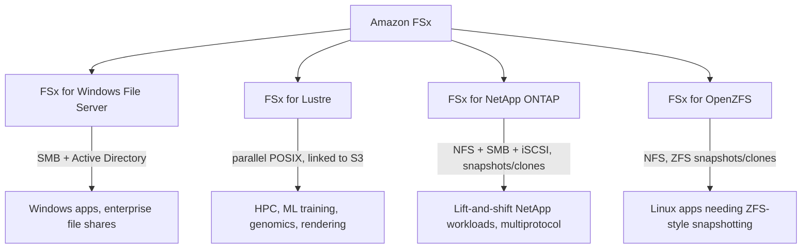

# Amazon FSx


<!-- official AWS Architecture Icons asset; see diagrams/README.md for the convention -->

*Service · Storage · maps to SAA-C03 Domain 3, MLA-C02 Domain 1 (FSx for Lustre specifically)*

## Definition

Amazon FSx is a family of **fully managed, third-party-compatible file systems**. Instead of one
generic file system, AWS gives you four purpose-built flavors — Windows File Server, Lustre,
NetApp ONTAP, and OpenZFS — each a managed version of a specific, well-known file system
technology, so you get its native feature set without having to install, patch, or operate it
yourself.

## Purpose

EFS covers Linux/NFS shared storage well, but it doesn't speak SMB (Windows), it isn't tuned for
extreme-throughput HPC/ML workloads, and it doesn't replicate NetApp-specific enterprise features
(deduplication, cloning, SnapMirror) that many existing on-prem environments depend on. FSx exists
so organizations with a specific file-system requirement — often from an existing on-prem system
they're migrating — get a **managed, native-compatible** equivalent in AWS, instead of either
running their own file server on EC2 or forcing a workload onto a file system that doesn't fit.

## How It Works



Walking through it:

1. **FSx for Windows File Server** speaks **SMB** and integrates with **Active Directory**, so
   Windows applications and users see it exactly like an on-prem Windows file share — including
   DFS namespaces and shadow copies (previous-versions "restore a file" UI).
2. **FSx for Lustre** is a parallel, POSIX-compliant file system built for extreme throughput and
   low latency across thousands of compute nodes simultaneously — and it can **link directly to an
   S3 bucket**, presenting S3 objects as files and writing results back to S3, which is exactly the
   pattern ML training jobs use.
3. **FSx for NetApp ONTAP** runs real NetApp ONTAP software managed by AWS — **multiprotocol**
   (NFS, SMB, and iSCSI simultaneously on the same data), with NetApp's storage efficiency features
   (deduplication, compression, instant clones, SnapMirror replication).
4. **FSx for OpenZFS** gives you the open-source ZFS file system's point-in-time snapshots, clones,
   and compression on Linux-based NFS workloads, without NetApp-specific licensing.

## Key Features / Components

- **FSx for Windows File Server** — SMB protocol, Active Directory (self-managed or AWS Managed
  Microsoft AD) integration, DFS namespaces for scaling across multiple file systems, shadow
  copies, Windows ACLs/quotas.
- **FSx for Lustre** — *scratch* deployment (temporary, high-performance, no replication — for
  short-lived HPC jobs) vs. *persistent* deployment (durable, replicated, for longer-running
  workloads); direct **S3 data repository association** (lazy-load objects as files, export
  results back).
- **FSx for NetApp ONTAP** — multiprotocol access, storage efficiency (dedup/compression/thin
  provisioning), instant snapshots and zero-copy clones, SnapMirror for DR replication, tiering to
  a cheaper capacity pool automatically.
- **FSx for OpenZFS** — ZFS snapshots/clones, configurable record size and compression, NFS access,
  sub-millisecond latencies on SSD-backed storage.
- All four: encryption at rest (KMS) and in transit, VPC-based networking, automated daily backups,
  and Multi-AZ deployment options for high availability (varies by flavor).

## Use Cases — When to Use It

- **FSx for Windows File Server** — enterprise file shares for Windows users, Windows-based
  applications (e.g., SharePoint, home directories, group shares) migrating from on-prem.
- **FSx for Lustre** — machine learning training on large datasets, high-performance computing
  (genomics, computational fluid dynamics), media rendering farms — anywhere "fastest possible
  shared throughput tied to S3" is the requirement.
- **FSx for NetApp ONTAP** — lift-and-shift of existing on-prem NetApp environments, workloads
  needing both NFS and SMB access to the *same* data, database workloads wanting instant
  clones for dev/test refreshes.
- **FSx for OpenZFS** — Linux workloads wanting ZFS's snapshot/clone model without NetApp's
  specific enterprise feature set or licensing.

## When NOT to Use It / Alternatives

- **Simple Linux NFS shared storage with no special feature requirement** — plain **EFS** is
  usually simpler to manage and cheaper; don't reach for FSx just because it's "more powerful" if
  you don't need its specific capabilities.
- **Object storage access pattern over HTTP** — use **S3** directly (and in the Lustre case, FSx
  is often paired *with* S3, not instead of it).
- **Single-instance block storage** (a database's local disk) — use **EBS**, which is cheaper for
  that pattern and doesn't require managing a separate file system.
- **No Windows/HPC/NetApp-specific requirement** — defaulting to the most specialized (and often
  more expensive) FSx flavor when EFS would do is a common real-world and exam anti-pattern.

## Why It's Important

**Real world:** FSx is the practical bridge for enterprises whose applications are *not*
Linux/NFS-native — Windows file shares and NetApp environments are extremely common in regulated
and legacy enterprise IT, and FSx lets them move to AWS without rewriting those dependencies. FSx
for Lustre specifically has become a standard building block in large-scale ML training pipelines.

**Exam weight:**
- **SAA-C03** — Domain 3, Task 3.1 (high-performing/scalable storage) tests choosing the *correct
  FSx flavor* against a scenario's protocol/feature keywords (Windows+AD, HPC, NetApp, ZFS).
- **MLA-C02** — Domain 1 (data preparation) names **FSx for Lustre** directly as a high-throughput
  option for storing and streaming large training datasets, especially when linked to an S3 data
  lake.

## Pricing Model (summary)

Billed **per GB-month of provisioned capacity** (varies by deployment type — SSD vs. HDD storage,
scratch vs. persistent for Lustre), plus **throughput capacity** charges for ONTAP/OpenZFS (and
optional for Windows), plus backup storage. Lustre scratch is cheaper than persistent because it
skips replication. Current rates: https://aws.amazon.com/fsx/pricing/

## Hands-on Lab (Floci)

**Honest limitation:** FSx is not in Floci's documented storage support table (only S3's object
API is fully emulated there — see `labs-floci/README.md`). The commands below show the real,
correct CLI syntax for each flavor so you can learn the API shape and workflow; expect that a
local Floci endpoint may reject or stub these calls. For functional verification, use AWS's
official documentation/sandbox or a short-lived real AWS FSx trial.

```bash
# FSx for Lustre — create a scratch file system linked to an S3 bucket
awslocal fsx create-file-system \
  --file-system-type LUSTRE \
  --storage-capacity 1200 \
  --subnet-ids subnet-xxxxxxxx \
  --lustre-configuration DeploymentType=SCRATCH_2,DataRepositoryAssociations='[]'

# FSx for Windows File Server — create a file system joined to AWS Managed AD
awslocal fsx create-file-system \
  --file-system-type WINDOWS \
  --storage-capacity 300 \
  --subnet-ids subnet-xxxxxxxx \
  --windows-configuration ActiveDirectoryId=d-xxxxxxxxxx,ThroughputCapacity=64

# List file systems and check status
awslocal fsx describe-file-systems

# Create a backup
awslocal fsx create-backup --file-system-id fs-xxxxxxxx
```

## Exam Tips

- **Match the flavor to the keyword**: "Windows" / "Active Directory" / "SMB share" → FSx for
  Windows File Server. "Machine learning training" / "HPC" / "fastest, linked to S3" → FSx for
  Lustre. "NetApp" / "multiprotocol" / "SnapMirror" / "instant clone for dev/test" → FSx for
  NetApp ONTAP. "ZFS" / "snapshot and clone on Linux" → FSx for OpenZFS.
- **FSx vs. EFS** — if the scenario doesn't mention Windows, HPC, or NetApp-specific features,
  default to EFS (simpler, usually cheaper) rather than any FSx flavor.
- **Lustre scratch vs. persistent** — scratch has no replication (data loss risk on hardware
  failure, lower cost, short-lived jobs); persistent replicates within the AZ (durable, longer-
  running jobs). A question mentioning "data must survive a failure" rules out scratch.
- FSx (all flavors) is still **file storage** in the object/block/file framing — mountable, shared,
  POSIX or SMB semantics — just a different protocol/feature set than EFS.

## Related Terms

- [`efs.md`](efs.md) — the simpler Linux/NFS alternative
- [`ebs.md`](ebs.md) — single-instance block alternative
- [`s3.md`](s3.md) — the data repository FSx for Lustre commonly links to
- `Active Directory`, `NFS`, `SMB`, `VPC` — see glossary
