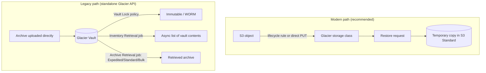

# Amazon S3 Glacier


<!-- official AWS Architecture Icons asset; see diagrams/README.md for the convention -->

*Service · Storage · maps to SAA-C03 Domain 1 & Domain 4 (named cost-optimization task statement)*

## Definition

"S3 Glacier" today means two closely related things, and telling them apart is itself an exam-
relevant skill: (1) the **S3 Glacier storage classes** — Instant Retrieval, Flexible Retrieval, and
Deep Archive — which you use through the **normal S3 API** on objects inside a regular bucket
(covered in [`s3-storage-classes.md`](s3-storage-classes.md)); and (2) the **legacy standalone
Glacier service**, with its own separate **vault/archive API**, predating that integration, still
operating underneath and still occasionally referenced directly on the exam and in older systems.
This document is the deep dive on Glacier **as an archival concept and legacy API** — the cheapest,
slowest tier of AWS storage, purpose-built for data you must keep but almost never touch.

## Purpose

Some data must be retained for years — tax records, medical imaging, compliance logs, scientific
raw data — not because anyone expects to read it again soon, but because deleting it isn't legally
or operationally allowed. Keeping that data on fast, expensive storage forever is wasteful. Amazon
Glacier (launched 2012, standalone) was built specifically to be the **cheapest possible** durable
storage, accepting much slower retrieval in exchange — AWS literally modeled the economics after
“we'll keep it practically forever, you just can't have it back instantly.” In 2021, AWS folded
Glacier's functionality into S3 as storage classes so you could manage archive data with the same
API/bucket model as everything else, while keeping the original Glacier vault API alive for systems
already built on it.

## How It Works



Walking through it:

1. **Modern path** (what almost everyone uses today): you `PUT` an object into a normal S3 bucket
   with its storage class set to one of the Glacier tiers (directly, or via a lifecycle rule aging
   it in from Standard). To read it back, you submit a **restore request** specifying how fast you
   need it (for Flexible Retrieval/Deep Archive); AWS stages a temporary copy back in S3 so you can
   `GET` it normally once the restore completes.
2. **Legacy path**: the original Glacier API doesn't use buckets/keys at all — it uses **vaults**
   (containers) and **archives** (the data blobs, identified by an opaque archive ID AWS assigns on
   upload, not a human-chosen key). Listing what's in a vault isn't instant — it requires an
   **inventory retrieval job** that runs asynchronously and you poll for completion.
3. **Vault Lock** lets you attach an immutable policy to a vault — once locked, the policy cannot
   be changed or deleted, enforcing WORM (write-once-read-many) compliance even against your own
   admins.
4. Both paths ultimately land on the same cold-storage infrastructure — the difference is purely
   **which API/mental model you interact with**.

## Key Features / Components

- **S3 Glacier Instant Retrieval** — millisecond access (reads like Standard), lowest storage cost
  among the "instant" classes, for data rarely touched but needing immediate availability when it is.
- **S3 Glacier Flexible Retrieval** (the modern name for what used to just be "Glacier") — three
  retrieval speed options:
  - *Expedited* — 1–5 minutes (more expensive per GB retrieved).
  - *Standard* — 3–5 hours.
  - *Bulk* — 5–12 hours (cheapest retrieval, for large, non-urgent restores).
- **S3 Glacier Deep Archive** — the cheapest S3 storage tier; retrieval takes **12–48 hours**
  (Standard 12 hours, Bulk up to 48 hours) — purpose-built for "almost never" access.
- **Minimum storage duration** — 90 days for Flexible Retrieval/Instant Retrieval, 180 days for
  Deep Archive; deleting or transitioning earlier still bills the remaining minimum days.
- **Vaults and Archives** (legacy API) — the standalone resource model, independent of S3 buckets.
- **Vault Lock policies** — immutable, compliance-grade retention enforcement.
- **Inventory retrieval jobs** — asynchronous listing of a vault's contents (legacy API doesn't
  support an instant `LIST`, unlike S3).

## Use Cases — When to Use It

- **Long-term regulatory/compliance records** (7–10+ year retention: financial statements,
  healthcare records, legal documents) — Deep Archive is usually the cheapest fit.
- **Media and scientific archives** — raw footage, research datasets kept "just in case," rarely reopened.
- **Backup target for AWS Backup / Storage Gateway Tape Gateway** — both services write their
  coldest retention tiers into Glacier classes under the hood.
- **Replacing physical tape vaults** — Glacier (via Tape Gateway) is the direct modern substitute
  for off-site tape rotation.
- **Immutable compliance archives** — Vault Lock (or S3 Object Lock on Glacier-class objects) for
  data that must be provably untampered.

## When NOT to Use It / Alternatives

- **Anything accessed more than roughly once a quarter** — the per-GB retrieval fee plus the wait
  (minutes to days) usually costs more in total than simply leaving the data on **S3 Standard-IA**
  or **Intelligent-Tiering**.
- **Data needing guaranteed sub-second access, even if rare** — only **Glacier Instant Retrieval**
  qualifies among the archive tiers; Flexible Retrieval and Deep Archive both have a hard minimum wait.
- **Frequently changing data** — Glacier's minimum storage duration and retrieval model assumes
  write-once, rarely-read; it's a poor fit for anything mutated often.
- **New application builds with no legacy constraint** — build on the **modern S3 storage class**
  model rather than integrating directly with the legacy standalone vault API, which is harder to
  work with (no human-readable keys, async listing) for no benefit in a greenfield system.

## Why It's Important

**Real world:** Glacier-tier storage is often **100x+ cheaper per GB** than S3 Standard, making it
the single biggest lever for controlling long-term storage cost in any data-heavy organization —
and Vault Lock / Object Lock immutability has become a standard ransomware and audit defense.

**Exam weight:** **SAA-C03** Domain 4, Task 4.1 ("Design cost-optimized storage solutions") names
Glacier-tier choices directly as the cheapest end of the storage spectrum; Domain 1, Task 1.3
(data security controls) covers Vault Lock/Object Lock for compliance retention scenarios. Expect
scenario questions that give you a retention period and an access-frequency hint, and ask you to
pick the cheapest class that still satisfies the stated RTO (how fast you must get the data back).

## Pricing Model (summary)

Billed **per GB-month stored** (lowest of all S3 tiers, decreasing further from Instant Retrieval
→ Flexible Retrieval → Deep Archive), plus a **per-GB retrieval fee** that varies by speed tier
(Expedited costs more than Bulk), plus request charges, plus an **early-deletion fee** if removed
before the minimum storage duration (90 or 180 days). Current rates:
https://aws.amazon.com/s3/pricing/ (Glacier tiers are listed alongside the other S3 classes).

## Hands-on Lab (Floci)

Floci's best-supported storage feature is the **S3 object API**, so practice the *modern path*
through it — this exercises the real-world approach almost everyone uses today.

```bash
# Upload an object directly into Glacier Flexible Retrieval
awslocal s3api put-object \
  --bucket my-study-bucket --key archive/2019-tax-records.pdf \
  --body 2019-tax-records.pdf --storage-class GLACIER

# Upload into Deep Archive (cheapest, slowest)
awslocal s3api put-object \
  --bucket my-study-bucket --key archive/2015-compliance-log.pdf \
  --body 2015-compliance-log.pdf --storage-class DEEP_ARCHIVE

# Request a restore (syntax is correct; real AWS would take hours, Floci won't simulate the wait)
awslocal s3api restore-object \
  --bucket my-study-bucket --key archive/2019-tax-records.pdf \
  --restore-request '{"Days":7,"GlacierJobParameters":{"Tier":"Standard"}}'

# Check restore status
awslocal s3api head-object --bucket my-study-bucket --key archive/2019-tax-records.pdf
```

**Honest limitation:** the **legacy standalone Glacier vault API** (`aws glacier create-vault`,
`initiate-job` for inventory/archive retrieval) is not covered by Floci's documented support table
(only S3's object API is listed — see `labs-floci/README.md`). It's included below purely as
reference for the exam-relevant command shapes, not as something to run locally:

```bash
# Legacy API reference only — likely unsupported on Floci
aws glacier create-vault --vault-name compliance-vault --account-id -
aws glacier initiate-job --vault-name compliance-vault --account-id - \
  --job-parameters '{"Type":"inventory-retrieval"}'
```

## Exam Tips

- **Separate "S3 Glacier storage classes" (modern, via normal S3 bucket/key API) from "standalone
  Amazon Glacier" (legacy, vault/archive API, no human-readable keys, async listing only)** — exam
  questions sometimes deliberately use older phrasing ("Amazon Glacier") to test whether you still
  map it correctly to today's S3 Glacier classes.
- **Retrieval time trap**: Instant Retrieval = ms, Flexible Retrieval = minutes-to-hours (three
  speed tiers), Deep Archive = 12–48 hours. Read the scenario's tolerance for wait time carefully.
- **Minimum storage duration + early deletion fee**: 90 days (Instant/Flexible Retrieval), 180 days
  (Deep Archive) — deleting sooner still bills the remainder.
- **Vault Lock / Object Lock = WORM/immutability** — the keyword for compliance and ransomware-
  defense scenarios.
- If the question emphasizes "lowest possible cost, retrieval time not a concern, data essentially
  never read" → **Deep Archive** is almost always the correct, cheapest-fit answer.

## Related Terms

- [`s3.md`](s3.md) — the base object storage service Glacier classes live inside
- [`s3-storage-classes.md`](s3-storage-classes.md) — full comparison across all S3 tiers, not just archive
- [`aws-backup.md`](aws-backup.md) — commonly targets Glacier tiers for long-term retention
- [`storage-gateway.md`](storage-gateway.md) — Tape Gateway writes virtual tapes into Glacier
- `Object Lock`, `Lifecycle policy`, `KMS` — see glossary
