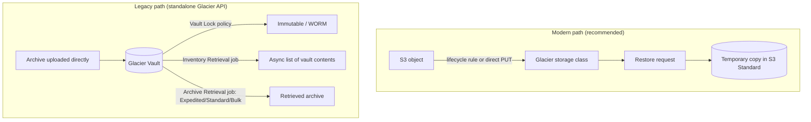
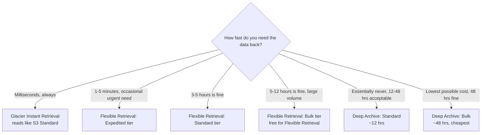
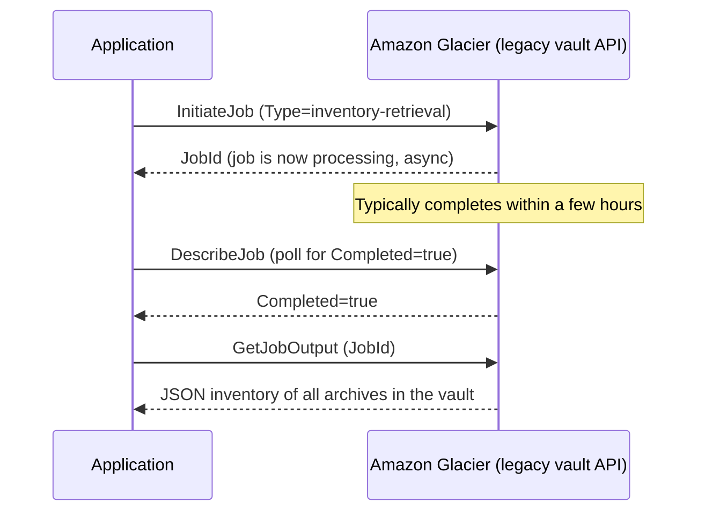

# Amazon S3 Glacier

> **Appears in:** [SAA-C03](../../certifications/saa-c03/README.md)


<!-- official AWS Architecture Icons asset; see diagrams/README.md for the convention -->

*Service · Storage · maps to SAA-C03 Domain 1 & Domain 4 (named cost-optimization task statement)*

## Definition

"S3 Glacier" today means two closely related things, and telling them apart is itself an exam-
relevant skill: (1) the **S3 Glacier storage classes** — Instant Retrieval, Flexible Retrieval, and
Deep Archive — which you use through the **normal S3 API** on objects inside a regular bucket
(covered in [`s3-storage-classes.md`](s3-storage-classes.md)); and (2) the **legacy standalone
Glacier service**, with its own separate **vault/archive API**, predating that integration, still
operating underneath and still occasionally referenced directly on the exam and in older systems.
This document is the deep dive on Glacier **as an archival concept and legacy API** — the cheapest,
slowest tier of AWS storage, purpose-built for data you must keep but almost never touch.

## Purpose

Some data must be retained for years — tax records, medical imaging, compliance logs, scientific
raw data — not because anyone expects to read it again soon, but because deleting it isn't legally
or operationally allowed. Keeping that data on fast, expensive storage forever is wasteful. Amazon
Glacier (launched 2012, standalone) was built specifically to be the **cheapest possible** durable
storage, accepting much slower retrieval in exchange — AWS literally modeled the economics after
“we'll keep it practically forever, you just can't have it back instantly.” In 2021, AWS folded
Glacier's functionality into S3 as storage classes so you could manage archive data with the same
API/bucket model as everything else, while keeping the original Glacier vault API alive for systems
already built on it.

The economic case for archive-tier storage is not a rounding error. At roughly **$0.00099/GB-month**
for Deep Archive against **$0.023/GB-month** for S3 Standard, moving genuinely cold data into Deep
Archive is a **~23x** cost reduction — real companies operating at exabyte scale (Pinterest's own
published case study below reports savings "in the millions of dollars per year" from this single
lever) treat correct archive-tier adoption as one of the highest-leverage FinOps actions available,
well above most compute-side optimizations in absolute dollar terms.

## How It Works



Walking through it:

1. **Modern path** (what almost everyone uses today): you `PUT` an object into a normal S3 bucket
   with its storage class set to one of the Glacier tiers (directly, or via a lifecycle rule aging
   it in from Standard). To read it back, you submit a **restore request** specifying how fast you
   need it (for Flexible Retrieval/Deep Archive); AWS stages a temporary copy back in S3 so you can
   `GET` it normally once the restore completes.
2. **Legacy path**: the original Glacier API doesn't use buckets/keys at all — it uses **vaults**
   (containers) and **archives** (the data blobs, identified by an opaque archive ID AWS assigns on
   upload, not a human-chosen key). Listing what's in a vault isn't instant — it requires an
   **inventory retrieval job** that runs asynchronously and you poll for completion.
3. **Vault Lock** lets you attach an immutable policy to a vault — once locked, the policy cannot
   be changed or deleted, enforcing WORM (write-once-read-many) compliance even against your own
   admins.
4. Both paths ultimately land on the same cold-storage infrastructure — the difference is purely
   **which API/mental model you interact with**.

### Retrieval tier decision tree



This decision tree is effectively the exam's entire Glacier-tier question bank compressed into one
picture: every scenario question is really just asking "given this stated retrieval-time tolerance,
which leaf of this tree is correct?"

### Real-world adoption workflow: identifying cold data before archiving it

A recurring real-world mistake is archiving data *before* confirming it's actually cold — since
early deletion/transition before the minimum storage duration elapses still bills the remainder.
AWS's own guidance (and large-scale adopters like Pinterest) use an access-pattern analysis
pipeline before committing to Glacier transitions:


*Figure: Pinterest's internal "storage insights" pipeline, aggregating S3 Server Access Logs
(access frequency) and S3 Inventory reports (size, storage class, object count) to identify which
datasets are genuinely cold enough to safely archive into S3 Glacier Deep Archive — the exact same
pattern **S3 Storage Lens** provides as a built-in AWS feature for teams without a custom pipeline.
Source: [AWS Storage Blog — "How Pinterest uses Amazon S3 Glacier Deep Archive to manage storage for its visual discovery engine"](https://aws.amazon.com/blogs/storage/how-pinterest-uses-amazon-s3-glacier-deep-archive-to-manage-storage-for-its-visual-discovery-engine/), © Amazon Web Services.*

### Legacy vault API: inventory retrieval job flow



Unlike S3's instant `ListObjectsV2`, the legacy Glacier vault API has **no synchronous list
operation at all** — even seeing what's in a vault requires running and waiting for an asynchronous
job, which is a large part of why AWS folded Glacier into S3's familiar bucket/key/LIST model for
every new workload.

## Key Features / Components

- **S3 Glacier Instant Retrieval** — millisecond access (reads like Standard), lowest storage cost
  among the "instant" classes, for data rarely touched but needing immediate availability when it is.
- **S3 Glacier Flexible Retrieval** (the modern name for what used to just be "Glacier") — three
  retrieval speed options:
  - *Expedited* — 1–5 minutes (more expensive per GB retrieved).
  - *Standard* — 3–5 hours.
  - *Bulk* — 5–12 hours (cheapest retrieval, for large, non-urgent restores).
- **S3 Glacier Deep Archive** — the cheapest S3 storage tier; retrieval takes **12–48 hours**
  (Standard 12 hours, Bulk up to 48 hours) — purpose-built for "almost never" access.
- **Minimum storage duration** — 90 days for Flexible Retrieval/Instant Retrieval, 180 days for
  Deep Archive; deleting or transitioning earlier still bills the remaining minimum days.
- **Vaults and Archives** (legacy API) — the standalone resource model, independent of S3 buckets.
- **Vault Lock policies** — immutable, compliance-grade retention enforcement.
- **Inventory retrieval jobs** — asynchronous listing of a vault's contents (legacy API doesn't
  support an instant `LIST`, unlike S3).
- **Provisioned retrieval capacity** — a paid add-on that *guarantees* Expedited retrieval
  throughput is available even during AWS-wide high-demand periods, rather than being served
  best-effort — relevant for organizations with a hard RTO commitment around archived data.
- **Batch Operations-driven restores** — for very large numbers of objects, S3 Batch Operations can
  issue restore requests at scale with built-in retry and a completion report, rather than
  scripting thousands of individual `RestoreObject` calls by hand.

## Use Cases — When to Use It

- **Long-term regulatory/compliance records** (7–10+ year retention: financial statements,
  healthcare records, legal documents) — Deep Archive is usually the cheapest fit.
- **Media and scientific archives** — raw footage, research datasets kept "just in case," rarely reopened.
- **Backup target for AWS Backup / Storage Gateway Tape Gateway** — both services write their
  coldest retention tiers into Glacier classes under the hood.
- **Replacing physical tape vaults** — Glacier (via Tape Gateway) is the direct modern substitute
  for off-site tape rotation.
- **Immutable compliance archives** — Vault Lock (or S3 Object Lock on Glacier-class objects) for
  data that must be provably untampered.

## When NOT to Use It / Alternatives

- **Anything accessed more than roughly once a quarter** — the per-GB retrieval fee plus the wait
  (minutes to days) usually costs more in total than simply leaving the data on **S3 Standard-IA**
  or **Intelligent-Tiering**.
- **Data needing guaranteed sub-second access, even if rare** — only **Glacier Instant Retrieval**
  qualifies among the archive tiers; Flexible Retrieval and Deep Archive both have a hard minimum wait.
- **Frequently changing data** — Glacier's minimum storage duration and retrieval model assumes
  write-once, rarely-read; it's a poor fit for anything mutated often.
- **New application builds with no legacy constraint** — build on the **modern S3 storage class**
  model rather than integrating directly with the legacy standalone vault API, which is harder to
  work with (no human-readable keys, async listing) for no benefit in a greenfield system.

## Why It's Important

**Real world:** Glacier-tier storage is often **100x+ cheaper per GB** than S3 Standard, making it
the single biggest lever for controlling long-term storage cost in any data-heavy organization —
and Vault Lock / Object Lock immutability has become a standard ransomware and audit defense.

**Exam weight:** **SAA-C03** Domain 4, Task 4.1 ("Design cost-optimized storage solutions") names
Glacier-tier choices directly as the cheapest end of the storage spectrum; Domain 1, Task 1.3
(data security controls) covers Vault Lock/Object Lock for compliance retention scenarios. Expect
scenario questions that give you a retention period and an access-frequency hint, and ask you to
pick the cheapest class that still satisfies the stated RTO (how fast you must get the data back).

## Pricing Model — Deep Dive

| Class | Illustrative storage $/GB-month | Illustrative retrieval $/GB | Min storage duration |
|---|---|---|---|
| S3 Glacier Instant Retrieval | $0.004 | $0.03 | 90 days |
| S3 Glacier Flexible Retrieval | $0.0036 | $0.01 standard / $0.03 expedited / free bulk | 90 days |
| S3 Glacier Deep Archive | $0.00099 | $0.02 standard / $0.0025 bulk | 180 days |

*(Illustrative list prices at time of writing — confirm current numbers at
https://aws.amazon.com/s3/pricing/, where Glacier tiers are listed alongside the other S3 classes.)*

### Worked example 1 — 100 TB migration from Flexible Retrieval to Deep Archive

Following the exact pattern Pinterest describes publicly: a company already has 100 TB sitting in
S3 Glacier Flexible Retrieval, confirmed (via access-pattern analysis) to be essentially never
read:

```
Current (Flexible Retrieval):  102,400 GB × $0.0036                 = $368.64/month
After migrating to Deep Archive: 102,400 GB × $0.00099               = $101.38/month
--------------------------------------------------------------------------------
Monthly savings                                                      ≈ $267.26/month (~73%)
Annual savings                                                        ≈ $3,207/year
```

At Pinterest's actual exabyte scale (hundreds or thousands of times this example's 100 TB), this
exact same percentage reduction is what their blog post describes as "considerable savings in the
millions of dollars per year" — the math is the same, just the multiplier is enormous.

### Worked example 2 — the object-count break-even trap (real AWS Storage Blog figures)

The AWS Storage Blog's own published cost-optimization analysis gives two real contrasting
scenarios for the **same total data volume** transitioned into Deep Archive, differing only in
average object size:

```
Scenario A — 1.67 billion objects @ 64 KB average size:
  One-time Lifecycle transition cost:   ≈ $83,500
  Monthly savings after transition:      ≈ $1,857.54/month
  Break-even period:                     ≈ 45 months

Scenario B — 104.85 million objects @ 1 MB average size (same total ~100 TB):
  One-time Lifecycle transition cost:   ≈ $5,242
  Monthly savings after transition:      ≈ $2,181.06/month
  Break-even period:                     ≈ 3 months
```

Same total bytes, wildly different outcomes — because the transition-request fee and the ~40 KB
per-object metadata overhead are both charged **per object**, not per GB. A dataset of many tiny
objects can take **15x longer** to break even than one with fewer, larger objects holding the same
total data. This is precisely why AWS recommends running an object-size/count analysis (via S3
Storage Lens or a custom pipeline like the one shown above) *before* committing a lifecycle rule
to Glacier-family classes.

### Worked example 3 — Expedited vs. Standard vs. Bulk retrieval cost for an urgent restore

Restoring 500 GB from Flexible Retrieval under real deadline pressure vs. no deadline pressure:

```
Expedited (1-5 min):   500 GB × $0.03               = $15.00  (needed *right now*)
Standard (3-5 hrs):     500 GB × $0.01               =  $5.00  (can wait a business day)
Bulk (5-12 hrs):        500 GB × $0.00 (free for Flexible Retrieval) = $0.00 (can wait overnight)
```

Bulk retrieval is **free** for S3 Glacier Flexible Retrieval specifically — a detail that often
surprises people expecting every retrieval tier to cost something — making "how urgent is this,
really?" the single highest-leverage question before issuing a restore request at any scale.

## Common Architectures

**1. Automated cold-data pipeline with Storage Lens + lifecycle rules.** S3 Storage Lens (or a
custom access-log pipeline, as shown above) continuously identifies prefixes/datasets with low
access ratios; a scheduled job reviews this output and adjusts lifecycle rules to transition
confirmed-cold data directly into Deep Archive, skipping the intermediate Flexible Retrieval tier
entirely when the access-frequency analysis already shows it's unnecessary — avoiding the double
transition-fee (Standard→Flexible→Deep Archive) in favor of a single, well-targeted jump.

**2. Compliance archive with Vault Lock / Object Lock immutability.** Financial or healthcare
records land in Deep Archive with **S3 Object Lock** in Compliance mode set for the exact
regulatory retention period (e.g., 7 years) — guaranteeing neither the application, an
administrator, nor even AWS Support can delete the data before the lock expires, satisfying
auditor requirements for provable record-retention integrity.

**3. Tape-to-cloud backup modernization via Tape Gateway.** An organization's existing backup
software continues writing to what it believes are physical tapes; Storage Gateway's Tape Gateway
actually lands those virtual tape images in S3, then archives them into Glacier Flexible Retrieval
or Deep Archive based on the backup software's own retention policy — see
[`storage-gateway.md`](storage-gateway.md) for the full flow.

**4. Two-tier archive with an upfront Instant Retrieval landing zone.** Rather than aging data
through Standard → Standard-IA → Glacier Flexible Retrieval → Deep Archive one hop at a time (each
transition incurring its own per-object request fee), an organization that already knows a dataset
will eventually need rare-but-occasionally-instant access **and** eventually go fully cold archives
it in two deliberate jumps: Standard directly to Glacier Instant Retrieval at 90 days, then directly
to Deep Archive at a later milestone once access history confirms it's gone fully cold — minimizing
the number of billed transition events compared to stepping through every intermediate tier.

## Limits & Quotas

- **Minimum storage duration** — 90 days (Instant Retrieval, Flexible Retrieval), 180 days (Deep
  Archive); early deletion/transition bills the remaining minimum days.
- **Per-object metadata overhead** — Glacier Flexible Retrieval and Deep Archive both add roughly
  **40 KB** of chargeable overhead per object (32 KB for the S3 index/metadata, 8 KB for additional
  metadata) — directly relevant to the break-even math above.
- **Legacy vault API archive size** — up to 40 TB per archive, with multipart upload required above
  certain thresholds, mirroring S3's own multipart model but through a separate API surface.
- **Legacy vault API archive ID length** — 138 bytes; archive IDs are opaque and assigned by
  Glacier on upload, not chosen by the caller (unlike an S3 key).
- **Restore request validity window** — a restored temporary copy exists only for the number of
  `Days` specified in the restore request; after that, it's deleted automatically and the object
  must be restored again to access it (the archived original's storage class never changes).
- **Expedited retrieval availability** — served best-effort during high-demand periods unless
  **Provisioned Retrieval Capacity** is purchased, which guarantees throughput for an additional
  hourly fee — a real operational consideration for anyone relying on Expedited for a strict RTO.
- **Archives per vault (legacy API)** — effectively unlimited; vaults themselves have a soft account
  limit (commonly cited around 1,000 per account/Region, raisable).
- **Concurrent restore jobs** — both the modern (`RestoreObject`) and legacy (`InitiateJob`) APIs
  are subject to account-level concurrency quotas on in-flight restore/retrieval jobs, which matter
  when restoring very large numbers of objects at once — S3 Batch Operations is the recommended way
  to manage this at scale rather than issuing thousands of individual calls directly.
- **S3 Object Lock retention vs. Glacier minimum storage duration** — these are two independent
  mechanisms that can both apply to the same object simultaneously; a Compliance-mode Object Lock
  retention period longer than the class's minimum storage duration is common and expected (the
  Lock, not the class minimum, becomes the binding constraint in that case).

## Troubleshooting / Common Issues

- **`InvalidObjectState` error on a `GET`** — the object is archived and has not been restored (or
  its restore window expired); issue a `RestoreObject` request first and wait for it to complete
  before `GET` will succeed.
- **Restore request accepted but data never becomes available** — poll `HeadObject` for
  `x-amz-restore: ongoing-request="false"` rather than assuming completion; also confirm the
  correct **Tier** was requested (Expedited is not available at all for Deep Archive — only
  Standard and Bulk are valid tiers there, a frequent mistake).
- **Unexpectedly large bill after a "cost-optimization" migration to Glacier** — almost always the
  per-object transition-request fee and ~40 KB metadata overhead on a dataset of many small
  objects; run the break-even calculation (see worked example above) using **actual average object
  size**, not just total data volume, before committing a lifecycle rule.
- **Legacy Glacier vault "list" operation seems to hang** — there is no synchronous list in the
  legacy API; an inventory retrieval **job** must be initiated and polled, which can take hours —
  this is expected behavior, not a fault, and is the exact reason most teams use the modern S3
  bucket/key model instead.
- **Expedited retrieval request rejected or delayed during a regional event** — Expedited is
  best-effort without **Provisioned Retrieval Capacity**; if a scenario has a hard RTO requirement
  around Expedited retrieval, the correct design answer is to purchase provisioned capacity ahead
  of time, not to assume Expedited is always instantly available.
- **Object deleted/transitioned before minimum storage duration, bill shows an unexpected charge**
  — this is the early-deletion fee behaving as designed; the fix going forward is to confirm actual
  retention needs before placing data into a Glacier class with a longer minimum duration than the
  data will realistically be kept.

## Hands-on Lab (Floci)

Floci's best-supported storage feature is the **S3 object API**, so practice the *modern path*
through it — this exercises the real-world approach almost everyone uses today.

```bash
# Upload an object directly into Glacier Flexible Retrieval
awslocal s3api put-object \
  --bucket my-study-bucket --key archive/2019-tax-records.pdf \
  --body 2019-tax-records.pdf --storage-class GLACIER

# Upload into Deep Archive (cheapest, slowest)
awslocal s3api put-object \
  --bucket my-study-bucket --key archive/2015-compliance-log.pdf \
  --body 2015-compliance-log.pdf --storage-class DEEP_ARCHIVE

# Request a restore (syntax is correct; real AWS would take hours, Floci won't simulate the wait)
awslocal s3api restore-object \
  --bucket my-study-bucket --key archive/2019-tax-records.pdf \
  --restore-request '{"Days":7,"GlacierJobParameters":{"Tier":"Standard"}}'

# Check restore status
awslocal s3api head-object --bucket my-study-bucket --key archive/2019-tax-records.pdf

# Issue a Bulk-tier restore for a large, non-urgent dataset (free for Flexible Retrieval)
awslocal s3api restore-object \
  --bucket my-study-bucket --key archive/2015-compliance-log.pdf \
  --restore-request '{"Days":1,"GlacierJobParameters":{"Tier":"Bulk"}}'
```

**Honest limitation:** the **legacy standalone Glacier vault API** (`aws glacier create-vault`,
`initiate-job` for inventory/archive retrieval) is not covered by Floci's documented support table
(only S3's object API is listed — see `labs-floci/README.md`). It's included below purely as
reference for the exam-relevant command shapes, not as something to run locally:

```bash
# Legacy API reference only — likely unsupported on Floci
aws glacier create-vault --vault-name compliance-vault --account-id -
aws glacier initiate-job --vault-name compliance-vault --account-id - \
  --job-parameters '{"Type":"inventory-retrieval"}'

# Poll the inventory retrieval job, then fetch its output
aws glacier describe-job --vault-name compliance-vault --account-id - --job-id <job-id>
aws glacier get-job-output --vault-name compliance-vault --account-id - --job-id <job-id> output.json
```

## Exam-Style Scenario Walkthroughs

**Scenario 1:** A hospital system must retain patient imaging data for 10 years per regulation, and
while re-access is extremely rare, when a request does come in (e.g., a malpractice case or patient
transfer), the data must be produced within the same business day. Which class, and why not Deep
Archive despite it being cheapest?

*Answer:* S3 Glacier Flexible Retrieval, using the Expedited (1–5 min) or Standard (3–5 hr) tier
depending on exact urgency — both comfortably fit "same business day." Deep Archive's 12–48 hour
retrieval window does **not** reliably fit a same-business-day requirement, so despite being
cheaper per GB-month, it fails the stated RTO and is the wrong answer here — a direct test of
reading the retrieval-time constraint before reaching for the cheapest option.

**Scenario 2:** A company is legally required to retain certain records such that **no one,
including their own administrators**, can delete them before a mandated 7-year period elapses, even
if an account is compromised. Which specific feature, applied to which API surface, satisfies this?

*Answer:* **S3 Object Lock in Compliance mode** (the modern path, applied directly to objects in a
regular S3 bucket) or, on the legacy vault API, a **Vault Lock policy** — both are WORM mechanisms
that become unchangeable once applied, with Compliance mode specifically preventing deletion by
anyone, including the root account, until retention expires. A plain bucket policy or IAM deny rule
would not suffice, since a sufficiently privileged administrator could always modify or remove
those — only Object Lock/Vault Lock's immutability is designed to resist that.

**Scenario 3:** A data engineering team wants to restore 200 TB of archived research data from S3
Glacier Flexible Retrieval for a one-time reanalysis project, with no urgency (a multi-day timeline
is fine), and wants to minimize retrieval cost above all else. What retrieval tier, and roughly what
should they expect to pay in retrieval fees?

*Answer:* Bulk retrieval tier — and for S3 Glacier Flexible Retrieval specifically, **Bulk
retrievals are free**, making this the only retrieval option with zero marginal retrieval cost; the
tradeoff is accepting the 5–12 hour completion window, which the "no urgency" framing explicitly
allows.

**Scenario 4:** An engineering team is building a brand-new application from scratch that needs
archival-tier storage and wants the simplest possible integration with their existing S3-based
tooling (lifecycle rules, IAM policies, the AWS SDK they already use for every other bucket). Should
they use the legacy Glacier vault API or the modern S3 Glacier storage classes?

*Answer:* The modern S3 Glacier storage classes, applied via ordinary S3 `PUT`/lifecycle rules on a
regular bucket. The legacy vault API (vaults, archives, opaque archive IDs, asynchronous inventory
listing) exists purely for systems already built against it; there is no reason for a greenfield
build to adopt its more awkward model when the modern path delivers identical underlying archival
storage through the familiar S3 bucket/key API.

## Exam Tips

- **Separate "S3 Glacier storage classes" (modern, via normal S3 bucket/key API) from "standalone
  Amazon Glacier" (legacy, vault/archive API, no human-readable keys, async listing only)** — exam
  questions sometimes deliberately use older phrasing ("Amazon Glacier") to test whether you still
  map it correctly to today's S3 Glacier classes.
- **Retrieval time trap**: Instant Retrieval = ms, Flexible Retrieval = minutes-to-hours (three
  speed tiers), Deep Archive = 12–48 hours. Read the scenario's tolerance for wait time carefully.
- **Minimum storage duration + early deletion fee**: 90 days (Instant/Flexible Retrieval), 180 days
  (Deep Archive) — deleting sooner still bills the remainder.
- **Vault Lock / Object Lock = WORM/immutability** — the keyword for compliance and ransomware-
  defense scenarios.
- **Deep Archive has no Expedited tier** — only Standard (~12 hrs) and Bulk (~48 hrs); if a
  question needs faster-than-that retrieval from an archive tier, Deep Archive is the wrong answer
  regardless of how cheap it is.
- **Bulk retrieval is free for Flexible Retrieval** — a detail worth memorizing directly, since it's
  an easy "which is cheapest" trap answer.
- If the question emphasizes "lowest possible cost, retrieval time not a concern, data essentially
  never read" → **Deep Archive** is almost always the correct, cheapest-fit answer.
- **Object count/size matters for transition cost**, not just total data volume — a scenario citing
  "millions of small objects" alongside a lifecycle-transition plan is testing whether you'll catch
  the per-object overhead/fee trap before recommending Glacier wholesale.

## Further Reading

- [Understanding S3 Glacier storage classes for long-term data storage](https://docs.aws.amazon.com/AmazonS3/latest/userguide/glacier-storage-classes.html) — official class-by-class reference
- [Understanding archive retrieval options](https://docs.aws.amazon.com/AmazonS3/latest/userguide/restoring-objects-retrieval-options.html) — the Expedited/Standard/Bulk timing table
- [Amazon S3 pricing](https://aws.amazon.com/s3/pricing/) — current, authoritative rates (Glacier tiers listed alongside other S3 classes)
- [AWS Storage Blog — Identify cold objects for archiving to Amazon S3 Glacier storage classes](https://aws.amazon.com/blogs/storage/identify-cold-objects-for-archiving-to-amazon-s3-glacier-storage-classes/) — the break-even cost figures referenced above
- [AWS Storage Blog — How Pinterest uses Amazon S3 Glacier Deep Archive](https://aws.amazon.com/blogs/storage/how-pinterest-uses-amazon-s3-glacier-deep-archive-to-manage-storage-for-its-visual-discovery-engine/) — the storage-insights pipeline diagram referenced above

## Related Terms

- [`s3.md`](s3.md) — the base object storage service Glacier classes live inside
- [`s3-storage-classes.md`](s3-storage-classes.md) — full comparison across all S3 tiers, not just archive
- [`aws-backup.md`](aws-backup.md) — commonly targets Glacier tiers for long-term retention
- [`storage-gateway.md`](storage-gateway.md) — Tape Gateway writes virtual tapes into Glacier
- `Object Lock`, `Lifecycle policy`, `KMS` — see glossary
