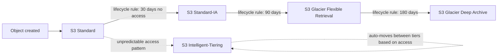

# S3 Storage Classes


<!-- official AWS Architecture Icons asset; see diagrams/README.md for the convention -->

*Service · Storage · maps to SAA-C03 Domain 4 (named task statement), DVA-C03 Domain 1, MLA-C02 Domain 1*

## Definition

S3 storage classes are different **pricing and performance tiers** you can assign to an object
inside the same bucket, using the exact same API. The data, durability, and how you reach it don't
fundamentally change — what changes is **how much it costs to store**, **how much it costs/takes
to retrieve**, and **how many copies/Availability Zones** back it.

## Purpose

Not all data gets accessed the same way. A product photo served to customers all day needs
millisecond access; a 7-year-old tax record almost never gets opened. Storing both at the same
price would be wasteful. AWS built storage classes so you (or an automated lifecycle rule) can
match cost to actual access pattern, instead of paying premium-tier prices for data that just sits
there.

## How It Works



Walking through it:

1. An object starts life in whatever class you specify on upload (default: **S3 Standard**).
2. A **lifecycle rule** (a policy on the bucket/prefix) automatically transitions it to cheaper
   classes as it ages, with zero application changes — the key and API calls stay identical.
3. **S3 Intelligent-Tiering** is the exception: instead of you defining age-based rules, AWS
   *monitors actual access* per object and moves it between frequent/infrequent (and optionally
   archive) tiers automatically, with no retrieval fee for moving back to frequent.
4. Retrieving an object from a colder class (Glacier tiers) may require an explicit **restore
   request** first before you can `GET` it directly (except Glacier Instant Retrieval, which reads
   like Standard, just cheaper to store).

## Key Features / Components

| Class | Availability (AZs) | Typical access time | Min storage duration | Use it for |
|---|---|---|---|---|
| **S3 Standard** | ≥3 AZs | Milliseconds | None | Frequently accessed, general-purpose data |
| **S3 Intelligent-Tiering** | ≥3 AZs | Milliseconds (frequent tier) | None (small monthly monitoring fee per object) | Unpredictable or unknown access patterns |
| **S3 Standard-IA** | ≥3 AZs | Milliseconds | 30 days | Infrequent access, needs millisecond retrieval, still multi-AZ resilient |
| **S3 One Zone-IA** | 1 AZ | Milliseconds | 30 days | Infrequent, *re-creatable* data (secondary backup copies, thumbnails) |
| **S3 Express One Zone** | 1 AZ | Single-digit ms, highest throughput | None | Latency-sensitive analytics/ML workloads needing the fastest S3 tier |
| **S3 Glacier Instant Retrieval** | ≥3 AZs | Milliseconds | 90 days | Archive data that's rarely touched but occasionally needs instant access |
| **S3 Glacier Flexible Retrieval** | ≥3 AZs | Minutes to hours (3 speed options) | 90 days | Archive, rarely accessed, retrieval wait is acceptable |
| **S3 Glacier Deep Archive** | ≥3 AZs | 12–48 hours | 180 days | Cheapest possible storage; compliance/long-term retention, almost never read |

- **Retrieval fee** — IA and Glacier classes charge per-GB to retrieve data; Standard and
  Intelligent-Tiering (frequent access tier) do not.
- **Early deletion / transition fee** — deleting or transitioning an object before its minimum
  storage duration elapses still bills you for the remaining minimum days.
- **Lifecycle transitions** — defined per bucket/prefix, support both transition (change class)
  and expiration (delete) rules, and can combine both.

## Use Cases — When to Use It

- **Standard** — your application's live, actively-served content (product images, active app data).
- **Intelligent-Tiering** — you genuinely don't know (or it varies) how often an object will be
  accessed — e.g., a shared data lake where some files get hot and others go cold unpredictably.
- **Standard-IA** — monthly reports, older backups you might still need to pull quickly.
- **One Zone-IA** — a *second* copy of something you can regenerate or that already lives
  redundantly elsewhere (e.g., a secondary replica of on-prem backups).
- **Glacier Instant Retrieval** — medical images or old user data you must produce instantly if
  requested, but rarely do.
- **Glacier Flexible Retrieval** — annual backups, disaster-recovery data, media archives where a
  few hours' wait is fine.
- **Glacier Deep Archive** — regulatory records (7–10 year retention), legal holds, data you are
  contractually required to keep but essentially never read.

## When NOT to Use It / Alternatives

- **Don't put One Zone-IA data you can't afford to lose** — it has no cross-AZ redundancy; if that
  AZ has a disaster, that copy is gone. Only use it for recreatable/secondary data.
- **Don't archive data you access more than once a quarter** into Glacier tiers — the per-GB
  retrieval fee plus wait time usually costs more than just leaving it on Standard-IA or
  Intelligent-Tiering.
- **Don't use Deep Archive for anything with an unpredictable "I might need this tomorrow"
  requirement** — 12–48 hour retrieval is a hard constraint, not a worst case.
- **Alternative for truly bursty, unknown-pattern data**: Intelligent-Tiering removes the guesswork
  entirely for a small monitoring fee — often the pragmatic default over hand-tuned lifecycle rules.

## Why It's Important

**Real world:** storage class choice is one of the highest-leverage, lowest-effort cost
optimizations in any AWS bill — misconfigured lifecycle rules (or none at all) are a textbook
FinOps finding. Getting durability class wrong (One Zone-IA for critical data) is also a real
resiliency risk, not just a cost one.

**Exam weight:** this is explicitly named. SAA-C03 **Domain 4, Task 4.1 — "Design cost-optimized
storage solutions"** calls out storage classes and lifecycle policies directly; Domain 3 Task 3.1
(performance) also touches retrieval latency tradeoffs. DVA-C03 Domain 1 Task 1.3 touches storage
class choice when using S3 as an app data store. MLA-C02 Domain 1 touches cost-efficient storage
of training datasets and model artifacts.

## Pricing Model (summary)

Storage is billed **per GB-month**, decreasing roughly in this order: Standard > Standard-IA ≈
Intelligent-Tiering frequent tier > One Zone-IA > Glacier Instant Retrieval > Glacier Flexible
Retrieval > Glacier Deep Archive (cheapest). Retrieval fees and request fees layer on top for IA
and Glacier tiers; Intelligent-Tiering adds a small flat per-object monitoring fee instead.
Current numbers: https://aws.amazon.com/s3/pricing/

## Hands-on Lab (Floci)

Floci's S3 implementation accepts storage-class metadata on objects and lifecycle configuration
API calls — a good way to practice the *syntax and workflow*, though it won't simulate real
multi-hour Glacier retrieval timing (that's physical infrastructure behavior, not an API shape).

```bash
# Upload directly into an infrequent-access class
awslocal s3api put-object \
  --bucket my-study-bucket --key reports/2025-q4.pdf \
  --body 2025-q4.pdf --storage-class STANDARD_IA

# Check what class an object is currently in
awslocal s3api head-object --bucket my-study-bucket --key reports/2025-q4.pdf

# Move an existing object to Glacier Flexible Retrieval via copy-in-place
awslocal s3api copy-object \
  --bucket my-study-bucket \
  --copy-source my-study-bucket/reports/2025-q4.pdf \
  --key reports/2025-q4.pdf \
  --storage-class GLACIER

# Enable Intelligent-Tiering via lifecycle rule instead of manual class assignment
cat > it-lifecycle.json << 'EOF'
{
  "Rules": [{
    "ID": "auto-tier-everything",
    "Filter": {"Prefix": ""},
    "Status": "Enabled",
    "Transitions": [{"Days": 0, "StorageClass": "INTELLIGENT_TIERING"}]
  }]
}
EOF
awslocal s3api put-bucket-lifecycle-configuration \
  --bucket my-study-bucket --lifecycle-configuration file://it-lifecycle.json
```

## Exam Tips

- **Retrieval time and fee differences** between the three Glacier tiers are a favorite trap:
  Instant Retrieval = milliseconds, Flexible Retrieval = minutes (Expedited) to hours (Standard/
  Bulk), Deep Archive = 12–48 hours. A question emphasizing "needs to be retrieved instantly, very
  rarely accessed" wants **Glacier Instant Retrieval**, not Standard-IA or Deep Archive.
- **One Zone-IA vs. Standard-IA** — the only difference is AZ count (1 vs. 3+). If the scenario
  says "the data must survive the loss of a facility," One Zone-IA is wrong.
- **Minimum storage duration + early deletion fee** — watch for scenarios where data is deleted or
  transitioned before 30/90/180 days; the exam tests that you still get billed for the remainder.
- **Intelligent-Tiering has no retrieval fee** moving between its own frequent/infrequent access
  tiers — that's its core selling point over manually-tuned lifecycle rules.
- Don't confuse these **storage classes** (an S3 feature, API-compatible, same bucket) with the
  **standalone legacy Glacier vault API** — see [`s3-glacier.md`](s3-glacier.md) for that distinction.

## Related Terms

- [`s3.md`](s3.md) — the base service these classes live inside
- [`s3-glacier.md`](s3-glacier.md) — deep dive on the archive tiers and legacy vault API
- [`aws-backup.md`](aws-backup.md) — often targets these classes for backup retention
- `Lifecycle policy`, `Object Lock` — see glossary
