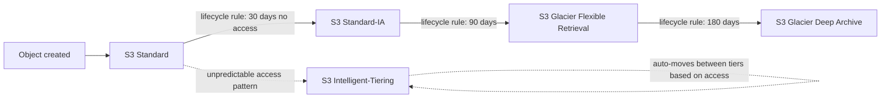
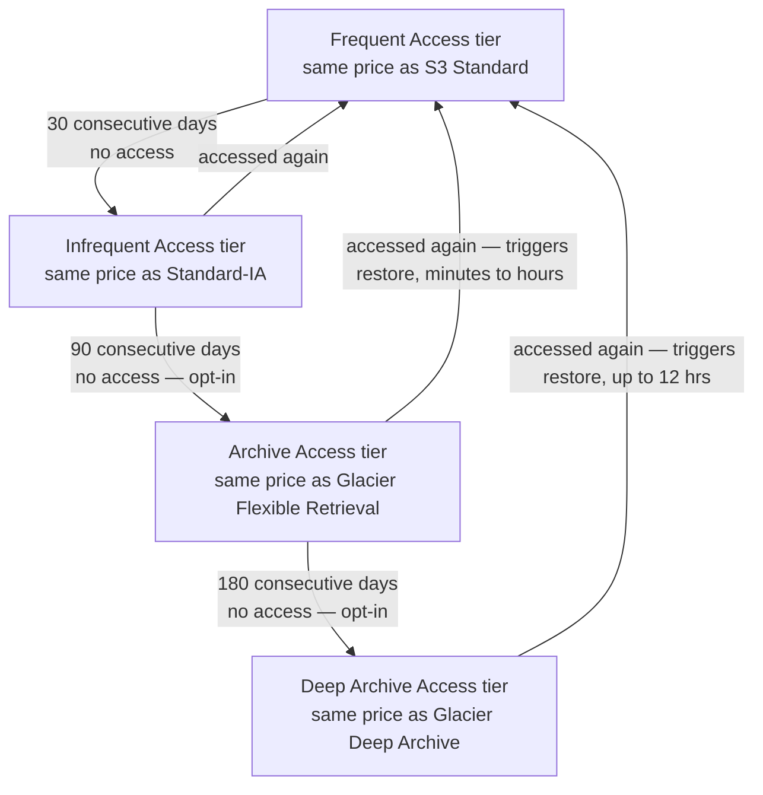
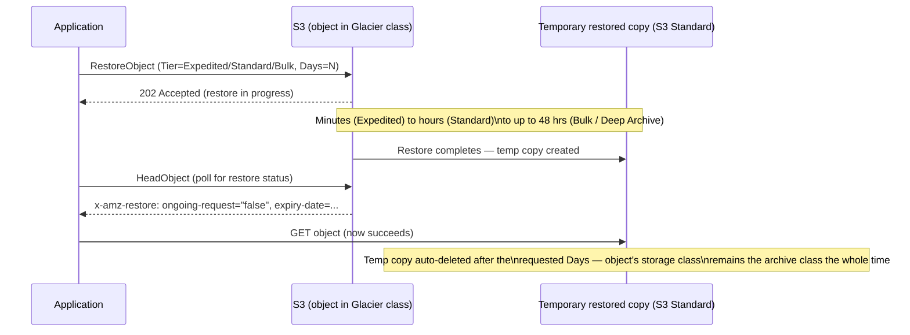

# S3 Storage Classes

> **Appears in:** [SAA-C03](../../certifications/saa-c03/README.md)


<!-- official AWS Architecture Icons asset; see diagrams/README.md for the convention -->

*Service · Storage · maps to SAA-C03 Domain 4 (named task statement), DVA-C03 Domain 1, MLA-C02 Domain 1*

## Definition

S3 storage classes are different **pricing and performance tiers** you can assign to an object
inside the same bucket, using the exact same API. The data, durability, and how you reach it don't
fundamentally change — what changes is **how much it costs to store**, **how much it costs/takes
to retrieve**, and **how many copies/Availability Zones** back it.

## Purpose

Not all data gets accessed the same way. A product photo served to customers all day needs
millisecond access; a 7-year-old tax record almost never gets opened. Storing both at the same
price would be wasteful. AWS built storage classes so you (or an automated lifecycle rule) can
match cost to actual access pattern, instead of paying premium-tier prices for data that just sits
there. The economics are not subtle: the gap between the most expensive class (S3 Standard) and the
cheapest (S3 Glacier Deep Archive) is roughly **23x per GB-month** — correctly tiering a large,
mostly-cold dataset is routinely the single biggest lever an organization has over its AWS storage
bill, bigger than almost any compute optimization.

## How It Works



Walking through it:

1. An object starts life in whatever class you specify on upload (default: **S3 Standard**).
2. A **lifecycle rule** (a policy on the bucket/prefix) automatically transitions it to cheaper
   classes as it ages, with zero application changes — the key and API calls stay identical.
3. **S3 Intelligent-Tiering** is the exception: instead of you defining age-based rules, AWS
   *monitors actual access* per object and moves it between frequent/infrequent (and optionally
   archive) tiers automatically, with no retrieval fee for moving back to frequent.
4. Retrieving an object from a colder class (Glacier tiers) may require an explicit **restore
   request** first before you can `GET` it directly (except Glacier Instant Retrieval, which reads
   like Standard, just cheaper to store).

### The official transition "waterfall"


*Figure: Amazon S3's supported Lifecycle transition paths between storage classes. Not every class
can transition directly to every other class — for example, you cannot transition directly
backward from a colder class to a warmer one via Lifecycle (you'd need to re-upload/copy the
object). Source: [Amazon S3 User Guide — "Transitioning objects using Amazon S3 Lifecycle"](https://docs.aws.amazon.com/AmazonS3/latest/userguide/lifecycle-transition-general-considerations.html), © Amazon Web Services.*

### Intelligent-Tiering's internal tier structure

S3 Intelligent-Tiering is itself not one tier but a small state machine of up to five access tiers
it moves an object through automatically, with no operational involvement from you:



The Archive Access and Deep Archive Access tiers are **opt-in** (you enable them per bucket/prefix
via an Intelligent-Tiering configuration) — without opting in, objects simply oscillate between
Frequent and Infrequent Access only. Objects smaller than 128 KB are never monitored and always
stay billed at the Frequent Access rate, since the fixed per-object monitoring fee wouldn't be
worth it on tiny objects.

### Restore request flow for archived objects



The object's storage class **never changes** during a restore — you're not moving it back to
Standard, you're asking S3 to also keep a temporary, time-limited readable copy alongside the
still-archived original, for the number of days you specify.

## Key Features / Components

| Class | Availability (AZs) | Typical access time | Min storage duration | Use it for |
|---|---|---|---|---|
| **S3 Standard** | ≥3 AZs | Milliseconds | None | Frequently accessed, general-purpose data |
| **S3 Intelligent-Tiering** | ≥3 AZs | Milliseconds (frequent tier) | None (small monthly monitoring fee per object) | Unpredictable or unknown access patterns |
| **S3 Standard-IA** | ≥3 AZs | Milliseconds | 30 days | Infrequent access, needs millisecond retrieval, still multi-AZ resilient |
| **S3 One Zone-IA** | 1 AZ | Milliseconds | 30 days | Infrequent, *re-creatable* data (secondary backup copies, thumbnails) |
| **S3 Express One Zone** | 1 AZ | Single-digit ms, highest throughput | None | Latency-sensitive analytics/ML workloads needing the fastest S3 tier |
| **S3 Glacier Instant Retrieval** | ≥3 AZs | Milliseconds | 90 days | Archive data that's rarely touched but occasionally needs instant access |
| **S3 Glacier Flexible Retrieval** | ≥3 AZs | Minutes to hours (3 speed options) | 90 days | Archive, rarely accessed, retrieval wait is acceptable |
| **S3 Glacier Deep Archive** | ≥3 AZs | 12–48 hours | 180 days | Cheapest possible storage; compliance/long-term retention, almost never read |

- **Retrieval fee** — IA and Glacier classes charge per-GB to retrieve data; Standard and
  Intelligent-Tiering (frequent access tier) do not.
- **Early deletion / transition fee** — deleting or transitioning an object before its minimum
  storage duration elapses still bills you for the remaining minimum days.
- **Lifecycle transitions** — defined per bucket/prefix, support both transition (change class)
  and expiration (delete) rules, and can combine both.
- **Minimum billable object size** — IA and Glacier classes bill a minimum of **128 KB** per
  object (Glacier Flexible/Deep Archive additionally charge roughly 40 KB of chargeable metadata
  overhead per object) — storing millions of tiny objects in these classes can cost *more* than
  Standard once this floor kicks in.
- **S3 Express One Zone** — launched 2023, a fundamentally different *directory-bucket* model (not
  a lifecycle target of a regular bucket) purpose-built for single-digit-millisecond, extremely
  high-throughput workloads like interactive analytics and model training checkpoints, co-located
  in a single AZ with your compute.

## Use Cases — When to Use It

- **Standard** — your application's live, actively-served content (product images, active app data).
- **Intelligent-Tiering** — you genuinely don't know (or it varies) how often an object will be
  accessed — e.g., a shared data lake where some files get hot and others go cold unpredictably.
- **Standard-IA** — monthly reports, older backups you might still need to pull quickly.
- **One Zone-IA** — a *second* copy of something you can regenerate or that already lives
  redundantly elsewhere (e.g., a secondary replica of on-prem backups).
- **Glacier Instant Retrieval** — medical images or old user data you must produce instantly if
  requested, but rarely do.
- **Glacier Flexible Retrieval** — annual backups, disaster-recovery data, media archives where a
  few hours' wait is fine.
- **Glacier Deep Archive** — regulatory records (7–10 year retention), legal holds, data you are
  contractually required to keep but essentially never read.
- **S3 Express One Zone** — feature stores and training-checkpoint storage for ML workloads running
  in the same AZ, or interactive SQL query engines needing the lowest possible S3 latency.

## When NOT to Use It / Alternatives

- **Don't put One Zone-IA data you can't afford to lose** — it has no cross-AZ redundancy; if that
  AZ has a disaster, that copy is gone. Only use it for recreatable/secondary data.
- **Don't archive data you access more than once a quarter** into Glacier tiers — the per-GB
  retrieval fee plus wait time usually costs more than just leaving it on Standard-IA or
  Intelligent-Tiering.
- **Don't use Deep Archive for anything with an unpredictable "I might need this tomorrow"
  requirement** — 12–48 hour retrieval is a hard constraint, not a worst case.
- **Alternative for truly bursty, unknown-pattern data**: Intelligent-Tiering removes the guesswork
  entirely for a small monitoring fee — often the pragmatic default over hand-tuned lifecycle rules.
- **Don't transition huge numbers of very small objects into Glacier tiers just because it's
  "cheaper per GB"** — the 40 KB metadata overhead and the transition-request fee per object can
  make it a net loss; run the break-even math first (see the worked example below).

## Why It's Important

**Real world:** storage class choice is one of the highest-leverage, lowest-effort cost
optimizations in any AWS bill — misconfigured lifecycle rules (or none at all) are a textbook
FinOps finding. Getting durability class wrong (One Zone-IA for critical data) is also a real
resiliency risk, not just a cost one.

**Exam weight:** this is explicitly named. SAA-C03 **Domain 4, Task 4.1 — "Design cost-optimized
storage solutions"** calls out storage classes and lifecycle policies directly; Domain 3 Task 3.1
(performance) also touches retrieval latency tradeoffs. DVA-C03 Domain 1 Task 1.3 touches storage
class choice when using S3 as an app data store. MLA-C02 Domain 1 touches cost-efficient storage
of training datasets and model artifacts.

## Pricing Model — Deep Dive

| Storage class | Illustrative storage $/GB-month (us-east-1) | Illustrative retrieval $/GB | Min storage duration | Min billable object |
|---|---|---|---|---|
| S3 Standard | $0.023 | none | none | none |
| S3 Intelligent-Tiering (Frequent) | $0.023 | none | none | none |
| S3 Standard-IA | $0.0125 | $0.01 | 30 days | 128 KB |
| S3 One Zone-IA | $0.01 | $0.01 | 30 days | 128 KB |
| S3 Glacier Instant Retrieval | $0.004 | $0.03 | 90 days | 128 KB |
| S3 Glacier Flexible Retrieval | $0.0036 | $0.01 standard / $0.03 expedited / free bulk | 90 days | ~40 KB overhead |
| S3 Glacier Deep Archive | $0.00099 | $0.02 standard / $0.0025 bulk | 180 days | ~40 KB overhead |

*(Illustrative list prices at time of writing — confirm current numbers at
https://aws.amazon.com/s3/pricing/ before using in a real estimate; AWS periodically revises S3
pricing region by region.)*

### Worked example — choosing a class for 50 TB of quarterly-accessed analytics data

Say a company has 50 TB of historical analytics data accessed roughly once per quarter for
reporting, and is deciding between leaving it on S3 Standard, moving it to Standard-IA, or moving
it to Glacier Instant Retrieval (all three support millisecond access, which this workload needs):

```
S3 Standard:               50,000 GB × $0.023   = $1,150.00/month storage, $0 retrieval
S3 Standard-IA:             50,000 GB × $0.0125  =   $625.00/month storage
                              + one retrieval/quarter: 50,000 GB × $0.01 / 3 months amortized ≈ $166.67/month
                              ≈ $791.67/month effective
S3 Glacier Instant Retrieval: 50,000 GB × $0.004  =   $200.00/month storage
                              + one retrieval/quarter: 50,000 GB × $0.03 / 3 months amortized ≈ $500.00/month
                              ≈ $700.00/month effective
```

Glacier Instant Retrieval wins here purely on the stated access pattern ("quarterly" is exactly
its designed-for frequency per AWS's own guidance), saving roughly **39% vs. Standard** and a bit
over Standard-IA — but notice how close Standard-IA and Glacier Instant Retrieval are: if access
frequency crept up to monthly instead of quarterly, Standard-IA's lower retrieval fee would likely
flip the winner. This is the core skill the exam is testing: **plug the real access frequency into
both the storage-rate and retrieval-rate lines before picking a class**, don't just pick the
cheapest storage rate on its own.

### Worked example — Intelligent-Tiering monitoring fee break-even

Intelligent-Tiering charges a small monitoring/automation fee per object per month (on the order of
$0.0025/1,000 objects) on top of whichever tier's storage rate the object currently sits in. For a
bucket of 10 million small objects with highly unpredictable access, the monitoring fee adds up to
real money (~$25/month for 10M objects), but it replaces what would otherwise be either (a) constant
manual lifecycle-rule tuning, or (b) a one-size-fits-all Standard storage bill that's far more
expensive across the whole unpredictable dataset — which is why Intelligent-Tiering is usually a
net win specifically for datasets where access pattern genuinely can't be predicted in advance,
and a net loss if you actually know the access pattern (a hand-tuned lifecycle rule beats the
monitoring fee in that case).

### Worked example 4 — comparing all classes side by side for a 100 TB mixed-access dataset

Putting the full comparison together for 100 TB with a mix of access patterns (illustrative rates):

```
All on S3 Standard:                     102,400 GB × $0.023   = $2,355.20/month
All on S3 Standard-IA (no retrieval):    102,400 GB × $0.0125  = $1,280.00/month
All on Glacier Instant Retrieval:        102,400 GB × $0.004   =   $409.60/month
All on Glacier Flexible Retrieval:       102,400 GB × $0.0036  =   $368.64/month
All on Glacier Deep Archive:             102,400 GB × $0.00099 =   $101.38/month
```

Laid out this way, the roughly **23x spread** between the cheapest and most expensive tier for
identical data volume is the single number worth memorizing for the exam — it's the reason storage
class selection is treated as one of the highest-leverage cost levers in the entire AWS catalog,
and why "just leave everything on Standard" is almost always the wrong default for data that isn't
genuinely hot.

## Common Architectures

**1. Tiered backup retention pipeline.** Nightly database backups land in S3 Standard, a lifecycle
rule moves them to Standard-IA after 30 days (still-recent backups occasionally get restored to
verify integrity), then to Glacier Flexible Retrieval after 90 days, and finally to Glacier Deep
Archive after 1 year with a 7-year expiration — matching cost to the declining probability that any
given backup will ever actually be restored.

**2. Intelligent-Tiering as the default for a shared data lake.** Rather than hand-tuning lifecycle
rules per prefix (which requires someone to correctly predict every team's access pattern),
platform teams increasingly set Intelligent-Tiering as the **bucket default storage class** for
shared/multi-tenant data lakes, letting AWS's own access monitoring do the tiering work per object,
independent of which team owns which prefix.

**3. One Zone-IA as a secondary DR copy.** A primary dataset already lives durably and redundantly
on-premises or in a different AWS service; a nightly job writes a secondary, regenerable copy into
S3 One Zone-IA purely as a cheap "just in case the primary needs a quick cloud restore point" —
accepting the single-AZ risk specifically because this copy isn't the only copy.

**4. S3 Express One Zone for interactive analytics co-located with compute.** A SQL query engine
running on EC2/EMR in a single AZ needs the absolute lowest S3 read/write latency for interactive,
iterative queries against a working dataset — the working dataset is placed in an S3 Express One
Zone **directory bucket** in the same AZ as the compute, cutting request latency to single-digit
milliseconds, while the authoritative, durable copy of the same data remains in a regular S3
Standard (multi-AZ) bucket as the system of record.

## Limits & Quotas

- **Lifecycle rules per bucket** — up to 1,000.
- **Minimum storage duration before early-deletion fee** — 30 days (Standard-IA, One Zone-IA),
  90 days (Glacier Instant Retrieval, Glacier Flexible Retrieval), 180 days (Glacier Deep Archive).
- **Minimum billable object size** — 128 KB for IA classes; objects below this are still billed as
  if they were 128 KB.
- **Intelligent-Tiering monitored object floor** — objects under 128 KB are never monitored/tiered;
  they always stay at the Frequent Access (Standard) rate.
- **Intelligent-Tiering archive tier opt-in windows** — 90+ consecutive days of no access for
  Archive Access, 180+ for Deep Archive Access, each independently configurable per bucket/prefix
  (and each must be explicitly enabled — they are off by default).
- **Storage class transition direction** — Lifecycle rules can only transition **forward** (warmer
  to colder); there is no native "demote this lifecycle rule back to Standard" — you'd `COPY` the
  object to re-promote it, which is itself billed as a new PUT into the target class.
- **S3 Express One Zone** — requires a **directory bucket** (a different bucket type with its own
  naming/addressing scheme), not a storage class you can apply inside a normal general-purpose
  bucket.
- **Transition request charges** — billed per 1,000 objects transitioned, varying by destination
  class; Glacier-family transitions carry a notably higher per-request rate than Standard-IA
  transitions, which is the direct cause of the break-even dynamics explored in the worked examples
  above.
- **Intelligent-Tiering minimum eligible object size for monitoring** — 128 KB, matching the IA
  classes' minimum billable size; this isn't a coincidence, it's the same threshold below which
  per-object overhead would exceed any plausible savings.
- **Storage class changes via `COPY`** — re-copying an object to change its class (including
  "promoting" it back to Standard) is billed as a new PUT-class request against the destination
  class, and counts toward that class's request pricing, not the source class's.

## Troubleshooting / Common Issues

- **"I restored an archived object but GET still fails"** — restores aren't instant even on
  success; poll `HeadObject` for `x-amz-restore: ongoing-request="false"` before assuming the
  temporary copy is ready, and remember the restore window (`Days=N`) is finite — if it expired,
  you must restore again.
- **Lifecycle rule "isn't doing anything"** — the most common cause is a **prefix/tag filter typo**
  that doesn't actually match any objects, or forgetting that a transition rule only fires going
  forward in time from when it's created (it won't retroactively re-evaluate objects' original
  creation dates in some edge cases around rule changes) — check **S3 Inventory** reports to verify
  which class objects are actually in.
- **Bill is higher after "optimizing" into Glacier** — almost always the per-object metadata
  overhead and transition-request fee on a dataset of many small objects; run the break-even
  calculation (see worked example above) before committing a lifecycle rule to production.
- **One Zone-IA objects unavailable after an AZ event** — this is the class behaving as designed,
  not a bug; it is explicitly not resilient to the loss of its single Availability Zone — if this
  surprises you in an incident, the class choice was the mistake, not the outage.
- **Intelligent-Tiering not moving objects to Archive Access** — confirm the archive tiers were
  actually **opted in** on the bucket's Intelligent-Tiering configuration; by default only the
  Frequent/Infrequent oscillation is active.

## Hands-on Lab (Floci)

Floci's S3 implementation accepts storage-class metadata on objects and lifecycle configuration
API calls — a good way to practice the *syntax and workflow*, though it won't simulate real
multi-hour Glacier retrieval timing (that's physical infrastructure behavior, not an API shape).

```bash
# Upload directly into an infrequent-access class
awslocal s3api put-object \
  --bucket my-study-bucket --key reports/2025-q4.pdf \
  --body 2025-q4.pdf --storage-class STANDARD_IA

# Check what class an object is currently in
awslocal s3api head-object --bucket my-study-bucket --key reports/2025-q4.pdf

# Move an existing object to Glacier Flexible Retrieval via copy-in-place
awslocal s3api copy-object \
  --bucket my-study-bucket \
  --copy-source my-study-bucket/reports/2025-q4.pdf \
  --key reports/2025-q4.pdf \
  --storage-class GLACIER

# Enable Intelligent-Tiering via lifecycle rule instead of manual class assignment
cat > it-lifecycle.json << 'EOF'
{
  "Rules": [{
    "ID": "auto-tier-everything",
    "Filter": {"Prefix": ""},
    "Status": "Enabled",
    "Transitions": [{"Days": 0, "StorageClass": "INTELLIGENT_TIERING"}]
  }]
}
EOF
awslocal s3api put-bucket-lifecycle-configuration \
  --bucket my-study-bucket --lifecycle-configuration file://it-lifecycle.json

# Configure Intelligent-Tiering archive tiers explicitly (opt-in)
cat > it-config.json << 'EOF'
{
  "Id": "ArchiveConfig",
  "Status": "Enabled",
  "Tierings": [
    {"Days": 90, "AccessTier": "ARCHIVE_ACCESS"},
    {"Days": 180, "AccessTier": "DEEP_ARCHIVE_ACCESS"}
  ]
}
EOF
awslocal s3api put-bucket-intelligent-tiering-configuration \
  --bucket my-study-bucket --id ArchiveConfig --intelligent-tiering-configuration file://it-config.json
```

## Exam-Style Scenario Walkthroughs

**Scenario 1:** A company has 80 TB of quarterly financial reports accessed roughly every 90 days
for audits, requiring millisecond retrieval whenever they are accessed (no waiting). They're
currently paying for S3 Standard and want to cut costs without violating the "instant when
accessed" requirement. What's the best class?

*Answer:* S3 Glacier Instant Retrieval. The 90-day access cadence matches its designed-for access
frequency ("quarterly") exactly, and unlike Flexible Retrieval or Deep Archive, it still reads at
millisecond latency with no restore step — satisfying "instant when accessed" while still being
dramatically cheaper than Standard or even Standard-IA at that access frequency.

**Scenario 2:** A startup has 2 PB of IoT sensor logs ingested continuously. Some device fleets are
queried daily by a live dashboard; others (decommissioned products) are essentially never queried
again, but which fleets fall into which bucket changes unpredictably as products are
launched/retired. What storage-class strategy minimizes ongoing operational effort and cost?

*Answer:* S3 Intelligent-Tiering as the bucket default, with the Archive Access and Deep Archive
Access tiers opted in. Because which fleets are "hot" vs. "cold" changes unpredictably over the
product lifecycle, a hand-maintained lifecycle rule would need constant manual re-tuning as
products launch and retire; Intelligent-Tiering's automatic per-object access monitoring removes
that operational burden entirely, including automatically archiving fleets that go fully cold.

**Scenario 3:** An e-commerce company needs product images to load with the lowest possible
latency for customers worldwide, and is willing to pay a premium for the fastest serving layer, but
also keeps a canonical durable copy of every image. What's the architecture?

*Answer:* S3 Standard (or Intelligent-Tiering) holds the durable canonical copy; **CloudFront**
sits in front of it as the actual latency-reducing layer for global customers, caching at edge
locations close to users. S3 Express One Zone is *not* the right answer here despite being S3's
fastest storage tier — it's single-AZ and meant for compute co-located in that same AZ (interactive
analytics, training checkpoints), not for serving globally distributed end users, which is
CloudFront's job regardless of which S3 storage class sits behind it.

**Scenario 4:** A dataset of 500 million objects, averaging 50 KB each, is a candidate for
transitioning to S3 Glacier Deep Archive to save on storage cost. A junior engineer proposes doing
it immediately. What should you check first, and why might the proposal be wrong?

*Answer:* Check the per-object transition-request fee and the ~40 KB Glacier metadata overhead
against the per-object storage savings, given the small (50 KB) average object size. At this size,
the 40 KB overhead alone is nearly as large as the object itself, meaning the *effective* storage
savings per object shrink substantially once overhead is counted, and the one-time transition
request fee across 500 million objects could take many months (or longer) to break even — exactly
the "small object, high object count" trap the exam and AWS's own published guidance both call out.

## Exam Tips

- **Retrieval time and fee differences** between the three Glacier tiers are a favorite trap:
  Instant Retrieval = milliseconds, Flexible Retrieval = minutes (Expedited) to hours (Standard/
  Bulk), Deep Archive = 12–48 hours. A question emphasizing "needs to be retrieved instantly, very
  rarely accessed" wants **Glacier Instant Retrieval**, not Standard-IA or Deep Archive.
- **One Zone-IA vs. Standard-IA** — the only difference is AZ count (1 vs. 3+). If the scenario
  says "the data must survive the loss of a facility," One Zone-IA is wrong.
- **Minimum storage duration + early deletion fee** — watch for scenarios where data is deleted or
  transitioned before 30/90/180 days; the exam tests that you still get billed for the remainder.
- **Intelligent-Tiering has no retrieval fee** moving between its own frequent/infrequent access
  tiers — that's its core selling point over manually-tuned lifecycle rules.
- **The 128 KB minimum billable size** and the **~40 KB Glacier metadata overhead** are the two
  numbers that explain why "archive everything" is sometimes a worse answer than "archive the big
  objects only" — expect scenario math questions that hinge on average object size, not just total
  volume.
- **Transitions only move forward** (warmer → colder); there's no native downgrade path via
  Lifecycle — promoting an object back requires re-uploading/copying it.
- Don't confuse these **storage classes** (an S3 feature, API-compatible, same bucket) with the
  **standalone legacy Glacier vault API** — see [`s3-glacier.md`](s3-glacier.md) for that distinction.

## Further Reading

- [Understanding and managing Amazon S3 storage classes](https://docs.aws.amazon.com/AmazonS3/latest/userguide/storage-class-intro.html) — official class-by-class reference
- [Transitioning objects using Amazon S3 Lifecycle](https://docs.aws.amazon.com/AmazonS3/latest/userguide/lifecycle-transition-general-considerations.html) — the transition waterfall diagram and rules
- [How S3 Intelligent-Tiering works](https://docs.aws.amazon.com/AmazonS3/latest/userguide/intelligent-tiering-overview.html)
- [Amazon S3 pricing](https://aws.amazon.com/s3/pricing/) — current, authoritative rates
- [AWS Storage Blog — identifying cold objects for archiving](https://aws.amazon.com/blogs/storage/identify-cold-objects-for-archiving-to-amazon-s3-glacier-storage-classes/) — real break-even cost analysis referenced above

## Related Terms

- [`s3.md`](s3.md) — the base service these classes live inside
- [`s3-glacier.md`](s3-glacier.md) — deep dive on the archive tiers and legacy vault API
- [`aws-backup.md`](aws-backup.md) — often targets these classes for backup retention
- `Lifecycle policy`, `Object Lock` — see glossary
