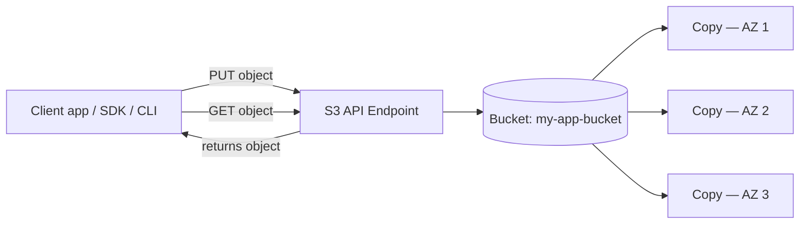
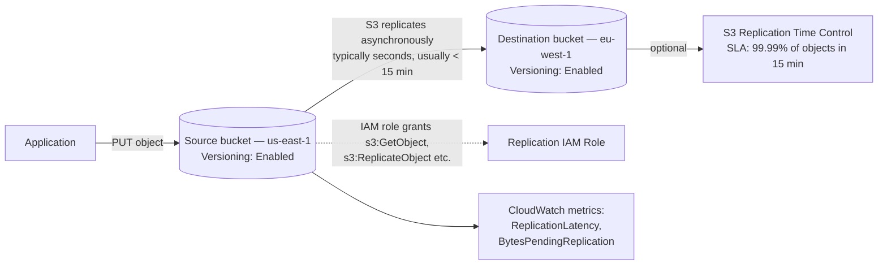
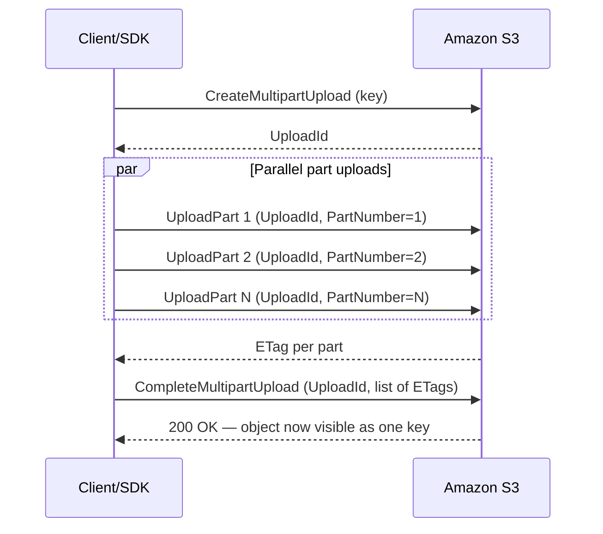
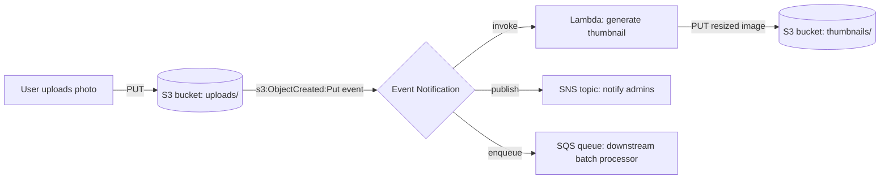
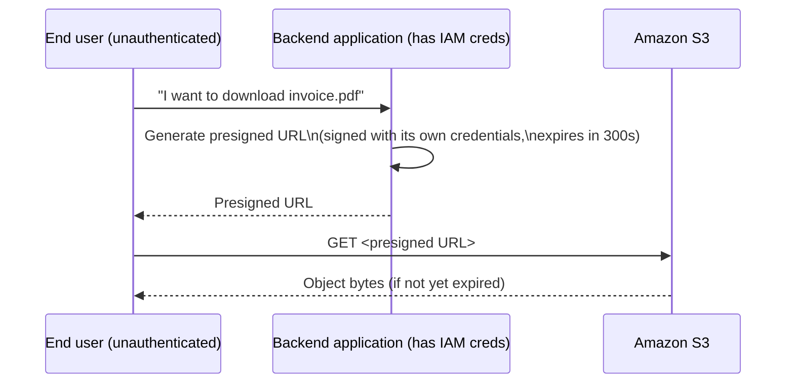
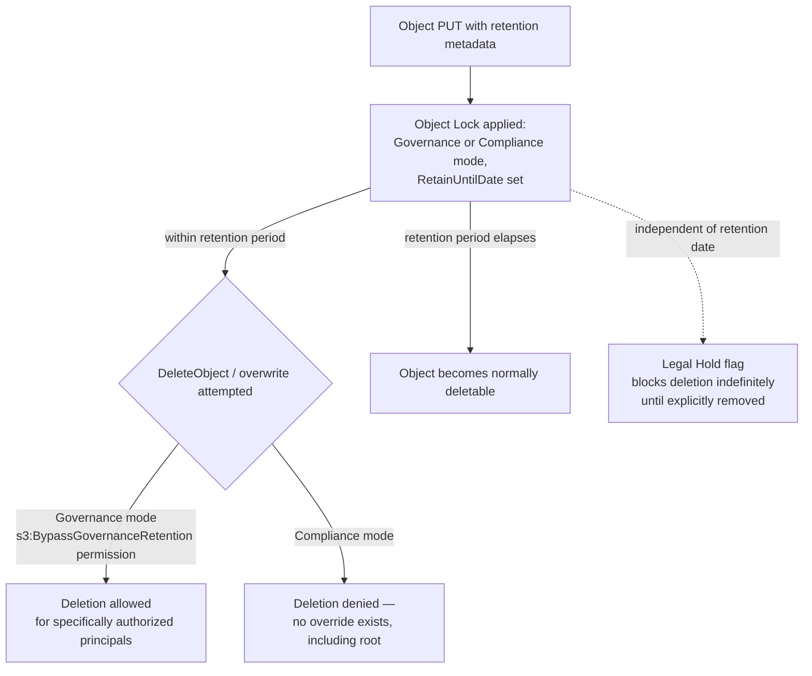

# Amazon S3 (Simple Storage Service)

> **Appears in:** [DVA-C03](../../certifications/dva-c03/README.md) · [SAA-C03](../../certifications/saa-c03/README.md)


<!-- official AWS Architecture Icons asset; see diagrams/README.md for the convention -->

*Service · Storage · maps to SAA-C03 Domain 1 & 3 & 4, DVA-C03 Domain 1 & 2, MLA-C02 Domain 1*

## Definition

Amazon S3 is AWS's **object storage** service. You store files — called **objects** — inside
containers called **buckets**, and you reach them over HTTP(S) using a key (basically a name/path
string), not a traditional filesystem. There's no drive to format, no fixed capacity to plan for,
and (practically) no upper limit on how much you can store.

## Purpose

Before S3 launched in 2006, "storage" meant buying physical disks, racking servers, planning
capacity years in advance, and building your own redundancy and backup. If you guessed wrong on
capacity you either wasted money or ran out of space. S3 was AWS's answer: storage that is
**durable by default** (11 nines — 99.999999999% — durability of objects over a year), **elastic**
(you never provision size, it just grows), and billed **per GB actually used**, accessible from
anywhere with an API call. It turned storage from a capital-planning problem into a utility, like
electricity.

It's worth dwelling on what "11 nines of durability" actually means, because the exam leans on it
and it's often misunderstood. It does **not** mean "99.999999999% uptime" (that's availability, a
separate and much lower number — around 99.99% for S3 Standard). Durability is about *not losing
your data*: AWS models it as, if you store 10,000,000 objects, you could statistically expect to
lose a single object roughly once every 10,000 years. AWS achieves this by redundantly storing
each object's data across a minimum of three physical facilities (Availability Zones) within a
Region, and by continuously running integrity checks (checksums) and self-healing any detected bit
rot or hardware failure automatically, invisibly to you.

## How It Works

In plain terms: you create a bucket (a globally-unique-named container, tied to one AWS Region),
then you `PUT` objects into it addressed by a key (e.g., `photos/2026/trip.jpg`). There are no
real folders — S3 is a flat key-value store; the console just *displays* `/` in a key as a folder
for convenience. Behind the scenes, AWS replicates every object across multiple devices in
multiple Availability Zones within that Region automatically — you don't configure that, it's
built in.



Walking through it:

1. **Client** — your app, the AWS CLI, or an SDK — sends a `PUT` request with the object's bytes
   and a key to the S3 API endpoint for that bucket/Region.
2. **S3 API Endpoint** handles auth (IAM/bucket policy check), then writes the object.
3. **Bucket** is the logical container; the object is durably written to **multiple AZs
   synchronously** before S3 returns success to the client — this is why S3 offers 11 nines of
   durability and (since Dec 2020) **strong read-after-write consistency**: the moment a `PUT`
   succeeds, every subsequent `GET`/`LIST` sees it, including overwrites and deletes.
4. A `GET` request goes through the same API endpoint and is served from whichever healthy AZ copy
   answers fastest — this is transparent to the client.

### Strong read-after-write consistency, visually


*Figure: how S3's strong consistency model resolves two near-simultaneous writes to the same key —
every reader, from any client, sees the same final value immediately after the last write
completes. Source: [Amazon S3 User Guide — "Welcome to Amazon S3"](https://docs.aws.amazon.com/AmazonS3/latest/userguide/Welcome.html), © Amazon Web Services.*

This single property eliminated an entire category of historical "read-after-write race condition"
workarounds (sleep-and-retry loops, DynamoDB-based consistency trackers sitting in front of S3) that
pre-2020 architectures had to build by hand.

### Cross-Region Replication (CRR) flow

Many architectures need a second, independent copy of a bucket's data in a different Region — for
disaster recovery, for lower-latency reads closer to users in another geography, or to satisfy a
data-residency requirement. S3 Replication (CRR for cross-Region, SRR for same-Region) does this
natively, asynchronously, object-by-object:



Walking through it:

1. Both source and destination buckets must have **Versioning enabled** — replication is built on
   top of S3's versioning system, which is how it tracks "what's new since last time."
2. You attach a **replication rule** to the source bucket (optionally scoped by prefix/tag), naming
   the destination bucket and an **IAM role** that S3 assumes to read from the source and write to
   the destination.
3. New `PUT`s (and, if configured, existing objects via S3 Batch Replication) are copied
   **asynchronously** — normal replication has no fixed SLA, but typically completes within
   minutes. **S3 Replication Time Control (S3 RTC)** is a paid add-on that gives a **99.99% SLA of
   replicating within 15 minutes**, with CloudWatch metrics (`ReplicationLatency`,
   `BytesPendingReplication`) to monitor it.
4. Replication can be **one-way or bi-directional** (two rules, one on each bucket, each targeting
   the other) — bi-directional needs extra care to avoid replication loops, which S3 prevents by
   not re-replicating an object that arrived *via* replication unless you explicitly opt in.
5. Encryption, storage class, and object tags/ACLs can all be changed during replication (e.g.
   replicate to a cheaper storage class in the destination, or re-encrypt under a different
   Region's KMS key) — this is a common exam detail.

### Multipart upload flow

Uploading a single multi-gigabyte object as one HTTP `PUT` is fragile — any network blip fails the
whole transfer and you start over. Multipart upload splits the object into independently uploaded
parts:



Walking through it:

1. The client initiates with `CreateMultipartUpload`, getting back an `UploadId` that ties all the
   parts together.
2. Parts (5 MB–5 GB each, except the last part which can be smaller) are uploaded **independently,
   in parallel, in any order**, and any failed part can be retried alone without restarting the
   whole object.
3. Once every part is uploaded, `CompleteMultipartUpload` tells S3 to assemble them into a single
   object — the object doesn't exist as a readable key until this step succeeds.
4. **Incomplete multipart uploads** silently consume storage (you're billed for uploaded parts even
   if you never complete them) — a very common real-world cost leak; the standard fix is a
   lifecycle rule that aborts incomplete multipart uploads after N days.
5. AWS recommends multipart above ~100 MB for resilience/parallelism and **requires** it above 5 GB
   (the hard single-PUT object size ceiling).

### Event-driven processing flow



Walking through it: an object-create (or delete, or restore-completed) event on a bucket/prefix can
fan out to **Lambda** (synchronous-feeling, for per-object processing like thumbnailing or
virus-scanning), **SNS** (for fan-out notification to multiple subscribers), **SQS** (for decoupled,
poll-based downstream processing with built-in retry/backoff), or **EventBridge** (for
routing into a broader event bus with content-based filtering). This pattern — "S3 as the trigger
for the rest of your architecture" — is the backbone of most serverless data pipelines.

### Presigned URL flow



The presigned URL embeds a signature computed from the app's own IAM credentials plus an expiry
timestamp — S3 validates the signature and expiry on the request, so the *end user* never needs
their own IAM identity or bucket permissions at all. This is the standard answer whenever a
scenario says "let an external/anonymous user temporarily upload or download one specific private
object."

### S3 Object Lock retention flow



Object Lock operates per-object (not per-bucket) and requires **Versioning enabled** on the bucket
at creation time — you cannot retroactively enable Object Lock on an existing bucket that wasn't
created with it. **Governance mode** permits deletion by principals holding the specific
`s3:BypassGovernanceRetention` IAM permission (useful for testing a retention policy before
finalizing it); **Compliance mode** has no override at all, for anyone, for the life of the
retention period — this is the mode auditors and ransomware-defense frameworks actually require. A
**Legal Hold** is a separate, independent flag with no expiration date — it blocks deletion
regardless of the retention-date mechanism, until someone with permission explicitly removes it.

## Key Features / Components

- **Bucket** — the top-level container; name must be globally unique across all of AWS, tied to one Region.
- **Object** — the actual file (0 bytes to 5 TB), plus metadata (content-type, custom tags, etc.).
- **Key** — the full "path" string that addresses an object inside a bucket (e.g. `invoices/2026/jan.pdf`).
- **Versioning** — keeps every version of an object when enabled, protecting against accidental overwrite/delete.
- **Storage Classes** — pricing/performance tiers (Standard, IA, Glacier family, etc.) — see [`s3-storage-classes.md`](s3-storage-classes.md).
- **Lifecycle Policies** — automatic rules to transition objects between storage classes or expire them by age.
- **Replication (CRR/SRR)** — Cross-Region or Same-Region Replication, automatically copies objects to another bucket for DR or latency.
- **Encryption** — SSE-S3 (AWS-managed keys), SSE-KMS (customer-managed keys via KMS, auditable), SSE-C (customer-supplied key), or client-side encryption before upload.
- **Access Control** — IAM policies, bucket policies (resource-based), (legacy) ACLs, and **S3 Block Public Access** (account/bucket-level safety switch, on by default for new buckets).
- **S3 Access Points** — named network endpoints with their own policy, simplifying access management for shared buckets.
- **Static Website Hosting** — serve a bucket's objects directly as a website (HTML/CSS/JS), often paired with CloudFront.
- **Event Notifications** — trigger Lambda, SQS, SNS, or EventBridge on object create/delete/restore events — backbone of event-driven architectures.
- **Multipart Upload** — splits large uploads into parts uploaded in parallel/resumable; AWS recommends it above ~100 MB, required above 5 GB.
- **Presigned URLs** — time-limited URLs that grant temporary access to a private object without changing IAM permissions.
- **S3 Object Lock** — WORM (write-once-read-many) protection, satisfies regulatory retention requirements.
- **S3 Select / Glacier Select** — query a subset of an object's data (CSV/JSON/Parquet) without downloading the whole thing.
- **S3 Transfer Acceleration** — routes uploads through CloudFront edge locations for faster long-distance transfers.
- **S3 Storage Lens / Batch Operations** — fleet-wide storage analytics, and bulk operations (copy, tag, restore) across billions of objects.
- **S3 Object Ownership / ACLs disabled** — since 2021 the recommended default for new buckets disables ACLs entirely, relying purely on IAM and bucket policies for access control — simpler mental model, fewer misconfiguration surfaces.
- **S3 Multi-Region Access Points** — a single global endpoint spanning buckets in multiple Regions, routing each request to the lowest-latency healthy copy automatically.
- **Requester Pays** — the bucket owner can shift data-transfer/request cost onto whoever downloads the data, common for public research/open datasets.

## Use Cases — When to Use It

- **Static website / SPA hosting for a marketing site.** A company needs a scalable, zero-maintenance
  home for a React SPA or static-site-generator build. S3 + CloudFront serves it with no servers to
  patch, scaling to any traffic spike automatically. *Alternative cost:* an EC2-based web server (even
  an Auto Scaling pair behind an ALB) bills a running-instance cost 24/7 plus OS patching overhead for
  content that's just static files.
- **Data lake foundation for enterprise analytics.** A retailer centralizes clickstream, POS, and
  inventory data from a dozen source systems into S3 as partitioned Parquet, queried ad hoc by Athena
  or Redshift Spectrum. S3's flat, schema-less object model lets every team land data without
  provisioning a database first. *Alternative cost:* forcing everything into a data warehouse up front
  couples storage and compute billing together and means a schema migration every time a new source
  system is onboarded.
- **Media archive for a broadcast/film studio.** Raw 4K/8K footage and finished masters accumulate at
  petabyte scale and must stay retrievable for re-cuts years later. S3 (lifecycle-tiered into Glacier
  classes) replaces a tape library and SAN the studio would otherwise own, rack, and refresh every
  3–5 years. *Alternative cost:* on-prem storage carries large capital expenditure and a real risk of
  facility-level data loss unless the studio also self-builds offsite replication.
- **Compliance log retention for a financial services firm.** CloudTrail, ALB, and VPC Flow Logs must
  be centrally retained for 7 years for SOX/PCI audits. S3 is the default landing zone AWS services
  themselves already write logs to, with Object Lock (Compliance mode) guaranteeing immutability.
  *Alternative cost:* a self-managed log cluster with manual snapshot export means owning capacity
  planning and proving immutability yourself — a much heavier audit burden.
- **Backup/DR target for a healthcare provider's EHR database.** Nightly RDS snapshots and
  application-level exports land in S3, replicated cross-Region for disaster recovery under HIPAA
  contingency-planning requirements. *Alternative cost:* a second on-prem array for offsite backup
  means the provider operates and secures an entire second physical site — a materially higher fixed
  cost than S3's pay-per-GB model.
- **ML training data staging for a computer-vision startup.** Millions of labeled images sit in S3
  before being fed to SageMaker/EC2 GPU training jobs, with native SDK integration into every ML
  framework. *Alternative cost:* keeping that dataset on local EBS/instance-store disks per training
  node instead means re-copying it (and paying for idle disk) every time a job moves to different
  hardware.
- **CI/CD build-artifact and container-layer distribution for a software company.** Every build's
  compiled binaries and Docker layers land in S3, pulled by deployment pipelines across many Regions.
  *Alternative cost:* a self-hosted Artifactory/Nexus cluster needs its own disks to size, patch, and
  scale — ongoing operational overhead S3's per-GB storage plus free intra-Region transfer avoids.
- **Compliance archival with Object Lock for a law firm's case records.** Documents under a statutory
  retention period need provable tamper-evidence for e-discovery. S3 Object Lock in Compliance mode
  makes deletion impossible, even by an administrator, until the retention date passes. *Alternative
  cost:* a bucket policy or IAM deny rule can always be loosened by someone with sufficient privilege
  — it doesn't satisfy "no one can delete this," including root.
- **Game patch and asset distribution for a studio with a global player base.** New builds and DLC
  assets are uploaded once to S3 and fanned out globally via CloudFront, absorbing launch-day download
  spikes without the studio provisioning its own CDN edge nodes. *Alternative cost:* dedicated
  download servers per Region bill for idle bandwidth capacity between launches and need their own
  failover design.
- **IoT sensor telemetry landing zone for a manufacturing company.** Thousands of shop-floor sensors
  push JSON readings into S3 via Kinesis Firehose, later crawled and queried by Athena. S3 absorbs
  effectively unlimited, bursty write volume cheaply. *Alternative cost:* writing the same raw
  telemetry straight into a relational database instead means provisioning (and paying for) database
  IOPS sized for the write burst, most of which sits idle between bursts.
- **Multi-Region active-active content syndication for a news publisher.** Articles and images must be
  writable and readable from both a US and EU newsroom with sub-15-minute propagation. S3 Multi-Region
  Access Points plus bi-directional CRR give one global endpoint with automatic regional routing.
  *Alternative cost:* two independently-synced CMS databases would need the publisher to build and
  maintain its own conflict-resolution logic for near-simultaneous edits.
- **User-generated content storage for a mobile social app.** User photo/video uploads must scale from
  thousands to millions of users without a storage migration. S3 has no fixed capacity to run out of
  and bills purely on bytes stored. *Alternative cost:* an EBS volume attached to the app server hits a
  hard per-volume ceiling (64 TiB) and ties storage capacity to a single instance's lifecycle — a
  redesign is needed the moment the app outgrows one server.
- **Log storage for compliance and operational visibility.** CloudTrail, ALB/CloudFront access logs,
  and VPC Flow Logs all land in S3 by AWS convention, immediately queryable by Athena without standing
  up a log-aggregation cluster. *Alternative cost:* a self-hosted ELK-style stack needs its own
  compute, storage sizing, and index-retention management for the same data.

## When NOT to Use It / Alternatives

- **You need a real filesystem mounted on a server** (random in-place edits, POSIX file locking, directory semantics) — S3 is not a filesystem. Use **EBS** (single instance, block) or **EFS** (many instances, shared NFS) instead.
- **You need microsecond/low-millisecond transactional read-write for a database** — S3 isn't built for that access pattern. Use **EBS**-backed RDS/EC2 or DynamoDB.
- **You need to run an OS or boot from it** — only EBS (or instance store) can be a boot volume.
- **Extremely small, extremely frequent read/writes of the same key** (hot-key contention) — consider DynamoDB or a cache in front of S3.

## Why It's Important

**Real world:** S3 is the default home for almost every unstructured byte an AWS-based company
owns — it is cheap, essentially infinitely durable, and the data substrate behind data lakes, ML
pipelines, static hosting, and backups industry-wide. Picking the wrong storage class or leaving
a bucket publicly writable are among the most common real-world cost and security incidents.

**Exam weight:** S3 is arguably the single most tested AWS service across all three certs.
- **SAA-C03** — Domain 1 Task 1.3 (encryption, replication, data security controls), Domain 3
  Task 3.1 (object vs block vs file storage tradeoffs — this exact comparison is a named task
  statement), Domain 4 Task 4.1 (cost-optimized storage via storage classes/lifecycle).
- **DVA-C03** — Domain 1 Task 1.3 (using S3 as an application data store, SDK integration,
  presigned URLs, event-driven triggers), Domain 2 Task 2.2 (SSE-KMS encryption).
- **MLA-C02** — Domain 1 (ingesting and storing ML training/feature data, data lake patterns).

## Pricing Model — Deep Dive

You pay for four independently-billed things: **storage** (per GB-month, by class), **requests**
(per-thousand, different rates for "write-class" vs "read-class" operations), **data transfer OUT**
to the internet (transfer *in*, and transfer within the same Region to most AWS services, is free),
and **feature add-ons** (Transfer Acceleration, replication data transfer, S3 Select scanned-data
fees). The numbers below are **illustrative US East (N. Virginia) list prices at the time of
writing** — always confirm current rates at https://aws.amazon.com/s3/pricing/ before using them
in a real cost estimate, since AWS revises pricing periodically (there was a broad GET/PUT/storage
price reduction in 2025, for example).

| Component | Illustrative us-east-1 rate |
|---|---|
| S3 Standard storage | $0.023/GB-month (first 50 TB), $0.022/GB (next 450 TB), $0.021/GB (over 500 TB) |
| PUT / COPY / POST / LIST requests | ~$0.005 per 1,000 requests |
| GET / SELECT requests | ~$0.0004 per 1,000 requests |
| Data transfer OUT to internet | Free for first 100 GB/month (account-wide, aggregated across services), then ~$0.09/GB for the next ~10 TB tier |
| Data transfer IN | Always free |

### Worked example 1 — a small SaaS app's monthly S3 bill

A startup stores 2 TB of user-uploaded images in S3 Standard, serves roughly 4 million `GET`s/month
to end users (app thumbnails), and writes about 150,000 new objects/month (`PUT`s), with 300 GB/month
of data transferred out to the internet (after the free 100 GB tier):

```
Storage:        2,000 GB × $0.023                       = $46.00
PUT requests:   150,000 / 1,000 × $0.005                 = $0.75
GET requests:   4,000,000 / 1,000 × $0.0004              = $1.60
Data transfer:  (300 - 100) GB × $0.09                   = $18.00
-------------------------------------------------------------
Total                                                     ≈ $66.35/month
```

Notice storage is *not* always the dominant line item — at low-to-moderate request volume and
data-transfer-heavy workloads, egress often outweighs raw storage cost. This is exactly why
CloudFront (which caches at the edge and has its own, often cheaper, pricing for repeat reads) is
so frequently paired with S3 for anything served to end users.

### Worked example 2 — lifecycle transition break-even

Say you have 10 TB of logs sitting in S3 Standard that are rarely read after 30 days. Transitioning
to S3 Glacier Deep Archive saves roughly `$0.023 - $0.00099 ≈ $0.02201`/GB-month — about $225/month
on 10 TB. But every **lifecycle transition** of an *existing* object is itself billed as a request
(a "Glacier/Deep Archive Transition request," roughly $0.05 per 1,000 objects for Glacier tiers),
and each object transitioned into a Glacier-family class also carries roughly 40 KB of chargeable
metadata overhead. For a dataset made of millions of very small objects, that one-time transition
fee plus per-object overhead can take months to earn back through the lower monthly storage rate —
real-world storage-cost audits (see the AWS Storage Blog post on [identifying cold objects for
archiving](https://aws.amazon.com/blogs/storage/identify-cold-objects-for-archiving-to-amazon-s3-glacier-storage-classes/))
report break-even periods ranging from **3 months** (for ~1 MB average object size) to **45
months** (for ~64 KB average object size) on the exact same total data volume — the lesson being
that **average object size**, not just total bytes, determines whether a lifecycle rule is
actually a win. See [`s3-storage-classes.md`](s3-storage-classes.md) for the full storage-class
pricing comparison and [`s3-glacier.md`](s3-glacier.md) for the archive-tier-specific calculation.

## Common Architectures

**1. Static website + CloudFront + ACM (serverless frontend).** A bucket (with Block Public Access
left ON) holds the built static site; CloudFront sits in front using an **Origin Access Control
(OAC)** to be the *only* principal allowed to read the bucket directly; ACM issues the free TLS
certificate; Route 53 points a custom domain at the CloudFront distribution. The entire frontend
has no running compute, scales automatically, and the origin (S3) is never reachable except through
CloudFront's cache.

**2. Data lake with Athena/Glue/Redshift Spectrum.** Raw data lands in a `raw/` prefix (often
Parquet or JSON), a **Glue Crawler** catalogs its schema into the **Glue Data Catalog**, and
**Athena** (or Redshift Spectrum) runs SQL directly against the S3 objects with no database to
provision — you pay Athena per TB scanned, which is itself an argument for compressing/partitioning
data in S3 (less scanned = cheaper queries). Lifecycle rules age `raw/` data to Standard-IA after
30 days once it's been crawled and transformed into a `curated/` prefix.

**3. Event-driven media pipeline.** Users upload raw video to an `incoming/` prefix; an
`s3:ObjectCreated:*` event triggers a Lambda (or Step Functions workflow for longer processing)
that calls MediaConvert, writes outputs to a `processed/` prefix, and that completion event in turn
triggers a notification (SNS/SQS) back to the application. S3 is both the storage layer and the
trigger mechanism — no polling anywhere in the pipeline.

**4. Multi-Region active-active application with S3 Multi-Region Access Points.** A global
application needs both Regions to be writable simultaneously (not a primary/standby DR pattern) —
bi-directional replication keeps two Regional buckets in sync, while an **S3 Multi-Region Access
Point** gives the application one global endpoint that automatically routes each request to
whichever bucket is lowest-latency for that client, and fails over automatically if one Region
becomes unreachable. This differs from the simpler DR-oriented CRR pattern above in one key way:
both Regions actively serve reads and writes under normal conditions, not just during a failover.

## Limits & Quotas

These are the commonly tested, real current limits (verify against the live AWS docs before relying
on exact numbers in production, as soft limits can be raised via Support):

- **Buckets per account** — soft limit of 100 by default; can be raised up to **1,000,000** per
  account via a Service Quotas increase request.
- **Object size** — 0 bytes to **5 TB** maximum per object.
- **Single PUT size** — **5 GB** maximum; anything larger **must** use multipart upload.
- **Multipart upload part size** — 5 MB minimum (except the last part) to 5 GB maximum per part;
  up to **10,000 parts** per multipart upload.
- **Bucket name** — 3–63 characters, lowercase letters/numbers/hyphens/dots only, globally unique.
- **Request rate** — S3 automatically scales to **at least 3,500 PUT/COPY/POST/DELETE and 5,500
  GET/HEAD requests per second, per prefix** — and scales further automatically as traffic
  increases; there is no need to "warm up" or manually request higher throughput (this changed from
  the older "randomize key prefixes" guidance, which is now legacy advice for pre-2018 behavior).
- **Lifecycle rules** — up to 1,000 rules per bucket.
- **Replication rules** — up to 1,000 rules per bucket.
- **Tags per object** — up to 10 key-value pairs.
- **Versions per object** — effectively unlimited, but every version is billed as its own full (or
  incremental, for some classes) object — a very common "why is my bill high" surprise when
  versioning is enabled without a lifecycle/expiration policy for noncurrent versions.
- **S3 Object Lock retention period** — up to 100 years can be specified for Compliance-mode
  retention on a single object, or indefinite via a legal hold with no expiration date at all.
- **Presigned URL expiry** — up to 7 days when signed with long-lived IAM user credentials (SigV4),
  but capped at the remaining session lifetime when signed with temporary STS credentials — a
  presigned URL can never outlive the credentials that signed it.
- **CORS rules per bucket** — up to 100 rules, each able to specify distinct allowed origins,
  methods, and headers — relevant for multi-tenant applications serving many different frontend
  origins against the same bucket.

## Troubleshooting / Common Issues

- **`403 Access Denied` on a GET that "should" work** — check, in order: (1) **Block Public Access**
  settings (account-level and bucket-level — these override a permissive bucket policy), (2) the
  **bucket policy** explicitly denying/not-allowing the action, (3) the **IAM policy** on the
  caller's role/user, (4) **SSE-KMS key policy** (the caller needs `kms:Decrypt` on the specific key
  too, not just S3 permissions, if the object is KMS-encrypted) (5) **Object Ownership/ACLs** if the
  object was written by a different AWS account.
- **Downloads of large objects are slow or time out** — use **byte-range GETs** to fetch in
  parallel chunks (the download-side mirror of multipart upload), or enable **S3 Transfer
  Acceleration** for long-distance transfers, or front the bucket with CloudFront.
- **"I just wrote this object and a GET returns the old version/404"** — this should not happen
  since December 2020 (strong read-after-write consistency); if you still see it, the client is
  almost certainly caching the response itself (browser cache, a CDN in front, or an SDK-level
  cache) — S3 itself is not the culprit.
- **Replication isn't catching up / objects never replicate** — confirm **Versioning is Enabled on
  both** source and destination buckets (replication silently requires this), check the
  `ReplicationLatency` and `BytesPendingReplication` CloudWatch metrics, and confirm the
  replication IAM role actually has `s3:ReplicateObject`/`s3:ReplicateDelete`/`s3:ReplicateTags` on
  the destination.
- **Presigned URL "expired" errors sooner than expected** — the expiry is calculated from when the
  URL was *generated*, not first used, and is capped by the signing credential's own session
  expiry if using temporary (STS) credentials — a presigned URL generated with 12-hour STS creds
  cannot outlive those creds even if you request a 7-day expiry.
- **CORS errors in the browser console** — S3 enforces CORS **per bucket**; a missing or
  too-narrow CORS configuration (wrong `AllowedOrigins`/`AllowedMethods`) is the single most common
  cause of "my web app can't PUT/GET to my bucket" tickets, and is unrelated to IAM/bucket-policy
  permissions, which is why it's easy to misdiagnose as an access problem.
- **Unexpectedly high bill with low "visible" data** — almost always one of: incomplete multipart
  uploads never aborted, old noncurrent object versions piling up under Versioning with no
  lifecycle expiration rule, or Glacier-tier early-deletion/early-transition fees from data removed
  before its minimum storage duration.
- **A lifecycle rule fires but objects don't actually transition** — confirm the objects already
  meet the class's **minimum billable size** expectations and that no conflicting rule (e.g., an
  expiration rule with a shorter day count than the transition rule) is deleting the object before
  the transition would have applied; S3 evaluates all rules on a prefix together, and the most
  aggressive matching action wins.
- **Cross-account access denied even though the bucket policy explicitly allows the other account**
  — check whether the object itself has an ACL set by the uploading account that doesn't grant the
  bucket owner full control; under the legacy ACL model, the bucket owner doesn't automatically own
  objects uploaded by other accounts unless `bucket-owner-full-control` was set at upload time —
  this entire class of problem goes away once ACLs are disabled account-wide (the modern default).

## Hands-on Lab (Floci)

Floci fully emulates the S3 object API — this is the best-supported service in Floci. Setup
assumed per [`labs-floci/README.md`](../../labs-floci/README.md) (`awslocal` alias pointed at
`localhost:4566`).

```bash
# Create a bucket
awslocal s3 mb s3://my-study-bucket

# Upload an object
echo "hello from floci" > hello.txt
awslocal s3 cp hello.txt s3://my-study-bucket/notes/hello.txt

# List objects (notice the flat key, folder is cosmetic)
awslocal s3 ls s3://my-study-bucket/ --recursive

# Download it back
awslocal s3 cp s3://my-study-bucket/notes/hello.txt ./downloaded.txt

# Enable versioning
awslocal s3api put-bucket-versioning \
  --bucket my-study-bucket \
  --versioning-configuration Status=Enabled

# Overwrite the object, then list all versions
echo "v2 content" > hello.txt
awslocal s3 cp hello.txt s3://my-study-bucket/notes/hello.txt
awslocal s3api list-object-versions --bucket my-study-bucket

# Set a lifecycle rule: move to Glacier after 30 days, expire after 365
cat > lifecycle.json << 'EOF'
{
  "Rules": [{
    "ID": "archive-old-notes",
    "Filter": {"Prefix": "notes/"},
    "Status": "Enabled",
    "Transitions": [{"Days": 30, "StorageClass": "GLACIER"}],
    "Expiration": {"Days": 365}
  }]
}
EOF
awslocal s3api put-bucket-lifecycle-configuration \
  --bucket my-study-bucket --lifecycle-configuration file://lifecycle.json

# Turn on default SSE-S3 encryption
awslocal s3api put-bucket-encryption \
  --bucket my-study-bucket \
  --server-side-encryption-configuration '{"Rules":[{"ApplyServerSideEncryptionByDefault":{"SSEAlgorithm":"AES256"}}]}'

# Generate a presigned URL (works against the Floci endpoint)
awslocal s3 presign s3://my-study-bucket/notes/hello.txt --expires-in 300

# Try a multipart upload manually (useful to see the 3-call shape)
awslocal s3api create-multipart-upload --bucket my-study-bucket --key big-file.bin
# -> note the UploadId, then upload-part / complete-multipart-upload against it

# Set up a basic replication rule's shape (requires a destination bucket + versioning on both)
awslocal s3 mb s3://my-study-bucket-replica
awslocal s3api put-bucket-versioning --bucket my-study-bucket-replica --versioning-configuration Status=Enabled
```

See also [`labs-floci/README.md`](../../labs-floci/README.md) for the full setup.

## Exam-Style Scenario Walkthroughs

**Scenario 1:** A media company stores 50 TB of user-uploaded video in S3 Standard. Analytics show
90% of videos are never watched again after the first 7 days, but the remaining 10% stay popular
indefinitely. Legal requires every video to remain instantly downloadable if requested by a user at
any time (data subject access requests). What's the most cost-effective design?

*Answer:* S3 Intelligent-Tiering, **not** a hand-tuned lifecycle rule. The "instantly downloadable
at any time" requirement rules out any Glacier-family class (even Instant Retrieval technically
works for *reads*, but mixing manual lifecycle rules with unpredictable per-object popularity is
exactly the scenario Intelligent-Tiering is designed for). A fixed age-based lifecycle rule (e.g.,
"move to IA after 7 days") would wrongly demote the still-popular 10%'s storage class assignment
logic if their popularity isn't strictly age-correlated — Intelligent-Tiering reacts to real access,
not just elapsed time.

**Scenario 2:** An application in `eu-west-1` needs read access to objects written by a partner
application in `us-east-1`, with less than 15 minutes of staleness tolerance for compliance
reporting, and must survive the `us-east-1` Region becoming unavailable entirely. What should you
add?

*Answer:* S3 Cross-Region Replication (CRR) from the `us-east-1` bucket into a new `eu-west-1`
bucket, with **S3 Replication Time Control (S3 RTC)** enabled for its 99.99%-within-15-minutes
SLA. Plain CRR alone has no fixed latency guarantee; RTC is the specific feature that turns "usually
fast" into a monitored, SLA-backed number — exactly what a compliance reporting requirement with a
hard staleness bound needs.

**Scenario 3:** A finance team needs to retain quarterly statement PDFs for 7 years, is extremely
unlikely to ever read them again after filing, but a regulator occasionally (rarely) issues an
audit request requiring the document within 2 business days. Which class satisfies this at the
lowest cost?

*Answer:* S3 Glacier Deep Archive, with Standard retrieval tier (~12 hours) comfortably inside a
2-business-day window. Bulk retrieval (~48 hours) could also fit if the 2 days are interpreted
generously, but Standard is the safer "comfortably within SLA" choice, and either way Deep Archive
(not Flexible Retrieval) is correct because the access frequency ("rarely, maybe never") and long
retention horizon (7 years, well past the 180-day minimum) both point to the cheapest tier.

## Exam Tips

- **Object vs. block vs. file storage** is the single most common framing trap: S3 = object
  (HTTP API, flat namespace, no mount) vs. EBS = block (mountable raw disk, one instance) vs.
  EFS/FSx = file (mountable, shared, POSIX/SMB). If the question says "mount a drive" or "boot an
  instance," the answer is never S3.
- **Consistency myth**: older material says S3 was only "eventually consistent" for overwrites —
  that changed in **December 2020**. S3 now has **strong read-after-write consistency** for all
  operations, including overwrite PUTs and DELETEs. Newer exam versions test the *current* model.
- Bucket names are **globally unique** (across every AWS account, not just yours) and **cannot
  contain uppercase letters** or underscores in most cases.
- Objects max out at **5 TB**; anything over **5 GB must use multipart upload**, and AWS
  recommends it above ~100 MB for resilience and parallelism.
- "Many instances need concurrent read/write to the same files with POSIX semantics" → that's
  **EFS**, not S3, even though S3 is the default storage answer for almost everything else.
- Presigned URLs are the standard answer for "let an unauthenticated user download/upload one
  specific private object temporarily."
- **Replication requires Versioning on both buckets** — if a question describes replication not
  working and doesn't mention versioning, that's usually the gap being tested.
- **S3 request-rate scaling is automatic** — don't pick an answer that involves manually
  "randomizing key prefixes" for performance; that was pre-2018 guidance and is a deliberate
  distractor in current question banks.
- **Request-rate performance is per prefix**, so spreading very hot keys across multiple prefixes
  is still a valid technique for extreme-scale workloads, just not a *required* one at normal scale.
- When a scenario emphasizes **"without changing the application's permissions model"** for
  temporary access, that's presigned URLs; when it emphasizes **"many different applications need
  distinct, scoped network endpoints into the same bucket,"** that's S3 Access Points.

## Further Reading

- [Amazon S3 User Guide](https://docs.aws.amazon.com/AmazonS3/latest/userguide/Welcome.html) — official documentation home
- [Amazon S3 pricing](https://aws.amazon.com/s3/pricing/) — current, authoritative rates
- [Replicating objects](https://docs.aws.amazon.com/AmazonS3/latest/userguide/replication.html) — CRR/SRR setup and semantics
- [Uploading and copying objects using multipart upload](https://docs.aws.amazon.com/AmazonS3/latest/userguide/mpuoverview.html)
- [S3 Object Lambda / Event Notifications](https://docs.aws.amazon.com/AmazonS3/latest/userguide/NotificationHowTo.html)
- [AWS Storage Blog — identifying cold objects for archiving](https://aws.amazon.com/blogs/storage/identify-cold-objects-for-archiving-to-amazon-s3-glacier-storage-classes/) — real-world lifecycle cost-optimization case study referenced above

## Related Terms

- [`s3-storage-classes.md`](s3-storage-classes.md) — pricing/performance tiers within S3
- [`s3-glacier.md`](s3-glacier.md) — deep archive tier and legacy vault API
- [`ebs.md`](ebs.md) — block storage alternative
- [`efs.md`](efs.md) — file storage alternative
- [`aws-backup.md`](aws-backup.md) — uses S3 as an underlying backup store
- `KMS`, `IAM policies`, `CloudFront` — see glossary
