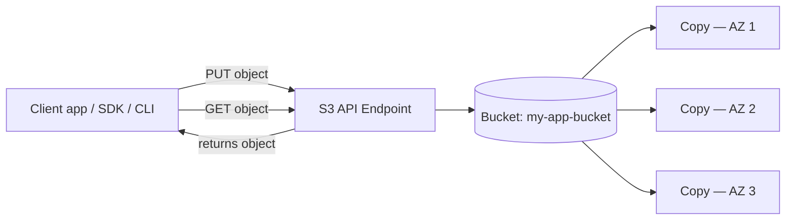

# Amazon S3 (Simple Storage Service)


<!-- official AWS Architecture Icons asset; see diagrams/README.md for the convention -->

*Service · Storage · maps to SAA-C03 Domain 1 & 3 & 4, DVA-C03 Domain 1 & 2, MLA-C02 Domain 1*

## Definition

Amazon S3 is AWS's **object storage** service. You store files — called **objects** — inside
containers called **buckets**, and you reach them over HTTP(S) using a key (basically a name/path
string), not a traditional filesystem. There's no drive to format, no fixed capacity to plan for,
and (practically) no upper limit on how much you can store.

## Purpose

Before S3 launched in 2006, "storage" meant buying physical disks, racking servers, planning
capacity years in advance, and building your own redundancy and backup. If you guessed wrong on
capacity you either wasted money or ran out of space. S3 was AWS's answer: storage that is
**durable by default** (11 nines — 99.999999999% — durability of objects over a year), **elastic**
(you never provision size, it just grows), and billed **per GB actually used**, accessible from
anywhere with an API call. It turned storage from a capital-planning problem into a utility, like
electricity.

## How It Works

In plain terms: you create a bucket (a globally-unique-named container, tied to one AWS Region),
then you `PUT` objects into it addressed by a key (e.g., `photos/2026/trip.jpg`). There are no
real folders — S3 is a flat key-value store; the console just *displays* `/` in a key as a folder
for convenience. Behind the scenes, AWS replicates every object across multiple devices in
multiple Availability Zones within that Region automatically — you don't configure that, it's
built in.



Walking through it:

1. **Client** — your app, the AWS CLI, or an SDK — sends a `PUT` request with the object's bytes
   and a key to the S3 API endpoint for that bucket/Region.
2. **S3 API Endpoint** handles auth (IAM/bucket policy check), then writes the object.
3. **Bucket** is the logical container; the object is durably written to **multiple AZs
   synchronously** before S3 returns success to the client — this is why S3 offers 11 nines of
   durability and (since Dec 2020) **strong read-after-write consistency**: the moment a `PUT`
   succeeds, every subsequent `GET`/`LIST` sees it, including overwrites and deletes.
4. A `GET` request goes through the same API endpoint and is served from whichever healthy AZ copy
   answers fastest — this is transparent to the client.

## Key Features / Components

- **Bucket** — the top-level container; name must be globally unique across all of AWS, tied to one Region.
- **Object** — the actual file (0 bytes to 5 TB), plus metadata (content-type, custom tags, etc.).
- **Key** — the full "path" string that addresses an object inside a bucket (e.g. `invoices/2026/jan.pdf`).
- **Versioning** — keeps every version of an object when enabled, protecting against accidental overwrite/delete.
- **Storage Classes** — pricing/performance tiers (Standard, IA, Glacier family, etc.) — see [`s3-storage-classes.md`](s3-storage-classes.md).
- **Lifecycle Policies** — automatic rules to transition objects between storage classes or expire them by age.
- **Replication (CRR/SRR)** — Cross-Region or Same-Region Replication, automatically copies objects to another bucket for DR or latency.
- **Encryption** — SSE-S3 (AWS-managed keys), SSE-KMS (customer-managed keys via KMS, auditable), SSE-C (customer-supplied key), or client-side encryption before upload.
- **Access Control** — IAM policies, bucket policies (resource-based), (legacy) ACLs, and **S3 Block Public Access** (account/bucket-level safety switch, on by default for new buckets).
- **S3 Access Points** — named network endpoints with their own policy, simplifying access management for shared buckets.
- **Static Website Hosting** — serve a bucket's objects directly as a website (HTML/CSS/JS), often paired with CloudFront.
- **Event Notifications** — trigger Lambda, SQS, SNS, or EventBridge on object create/delete/restore events — backbone of event-driven architectures.
- **Multipart Upload** — splits large uploads into parts uploaded in parallel/resumable; AWS recommends it above ~100 MB, required above 5 GB.
- **Presigned URLs** — time-limited URLs that grant temporary access to a private object without changing IAM permissions.
- **S3 Object Lock** — WORM (write-once-read-many) protection, satisfies regulatory retention requirements.
- **S3 Select / Glacier Select** — query a subset of an object's data (CSV/JSON/Parquet) without downloading the whole thing.
- **S3 Transfer Acceleration** — routes uploads through CloudFront edge locations for faster long-distance transfers.
- **S3 Storage Lens / Batch Operations** — fleet-wide storage analytics, and bulk operations (copy, tag, restore) across billions of objects.

## Use Cases — When to Use It

- **Static website / SPA hosting** — host HTML/JS/CSS directly from a bucket, fronted by CloudFront for HTTPS and caching.
- **Data lake foundation** — the standard landing zone for raw and processed data queried by Athena, Redshift Spectrum, EMR, or Glue.
- **Application asset storage** — user-uploaded images/videos/documents for a web or mobile app.
- **Backup and archive target** — the underlying store for AWS Backup, Storage Gateway, database snapshots, and DR copies.
- **Big data / ML training data storage** — the canonical place to stage structured and unstructured datasets before training (MLA-C02 Domain 1).
- **Software/artifact distribution** — hosting install packages, container layers, build artifacts.
- **Log storage** — CloudTrail, ALB/CloudFront access logs, VPC Flow Logs all land in S3 by convention.

## When NOT to Use It / Alternatives

- **You need a real filesystem mounted on a server** (random in-place edits, POSIX file locking, directory semantics) — S3 is not a filesystem. Use **EBS** (single instance, block) or **EFS** (many instances, shared NFS) instead.
- **You need microsecond/low-millisecond transactional read-write for a database** — S3 isn't built for that access pattern. Use **EBS**-backed RDS/EC2 or DynamoDB.
- **You need to run an OS or boot from it** — only EBS (or instance store) can be a boot volume.
- **Extremely small, extremely frequent read/writes of the same key** (hot-key contention) — consider DynamoDB or a cache in front of S3.

## Why It's Important

**Real world:** S3 is the default home for almost every unstructured byte an AWS-based company
owns — it is cheap, essentially infinitely durable, and the data substrate behind data lakes, ML
pipelines, static hosting, and backups industry-wide. Picking the wrong storage class or leaving
a bucket publicly writable are among the most common real-world cost and security incidents.

**Exam weight:** S3 is arguably the single most tested AWS service across all three certs.
- **SAA-C03** — Domain 1 Task 1.3 (encryption, replication, data security controls), Domain 3
  Task 3.1 (object vs block vs file storage tradeoffs — this exact comparison is a named task
  statement), Domain 4 Task 4.1 (cost-optimized storage via storage classes/lifecycle).
- **DVA-C03** — Domain 1 Task 1.3 (using S3 as an application data store, SDK integration,
  presigned URLs, event-driven triggers), Domain 2 Task 2.2 (SSE-KMS encryption).
- **MLA-C02** — Domain 1 (ingesting and storing ML training/feature data, data lake patterns).

## Pricing Model (summary)

You pay for: **storage** (per GB-month, varies by storage class), **requests** (per-thousand
PUT/COPY/POST/LIST vs GET/SELECT, different rates), **data transfer out** to the internet (transfer
in and transfer within the same Region to most AWS services is free), and extras like Transfer
Acceleration, replication, and S3 Select scanned-data fees. There's no charge to transfer data
*into* S3. Exact current rates: https://aws.amazon.com/s3/pricing/

## Hands-on Lab (Floci)

Floci fully emulates the S3 object API — this is the best-supported service in Floci. Setup
assumed per [`labs-floci/README.md`](../../labs-floci/README.md) (`awslocal` alias pointed at
`localhost:4566`).

```bash
# Create a bucket
awslocal s3 mb s3://my-study-bucket

# Upload an object
echo "hello from floci" > hello.txt
awslocal s3 cp hello.txt s3://my-study-bucket/notes/hello.txt

# List objects (notice the flat key, folder is cosmetic)
awslocal s3 ls s3://my-study-bucket/ --recursive

# Download it back
awslocal s3 cp s3://my-study-bucket/notes/hello.txt ./downloaded.txt

# Enable versioning
awslocal s3api put-bucket-versioning \
  --bucket my-study-bucket \
  --versioning-configuration Status=Enabled

# Overwrite the object, then list all versions
echo "v2 content" > hello.txt
awslocal s3 cp hello.txt s3://my-study-bucket/notes/hello.txt
awslocal s3api list-object-versions --bucket my-study-bucket

# Set a lifecycle rule: move to Glacier after 30 days, expire after 365
cat > lifecycle.json << 'EOF'
{
  "Rules": [{
    "ID": "archive-old-notes",
    "Filter": {"Prefix": "notes/"},
    "Status": "Enabled",
    "Transitions": [{"Days": 30, "StorageClass": "GLACIER"}],
    "Expiration": {"Days": 365}
  }]
}
EOF
awslocal s3api put-bucket-lifecycle-configuration \
  --bucket my-study-bucket --lifecycle-configuration file://lifecycle.json

# Turn on default SSE-S3 encryption
awslocal s3api put-bucket-encryption \
  --bucket my-study-bucket \
  --server-side-encryption-configuration '{"Rules":[{"ApplyServerSideEncryptionByDefault":{"SSEAlgorithm":"AES256"}}]}'

# Generate a presigned URL (works against the Floci endpoint)
awslocal s3 presign s3://my-study-bucket/notes/hello.txt --expires-in 300
```

See also [`labs-floci/README.md`](../../labs-floci/README.md) for the full setup.

## Exam Tips

- **Object vs. block vs. file storage** is the single most common framing trap: S3 = object
  (HTTP API, flat namespace, no mount) vs. EBS = block (mountable raw disk, one instance) vs.
  EFS/FSx = file (mountable, shared, POSIX/SMB). If the question says "mount a drive" or "boot an
  instance," the answer is never S3.
- **Consistency myth**: older material says S3 was only "eventually consistent" for overwrites —
  that changed in **December 2020**. S3 now has **strong read-after-write consistency** for all
  operations, including overwrite PUTs and DELETEs. Newer exam versions test the *current* model.
- Bucket names are **globally unique** (across every AWS account, not just yours) and **cannot
  contain uppercase letters** or underscores in most cases.
- Objects max out at **5 TB**; anything over **5 GB must use multipart upload**, and AWS
  recommends it above ~100 MB for resilience and parallelism.
- "Many instances need concurrent read/write to the same files with POSIX semantics" → that's
  **EFS**, not S3, even though S3 is the default storage answer for almost everything else.
- Presigned URLs are the standard answer for "let an unauthenticated user download/upload one
  specific private object temporarily."

## Related Terms

- [`s3-storage-classes.md`](s3-storage-classes.md) — pricing/performance tiers within S3
- [`s3-glacier.md`](s3-glacier.md) — deep archive tier and legacy vault API
- [`ebs.md`](ebs.md) — block storage alternative
- [`efs.md`](efs.md) — file storage alternative
- [`aws-backup.md`](aws-backup.md) — uses S3 as an underlying backup store
- `KMS`, `IAM policies`, `CloudFront` — see glossary
