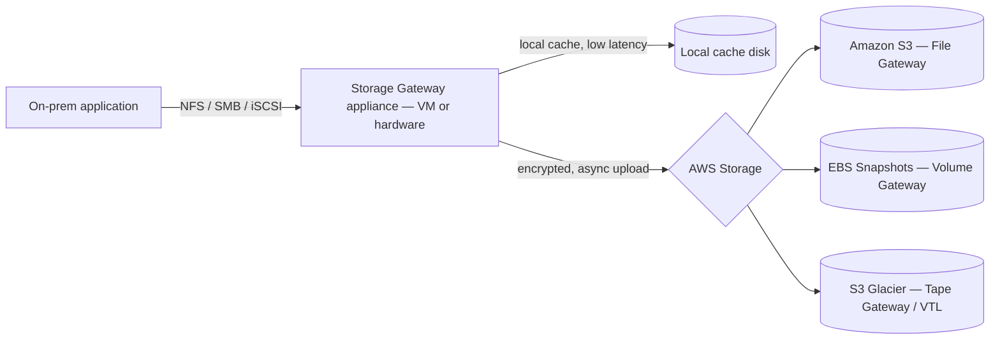

# AWS Storage Gateway


<!-- official AWS Architecture Icons asset; see diagrams/README.md for the convention -->

*Service · Storage · maps to SAA-C03 Domain 2 (hybrid/DR architectures)*

## Definition

AWS Storage Gateway is a **hybrid-cloud appliance** — software you run as a virtual machine
on-premises (or a physical hardware appliance) — that lets your existing on-premises applications
use AWS storage (S3, EBS snapshots, Glacier) through familiar protocols like NFS, SMB, and iSCSI,
without rewriting the application.

## Purpose

Many organizations have applications and backup software built around local file shares, block
volumes, or physical tape libraries. Migrating them to native cloud storage overnight isn't
realistic — it means rewriting integrations and retraining operations teams. Storage Gateway
exists as the **bridge**: it presents AWS storage using the exact protocols those existing systems
already expect, with local caching for performance, so you get cloud durability and economics
without an application rewrite — a stepping stone for gradual cloud migration or a permanent
hybrid architecture.

## How It Works



Walking through it:

1. The on-premises application talks to the Storage Gateway appliance using a **standard storage
   protocol** it already understands — NFS/SMB for files, iSCSI for block volumes — as if the
   appliance were just another local file server or SAN.
2. The appliance keeps a **local cache** of the most recently/frequently used data, so reads and
   writes to "hot" data feel like local disk speed.
3. In the background, the appliance **asynchronously and securely uploads** data to AWS, encrypted
   in transit and at rest.
4. Depending on the **gateway type**, that data lands as S3 objects (File Gateway), EBS snapshots
   (Volume Gateway), or virtual tape images in S3/Glacier (Tape Gateway) — giving you cloud
   durability and the option to access/restore it directly in AWS tools, independent of the
   on-prem appliance.

## Key Features / Components

- **File Gateway** — presents an **NFS or SMB** file share backed by S3; each file becomes an S3
  object, accessible both through the gateway (on-prem) and directly via the S3 API (cloud-native
  tools, Athena, Lambda triggers) — ideal for hybrid file access and content repositories.
- **Volume Gateway** — presents **iSCSI block volumes**:
  - *Cached mode* — primary data lives in AWS (S3-backed), with only the hottest data cached
    locally; minimizes on-prem storage footprint.
  - *Stored mode* — primary data lives on-premises (full local copy), with asynchronous, scheduled
    backups (as EBS snapshots) to AWS for durability/DR — on-prem apps keep local-disk latency for everything.
- **Tape Gateway** — presents a **Virtual Tape Library (VTL)** compatible with existing backup
  software (NetBackup, Veeam, etc.), replacing physical tape with virtual tapes stored in S3/S3
  Glacier — no new backup software needed.
- **Encryption** — data encrypted in transit (TLS) and at rest (SSE-S3/KMS) automatically.
- **Bandwidth throttling** — control how much of the on-prem network link the gateway consumes.
- **CloudWatch integration** — monitor cache hit rate, upload buffer usage, and throughput.

## Use Cases — When to Use It

- **Backing up on-premises data to the cloud** without replacing existing backup software — Tape
  Gateway slots in as a drop-in virtual tape library.
- **Hybrid file shares** where some users/apps are on-prem and others are cloud-native, all needing
  access to the same files — File Gateway.
- **Disaster recovery of on-premises systems** — replicate critical volumes/files to AWS so you can
  restore or spin up a DR environment in the cloud if the on-prem site fails.
- **Reducing on-premises storage footprint** — Cached Volume Gateway lets you keep most data in the
  cloud while retaining low-latency access to the active working set.
- **Gradual, low-risk cloud migration** — move the storage layer first, keep the application
  on-prem, re-architect later at your own pace.

## When NOT to Use It / Alternatives

- **A brand-new, fully cloud-native application** — there's no on-prem leg to bridge, so just use
  **S3**, **EBS**, or **EFS** directly; adding a gateway here is unnecessary complexity and cost.
- **You need the lowest possible on-prem latency for 100% of your data, permanently** — Stored
  Volume Gateway helps, but if there's no cloud storage need at all, this isn't the right service.
- **Real-time, sub-second cross-site replication requirements** — Storage Gateway uploads
  asynchronously; for synchronous replication needs, look at purpose-built DR tooling (e.g., AWS
  Elastic Disaster Recovery) instead.

## Why It's Important

**Real world:** most large enterprises aren't "cloud-native" overnight — Storage Gateway is a
common, pragmatic first step in a multi-year migration, and a mainstay of tape-replacement backup
modernization projects (tape hardware maintenance and off-site rotation is expensive and
operationally painful).

**Exam weight:** **SAA-C03** Domain 2 (resilient/hybrid architectures) tests Storage Gateway as the
answer whenever a scenario describes an **existing on-premises application** that needs cloud
storage benefits (durability, reduced local footprint, DR) **without changing the application**.
It's also a classic "distractor vs. real cloud-native service" question — if the scenario has no
on-prem component, Storage Gateway is usually a wrong-answer trap.

## Pricing Model (summary)

The gateway software itself is **free** to run; you pay for the **underlying AWS storage consumed**
(S3 rates for File/Tape Gateway, EBS snapshot rates for Volume Gateway) plus **data transfer**
between on-prem and AWS. On-prem hardware/VM compute to run the appliance is a cost you bear
locally. Current rates: https://aws.amazon.com/storagegateway/pricing/

## Hands-on Lab (Floci)

**Honest limitation:** Storage Gateway is not in Floci's documented support table (only S3's
object API is fully emulated — see `labs-floci/README.md`) and it fundamentally requires an
on-premises VM/hardware component that a local API emulator can't represent. Use the commands
below to learn the **real control-plane CLI shape**; expect them to be unsupported against a local
Floci endpoint. The practical substitute for hands-on practice: build the S3 lab in
[`s3.md`](s3.md) and mentally map it to "this is what File Gateway would be writing into."

```bash
# List gateways (requires a gateway already activated against a running appliance in real AWS)
aws storagegateway list-gateways

# Create an NFS file share backed by an S3 bucket (File Gateway)
aws storagegateway create-nfs-file-share \
  --client-token my-file-share-001 \
  --gateway-arn arn:aws:storagegateway:us-east-1:111122223333:gateway/sgw-xxxxxxxx \
  --role arn:aws:iam::111122223333:role/StorageGatewayRole \
  --location-arn arn:aws:s3:::my-study-bucket

# Create a cached iSCSI volume (Volume Gateway)
aws storagegateway create-cached-iscsi-volume \
  --gateway-arn arn:aws:storagegateway:us-east-1:111122223333:gateway/sgw-xxxxxxxx \
  --volume-size-in-bytes 107374182400 \
  --target-name study-volume \
  --network-interface-id 10.0.0.10 \
  --client-token my-volume-001

# List virtual tapes (Tape Gateway)
aws storagegateway list-tapes
```

## Exam Tips

- **Keyword "hybrid"** plus "on-premises application" plus "use AWS storage without rewriting the
  app" → Storage Gateway, almost every time.
- **Replace a physical tape library / existing backup software** → **Tape Gateway**, specifically.
- **iSCSI block volumes presented to an on-prem server, backed by the cloud** → **Volume Gateway**;
  distinguish **Cached** (most data lives in AWS, local cache only) from **Stored** (most data
  lives on-prem, async backup to AWS) — this Cached-vs-Stored distinction is a frequent trap.
- **NFS/SMB file share where individual files should also be directly usable as S3 objects** →
  **File Gateway**.
- If the scenario has no on-premises component at all, Storage Gateway is very likely the wrong
  answer — a cloud-native service (S3/EBS/EFS/AWS Backup) is what's being tested instead.

## Related Terms

- [`s3.md`](s3.md) — backing store for File Gateway and Tape Gateway
- [`ebs.md`](ebs.md) — backing store (via snapshots) for Volume Gateway
- [`aws-backup.md`](aws-backup.md) — can centrally manage Storage Gateway volume backups
- [`fsx.md`](fsx.md) — an alternative hybrid path for Windows file shares (FSx File Gateway)
- `iSCSI`, `NFS`, `SMB`, `Virtual Tape Library` — see glossary
