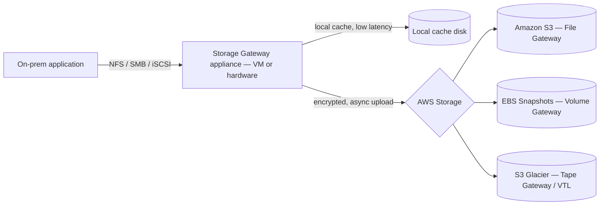
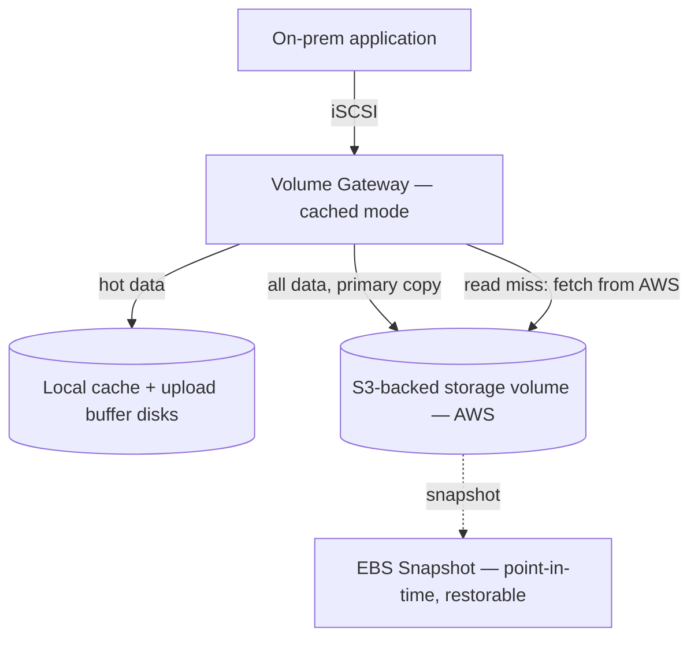
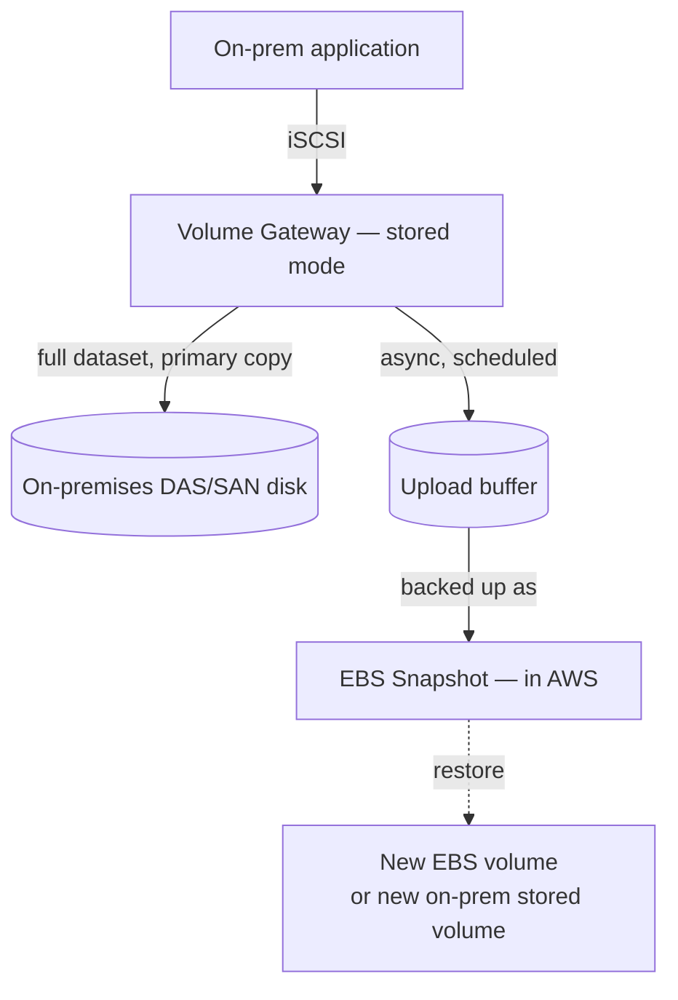
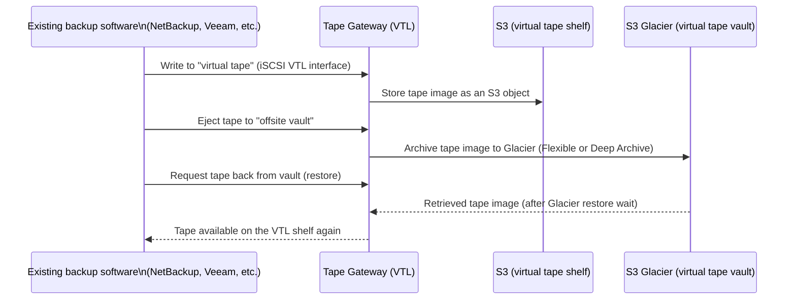
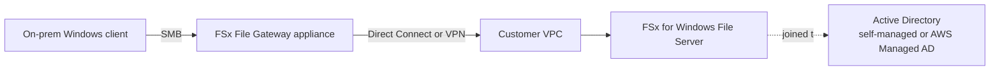

# AWS Storage Gateway


<!-- official AWS Architecture Icons asset; see diagrams/README.md for the convention -->

*Service · Storage · maps to SAA-C03 Domain 2 (hybrid/DR architectures)*

## Definition

AWS Storage Gateway is a **hybrid-cloud appliance** — software you run as a virtual machine
on-premises (or a physical hardware appliance) — that lets your existing on-premises applications
use AWS storage (S3, EBS snapshots, Glacier) through familiar protocols like NFS, SMB, and iSCSI,
without rewriting the application.

## Purpose

Many organizations have applications and backup software built around local file shares, block
volumes, or physical tape libraries. Migrating them to native cloud storage overnight isn't
realistic — it means rewriting integrations and retraining operations teams. Storage Gateway
exists as the **bridge**: it presents AWS storage using the exact protocols those existing systems
already expect, with local caching for performance, so you get cloud durability and economics
without an application rewrite — a stepping stone for gradual cloud migration or a permanent
hybrid architecture.

The detail worth internalizing is *where the data actually lives* in each gateway type, because it
changes both the cost model and the failure mode: File Gateway and (Cached) Volume Gateway treat
AWS as the **primary** copy with a local cache; Stored Volume Gateway treats on-premises as the
**primary** copy with AWS as an **async backup target**. Picking the wrong one for a given
scenario is a very real operational mistake (e.g., assuming Stored mode gives you the storage
footprint reduction that only Cached mode actually provides).

## How It Works



Walking through it:

1. The on-premises application talks to the Storage Gateway appliance using a **standard storage
   protocol** it already understands — NFS/SMB for files, iSCSI for block volumes — as if the
   appliance were just another local file server or SAN.
2. The appliance keeps a **local cache** of the most recently/frequently used data, so reads and
   writes to "hot" data feel like local disk speed.
3. In the background, the appliance **asynchronously and securely uploads** data to AWS, encrypted
   in transit and at rest.
4. Depending on the **gateway type**, that data lands as S3 objects (File Gateway), EBS snapshots
   (Volume Gateway), or virtual tape images in S3/Glacier (Tape Gateway) — giving you cloud
   durability and the option to access/restore it directly in AWS tools, independent of the
   on-prem appliance.

### Cached Volume Gateway — AWS as primary, local cache only



In **Cached** mode, AWS holds the **entire** dataset; the on-premises appliance only keeps the
"working set" locally for low-latency access, falling back to AWS for any cache miss. This is the
mode that genuinely **reduces on-premises storage footprint**, since the full dataset no longer
needs to fit locally at all.

### Stored Volume Gateway — on-prem as primary, AWS as async backup



In **Stored** mode, the full dataset stays on-premises (so there's no footprint reduction), and AWS
only receives periodic, asynchronous **EBS-snapshot-formatted backups** — this is the DR-focused
mode, not the storage-reduction mode, and mixing these two up is the single most common Storage
Gateway exam trap.

### Tape Gateway — replacing physical tape with a Virtual Tape Library



Tape Gateway's entire value proposition is that it requires **zero changes to existing backup
software** — the backup application still thinks it's talking to physical tape drives and an
offsite tape vault; Storage Gateway translates that into S3/Glacier operations underneath.

### FSx File Gateway — the Windows-specific hybrid path


*Figure: the official FSx File Gateway architecture — a Direct Connect or VPN link carries SMB
traffic from the on-premises gateway appliance to an FSx for Windows File Server file system in a
VPC, which in turn joins the customer's Active Directory domain (self-managed or AWS Managed
Microsoft AD) for authentication. Source: [What is Amazon FSx File Gateway](https://docs.aws.amazon.com/filegateway/latest/filefsxw/what-is-file-fsxw.html), © Amazon Web Services.*



Unlike S3 File Gateway (which turns files into S3 objects), **FSx File Gateway** is a low-latency
cache in front of an actual **FSx for Windows File Server** file system in AWS — a distinct gateway
type purpose-built for organizations that need the full native Windows file share feature set
(DFS, shadow copies, NTFS ACLs) available on-premises with low latency, while the authoritative
copy lives in FSx, not as flat S3 objects.

## Key Features / Components

- **File Gateway** — presents an **NFS or SMB** file share backed by S3; each file becomes an S3
  object, accessible both through the gateway (on-prem) and directly via the S3 API (cloud-native
  tools, Athena, Lambda triggers) — ideal for hybrid file access and content repositories.
- **Volume Gateway** — presents **iSCSI block volumes**:
  - *Cached mode* — primary data lives in AWS (S3-backed), with only the hottest data cached
    locally; minimizes on-prem storage footprint.
  - *Stored mode* — primary data lives on-premises (full local copy), with asynchronous, scheduled
    backups (as EBS snapshots) to AWS for durability/DR — on-prem apps keep local-disk latency for everything.
- **Tape Gateway** — presents a **Virtual Tape Library (VTL)** compatible with existing backup
  software (NetBackup, Veeam, etc.), replacing physical tape with virtual tapes stored in S3/S3
  Glacier — no new backup software needed.
- **FSx File Gateway** — a low-latency cache in front of an FSx for Windows File Server file system
  in AWS, for organizations needing full native Windows file-share semantics on-premises.
- **Encryption** — data encrypted in transit (TLS) and at rest (SSE-S3/KMS) automatically.
- **Bandwidth throttling** — control how much of the on-prem network link the gateway consumes.
- **CloudWatch integration** — monitor cache hit rate, upload buffer usage, and throughput.
- **Local Cache sizing** — Cached Volume Gateway and File Gateway both depend on correctly sized
  local cache disks; an undersized cache causes frequent AWS round-trips (and higher latency) even
  for data that *should* be considered "hot."

## Use Cases — When to Use It

- **Backing up on-premises data to the cloud** without replacing existing backup software — Tape
  Gateway slots in as a drop-in virtual tape library.
- **Hybrid file shares** where some users/apps are on-prem and others are cloud-native, all needing
  access to the same files — File Gateway.
- **Disaster recovery of on-premises systems** — replicate critical volumes/files to AWS so you can
  restore or spin up a DR environment in the cloud if the on-prem site fails.
- **Reducing on-premises storage footprint** — Cached Volume Gateway lets you keep most data in the
  cloud while retaining low-latency access to the active working set.
- **Gradual, low-risk cloud migration** — move the storage layer first, keep the application
  on-prem, re-architect later at your own pace.
- **Low-latency access to a cloud-native Windows file share** — FSx File Gateway, for branch
  offices needing fast local access to a centrally managed FSx for Windows File Server file system.

## When NOT to Use It / Alternatives

- **A brand-new, fully cloud-native application** — there's no on-prem leg to bridge, so just use
  **S3**, **EBS**, or **EFS** directly; adding a gateway here is unnecessary complexity and cost.
- **You need the lowest possible on-prem latency for 100% of your data, permanently** — Stored
  Volume Gateway helps, but if there's no cloud storage need at all, this isn't the right service.
- **Real-time, sub-second cross-site replication requirements** — Storage Gateway uploads
  asynchronously; for synchronous replication needs, look at purpose-built DR tooling (e.g., AWS
  Elastic Disaster Recovery) instead.

## Why It's Important

**Real world:** most large enterprises aren't "cloud-native" overnight — Storage Gateway is a
common, pragmatic first step in a multi-year migration, and a mainstay of tape-replacement backup
modernization projects (tape hardware maintenance and off-site rotation is expensive and
operationally painful).

**Exam weight:** **SAA-C03** Domain 2 (resilient/hybrid architectures) tests Storage Gateway as the
answer whenever a scenario describes an **existing on-premises application** that needs cloud
storage benefits (durability, reduced local footprint, DR) **without changing the application**.
It's also a classic "distractor vs. real cloud-native service" question — if the scenario has no
on-prem component, Storage Gateway is usually a wrong-answer trap.

## Pricing Model — Deep Dive

The gateway software itself is **free**; billing flows entirely to the underlying AWS storage it
writes into, plus data-transfer and request charges layered on top.

| Gateway type | What you're really billed for |
|---|---|
| File Gateway | Standard S3 storage rates (per storage class) for the objects it writes, plus S3 request charges |
| Volume Gateway (Cached) | S3-backed storage volume rate (~$0.025/GB-month) plus snapshot (EBS) storage for point-in-time backups |
| Volume Gateway (Stored) | EBS snapshot storage rate (~$0.05/GB-month) for the periodic backups; no charge for the on-prem primary copy, since it isn't in AWS |
| Tape Gateway | S3/S3 Glacier storage rate for virtual tapes, by whichever class they're archived into, plus a small per-gateway monthly activation-adjacent charge in some configurations |
| Data transfer (all types) | Standard AWS data-transfer-out rates for any data pulled back out of AWS to on-premises |

*(Illustrative — confirm current numbers at https://aws.amazon.com/storagegateway/pricing/; this
service's bill is really "whatever the backing S3/EBS/Glacier pricing page says," not a distinct
pricing model of its own.)*

### Worked example — Cached Volume Gateway footprint reduction

A branch office has 20 TB of active data, but only genuinely "hot" (frequently touched) data is
about 2 TB at any time. Running Cached Volume Gateway with a 2 TB local cache instead of a
20 TB local SAN:

```
On-prem SAN approach:        20 TB of local disk hardware, full capital cost, full footprint
Cached Volume Gateway:        2 TB local cache disk (small footprint)
                              + 20 TB × $0.025/GB-month (S3-backed storage volume rate) = $512.00/month
                              + EBS snapshot backups of that volume for DR, billed at
                                standard EBS snapshot rates on top
```

The real win here isn't necessarily a lower *total* dollar figure than owning hardware outright —
it's eliminating the capital expense and physical footprint of 20 TB of on-prem disk, replacing it
with 2 TB of cache hardware plus a predictable monthly AWS bill, which is the actual argument most
organizations make for this pattern (operational/capital expenditure shift, not raw storage-cost
arbitrage).

### Worked example — Tape Gateway vs. physical tape rotation

A company currently pays for monthly offsite tape courier service, tape media, and a tape library
lease, totaling roughly $2,000/month for 50 TB of monthly backup volume. Switching to Tape Gateway
writing to S3 Glacier Deep Archive for long-term retention:

```
50,000 GB × $0.00099/GB-month (Deep Archive)                   ≈ $49.50/month storage
+ occasional restore requests, billed per-GB at restore time
+ no tape media purchase, no courier contract, no library lease hardware refresh cycle
```

This is the single most common real-world Storage Gateway business case: physical tape's *ongoing
operational* cost (courier, media, hardware refresh, offsite vault contracts) is usually far
higher than the equivalent Glacier-tier storage cost, even before counting the operational risk of
a courier losing a physical tape in transit.

### Worked example — File Gateway vs. direct S3 access cost comparison

A branch office considers whether to keep using File Gateway (NFS in front of S3) versus migrating
the application to call the S3 API directly, for 5 TB of actively-used content:

```
File Gateway:  5,000 GB × S3 Standard rate ($0.023)             = $115.00/month storage
               + local cache hardware (on-prem capital cost, not an AWS bill line item)
               + no additional Storage Gateway service fee

Direct S3:     5,000 GB × S3 Standard rate ($0.023)              = $115.00/month storage
               + application rewrite cost (one-time, not recurring)
```

The **AWS storage bill is identical** either way — File Gateway's cost is the same underlying S3
storage rate, since that's genuinely where the data lives. The real decision driver is the
**one-time application rewrite cost** to call the S3 API natively versus the **ongoing operational
cost** of running and maintaining the on-prem gateway appliance and its local cache hardware — a
non-storage tradeoff that's easy to overlook if you only look at the AWS bill.

## Common Architectures

**1. Backup modernization without replacing backup software.** An enterprise's existing Veeam or
NetBackup environment is pointed at a Tape Gateway's virtual tape library instead of a physical
tape robot — the backup software configuration barely changes, but tapes "ejected to the vault"
now land in S3 Glacier, eliminating the physical tape supply chain entirely while keeping the
existing backup team's tooling and runbooks intact.

**2. Branch-office file share consolidation.** Multiple branch offices each run a small File
Gateway appliance presenting a local SMB share; all of them write into the **same** central S3
bucket (different prefixes per branch), so head office can run analytics/search across every
branch's files directly via the S3 API, while each branch still gets local-speed file access
through its own gateway's cache.

**3. DR staging for an on-premises database server.** A Stored Volume Gateway backs up an
on-premises database's block volumes asynchronously as EBS snapshots. If the primary site is lost,
those snapshots are used to create real EBS volumes in AWS, attached to standby EC2 instances
running the same database engine, turning what would have been a from-scratch disaster recovery
rebuild into a snapshot-restore operation.

**4. Hybrid data lake ingestion from legacy file servers.** A manufacturing company's shop-floor
systems write sensor logs to a local file share that a File Gateway presents over NFS, with every
file landing as an S3 object in a prefix that an existing Glue/Athena data lake pipeline already
watches — the shop-floor systems keep running unmodified while their output quietly becomes part of
the same cloud analytics pipeline that ingests data from fully cloud-native sources.

## Limits & Quotas

- **Gateways per AWS account/Region** — a default soft quota (commonly cited around 15–20 per
  account/Region, raisable via Support) — relevant when planning large multi-branch deployments.
- **Volumes per Volume Gateway** — up to 32 volumes per gateway (Cached), each up to 32 TiB.
- **File shares per File Gateway** — up to 10 file shares per gateway by default (raisable).
- **Tape capacity per Tape Gateway** — supports very large virtual tape libraries; individual
  virtual tapes can be provisioned from 100 GiB up to 15 TiB.
- **Local cache/upload buffer disk requirements** — Storage Gateway VMs have minimum recommended
  local disk allocations (varies by gateway type) that must be provisioned on the hypervisor/host
  running the appliance — undersizing this is a common real-world deployment mistake that throttles
  effective throughput.
- **Bandwidth throttling schedule** — configurable by time-of-day/day-of-week windows, letting
  organizations cap gateway upload bandwidth during business hours and relax it overnight.
- **iSCSI initiators per volume** — typically one active initiator connection per iSCSI target at a
  time for standard Volume Gateway use (not a Multi-Attach-style concurrent-access feature).
- **Snapshot schedule granularity (Volume Gateway)** — snapshots can be scheduled as frequently as
  hourly, each captured as a standard EBS snapshot, inheriting all of EBS's own incremental-storage
  economics described in [`ebs.md`](ebs.md).
- **Maximum virtual tapes per Tape Gateway** — supports large virtual tape libraries (commonly
  cited around 1,500 tapes per gateway, raisable), useful when sizing a replacement for a
  physical tape library with a known existing tape count.

## Troubleshooting / Common Issues

- **Gateway appears "offline" or activation fails** — almost always an outbound network/firewall
  issue: the appliance needs outbound HTTPS access to specific AWS Storage Gateway service
  endpoints; a restrictive on-prem firewall or proxy blocking this is the most common activation
  failure.
- **Cache hit rate is low / everything feels slow** — the local cache disk is undersized relative
  to the actual working set; monitor the `CacheHitPercent` CloudWatch metric and grow the cache
  disk allocation if it's consistently low.
- **Upload buffer filling up faster than it drains** — the on-prem internet/Direct Connect link
  doesn't have enough sustained bandwidth for the write rate the application is generating; either
  throttle the application's write rate, increase link bandwidth, or accept a growing backlog
  (which eventually blocks writes once the buffer is full).
- **Confusing Cached and Stored mode's footprint behavior** — if someone deployed **Stored** mode
  expecting the "small local footprint" benefit, that's a design mistake, not a bug — Stored mode
  always keeps the full dataset on-premises by definition; **Cached** mode is the one that reduces
  footprint.
- **Tape "stuck" in a retrieval state for a long time** — if the tape was previously archived to
  Glacier Deep Archive, recall that its retrieval time is **12–48 hours**, matching Deep Archive's
  normal restore SLA; this is expected, not a fault.
- **FSx File Gateway can't reach the file system** — check Direct Connect/VPN routing between the
  on-prem appliance and the FSx for Windows File Server's VPC, and confirm Active Directory domain
  trust/joining succeeded; this mirrors the same troubleshooting steps as a direct FSx for Windows
  deployment issue.

## Hands-on Lab (Floci)

**Honest limitation:** Storage Gateway is not in Floci's documented support table (only S3's
object API is fully emulated — see `labs-floci/README.md`) and it fundamentally requires an
on-premises VM/hardware component that a local API emulator can't represent. Use the commands
below to learn the **real control-plane CLI shape**; expect them to be unsupported against a local
Floci endpoint. The practical substitute for hands-on practice: build the S3 lab in
[`s3.md`](s3.md) and mentally map it to "this is what File Gateway would be writing into."

```bash
# List gateways (requires a gateway already activated against a running appliance in real AWS)
aws storagegateway list-gateways

# Create an NFS file share backed by an S3 bucket (File Gateway)
aws storagegateway create-nfs-file-share \
  --client-token my-file-share-001 \
  --gateway-arn arn:aws:storagegateway:us-east-1:111122223333:gateway/sgw-xxxxxxxx \
  --role arn:aws:iam::111122223333:role/StorageGatewayRole \
  --location-arn arn:aws:s3:::my-study-bucket

# Create a cached iSCSI volume (Volume Gateway)
aws storagegateway create-cached-iscsi-volume \
  --gateway-arn arn:aws:storagegateway:us-east-1:111122223333:gateway/sgw-xxxxxxxx \
  --volume-size-in-bytes 107374182400 \
  --target-name study-volume \
  --network-interface-id 10.0.0.10 \
  --client-token my-volume-001

# List virtual tapes (Tape Gateway)
aws storagegateway list-tapes

# Create a tape pool-archived virtual tape (Tape Gateway, archive directly to Deep Archive)
aws storagegateway create-tape-with-barcode \
  --gateway-arn arn:aws:storagegateway:us-east-1:111122223333:gateway/sgw-xxxxxxxx \
  --tape-size-in-bytes 107374182400 \
  --tape-barcode TAPE00001 \
  --pool-id GLACIER

# Describe a File Gateway's cache usage (requires real gateway with CloudWatch metrics)
aws cloudwatch get-metric-statistics \
  --namespace AWS/StorageGateway --metric-name CacheHitPercent \
  --dimensions Name=GatewayId,Value=sgw-xxxxxxxx \
  --start-time 2026-11-01T00:00:00Z --end-time 2026-11-02T00:00:00Z \
  --period 3600 --statistics Average
```

## Exam-Style Scenario Walkthroughs

**Scenario 1:** A company's existing on-premises backup software (Veeam) currently writes to a
physical tape library, and the team wants to eliminate the tape hardware and offsite courier
contract entirely, without migrating to a different backup product or retraining the backup
operations team. What's the solution?

*Answer:* Tape Gateway — it presents a Virtual Tape Library over iSCSI that Veeam (and most
enterprise backup software) already knows how to talk to, so the backup software's configuration
barely changes; "tapes" ejected to the offsite vault land in S3/S3 Glacier instead of a physical
courier truck.

**Scenario 2:** An on-premises application needs its primary dataset to remain fully available
locally for lowest latency, with asynchronous backups automatically pushed to AWS for disaster
recovery, and does **not** need to reduce its on-premises storage footprint. Which gateway type and
mode?

*Answer:* Volume Gateway in **Stored** mode. The requirement explicitly rules out Cached mode
(which would move the primary copy to AWS and reduce the on-prem footprint) — Stored mode keeps the
full dataset on-premises as primary, with AWS receiving only periodic, asynchronous EBS-snapshot
backups.

**Scenario 3:** A retail chain has 30 branch locations, each running local file servers for
point-of-sale logs and inventory photos, and head office wants to run centralized analytics across
every branch's files using standard AWS tools (Athena, Lambda) without requiring each branch to
rebuild its local application. What's the architecture?

*Answer:* Deploy a File Gateway appliance at each branch, each writing into the **same central S3
bucket** (different prefix per branch) — local applications keep working against the familiar
NFS/SMB share via the gateway's local cache, while head office runs Athena queries or Lambda
functions directly against the S3 objects those gateways produce, with no changes needed at any
branch's application layer.

**Scenario 4:** A company needs branch-office employees to get low-latency access to a centrally
managed Windows file share that supports full NTFS ACLs, DFS, and shadow copies — not flat S3
objects — while the authoritative copy stays centrally managed in AWS. Which specific gateway type?

*Answer:* FSx File Gateway (not the more commonly referenced S3 File Gateway) — it caches a real
**FSx for Windows File Server** file system locally at the branch, preserving full native Windows
file-share semantics, which S3 File Gateway's "files become S3 objects" model cannot replicate.

## Exam Tips

- **Keyword "hybrid"** plus "on-premises application" plus "use AWS storage without rewriting the
  app" → Storage Gateway, almost every time.
- **Replace a physical tape library / existing backup software** → **Tape Gateway**, specifically.
- **iSCSI block volumes presented to an on-prem server, backed by the cloud** → **Volume Gateway**;
  distinguish **Cached** (most data lives in AWS, local cache only) from **Stored** (most data
  lives on-prem, async backup to AWS) — this Cached-vs-Stored distinction is a frequent trap.
- **NFS/SMB file share where individual files should also be directly usable as S3 objects** →
  **File Gateway**.
- **Low-latency on-prem access to a native Windows file system in AWS (not flat S3 objects)** →
  **FSx File Gateway**, distinct from S3 File Gateway.
- If the scenario has no on-premises component at all, Storage Gateway is very likely the wrong
  answer — a cloud-native service (S3/EBS/EFS/AWS Backup) is what's being tested instead.

## Further Reading

- [What Is AWS Storage Gateway?](https://docs.aws.amazon.com/storagegateway/latest/userguide/WhatIsStorageGateway.html) — official documentation home
- [How Amazon S3 File Gateway works](https://docs.aws.amazon.com/filegateway/latest/files3/file-gateway-concepts.html)
- [How Volume Gateway works (Cached and Stored)](https://docs.aws.amazon.com/storagegateway/latest/vgw/StorageGatewayConcepts.html) — the architecture diagrams referenced above
- [What is Amazon FSx File Gateway](https://docs.aws.amazon.com/filegateway/latest/filefsxw/what-is-file-fsxw.html)
- [AWS Storage Gateway pricing](https://aws.amazon.com/storagegateway/pricing/) — current, authoritative rates

## Related Terms

- [`s3.md`](s3.md) — backing store for File Gateway and Tape Gateway
- [`ebs.md`](ebs.md) — backing store (via snapshots) for Volume Gateway
- [`aws-backup.md`](aws-backup.md) — can centrally manage Storage Gateway volume backups
- [`fsx.md`](fsx.md) — an alternative hybrid path for Windows file shares (FSx File Gateway)
- `iSCSI`, `NFS`, `SMB`, `Virtual Tape Library` — see glossary
